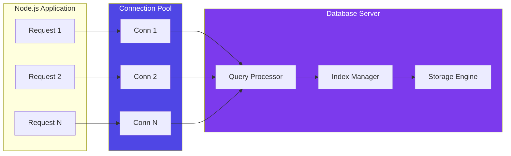
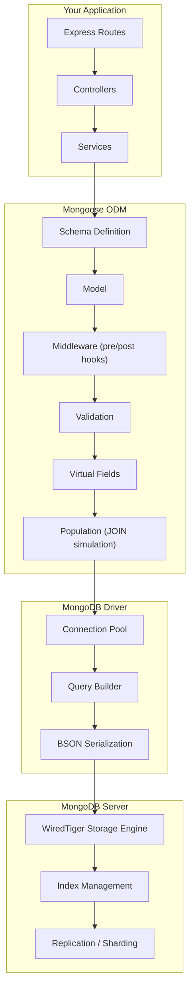
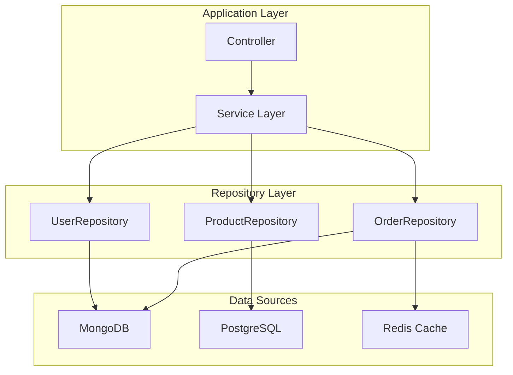
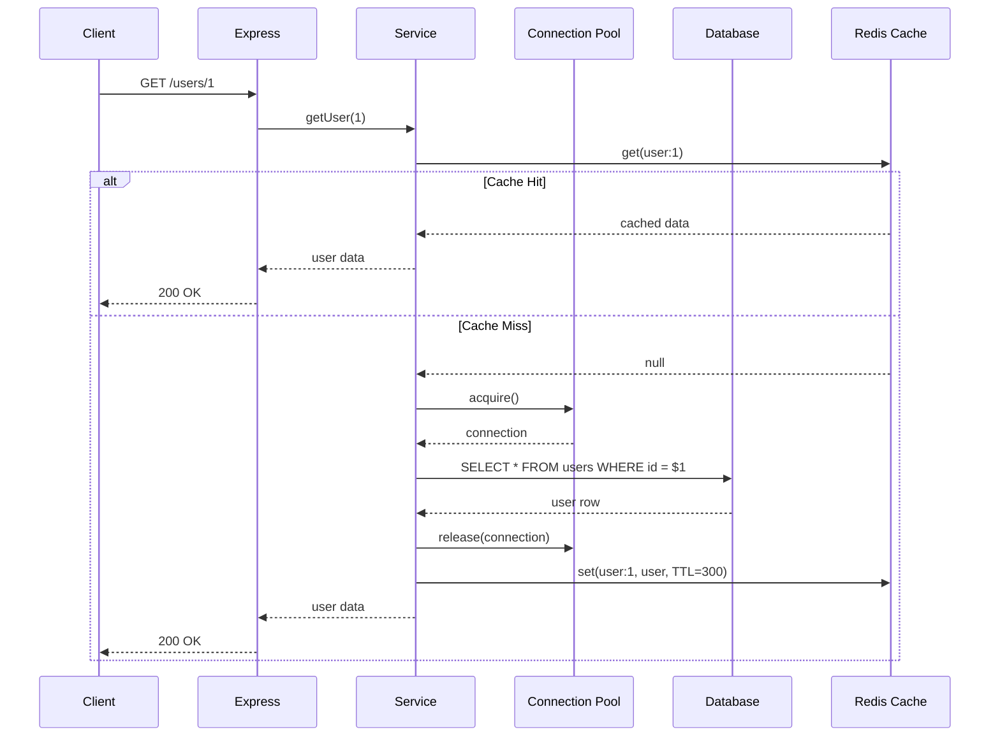

# Working with Databases

## 📖 Introduction

Most Node.js applications need to persist data — user accounts, products, orders, messages. Choosing the right database and using it effectively is one of the most important architectural decisions you'll make. Node.js supports both **NoSQL** databases (like MongoDB) through ODMs like Mongoose, and **SQL** databases (like PostgreSQL, MySQL) through drivers like `pg` or ORMs like Prisma and Sequelize.

This guide covers both paths: connecting, modeling, querying, and optimizing database access in Node.js.

## 🤔 Why Do We Need This?

HTTP requests are stateless — each request is independent. Without a database, every user's data disappears when the server restarts. Databases provide:

1. **Persistence** — Data survives restarts and failures
2. **Concurrency** — Multiple users read/write simultaneously without corruption
3. **Querying** — Filter, sort, aggregate, and search millions of records efficiently
4. **Relationships** — Connect users to posts, orders to products, etc.
5. **Transactions** — Ensure multiple operations succeed or fail together
6. **Scaling** — Handle growing data volumes with indexes, replication, and sharding

## ⚠️ Problem Statement

A production data layer must handle:

1. **Connection management** — Opening a new database connection per request is prohibitively slow
2. **Query performance** — Unoptimized queries become exponentially slower as data grows
3. **N+1 queries** — Fetching related data one-by-one destroys performance
4. **Data integrity** — Concurrent writes can corrupt data without proper isolation
5. **Schema changes** — As your app evolves, your database schema must evolve too
6. **Security** — SQL injection, mass assignment, and exposed credentials are real threats

## 📚 Real World Story

**Uber** migrated from a monolithic PostgreSQL database to a polyglot persistence architecture: MySQL for trip data, MongoDB for location data, Cassandra for real-time analytics, and Redis for caching. Each service owns its data and communicates through APIs.

For their trip matching service, they needed sub-50ms database reads. They achieved this by:
- Using MongoDB with proper indexing on geospatial coordinates
- Implementing a read-through cache with Redis
- Sharding MongoDB clusters across geographic regions
- Using connection pooling to eliminate connection overhead

The lesson: one database doesn't fit all workloads. Node.js's ecosystem lets you pick the right tool for each job.

## 🍕 Real World Analogy

| Database Concept | Library Analogy |
|-----------------|----------------|
| **Database** | The entire library building |
| **Collection / Table** | A section (Fiction, Non-Fiction) |
| **Document / Row** | A single book |
| **Field / Column** | A book's attribute (title, author, ISBN) |
| **Index** | The card catalog — helps you find books without searching every shelf |
| **Query** | Asking the librarian for specific books |
| **Transaction** | Checking out and returning books atomically |
| **Connection Pool** | Multiple librarians serving multiple patrons simultaneously |

## 👁️ Visual Explanation

```
MongoDB (NoSQL):
Collection: users                      Collection: orders
┌─────────────────────────────┐       ┌─────────────────────────────┐
│ { "_id": "abc1",           │       │ { "_id": "xyz1",           │
│   "name": "Alice",         │       │   "userId": "abc1",        │
│   "email": "a@test.com",   │       │   "items": [...],          │
│   "orders": [ "xyz1" ] }   │       │   "total": 49.99 }         │
│ { "_id": "abc2", ... }     │       │ { "_id": "xyz2", ... }     │
└─────────────────────────────┘       └─────────────────────────────┘

SQL (PostgreSQL):
Table: users                           Table: orders
┌─────┬───────┬─────────────┐         ┌─────┬────────┬───────┬───────┐
│ id │ name  │ email       │         │ id  │ user_id│ total │ status│
├─────┼───────┼─────────────┤         ├─────┼────────┼───────┼───────┤
│ 1  │ Alice │ a@test.com  │         │ 101 │ 1      │ 49.99 │ paid  │
│ 2  │ Bob   │ b@test.com  │         │ 102 │ 1      │ 29.99 │ shipped│
└─────┴───────┴─────────────┘         └─────┴────────┴───────┴───────┘
```

## 📊 Mermaid Diagram 1: Database Connection Flow



## ⚙️ Internal Working: Connection Pooling

Opening a database connection involves: TCP handshake, authentication, SSL negotiation, and session setup — which takes 10-100ms. Doing this per request would add unacceptable latency. Connection pools solve this by maintaining a set of persistent connections that are reused across requests.

```javascript
// Without pooling → each request opens/closes a connection
// With pooling → connections are borrowed and returned
app.get('/users', async (req, res) => {
  const conn = await pool.acquire(); // Get from pool (microseconds)
  const result = await conn.query('SELECT * FROM users');
  pool.release(conn);                 // Return to pool
  res.json(result.rows);
});
```

## 🔄 Mermaid Diagram 2: Mongoose ODM Architecture



## 🏗️ Architecture: Repository Pattern with Database Abstraction



## 👣 Step-by-Step Flow: Processing a Database Request



## 📝 Syntax

### Mongoose (MongoDB)

```javascript
const mongoose = require('mongoose');

// Connect
await mongoose.connect(process.env.MONGO_URI, {
  maxPoolSize: 10,
  serverSelectionTimeoutMS: 5000,
});

// Schema
const userSchema = new mongoose.Schema({
  name:  { type: String, required: true, trim: true },
  email: { type: String, required: true, unique: true, lowercase: true },
  age:   { type: Number, min: 13, max: 120 },
}, { timestamps: true });

// Model
const User = mongoose.model('User', userSchema);

// CRUD
await User.create(data);
await User.findById(id);
await User.find({ age: { $gte: 18 } }).sort({ name: 1 }).limit(10);
await User.findByIdAndUpdate(id, updates, { new: true, runValidators: true });
await User.findByIdAndDelete(id);
```

### PostgreSQL (pg)

```javascript
const { Pool } = require('pg');

const pool = new Pool({
  connectionString: process.env.DATABASE_URL,
  max: 20,
  idleTimeoutMillis: 30000,
});

// Query with parameterized inputs (prevents SQL injection)
const { rows } = await pool.query(
  'SELECT id, name, email FROM users WHERE id = $1',
  [userId]
);
```

## 🟢 Basic Example: Mongoose CRUD

```javascript
const express = require('express');
const mongoose = require('mongoose');

const app = express();
app.use(express.json());

// Connect to MongoDB
mongoose.connect(process.env.MONGO_URI)
  .then(() => console.log('Connected to MongoDB'))
  .catch(err => console.error('MongoDB connection error:', err));

// Define schema
const productSchema = new mongoose.Schema({
  name: { type: String, required: true },
  price: { type: Number, required: true },
  category: { type: String, enum: ['electronics', 'clothing', 'food'] },
  inStock: { type: Boolean, default: true },
}, { timestamps: true });

// Add index for common queries
productSchema.index({ category: 1, price: -1 });

const Product = mongoose.model('Product', productSchema);

// Routes
app.get('/products', async (req, res) => {
  const { category, minPrice, page = 1, limit = 20 } = req.query;
  const filter = {};
  if (category) filter.category = category;
  if (minPrice) filter.price = { $gte: parseFloat(minPrice) };

  const products = await Product.find(filter)
    .sort({ createdAt: -1 })
    .skip((page - 1) * limit)
    .limit(parseInt(limit));

  const total = await Product.countDocuments(filter);
  res.json({ data: products, total, page, totalPages: Math.ceil(total / limit) });
});

app.post('/products', async (req, res) => {
  try {
    const product = await Product.create(req.body);
    res.status(201).json(product);
  } catch (err) {
    if (err.name === 'ValidationError') {
      return res.status(422).json({ error: err.message });
    }
    throw err;
  }
});

app.listen(3000);
```

**What's happening:**
- `mongoose.connect()` establishes a connection pool (10 connections by default)
- **Schema** defines the shape and validation rules for documents
- **Index** on `(category, price)` speeds up filtered queries
- **Pagination** with `skip`/`limit` prevents returning millions of records
- **ValidationError** is caught and returned as 422 instead of crashing

## 🟡 Intermediate Example: PostgreSQL with Transactions

```javascript
const { Pool } = require('pg');

const pool = new Pool({
  connectionString: process.env.DATABASE_URL,
  max: 20,
});

// Fund transfer with ACID transaction
async function transferFunds(fromId, toId, amount) {
  const client = await pool.connect();
  try {
    await client.query('BEGIN');

    // Deduct from sender
    const deduct = await client.query(
      'UPDATE accounts SET balance = balance - $1 WHERE id = $2 AND balance >= $1 RETURNING balance',
      [amount, fromId]
    );
    if (deduct.rows.length === 0) {
      await client.query('ROLLBACK');
      throw new Error('Insufficient funds');
    }

    // Add to receiver
    await client.query(
      'UPDATE accounts SET balance = balance + $1 WHERE id = $2',
      [amount, toId]
    );

    // Record the transaction
    await client.query(
      'INSERT INTO transfers (from_id, to_id, amount) VALUES ($1, $2, $3)',
      [fromId, toId, amount]
    );

    await client.query('COMMIT');
    return { success: true, fromBalance: deduct.rows[0].balance };
  } catch (err) {
    await client.query('ROLLBACK');
    throw err;
  } finally {
    client.release();
  }
}
```

**What's happening:**
- **Pool.connect()** acquires a dedicated connection from the pool for the transaction
- **BEGIN/COMMIT/ROLLBACK** ensures all or nothing
- **`balance >= $1`** check prevents overdraft atomically (no race condition)
- **`client.release()`** in `finally` ensures the connection always returns to the pool
- **Parameterized queries** (`$1`, `$2`) prevent SQL injection

## 🔴 Advanced Example: Production Database Service with Migrations

```javascript
// db/index.js — central database module
const { Pool } = require('pg');
const mongoose = require('mongoose');
const Redis = require('ioredis');

class DatabaseService {
  constructor() {
    this.pgPool = new Pool({
      connectionString: process.env.DATABASE_URL,
      max: 20,
      idleTimeoutMillis: 30000,
      connectionTimeoutMillis: 5000,
    });
    this.redis = new Redis(process.env.REDIS_URL);
  }

  async connect() {
    // Connect to PostgreSQL
    await this.pgPool.connect();
    console.log('PostgreSQL connected');

    // Connect to MongoDB
    await mongoose.connect(process.env.MONGO_URI, {
      maxPoolSize: 10,
      serverSelectionTimeoutMS: 5000,
      heartbeatFrequencyMS: 10000,
    });
    console.log('MongoDB connected');

    // Run migrations
    await this.runMigrations();
  }

  async runMigrations() {
    const migrationTable = `
      CREATE TABLE IF NOT EXISTS migrations (
        id SERIAL PRIMARY KEY,
        name VARCHAR(255) NOT NULL UNIQUE,
        run_at TIMESTAMP DEFAULT NOW()
      )
    `;
    await this.pgPool.query(migrationTable);

    const migrations = [
      '001_create_users.sql',
      '002_create_orders.sql',
      '003_add_indexes.sql',
    ];

    for (const migration of migrations) {
      const { rows } = await this.pgPool.query(
        'SELECT id FROM migrations WHERE name = $1',
        [migration]
      );
      if (rows.length === 0) {
        const sql = require('fs').readFileSync(
          `./migrations/${migration}`, 'utf8'
        );
        await this.pgPool.query(sql);
        await this.pgPool.query(
          'INSERT INTO migrations (name) VALUES ($1)',
          [migration]
        );
        console.log(`Migration ${migration} applied`);
      }
    }
  }

  async healthCheck() {
    const checks = {
      postgres: false,
      mongodb: false,
      redis: false,
    };

    try {
      await this.pgPool.query('SELECT 1');
      checks.postgres = true;
    } catch { /* failed */ }

    try {
      await mongoose.connection.db.admin().ping();
      checks.mongodb = true;
    } catch { /* failed */ }

    try {
      await this.redis.ping();
      checks.redis = true;
    } catch { /* failed */ }

    return checks;
  }

  async disconnect() {
    await this.pgPool.end();
    await mongoose.disconnect();
    await this.redis.quit();
  }
}

module.exports = new DatabaseService();
```

**What's happening:**
- **Centralized database service** manages all data connections in one place
- **Migrations** are tracked in the database itself — each runs exactly once
- **Health checks** verify all data stores are reachable
- **Graceful disconnect** closes all connections on shutdown

## ⚙️ How It Works Internally

### Mongoose Middleware (Hooks)

When you call `.save()` or `.create()`, Mongoose executes a chain of middleware:

```
pre('save') validators → pre('save') hooks → actual save → post('save') hooks
```

```javascript
userSchema.pre('save', async function(next) {
  // Hash password before saving
  if (this.isModified('password')) {
    this.password = await bcrypt.hash(this.password, 12);
  }
  next();
});

userSchema.post('save', function(doc) {
  // Log after save (doc is the saved document)
  logger.info(`User ${doc._id} created`);
});
```

### Connection Pool Lifecycle

1. **Init**: Pool creates N connections (typically 10-20)
2. **Acquire**: A request borrows a connection (microseconds if available)
3. **Query**: The connection executes the query
4. **Release**: The connection returns to the pool (not closed!)
5. **Idle timeout**: If a connection is idle too long, it's closed
6. **Growth**: If all connections are busy, the pool creates more (up to `max`)
7. **Overflow**: If `max` is reached, the request waits for a connection

## 📦 Performance Notes

### Indexing Strategy

```javascript
// MongoDB indexes
userSchema.index({ email: 1 });                    // Single field (unique logins)
userSchema.index({ status: 1, createdAt: -1 });    // Compound (filter + sort)
userSchema.index({ location: '2dsphere' });          // Geospatial

// PostgreSQL indexes
CREATE INDEX idx_users_email ON users (email);
CREATE INDEX idx_orders_status_date ON orders (status, created_at DESC);
CREATE INDEX idx_products_search ON products USING GIN (search_vector);
```

### Query Optimization Tips

| Issue | Symptom | Fix |
|-------|---------|-----|
| No index | `COLLSCAN` (MongoDB) or `Seq Scan` (PG) | Add appropriate index |
| Too many fields indexed | Slow writes | Keep indexes lean (max 5 per collection) |
| N+1 queries | Exponential slowdown | Use `populate()` or JOINs |
| Large skip values | Slow pagination | Use cursor-based pagination |
| Missing `limit` | Memory pressure | Always paginate |

## 🔒 Security Notes

### 1. SQL Injection Prevention

```javascript
// ❌ DANGEROUS — string interpolation
const query = `SELECT * FROM users WHERE email = '${email}'`;
// Input: "' OR 1=1; --" → SELECT * FROM users WHERE email = '' OR 1=1; --'

// ✅ Safe — parameterized queries
const query = 'SELECT * FROM users WHERE email = $1';
pool.query(query, [email]);
```

### 2. Mass Assignment Protection

```javascript
// ❌ DANGEROUS — attacker can set role: "admin"
await User.create(req.body);

// ✅ Safe — whitelist allowed fields
const allowedFields = ['name', 'email', 'age'];
const safeData = {};
for (const field of allowedFields) {
  if (req.body[field] !== undefined) safeData[field] = req.body[field];
}
await User.create(safeData);
```

### 3. Connection String Security

- Never commit database URLs with credentials to version control
- Use environment variables or secret managers
- Rotate credentials regularly
- Use SSL/TLS for production connections

## ⚠️ Common Mistakes

1. **❌ No connection pool** — Creating a new connection for every request is 10-100x slower than reusing from a pool

2. **❌ Missing indexes** — Without indexes, even moderately sized collections (100K+ documents) will have slow queries

3. **❌ N+1 queries** — Fetching related data in a loop instead of using JOINs or `populate()`

4. **❌ Not handling connection failures** — Database servers restart, networks blink — use retry logic with exponential backoff

5. **❌ Storing plain text passwords** — Always hash passwords with bcrypt (cost factor 10-12)

6. **❌ No migration strategy** — Manually altering schemas leads to inconsistencies between environments

## 🚀 Best Practices

### Database Connection Checklist

```javascript
// ✅ Production-ready connection setup
const mongoose = require('mongoose');

mongoose.connect(process.env.MONGO_URI, {
  maxPoolSize: 10,
  serverSelectionTimeoutMS: 5000,
  socketTimeoutMS: 45000,
}).then(() => {
  console.log('MongoDB connected');
}).catch(err => {
  console.error('MongoDB connection failed:', err.message);
  process.exit(1); // Fail fast — don't run without a database
});

// Handle disconnection
mongoose.connection.on('disconnected', () => {
  console.warn('MongoDB disconnected. Attempting reconnection...');
});

process.on('SIGTERM', async () => {
  await mongoose.disconnect();
  process.exit(0);
});
```

### Schema Design Rules

- **Embed** related data that's always accessed together (user's address)
- **Reference** related data that's accessed independently (user's orders)
- **Index** fields used in `find()`, `sort()`, and `$lookup` operations
- **Validate** at the schema level, not just in routes
- **Use `timestamps: true`** for automatic `createdAt`/`updatedAt`

## 🎯 Interview Questions

**Q1: What's the difference between SQL and NoSQL databases?**

SQL databases (PostgreSQL, MySQL) have fixed schemas, support JOINs, ACID transactions, and are best for complex relationships and financial data. NoSQL databases (MongoDB) have flexible schemas, scale horizontally more easily, and are best for hierarchical data, content management, and rapid prototyping.

**Q2: What is the N+1 query problem and how do you solve it?**

The N+1 problem occurs when you fetch a list of items and then loop through them to fetch related data, resulting in 1 + N queries. Example: fetching 100 users and then querying each user's orders separately (101 queries). Solve it by using `populate()` in Mongoose, JOINs in SQL, or DataLoader for GraphQL.

**Q3: How does a connection pool work?**

A connection pool maintains a set of persistent database connections. When a request needs to query the database, it borrows a connection from the pool. After the query completes, the connection returns to the pool instead of being closed. This eliminates the overhead of establishing a new TCP connection + authentication for every request. Typical pool sizes are 10-20 connections per Node.js process.

**Q4: What's the difference between embedded documents and references in MongoDB?**

Embedded documents store related data inside the parent document (e.g., a user's addresses inside the user document). References store IDs that point to documents in other collections. Embed for data always accessed together (user profile + settings). Reference for independently accessed or growing data (user + orders).

## 📝 MCQs

**1. What is the primary purpose of a database connection pool?**
- A) Encrypt database connections
- B) Reuse connections to avoid connection overhead ✅
- C) Load balance queries across servers
- D) Cache query results

**2. Which Mongoose feature prevents mass assignment vulnerabilities?**
- A) `timestamps: true`
- B) Schema validation (whitelisting fields) ✅
- C) Connection pooling
- D) Virtual fields

**3. How do you prevent SQL injection in Node.js with PostgreSQL?**
- A) Escape all input strings manually
- B) Use parameterized queries ($1, $2) ✅
- C) Use string interpolation
- D) Use the `escape()` function

**4. What does `{ timestamps: true }` in a Mongoose schema automatically add?**
- A) `createdAt` and `updatedAt` fields ✅
- B) Indexes on all fields
- C) Automatic data validation
- D) Connection pooling

**5. Which MongoDB index type is used for location-based queries?**
- A) Text index
- B) Compound index
- C) 2dsphere index ✅
- D) Hashed index

**Answer Key:** 1-B, 2-B, 3-B, 4-A, 5-C

## 💻 Coding Challenge 1: User CRUD API with Mongoose

Build an Express API with Mongoose for user management:
- Schema: `name` (required), `email` (unique, lowercase), `age` (min 13), `role` (enum: user/admin)
- Routes: `GET /users` (with pagination), `POST /users`, `GET /users/:id`, `PUT /users/:id`, `DELETE /users/:id`
- All mutations return proper validation errors
- Add a `pre('save')` hook that uppercases the first letter of the name

## 💻 Coding Challenge 2: E-Commerce Order System with PostgreSQL

Build an order management system with PostgreSQL:
- Tables: `customers (id, name, email)`, `products (id, name, price, stock)`, `orders (id, customer_id, total)`, `order_items (order_id, product_id, quantity, price)`
- Implement an order creation endpoint with a transaction:
  - Check stock for all items
  - Deduct stock
  - Create the order record
  - Rollback if any step fails
- Add proper indexes for customer lookups

## 💻 Coding Challenge 3: Database Migration System

Build a simple migration runner:
- Track applied migrations in a `migrations` table
- Read `.sql` files from a `migrations/` directory
- Apply only unapplied migrations in order
- Log each migration application
- Handle errors gracefully — if a migration fails, stop and report which one

## 🧪 Mini Exercise: Debugging Database Issues

This API has database bugs. Find and fix them:

```javascript
app.get('/users/:id', async (req, res) => {
  // Bug 1: No input validation on id
  const user = await User.findById(req.params.id);
  
  // Bug 2: No 404 check — returns null instead of 404
  res.json({ data: user });
});

app.post('/users', async (req, res) => {
  // Bug 3: Mass assignment — attacker can set admin role
  const user = await User.create(req.body);
  
  // Bug 4: No error handling for validation errors
  res.status(201).json(user);
});

// Bug 5: No connection error handling
mongoose.connect(process.env.MONGO_URI);
// If this fails, the server crashes with an unhandled promise rejection
```

## 🌍 Real World Problem (Interview Coding Challenge)

**Problem:** You're designing the data layer for a food delivery platform. Restaurants have menus (categories + items), customers place orders, and delivery drivers get assigned. The system must handle 1000+ orders per minute during peak hours.

**Requirements:**
1. Menu data (mostly read, rarely written) should be cached for fast retrieval
2. Orders must be processed atomically — stock check + payment + driver assignment
3. Real-time order status updates for customers and drivers
4. Historical order data for analytics (high write volume)

**Questions:**
1. Which database(s) would you choose for each data type? Why?
2. How would you handle the "last item in stock" race condition when multiple users order simultaneously?
3. What caching strategy would you use for the menu?
4. How would you scale the order processing system horizontally?

**Interview Tip:** Discuss using MongoDB for menu/catalog, PostgreSQL with transactions for orders, Redis for caching and real-time status, and a message queue (BullMQ) for order processing. Mention optimistic concurrency control for stock management.

## 🏗️ Mini Project: URL Shortener with Analytics

Build a URL shortener with a database backend:

**Core features:**
- `POST /shorten` — Accept a URL, return a short code
- `GET /:code` — Redirect to the original URL
- Track click count, last accessed time, and referrer for each short URL
- Analytics endpoint: `GET /analytics/:code` — return click stats

**Technical requirements:**
- Use PostgreSQL for storing URL mappings and analytics
- Add proper indexes on the short code for fast lookups
- Use a connection pool with configurable size
- Implement rate limiting (10 shorten requests per minute per IP)
- Handle 404 for expired or invalid short codes

**Bonus features:**
- Add Redis caching for popular URLs (reduce DB reads by 80%)
- Add an expiration TTL for short URLs
- Generate QR codes for each short URL
- Add user authentication so users can see all their URLs

## 📖 Summary

| Concept | Key Takeaway |
|---------|-------------|
| **Connection pooling** | Reuse connections — never open/close per request |
| **ODM / ORM** | Mongoose for MongoDB, pg for PostgreSQL, Prisma for both |
| **Indexes** | Speed up queries but slow down writes — choose wisely |
| **Transactions** | Ensure atomicity for multi-step operations |
| **N+1 problem** | Use `populate()` (MongoDB) or JOINs (SQL) |
| **Migrations** | Track schema changes in version control, apply in order |
| **Security** | Parameterized queries, whitelisted fields, environment-specific config |
| **Caching** | Cache read-heavy data, invalidate on writes |

## 📋 Cheat Sheet

```javascript
// === MONGODB (Mongoose) ===
const mongoose = require('mongoose');
await mongoose.connect(process.env.MONGO_URI);

const schema = new mongoose.Schema({ name: String }, { timestamps: true });
const Model = mongoose.model('Name', schema);
await Model.create(data);
await Model.find({ field: value }).sort({ createdAt: -1 }).limit(10);
await Model.findByIdAndUpdate(id, update, { new: true });

// === POSTGRESQL (pg) ===
const { Pool } = require('pg');
const pool = new Pool({ connectionString: process.env.DATABASE_URL, max: 20 });
const { rows } = await pool.query('SELECT * FROM users WHERE id = $1', [id]);

// Transactions
const client = await pool.connect();
await client.query('BEGIN');
try {
  await client.query('UPDATE ...');
  await client.query('COMMIT');
} catch (err) {
  await client.query('ROLLBACK');
  throw err;
} finally {
  client.release();
}
```

## 📚 Further Reading

- [Mongoose Documentation](https://mongoosejs.com/docs/guide.html)
- [node-postgres (pg) Documentation](https://node-postgres.com/)
- [Prisma ORM](https://www.prisma.io/)
- [MongoDB University — Free Courses](https://university.mongodb.com/)
- [PostgreSQL Tutorial](https://www.postgresqltutorial.com/)

## 🔗 Related Topics

- [Caching with Redis](./caching) — Caching strategies for database queries
- [Message Queues](./message-queues) — Async processing with BullMQ
- [Error Handling](../core/error-handling) — Graceful error handling patterns
- [Performance Optimization](../production/performance) — Database query optimization
- [Security Hardening](../production/production-architecture) — Production database security
