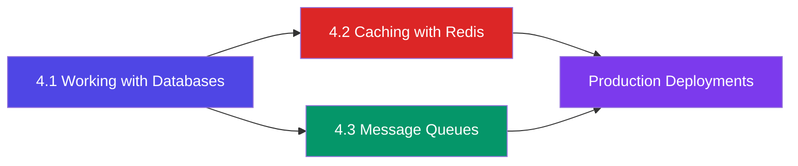

# 4️⃣ Data Layer

## 📖 Introduction

This module covers how Node.js applications **persist, cache, and communicate** with data stores and message brokers. From CRUD operations with SQL and NoSQL databases to high-performance caching with Redis and asynchronous processing with message queues — you'll learn the patterns used by every production Node.js backend.

## 🎯 Why This Module Exists

Data is the heart of most applications. Choosing the right database, caching strategy, and async processing pattern directly impacts your application's performance, scalability, and reliability. This module teaches you how to design the data layer for production workloads.

## 📚 Learning Objectives

| # | Objective |
|---|-----------|
| 1 | Connect Node.js to MongoDB and SQL databases using ODMs and drivers |
| 2 | Implement CRUD operations with proper error handling and connection pooling |
| 3 | Design database schemas for performance (indexes, relations, embedded docs) |
| 4 | Implement caching strategies (cache-aside, write-through) with Redis |
| 5 | Build background job processing with message queues (BullMQ) |
| 6 | Understand pub/sub patterns and when to use them |

## 🧱 Prerequisites

| Skill | Level |
|-------|-------|
| Node.js fundamentals | ✅ Comfortable |
| Async/await and Promises | ✅ Comfortable |
| Express.js basics | ✅ Comfortable |
| JSON and data modeling | 🔧 Helpful |

## ⏱️ Estimated Learning Time

| Topic | Est. Time |
|-------|-----------|
| Working with Databases (MongoDB + SQL) | 120 min |
| Caching with Redis | 90 min |
| Message Queues & BullMQ | 90 min |
| **Total** | **~5 hours** |

## 🗺️ Learning Roadmap

## 📋 Topics Covered

| # | Topic | Difficulty |
|---|-------|------------|
| 4.1 | Working with Databases (MongoDB + SQL) | 🟡 Intermediate |
| 4.2 | Caching with Redis & In-Memory Stores | 🟡 Intermediate |
| 4.3 | Message Queues & BullMQ | 🔴 Advanced |

## 🌍 Real-World Applications

| Topic | Used In |
|-------|---------|
| MongoDB + Mongoose | Uber, eBay, LinkedIn |
| PostgreSQL | Instagram, Spotify, Reddit |
| Redis Caching | Twitter, Pinterest, GitHub |
| BullMQ / Message Queues | Slack, Trello, Discord |

## 🛠️ Mini Projects

| Project | Topics |
|---------|--------|
| **E-Commerce Product API** | MongoDB schemas, CRUD, pagination |
| **URL Shortener with Cache** | SQL, Redis caching, analytics |
| **Background Email Processor** | BullMQ, job scheduling, retries |

## 🎯 Interview Preparation

Common questions: SQL vs NoSQL, connection pooling, N+1 queries, cache invalidation, CAP theorem, message queue patterns, eventual consistency.

## 🔗 Related Modules

| Module | Connection |
|--------|-----------|
| [Web Development](/DSA-Notes-Problems/nodejs/web) | Express + databases |
| [Core Concepts](/DSA-Notes-Problems/nodejs/core) | Streams, async patterns |
| [Production](/DSA-Notes-Problems/nodejs/production) | Deployment, monitoring, performance |
