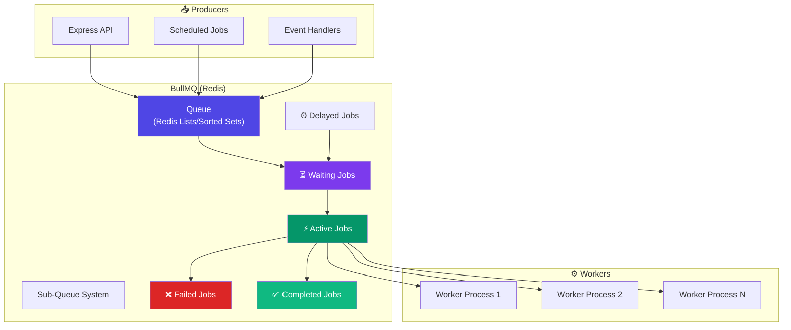
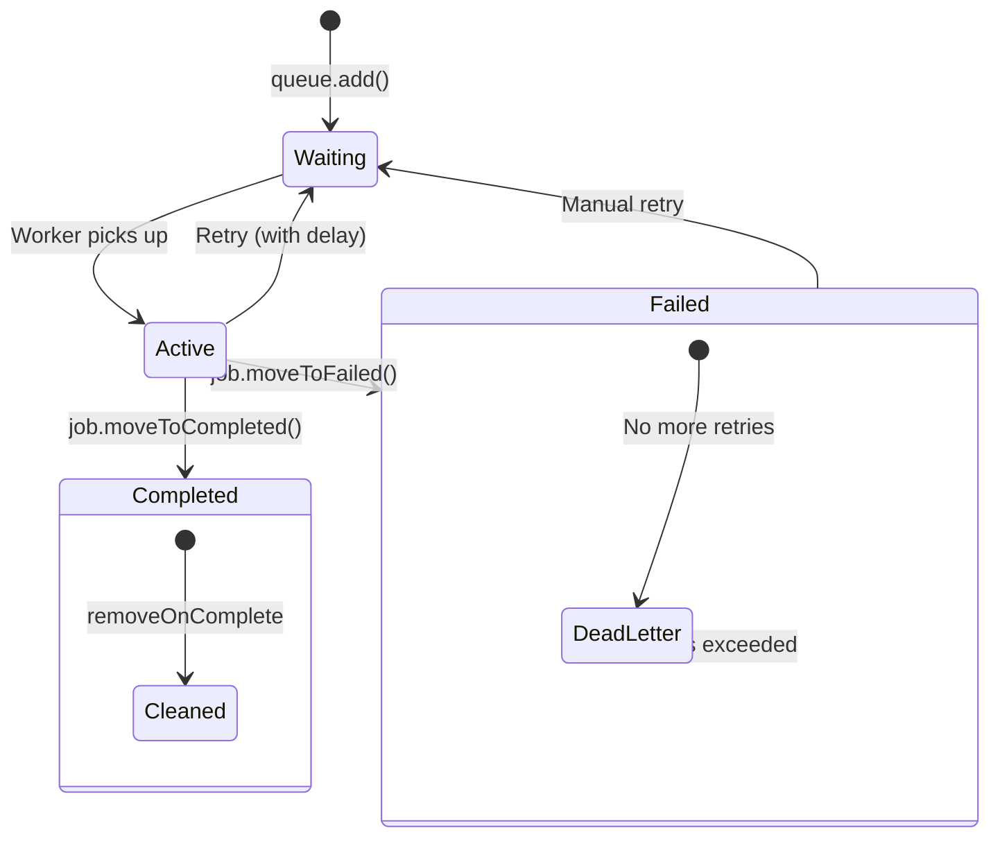
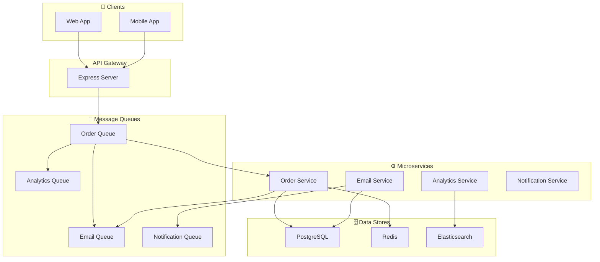
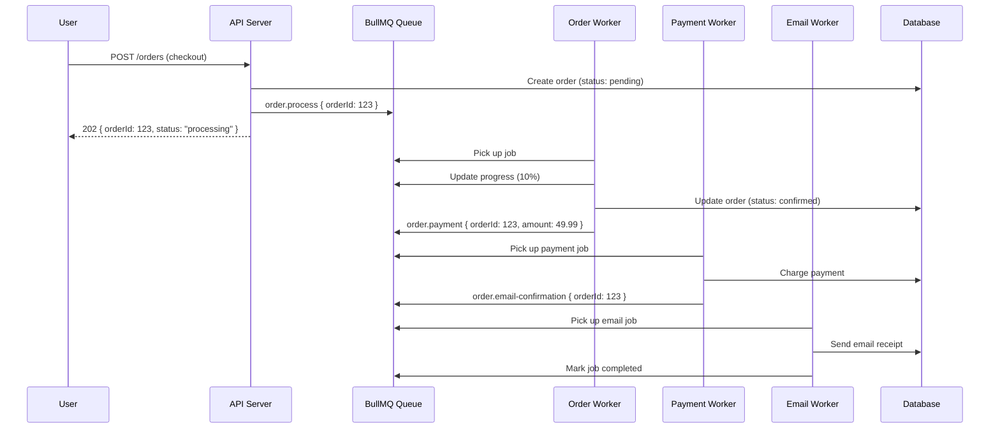

# Message Queues

## 📖 Introduction

Message queues enable **asynchronous communication** between parts of a system. Instead of processing a task immediately (blocking the user's request), you send a message to a queue and process it in the background. This decouples producers (who create work) from consumers (who do the work), allowing each to scale independently.

Node.js is an excellent platform for message queue consumers because its event-driven, non-blocking I/O handles many concurrent queue workers efficiently. The most popular queue for Node.js is **BullMQ**, built on top of Redis.

## 🤔 Why Do We Need This?

```javascript
// ❌ Synchronous — user waits for everything
app.post('/register', async (req, res) => {
  const user = await createUser(req.body);
  await sendWelcomeEmail(user.email);      // 500ms
  await updateAnalytics(user);              // 200ms
  await notifyAdmin(user);                  // 300ms
  res.json({ success: true });             // User waited 1 second!
});

// ✅ Async — instant response, tasks queued
app.post('/register', async (req, res) => {
  const user = await createUser(req.body);
  await emailQueue.add({ email: user.email });     // ~5ms
  await analyticsQueue.add({ userId: user.id });   // ~5ms
  await notificationQueue.add({ userId: user.id }); // ~5ms
  res.json({ success: true });                     // 15ms total!
});
```

Queues also provide **reliability** — if the email service is down, the job stays in the queue and retries later. If the server crashes mid-processing, the job is picked up by another worker.

## ⚠️ Problem Statement

A production message queue system must solve:

1. **Reliability** — Messages must not be lost if a consumer crashes mid-processing
2. **Scalability** — Multiple consumers must be able to process jobs in parallel
3. **Ordering** — Some jobs must be processed in order, others can be parallel
4. **Retries** — Failed jobs should be retried with exponential backoff
5. **Scheduling** — Some jobs need to run at specific times (cron, delayed)
6. **Dead letters** — Jobs that keep failing should be quarantined for inspection
7. **Monitoring** — Queue depth, processing times, failure rates must be observable

## 📚 Real World Story

**Slack** processes billions of events per day through their message queue infrastructure. When a user sends a message in a channel, that event is published to a queue. Multiple consumer services pick up the event:

1. **Message store service** — Persists the message
2. **Search indexing service** — Indexes for search
3. **Notification service** — Sends push notifications to offline users
4. **Analytics service** — Tracks message volume and engagement
5. **Bot service** — Triggers any bots in the channel

By using queues, Slack ensures that the user who sent the message gets an immediate response, while all the secondary work happens asynchronously. If any consumer is slow or down, the others are unaffected.

## 🍕 Real World Analogy

| Queue Concept | Restaurant Analogy |
|--------------|-------------------|
| **Producer** | The waiter who takes your order |
| **Queue** | The order ticket rail in the kitchen |
| **Consumer** | The chef who cooks your meal |
| **Job** | A single order ticket |
| **Retry** | Chef re-cooks a burned dish |
| **Dead letter** | Order cancelled after too many attempts |
| **Priority** | VIP orders go to the front |
| **Delay** | "Please serve this in 30 minutes" |
| **Scheduling** | Daily special preparation at 6 AM |

## 👁️ Visual Explanation

```
Synchronous (Blocking):                    Async with Queue:
                                          
Client         Server                     Client         Server         Queue         Worker
  │              │                          │              │              │              │
  ├── POST ─────►│                          ├── POST ─────►│              │              │
  │              ├── Email ───────►[slow]   │◄── 202 ──────┤              │              │
  │              ├── SMS ─────────►[slow]   │              ├── Add Job ───►│              │
  │              ├── Analytics ───►[slow]   │              │              ├── Pick Up ──►│
  │◄── 200 ──────┤                          │              │              │              ├── Email
  │              │                          │              │              │              ├── SMS
                                            │              │              │              ├── Analytics
                                            │              │              │              │
                                            │              │              │◄── Done ──────┤
              User waited 3+ seconds                      User responded in 15ms!
```

## 📊 Mermaid Diagram 1: BullMQ Architecture



## ⚙️ Internal Working: How BullMQ Manages Jobs

BullMQ uses Redis as its backend. Here's how it works internally:

1. **Adding a job**: `queue.add(name, data, opts)` → Redis `LPUSH` to a waiting list
2. **Processing**: Workers use Redis `BRPOPLPUSH` to atomically move a job from waiting → active (blocking pop prevents busy-waiting)
3. **Completion**: Worker calls `job.moveToCompleted()` → Redis moves job to a completed set
4. **Failure**: Worker calls `job.moveToFailed()` → Redis moves job to a failed set, checks retry count
5. **Retry**: If retries remain, BullMQ re-adds the job to the waiting list with a delay
6. **Delayed jobs**: Stored in a sorted set with timestamp as score, polled every second

The key Redis data structures BullMQ uses:
- **Lists**: Waiting jobs (ordered queue)
- **Sets**: Active jobs, completed jobs, failed jobs
- **Sorted Sets**: Delayed jobs (by timestamp), repeatable jobs (by next run time)

## 🔄 Mermaid Diagram 2: Job Lifecycle



## 🏗️ Architecture: Microservices Communication with Queues



## 👣 Step-by-Step Flow: Processing an E-Commerce Order



## 📝 Syntax

### BullMQ

```javascript
const { Queue, Worker } = require('bullmq');
const Redis = require('ioredis');

const connection = new Redis(process.env.REDIS_URL);

// Define a queue
const emailQueue = new Queue('email', { connection });

// Add a job
await emailQueue.add('welcome-email', {
  to: 'user@example.com',
  name: 'Alice',
  template: 'welcome',
}, {
  attempts: 3,
  backoff: { type: 'exponential', delay: 1000 },
  removeOnComplete: { count: 100 },
});

// Process jobs
const worker = new Worker('email', async (job) => {
  const { to, name } = job.data;
  await sendEmail({ to, subject: `Welcome ${name}!` });
  return { sent: true };
}, { connection });
```

## 🟢 Basic Example: Background Email Processing

```javascript
const { Queue, Worker } = require('bullmq');
const Redis = require('ioredis');
const express = require('express');

const app = express();
app.use(express.json());

const connection = new Redis(process.env.REDIS_URL);
const emailQueue = new Queue('email', { connection });

// Express endpoint — instant response
app.post('/register', async (req, res) => {
  const user = await User.create(req.body);

  // Queue the email — don't block the response
  await emailQueue.add('welcome', {
    email: user.email,
    name: user.name,
    userId: user.id,
  }, {
    attempts: 3,
    backoff: { type: 'exponential', delay: 5000 },
  });

  res.status(201).json({
    message: 'User created. Welcome email will be sent shortly.',
    userId: user.id,
  });
});

// Worker (can be in a separate process)
const worker = new Worker('email', async (job) => {
  console.log(`Sending ${job.name} to ${job.data.email}`);

  switch (job.name) {
    case 'welcome':
      await sendTemplateEmail(job.data.email, 'welcome', { name: job.data.name });
      break;
    case 'reset-password':
      await sendTemplateEmail(job.data.email, 'reset-password', { token: job.data.token });
      break;
  }

  return { sent: true, to: job.data.email };
}, { connection, concurrency: 5 });

worker.on('completed', (job) => {
  console.log(`✅ Job ${job.id} completed`);
});

worker.on('failed', (job, err) => {
  console.error(`❌ Job ${job.id} failed after ${job.attemptsMade} attempts:`, err.message);
});

app.listen(3000);
```

**What's happening:**
- **`queue.add()`** adds a job to the queue — returns immediately (microseconds)
- **`Worker`** picks up jobs and processes them asynchronously
- **`attempts: 3`** — if the email fails (e.g., SMTP error), it retries up to 3 times
- **`backoff.exponential`** — waits 5s, then 10s, then 20s between retries
- **`concurrency: 5`** — processes up to 5 emails simultaneously
- **Job events** — `completed` and `failed` for logging and monitoring

## 🟡 Intermediate Example: Job Scheduling and Dependencies

```javascript
const { Queue, Worker } = require('bullmq');
const Redis = require('ioredis');
const connection = new Redis(process.env.REDIS_URL);

const orderQueue = new Queue('order-processing', { connection });

// Order processing pipeline
app.post('/orders', async (req, res) => {
  const order = await Order.create(req.body);

  // Step 1: Validate payment
  const paymentJob = await orderQueue.add('validate-payment', {
    orderId: order.id,
    amount: order.total,
    cardToken: req.body.cardToken,
  }, { attempts: 2 });

  // Step 2: After payment succeeds, reserve inventory
  const inventoryJob = await orderQueue.add('reserve-inventory', {
    orderId: order.id,
    items: order.items,
  }, {
    dependsOn: [paymentJob.id], // Only after payment succeeds!
    attempts: 3,
  });

  // Step 3: After inventory reserved, send confirmation
  await orderQueue.add('send-confirmation', {
    orderId: order.id,
    email: req.body.email,
  }, {
    dependsOn: [inventoryJob.id],
    delay: 5000, // Send confirmation 5 seconds after inventory reserved
  });

  // Step 4: Schedule a follow-up email 24 hours later
  await orderQueue.add('follow-up-email', {
    orderId: order.id,
    email: req.body.email,
  }, {
    delay: 24 * 60 * 60 * 1000, // 24 hours
    attempts: 3,
  });

  res.status(202).json({ orderId: order.id });
});

// Worker processes
const worker = new Worker('order-processing', async (job) => {
  switch (job.name) {
    case 'validate-payment':
      return await processPayment(job.data);
    case 'reserve-inventory':
      return await reserveStock(job.data);
    case 'send-confirmation':
      return await sendOrderEmail(job.data);
    case 'follow-up-email':
      return await sendFollowUp(job.data);
  }
}, { connection });
```

**What's happening:**
- **Job dependencies** (`dependsOn`) create a pipeline — payment must succeed before inventory is reserved
- **Delayed jobs** — follow-up email runs 24 hours later without any cron/scheduler
- **`delay`** can also be used for rate limiting (e.g., send max 10 emails per minute by spacing them 6 seconds apart)

## 🔴 Advanced Example: Webhook Delivery System with Retries

```javascript
const { Queue, Worker } = require('bullmq');
const Redis = require('ioredis');
const axios = require('axios');
const crypto = require('crypto');

const connection = new Redis(process.env.REDIS_URL);
const webhookQueue = new Queue('webhooks', { connection });

// Webhook delivery function
async function deliverWebhook(url, payload, secret) {
  const timestamp = Date.now();
  const signature = crypto
    .createHmac('sha256', secret)
    .update(`${timestamp}.${JSON.stringify(payload)}`)
    .digest('hex');

  const response = await axios.post(url, payload, {
    headers: {
      'Content-Type': 'application/json',
      'X-Webhook-Signature': signature,
      'X-Webhook-Timestamp': timestamp,
    },
    timeout: 10000,
    validateStatus: () => true, // Don't throw on non-2xx
  });

  // Classify the response
  if (response.status >= 200 && response.status < 300) {
    return { status: 'success', statusCode: response.status };
  }

  // 4xx errors (client errors) — don't retry, the endpoint is misconfigured
  if (response.status >= 400 && response.status < 500) {
    throw new NonRetriableError(`Webhook rejected: ${response.status} ${response.data}`);
  }

  // 5xx errors — retry with exponential backoff
  throw new Error(`Server error: ${response.status}`);
}

class NonRetriableError extends Error {
  constructor(message) {
    super(message);
    this.name = 'NonRetriableError';
  }
}

// Add webhook job
async function sendWebhook(event, url, payload, secret) {
  await webhookQueue.add(event, {
    url, payload, secret,
    event,
  }, {
    attempts: 5,
    backoff: { type: 'exponential', delay: 2000 },
    removeOnComplete: { age: 3600 * 24 }, // Keep for 24 hours
    removeOnFail: { age: 3600 * 24 * 7 }, // Keep failed for 7 days
  });
}

// Webhook worker
const worker = new Worker('webhooks', async (job) => {
  const { url, payload, secret } = job.data;

  // Check if the endpoint is rate-limited
  const backoff = await getEndpointBackoff(url);
  if (backoff > 0) {
    throw new Error(`Endpoint rate-limited. Retry in ${backoff}ms`);
  }

  return await deliverWebhook(url, payload, secret);
}, { connection });

worker.on('failed', async (job, err) => {
  if (err instanceof NonRetriableError) {
    // Don't retry — client error
    await job.discard();
    await notifyAdmin(`Webhook permanently failed: ${job.data.url}`, err.message);
  } else if (job.attemptsMade >= job.opts.attempts) {
    // All retries exhausted
    await notifyAdmin(`Webhook exhausted retries: ${job.data.url}`, err.message);
  }
});

// Scheduled cleanup for completed jobs
const { QueueScheduler } = require('bullmq');
new QueueScheduler('webhooks', { connection });
```

**What's happening:**
- **Webhook delivery** with HMAC signature verification for security
- **Non-retriable errors** (4xx) are discarded immediately — don't waste attempts on misconfigured endpoints
- **Rate-limit aware** — checks if an endpoint has rate-limited us and backs off
- **Admin notifications** when webhooks permanently fail
- **Cleanup policies** — completed jobs kept 24h, failed jobs kept 7 days

## 🏭 Production Example: Multi-Queue Task Processing System

```javascript
// queue-service.js
const { Queue, Worker } = require('bullmq');
const Redis = require('ioredis');

class QueueService {
  constructor() {
    this.connection = new Redis(process.env.REDIS_URL, {
      maxRetriesPerRequest: null,
      enableReadyCheck: false,
    });

    this.queues = {};
    this.workers = {};

    // Define queues
    this.createQueue('email', {
      defaultJobOptions: {
        attempts: 3,
        backoff: { type: 'exponential', delay: 1000 },
        removeOnComplete: { age: 86400 },
      },
    });

    this.createQueue('image-processing', {
      defaultJobOptions: {
        attempts: 2,
        backoff: { type: 'fixed', delay: 30000 },
        removeOnComplete: { age: 3600 },
      },
      limiter: { max: 5, duration: 1000 }, // Process 5 images per second
    });

    this.createQueue('data-export', {
      defaultJobOptions: {
        attempts: 1,
        timeout: 300000, // 5 minute timeout for exports
      },
    });
  }

  createQueue(name, opts = {}) {
    this.queues[name] = new Queue(name, { connection: this.connection, ...opts });
  }

  async addJob(queueName, jobName, data, opts = {}) {
    return await this.queues[queueName].add(jobName, data, opts);
  }

  async addBulk(queueName, jobs) {
    return await this.queues[queueName].addBulk(jobs);
  }

  createWorker(name, processor, opts = {}) {
    const worker = new Worker(name, processor, {
      connection: this.connection,
      concurrency: opts.concurrency || 3,
      ...opts,
    });

    worker.on('error', (err) => {
      console.error(`Worker ${name} error:`, err.message);
    });

    this.workers[name] = worker;
    return worker;
  }

  async getQueueMetrics(name) {
    const queue = this.queues[name];
    if (!queue) return null;

    const [waiting, active, completed, failed, delayed] = await Promise.all([
      queue.getWaitingCount(),
      queue.getActiveCount(),
      queue.getCompletedCount(),
      queue.getFailedCount(),
      queue.getDelayedCount(),
    ]);

    return { waiting, active, completed, failed, delayed };
  }

  async closeAll() {
    await Promise.all([
      ...Object.values(this.workers).map(w => w.close()),
      ...Object.values(this.queues).map(q => q.close()),
    ]);
    await this.connection.quit();
  }
}

// Usage
const queueService = new QueueService();

// Producer
app.post('/images/process', async (req, res) => {
  await queueService.addJob('image-processing', 'resize', {
    imageId: req.body.imageId,
    sizes: ['thumbnail', 'medium', 'large'],
  }, {
    priority: 10, // High priority
  });

  res.status(202).json({ message: 'Image queued for processing' });
});

// Worker
queueService.createWorker('image-processing', async (job) => {
  const { imageId, sizes } = job.data;
  for (const size of sizes) {
    await resizeImage(imageId, size);
    await job.updateProgress((sizes.indexOf(size) + 1) / sizes.length * 100);
  }
  return { processed: true, sizes };
}, { concurrency: 5 });

// Metrics endpoint
app.get('/queue/metrics', async (req, res) => {
  const email = await queueService.getQueueMetrics('email');
  const image = await queueService.getQueueMetrics('image-processing');
  res.json({ email, imageProcessing: image });
});
```

**What's happening:**
- **Centralized QueueService** manages all queues in one place
- **Rate limiter** on image processing — max 5 jobs per second to avoid overwhelming the server
- **Bulk job addition** — efficient for adding many jobs at once
- **Priority** — high-priority jobs are processed before low-priority ones
- **Progress tracking** — `job.updateProgress()` allows real-time progress monitoring
- **Metrics** — queue depth, processing rates, and failure counts are exposed via API

## ⚙️ How It Works Internally

### BullMQ Redis Data Structures

| Key Pattern | Data Structure | Purpose |
|-------------|---------------|---------|
| `bull:queue:wait` | List | Jobs waiting to be processed |
| `bull:queue:active` | Set | Jobs currently being processed |
| `bull:queue:completed` | Set | Successfully completed jobs |
| `bull:queue:failed` | Set | Failed jobs |
| `bull:queue:delayed` | Sorted Set | Jobs scheduled for future (by timestamp) |
| `bull:queue:id` | String | Auto-incrementing job ID counter |

### Job Processing Flow

1. **Worker checks `wait` list** using `BRPOPLPUSH` (blocking right-pop, left-push to active)
2. **Job is now in `active` set** — other workers won't pick it up
3. **Worker executes the processor function**
4. **On success**: `job.moveToCompleted()` → job moves to `completed` set
5. **On failure**: `job.moveToFailed()` → checks retry count
   - If retries remain → job moves to `delayed` sorted set (with delay timestamp)
   - If no retries → job stays in `failed` set (dead letter)

## 📦 Performance Notes

### Queue Sizing

| Queue | Jobs/s | Workers | Concurrency per Worker |
|-------|--------|---------|----------------------|
| Email | 50 | 2 | 5 |
| Image Processing | 10 | 3 | 3 |
| Data Export | 1 | 1 | 1 |
| Webhooks | 100 | 4 | 10 |

### Optimization Tips

- **Use separate queues** for different types of work (images vs emails) — don't mix fast and slow jobs
- **Set concurrency** based on the type of work: I/O-bound (high concurrency), CPU-bound (low concurrency)
- **Use `removeOnComplete`** to prevent Redis memory from filling up with completed job data
- **Separate worker processes** — run workers in separate Node.js processes (or servers) from your API

## 🔒 Security Notes

### Job Data Security

- Don't put sensitive data (passwords, tokens) in job data — use references (IDs)
- Jobs are stored in Redis — secure Redis with a password and network isolation
- Validate job data before processing (workers should trust but verify)

```javascript
// ❌ Don't store sensitive data in jobs
await queue.add('send-email', { password: 'plain-text-password' });

// ✅ Store references, look up sensitive data in the worker
await queue.add('send-email', { userId: 123 });
// In worker: const user = await User.findById(job.data.userId);
```

## ⚠️ Common Mistakes

1. **❌ Not handling job failures** — Uncaught exceptions in workers cause jobs to fail silently. Always add `worker.on('failed')` handlers.

2. **❌ No backoff on retries** — Retrying immediately after failure overwhelms the system. Use exponential backoff.

3. **❌ Storing sensitive data in job payload** — Job data is visible in Redis. Store IDs, look up sensitive data in the worker.

4. **❌ Too many retries** — Retrying 10+ times delays dead letter detection. 3-5 retries is usually enough.

5. **❌ Running workers on the same process as the API** — CPU-intensive workers block the Event Loop. Run workers in separate processes.

6. **❌ No dead letter handling** — Jobs that keep failing accumulate in Redis. Set up monitoring and alerting.

## 🚀 Best Practices

```javascript
// ✅ Production worker configuration
const worker = new Worker('queue', async (job) => {
  try {
    const result = await processJob(job);
    return result;
  } catch (err) {
    // Log with structured logging
    logger.error({ jobId: job.id, jobName: job.name, err }, 'Job failed');
    throw err; // Re-throw for BullMQ retry mechanism
  }
}, {
  connection,
  concurrency: 5,
  lockDuration: 30000,     // Job lock timeout (30s)
  stalledInterval: 30000,  // Check for stalled jobs every 30s
  maxStalledCount: 3,      // Max times a job can be stalled
});

worker.on('completed', (job) => {
  logger.info({ jobId: job.id }, 'Job completed');
});

worker.on('failed', (job, err) => {
  // Alert if retries exhausted
  if (job.attemptsMade >= job.opts.attempts) {
    alertDevops(`Job permanently failed: ${job.id}`, err);
  }
});
```

## 🎯 Interview Questions

**Q1: What's the difference between a work queue and pub/sub?**

In a **work queue**, each message is delivered to exactly one consumer. When multiple consumers are listening, work is distributed (each message processed once). In **pub/sub**, every message is delivered to all subscribers. Use work queues for task distribution (email sending), pub/sub for event broadcasting (user signed up → notify all services).

**Q2: How do you handle job retries with exponential backoff?**

BullMQ supports built-in backoff: `backoff: { type: 'exponential', delay: 1000 }`. With attempts: 5, the retry delays would be: 1s, 2s, 4s, 8s, 16s. This prevents overwhelming the failing system while ensuring the job eventually gets processed. For custom backoff, provide a function: `backoff: { type: 'custom', delay: (attempt) => attempt * 5000 }`.

**Q3: How do you prevent duplicate job processing?**

Use BullMQ's job deduplication: set a unique job ID with `queue.add(name, data, { jobId: uniqueKey })`. BullMQ won't add a job with the same ID twice. Alternatively, make your job processing idempotent — processing the same job twice produces the same result.

**Q4: What happens when a worker crashes mid-job?**

BullMQ has a **stalled jobs** mechanism. If a worker doesn't report progress or complete a job within `lockDuration` (default 30s), BullMQ considers the job stalled and moves it back to the waiting queue for another worker to pick up. This ensures no job is lost on worker crash.

## 📝 MCQs

**1. What BullMQ feature prevents a job from being lost when a worker crashes?**
- A) Job persistence
- B) Stalled jobs detection ✅
- C) Job logging
- D) Worker health checks

**2. Which pattern should you use when each message must be processed by exactly one consumer?**
- A) Pub/Sub
- B) Work queue ✅
- C) Event bus
- D) Streaming

**3. What happens to a job when `attempts: 3` is set and it fails all 3 times?**
- A) The job is automatically retried after 1 hour
- B) The job stays in the failed set (dead letter) ✅
- C) The job is deleted
- D) An alert is sent to the admin

**4. Which backoff strategy is best for transient failures (e.g., service temporarily down)?**
- A) Fixed delay
- B) Exponential backoff ✅
- C) No backoff
- D) Random delay

**5. What is the primary benefit of running workers in a separate process from the API?**
- A) Easier deployment
- B) CPU-intensive jobs don't block API requests ✅
- C) Less memory usage
- D) Simpler code structure

**Answer Key:** 1-B, 2-B, 3-B, 4-B, 5-B

## 💻 Coding Challenge 1: Email Queue Worker

Build a BullMQ email queue that:
- Creates an `email` queue with 3 retry attempts and exponential backoff
- Adds a job when `POST /send-email` is called with `{ to, subject, body }`
- Worker simulates sending (console.log) and tracks success/failure
- Expose a `GET /queue/stats` endpoint showing waiting, active, completed, failed counts
- Handle worker crashes gracefully (don't lose jobs)

## 💻 Coding Challenge 2: Job Pipeline with Dependencies

Build an order processing pipeline with BullMQ:
- `POST /orders` → creates an order and starts the pipeline
- Job 1: Validate payment (1 attempt, no retry on decline)
- Job 2: Reserve inventory (3 attempts, stock check timeout)
- Job 3: Send confirmation email (2 attempts, exponential backoff)
- Job 4: Schedule follow-up (24 hour delay, then send)
- Each job depends on the previous one (use `dependsOn`)

## 💻 Coding Challenge 3: Webhook Delivery System

Build a webhook delivery system:
- `POST /webhooks/register` — Register a webhook URL
- `POST /webhooks/trigger` — Trigger a webhook event (queued for delivery)
- Worker delivers with retries (5 attempts, exponential backoff)
- Respect `Retry-After` headers from the receiving server
- Discard on 4xx errors (client misconfiguration)
- Track delivery stats (success rate, avg delivery time)

## 🧪 Mini Exercise: Debugging Queue Failures

This queue system has bugs. Find and fix them:

```javascript
const { Queue, Worker } = require('bullmq');
const Redis = require('ioredis');
const connection = new Redis();

const queue = new Queue('tasks', { connection });

// Bug 1: What happens if the processor throws but there's no error handler?
const worker = new Worker('tasks', async (job) => {
  if (job.data.type === 'fail') {
    throw new Error('Processing failed');
  }
  console.log('Processed:', job.id);
}, { connection });

// Bug 2: No 'failed' event handler — we won't know jobs are failing!

// Bug 3: No retry configuration — one failure and the job is dead forever
await queue.add('task', { type: 'slow' });
// Bug 4: What if the slow task times out without lockDuration configured?

// Bug 5: Worker runs in the same process as the API — blocking issue?
app.get('/fast', (req, res) => {
  res.json({ ok: true });
  // This hangs if worker is busy!
});
```

## 🌍 Real World Problem (Interview Coding Challenge)

**Problem:** You're designing the background job system for a video processing platform (like YouTube). Users upload videos, and the system must:
1. Transcode to multiple resolutions (360p, 720p, 1080p)
2. Generate thumbnails at different timestamps
3. Analyze content for copyright detection
4. Transcribe audio to captions
5. Notify the user when processing is complete

**Requirements:**
- Processing a 10-minute video takes ~5 minutes
- Users upload 100 videos/minute during peak hours
- Processing is CPU-intensive (FFmpeg)
- The system must handle worker failures gracefully
- Users should see real-time progress

**Questions:**
1. How would you architect the queue system for this pipeline?
2. How do you handle workers crashing mid-transcode?
3. How do you scale workers horizontally based on queue depth?
4. How do you report progress to the user in real time?

**Interview Tip:** Discuss using BullMQ with job progress tracking, separate queues for each stage (transcode → thumbnail → analyze → notify), worker pools with auto-scaling, and WebSocket progress updates using Socket.IO.

## 🏗️ Mini Project: Background Job Dashboard

Build a full-featured job processing system:

**Core features:**
- `POST /jobs` — Create a job (type: email, report, export)
- `GET /jobs` — List all jobs with status
- `GET /jobs/:id` — Get job details and progress
- `DELETE /jobs/:id` — Cancel a job
- Real-time updates via WebSocket when job status changes
- Dashboard showing queue metrics (waiting, active, failed)

**Technical requirements:**
- Use BullMQ with Redis
- Separate worker process (run with `node worker.js`)
- Implement rate limiting per job type
- Job scheduling (delayed and repeatable jobs)
- Dead letter handling (alert on failed jobs)

**Bonus features:**
- Job retry button in the dashboard
- Export job results as CSV
- Auto-scale workers based on queue depth
- Job priority system (premium users' jobs first)

## 📖 Summary

| Concept | Key Takeaway |
|---------|-------------|
| **Decoupling** | Queues separate producers from consumers — they scale independently |
| **BullMQ** | Redis-based queue for Node.js with retries, delays, and dependencies |
| **Work Queue** | Each message → one consumer (task distribution) |
| **Pub/Sub** | Each message → all consumers (event broadcasting) |
| **Retries** | Always use exponential backoff — 3-5 attempts max |
| **Dead Letters** | Jobs that exhaust retries need manual inspection |
| **Stalled Jobs** | BullMQ auto-reassigns jobs from crashed workers |
| **Separate Processes** | Run workers in their own processes to avoid blocking the API |

## 📋 Cheat Sheet

```javascript
// Quick reference: BullMQ

// 1. Setup
const { Queue, Worker } = require('bullmq');
const connection = new (require('ioredis'))(process.env.REDIS_URL);

// 2. Queue
const queue = new Queue('name', { connection });

// 3. Add job
await queue.add('job-name', { data: 'value' }, {
  attempts: 3,
  backoff: { type: 'exponential', delay: 1000 },
  delay: 5000, // 5 second delay
  jobId: 'unique-id', // Deduplication
});

// 4. Worker
const worker = new Worker('name', async (job) => {
  // Process job
  return { result: 'success' };
}, { connection, concurrency: 5 });

// 5. Events
worker.on('completed', (job) => {});
worker.on('failed', (job, err) => {});
worker.on('progress', (job, progress) => {});

// 6. Queue metrics
await queue.getWaitingCount();
await queue.getActiveCount();
await queue.getCompletedCount();
await queue.getFailedCount();
```

## 📚 Further Reading

- [BullMQ Documentation](https://docs.bullmq.io/)
- [BullMQ Patterns](https://docs.bullmq.io/patterns)
- [Redis Pub/Sub](https://redis.io/docs/latest/develop/interact/pubsub/)
- [RabbitMQ Tutorials](https://www.rabbitmq.com/tutorials)
- [Apache Kafka Introduction](https://kafka.apache.org/intro)

## 🔗 Related Topics

- [Caching with Redis](./caching) — Redis data structures, pub/sub
- [Working with Databases](./databases) — Async processing for DB operations
- [WebSockets & Real-Time](../web/websockets-realtime) — Real-time progress updates
- [Performance Optimization](../production/performance) — Offloading CPU work to queues
- [Monitoring](../production/logging-and-monitoring) — Queue metrics and alerting
