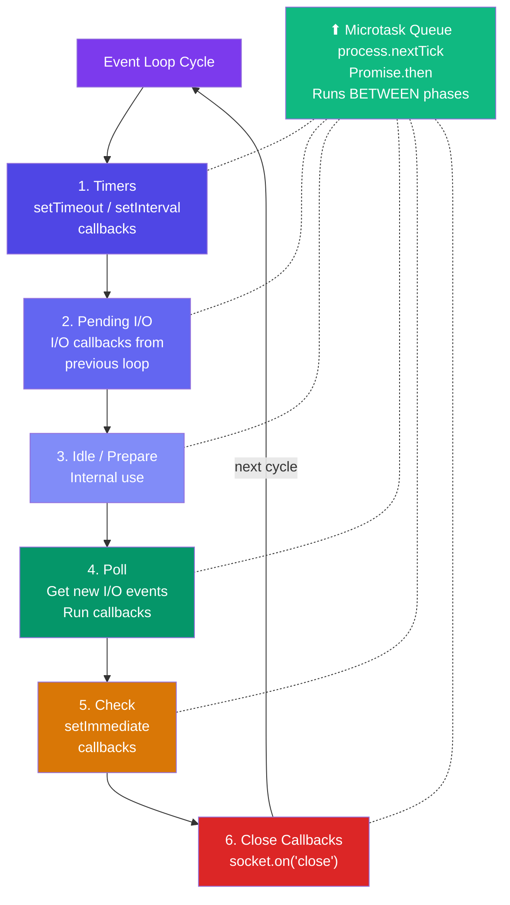

# Node.js Architecture

## 🔄 Single-Threaded Architecture

Most traditional servers (like Apache) use a **multi-threaded** model — they create a new thread (like a mini-program) for every request. Each thread takes memory (~2MB). So 10,000 concurrent users = 20GB RAM just for threads!

Node.js uses a **single thread** for JavaScript execution. But it's smarter — it uses **non-blocking I/O** so that one thread can handle thousands of requests.

| Approach | Memory Usage | Concurrent Users |
|----------|-------------|------------------|
| Multi-Thread (Apache) | ~2MB per thread → 20GB for 10K users | Limited by RAM |
| Single-Thread (Node.js) | Very low memory | Handles 10K+ easily |


---

## ⚡ Event-Driven Architecture

Node.js is built around **events**. When something happens (a request arrives, a file is read, a database query finishes), an **event** is emitted, and a **listener** (callback function) handles it.

Think of it like a **notification system**:
- You subscribe to notifications: "Tell me when my pizza is ready"
- You go do other things
- When the pizza is ready, your phone buzzes (event fires)
- You handle it (eat the pizza)

---

## 🚫 Blocking vs Non-Blocking I/O

**I/O** = Input/Output operations: reading files, database queries, network requests — anything that involves waiting.

```javascript
// ❌ BLOCKING — The entire program FREEZES here until file is read
const fs = require('fs');
const data = fs.readFileSync('big-file.txt'); // FREEZE for 500ms
console.log(data);
console.log('This prints AFTER the file is read');

// ✅ NON-BLOCKING — Program continues while file reads in background
fs.readFile('big-file.txt', (err, data) => {
  // This callback runs LATER when file is ready
  console.log(data);
});
console.log('This prints IMMEDIATELY, without waiting!');
```

> **Real-world analogy**: Blocking is like standing in a coffee queue and refusing to do anything until you get your coffee. Non-blocking is placing your order and sitting down to work — you get notified when coffee is ready.

---

## 🔁 The Event Loop — The Heart of Node.js

The **Event Loop** is the mechanism that makes Node.js non-blocking. It constantly checks: "Is there anything to do?" and executes tasks one by one.


### 🔢 Event Loop Phases Explained

The Event Loop runs through these phases continuously:



| Phase | What Happens | Example |
|-------|-------------|---------|
| **Timers** | Runs expired `setTimeout` and `setInterval` callbacks | `setTimeout(() => {}, 0)` |
| **Pending I/O** | Handles I/O callbacks from previous loop | Error callbacks |
| **Idle/Prepare** | Internal use only | — |
| **Poll** | Gets new I/O events, runs their callbacks | File read complete, HTTP response received |
| **Check** | Runs `setImmediate` callbacks | `setImmediate(() => {})` |
| **Close Callbacks** | Handles closed connections | `socket.on('close', ...)` |

**Important:** Between every phase, Node.js checks the **Microtask Queue** (process.nextTick + Promises) and runs them ALL before moving to next phase.

### 🔑 Priority Order

### 🔑 Priority Order

```
process.nextTick()     ← Highest priority (runs before anything else)
Promise.then()         ← Second priority
setTimeout(fn, 0)      ← Third
setImmediate()         ← After I/O
```

```javascript
console.log('1 - Start');

setTimeout(() => console.log('4 - setTimeout'), 0);

Promise.resolve().then(() => console.log('3 - Promise'));

process.nextTick(() => console.log('2 - nextTick'));

console.log('5 - End');

// Output:
// 1 - Start
// 5 - End
// 2 - nextTick     (microtask, runs first)
// 3 - Promise      (microtask, runs second)
// 4 - setTimeout   (timer phase)
```
