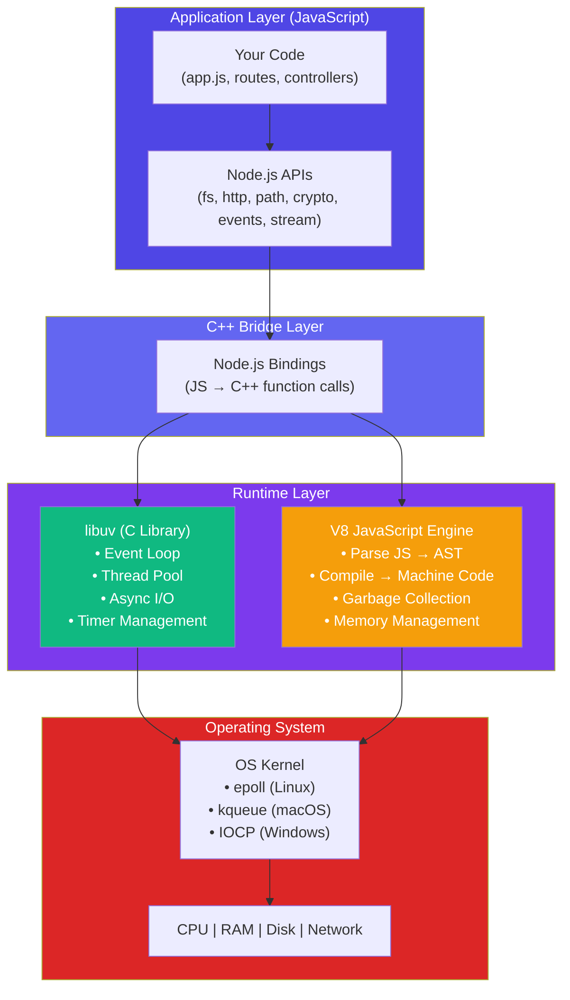
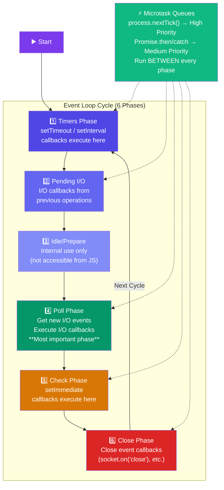
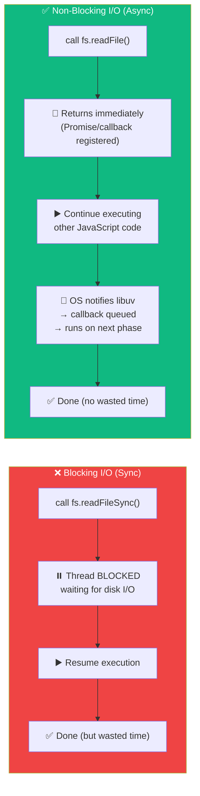
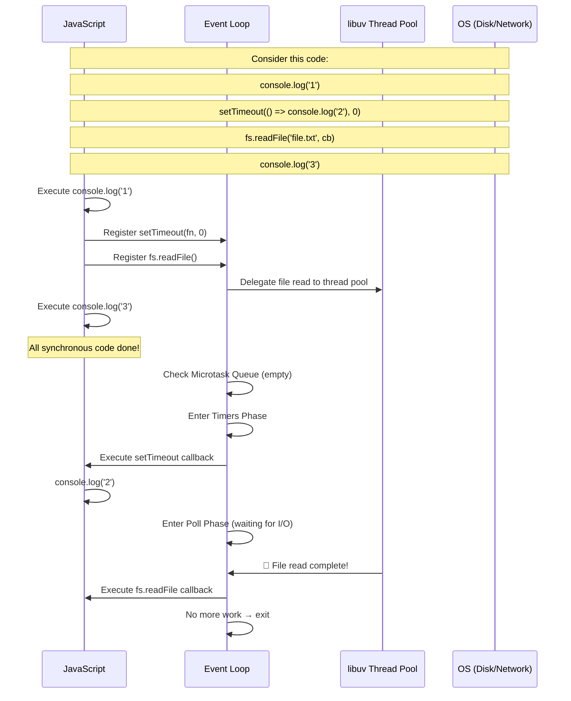

# Node.js Architecture & Event Loop

## 📖 Introduction

Node.js achieves high concurrency with a **single thread** through its event-driven, non-blocking I/O architecture. The **Event Loop** is the heart of this system — a mechanism that continuously checks for pending tasks and executes them one by one, without ever blocking.

> **The Event Loop is what makes Node.js "Node.js."** Without it, Node.js would just be a JavaScript runtime that blocks on every I/O operation.

## 🤔 Why Do We Need This?

Traditional web servers use a **multi-threaded** model:

```
10,000 concurrent users = 10,000 threads
Each thread = ~2MB RAM
Total = 20GB RAM just for thread overhead!
```

This approach is:
- **Memory-prohibitive** at scale
- **CPU-wasteful** — threads spend 90% of their time waiting for I/O
- **Hard to debug** — race conditions, deadlocks, thread safety

Node.js's single-threaded + Event Loop model handles **10x more users with 10x less memory**.

## ⚠️ Problem Statement

Imagine an e-commerce site during Black Friday:

```
10,000 users hit the site simultaneously.
Each request needs:
  1. Read user profile (DB query: 50ms)
  2. Fetch order history (DB query: 100ms)
  3. Calculate recommendations (DB query: 200ms)
  4. Render the page (CPU: 5ms)

Multi-Threaded Server:
  10,000 threads × (50 + 100 + 200 + 5)ms of waiting = DROWNING

Node.js Server:
  1 thread × 5ms CPU + non-blocking DB queries = 🚀 SMOOTH SAILING
```

The problem: traditional servers **wait** during I/O. Node.js **works** during I/O.

## 📚 Real World Story

**PayPal's Switch from Java to Node.js**

In 2013, PayPal's Java-based application was struggling. Each request took **450ms to build the page**. The team rewrote the same application in Node.js.

Results:
- **Build time: 450ms → 40ms** (11x faster)
- **Requests per second: 2,000 → 4,000** (2x more)
- **Time to market: 2x faster development**
- **Team size: Smaller team, same output**

Why? Node.js's non-blocking architecture meant the Java team's complex thread management code simply disappeared.

> *"Node.js allowed us to build applications twice as fast with fewer people."*
> — **PayPal Engineering Blog**

## 🍕 Real World Analogy

**A Smart Waiter at a Busy Restaurant**

| Concept | Analogy | 
|---------|---------|
| **Multi-threaded server** | 50 waiters, each assigned to one table. They stand at the kitchen waiting for each dish. |
| **Node.js (single-threaded)** | 1 super-efficient waiter who takes order #1, delivers it to the kitchen, immediately takes order #2, delivers to kitchen, checks on order #3... When a dish is ready (event!), the waiter picks it up and serves it. |

The single waiter handles 50 tables because he never stands idle. He's the Event Loop.

## 👁️ Visual Explanation

```
MULTI-THREADED (Blocking I/O)
═══════════════════════════════
Time → 0ms      50ms     100ms    150ms    200ms
Req1   [───DB Query────]                         ← Thread 1 blocked
Req2        [───DB Query────]                    ← Thread 2 blocked
Req3             [───DB Query────]               ← Thread 3 blocked
CPU                           [░░░░]             ← Only now actual work

NODE.JS (Non-Blocking I/O)
═══════════════════════════
Time → 0ms      50ms     100ms    150ms    200ms
Req1   [DB──]                                  ← Start query, don't wait
Req2   [DB──]                                  ← Start another
Req3   [DB──]                                  ← Start another
CPU    [░░]    [░░]     [░░]     [░░]     [░░] ← Use wait time for CPU work
               ↑ DB1 done → callback runs here
                        ↑ DB2 done → callback runs here
                                  ↑ DB3 done → callback runs here
```

## 📊 Mermaid Diagram 1: Node.js Architecture Layers



> 💡 **Did You Know?** libuv was originally developed for Node.js but is now used by other languages too (Julia, Luvit, etc.). It's the silent hero behind async I/O.

## ⚙️ Internal Working: The Event Loop in Detail

The Event Loop is a **C program** (part of libuv) that runs in an infinite loop. Here's the pseudo-code:

```c
// Simplified libuv Event Loop (written in C)
int uv_run(uv_loop_t* loop) {
  while (uv_loop_alive(loop)) {
    // 1. Timers: Run expired setTimeout/setInterval callbacks
    uv__run_timers(loop);
    
    // 2. Pending I/O: Run callbacks from completed I/O
    uv__run_pending(loop);
    
    // 3. Idle/Prepare: Internal housekeeping
    uv__run_idle(loop);
    uv__run_prepare(loop);
    
    // 4. Poll: Wait for new I/O events (blocking)
    uv__io_poll(loop, timeout);
    
    // 5. Check: Run setImmediate callbacks
    uv__run_check(loop);
    
    // 6. Close: Run close callbacks
    uv__run_closing_handles(loop);
  }
  return 0;
}
```

The JavaScript layer sits on top and **cannot see the Event Loop directly**. It registers callbacks that the Event Loop invokes at the right time.

## 🔄 Mermaid Diagram 2: Event Loop Phases



## 🏗️ Architecture: Blocking vs Non-Blocking I/O



## 👣 Step-by-Step Flow: Tracing Event Loop Execution



**Execution order:** `1 → 3 → 2 → (file contents when ready)`

<details>
<summary>🔬 Detailed Trace</summary>

```
Phase                    | Queue                      | Output
─────────────────────────┼────────────────────────────┼───────
Synchronous Execution    | Runs immediately           | 1
Synchronous Execution    | Runs immediately           | 3
─────────────────────────┼────────────────────────────┼───────
Microtasks (between)     | process.nextTick/Promises  | (empty)
─────────────────────────┼────────────────────────────┼───────
Timers Phase             | setTimeout(0) callbacks    | 2
─────────────────────────┼────────────────────────────┼───────
Pending I/O              | Completed I/O callbacks    | (empty)
─────────────────────────┼────────────────────────────┼───────
Poll Phase               | New I/O + existing         | (file content)
─────────────────────────┼────────────────────────────┼───────
Check Phase              | setImmediate callbacks     | (empty)
─────────────────────────┼────────────────────────────┼───────
Close Phase              | Close callbacks            | (empty)
─────────────────────────┼────────────────────────────┼───────
→ Next cycle or exit
```
</details>

## 📝 Syntax: Execution Priority

```javascript
// Execution priority in Node.js (HIGH to LOW):
// 1. process.nextTick()    ← HIGHEST
// 2. Promise.then/catch    ← SECOND
// 3. setTimeout(fn, 0)     ← TIMER PHASE
// 4. setImmediate()        ← CHECK PHASE (AFTER I/O)
```

## 🟢 Basic Example: Understanding Order

```javascript
console.log('1 - Synchronous');

setTimeout(() => {
  console.log('4 - setTimeout (Timer Phase)');
}, 0);

setImmediate(() => {
  console.log('5 - setImmediate (Check Phase)');
});

Promise.resolve().then(() => {
  console.log('3 - Promise.then (Microtask)');
});

process.nextTick(() => {
  console.log('2 - process.nextTick (Microtask - HIGHEST)');
});

console.log('6 - Synchronous End');

// OUTPUT:
// 1 - Synchronous
// 6 - Synchronous End
// 2 - process.nextTick (Microtask - HIGHEST)
// 3 - Promise.then (Microtask)
// 4 - setTimeout (Timer Phase)
// 5 - setImmediate (Check Phase)
```

**Line-by-line explanation:**
| Line | Phase | Why? |
|------|-------|------|
| `console.log('1')` | Synchronous | Runs immediately |
| `setTimeout(cb, 0)` | Registers timer | Timer callback goes to Timers Phase |
| `setImmediate(cb)` | Registers check | Goes to Check Phase |
| `Promise.resolve().then(cb)` | Registers microtask | Goes to Microtask Queue |
| `process.nextTick(cb)` | Registers microtask | Goes to Microtask Queue (BEFORE Promises) |
| `console.log('6')` | Synchronous | Runs immediately |

After sync code finishes, microtasks run first (nextTick → Promise), then Timer Phase (setTimeout), then Check Phase (setImmediate).

## 🟡 Intermediate Example: I/O + Timers

```javascript
const fs = require('fs');

fs.readFile(__filename, 'utf-8', () => {
  console.log('1 - I/O callback (Poll Phase)');
  
  setTimeout(() => {
    console.log('2 - setTimeout inside I/O');
  }, 0);
  
  setImmediate(() => {
    console.log('3 - setImmediate inside I/O');
  });
});

// ─── INSIDE I/O callback, setImmediate ALWAYS runs before setTimeout ───
// OUTPUT:
// 1 - I/O callback (Poll Phase)
// 3 - setImmediate inside I/O
// 2 - setTimeout inside I/O

// ─── WHY? When inside I/O callback:
// Poll Phase → Check Phase (setImmediate) → Timers Phase (setTimeout)
```

> 🧠 **Memory Trick:** Inside I/O callbacks, `setImmediate` wins over `setTimeout(fn, 0)` because Check Phase comes right after Poll Phase, while Timers Phase comes later.

## 🔴 Advanced Example: Microtask Starvation

```javascript
let count = 0;

function recursiveNextTick() {
  process.nextTick(() => {
    count++;
    if (count < 100000) {
      recursiveNextTick();  // Keeps adding to microtask queue
    }
  });
}

// Start
setTimeout(() => {
  console.log('This may take a while to print...');
}, 100);

recursiveNextTick();

// ─── PROBLEM ───
// The recursive nextTick keeps the microtask queue full.
// The Event Loop NEVER reaches the Timer Phase.
// The setTimeout callback is STARVED indefinitely!

// ─── FIX ───
function fixedRecursive() {
  setImmediate(() => {      // Use setImmediate instead
    count++;
    if (count < 100000) {
      fixedRecursive();     // Check Phase → Poll → Timers → allows others to run
    }
  });
}
```

> ⚠️ **Common Mistake:** `process.nextTick()` can starve the Event Loop! Use `setImmediate()` for recursive async operations to allow other phases to execute.

## 🏭 Production Example: Graceful Shutdown with Event Loop

```javascript
const http = require('http');
const { Pool } = require('pg');

const pool = new Pool({ connectionString: process.env.DATABASE_URL });

const server = http.createServer(async (req, res) => {
  try {
    const { rows } = await pool.query('SELECT NOW()');
    res.writeHead(200, { 'Content-Type': 'application/json' });
    res.end(JSON.stringify({ time: rows[0].now }));
  } catch (err) {
    console.error('DB Error:', err.message);
    res.writeHead(500);
    res.end('Internal Server Error');
  }
});

// ─── GRACEFUL SHUTDOWN ───
// Handle SIGTERM (from Kubernetes, Docker, process manager)
process.on('SIGTERM', async () => {
  console.log('🛑 SIGTERM received. Shutting down gracefully...');
  
  // 1. Stop accepting new connections
  server.close(() => {
    console.log('✅ HTTP server closed');
  });
  
  // 2. Close database connections
  await pool.end();
  console.log('✅ Database pool closed');
  
  // 3. Wait for pending requests (Event Loop will process them)
  // 4. Force exit after timeout (safety net)
  setTimeout(() => {
    console.error('⚠️ Forced shutdown after timeout');
    process.exit(1);
  }, 30000).unref();  // .unref() — Don't let this timer keep the process alive!
});

// Handle unhandled promise rejections
process.on('unhandledRejection', (reason) => {
  console.error('❌ Unhandled Rejection:', reason);
  // In Node 15+, this crashes the process. Always handle rejections!
});

server.listen(3000, () => {
  console.log('🚀 Server running on :3000');
});
```

**Key Event Loop concepts used:**
- `server.close()` — Stops accepting new connections, waits for pending
- `.unref()` — Prevents a timer from keeping the process alive
- Event Loop exits naturally when nothing is pending

## ⚙️ How It Works Internally

The Event Loop is implemented in **libuv (C code)** and uses the OS's native async I/O mechanisms:

| OS | Mechanism | Type |
|----|-----------|------|
| Linux | `epoll` | Event notification |
| macOS / iOS | `kqueue` | Kernel event queue |
| Windows | `IOCP` | I/O Completion Ports |
| Solaris | `event ports` | Event ports |

**The Poll Phase explained:**
1. Node.js calls `epoll_wait()` (Linux) or equivalent
2. This is a **blocking call** — the thread sleeps here
3. When I/O completes, the OS wakes the thread
4. The completed I/O callbacks are moved to the pending queue
5. Node.js executes them one by one

**The Thread Pool:**
- Default size: **4 threads**
- Can be increased: `UV_THREADPOOL_SIZE=8`
- Used for: `fs` operations, `crypto` (pbkdf2, randomBytes), DNS lookups
- NOT used for: Network I/O (uses OS async directly — `epoll`/`kqueue`/`IOCP`)

## 📦 Performance Notes

| Scenario | Impact | Mitigation |
|----------|--------|------------|
| **Event Loop blocking** | All users wait! 500ms block = 500ms delay for EVERYONE | Never use sync I/O in request handlers |
| **CPU-intensive tasks** | Event Loop can't process other requests | Use Worker Threads or split into chunks |
| **Too many nextTick** | Starves I/O callbacks, memory grows | Use `setImmediate()` for recursion |
| **Large JSON parsing** | `JSON.parse()` is synchronous → blocks Event Loop | Stream large JSON with `JSONStream` |
| **UV_THREADPOOL_SIZE** | Default 4 threads may bottleneck | Increase for heavy `fs`/`crypto` usage |

> 📦 **Performance Note:** Monitor Event Loop lag with tools like `process.hrtime()` or APM tools (Datadog, New Relic). If lag exceeds 50ms, investigate.

## 🔒 Security Notes

| Risk | Explanation | Mitigation |
|------|-------------|------------|
| **Event Loop starvation** | Malicious input causes infinite recursion | Set timeouts on operations |
| **DoS via sync I/O** | An attacker triggers `readFileSync` | Never use sync APIs in request handlers |
| **Timer abuse** | Thousands of setTimeout(0) calls | Rate-limit user-triggered timers |
| **Unref() awareness** | Forgetting .unref() keeps process alive | Use `.unref()` on keep-alive timers |

> 🔒 **Security Note:** A common Node.js DoS attack is sending a request that triggers a sync file read or crypto operation. This blocks the Event Loop for ALL users. Always audit for sync API usage in request handlers.

## ⚠️ Common Mistakes

```javascript
// ❌ MISTAKE 1: Blocking the Event Loop in a request handler
app.get('/compute', (req, res) => {
  // ⛔ This blocks EVERYBODY for 5 seconds
  const end = Date.now() + 5000;
  while (Date.now() < end) {}
  res.send('Done');
});

// ✅ FIX: Use async or defer to Worker Thread
app.get('/compute', async (req, res) => {
  const result = await runInWorker(heavyComputation);
  res.send(result);
});

// ❌ MISTAKE 2: Confusing nextTick with setImmediate
process.nextTick(() => console.log('nextTick'));    // Runs BEFORE I/O
setImmediate(() => console.log('immediate'));       // Runs AFTER I/O
// Not the same! nextTick is NOT part of the Event Loop phases

// ❌ MISTAKE 3: Forgetting that Promises are microtasks
Promise.resolve().then(() => console.log('promise'));
// This runs BEFORE setTimeout(0) and setImmediate!

// ❌ MISTAKE 4: Not understanding process.exit behavior
const interval = setInterval(() => {
  console.log('tick');  // This may not run!
}, 100);
process.exit(0);  // ⛔ Exits immediately, interval never fires
// cleanup handlers still run (if any)
```

## 🚀 Best Practices

| # | Practice | Why |
|---|----------|-----|
| 1 | **Never use `*Sync` methods in request handlers** | Blocks the Event Loop for ALL users |
| 2 | **Use `setImmediate()` for recursive async operations** | Prevents microtask starvation of I/O |
| 3 | **Monitor Event Loop lag in production** | Detects performance regressions early |
| 4 | **Use `.unref()` on keep-alive timers** | Allows graceful process exit |
| 5 | **Increase `UV_THREADPOOL_SIZE` for heavy I/O apps** | Match thread count to workload |
| 6 | **Prefer `fs.promises` API** | Cleaner async/await avoids callback confusion |
| 7 | **Always handle `unhandledRejection`** | Node 15+ crashes on unhandled rejections |

## 🎯 Interview Questions

**Q1: Explain the Event Loop in Node.js.**
The Event Loop is a C program (libuv) that runs in phases: Timers → Pending I/O → Idle → Poll → Check → Close. It continuously checks for pending callbacks and executes them. Between phases, it drains the microtask queue (nextTick → Promises).

**Q2: What's the difference between `process.nextTick()` and `setImmediate()`?**
`process.nextTick()` runs in the microtask queue BETWEEN any phases — it's highest priority. `setImmediate()` runs in the Check Phase (after I/O). Inside I/O callbacks, `setImmediate` runs before `setTimeout(0)`.

**Q3: How does Node.js handle thousands of concurrent connections with a single thread?**
The Event Loop never blocks on I/O. It delegates I/O to libuv's thread pool or the OS kernel (epoll/kqueue/IOCP). When I/O completes, a callback is queued. The single thread just moves from task to task efficiently.

**Q4: What is libuv and why is it important?**
libuv is a C library that provides the Event Loop, Thread Pool, async I/O, and timer management. It's the abstraction layer that makes Node.js work across Linux, macOS, and Windows.

## 📝 MCQs

**1. Which phase of the Event Loop runs `setTimeout` callbacks?**
- A) Poll Phase
- B) Timers Phase ✅
- C) Check Phase
- D) Close Phase

**2. What happens between each Event Loop phase?**
- A) Garbage collection runs
- B) Microtask queue is drained ✅
- C) Thread pool is resized
- D) File descriptors are closed

**3. Which of these runs FIRST after synchronous code completes?**
- A) `setTimeout(fn, 0)`
- B) `setImmediate(fn)`
- C) `process.nextTick(fn)` ✅
- D) `Promise.resolve().then(fn)`

**4. What is the default size of libuv's thread pool?**
- A) 2
- B) 4 ✅
- C) 8
- D) 16

**5. Which OS mechanism does Node.js use on Linux for async I/O?**
- A) IOCP
- B) kqueue
- C) epoll ✅
- D) select

## 💻 Coding Challenge 1: Order Challenge

Write a program that prints the numbers 1-5 in this specific order using async primitives:
```
Output: 1, 2, 3, 4, 5
```
Rules:
- `1` must be synchronous
- `2` must use `process.nextTick()`
- `3` must use `Promise.resolve().then()`
- `4` must use `setTimeout(0)`
- `5` must use `setImmediate()`
- You can only add callbacks, not modify the order of calls

<details>
<summary>💡 Solution</summary>

```javascript
console.log('1');                              // Synchronous

process.nextTick(() => console.log('2'));       // Microtask (highest priority)

Promise.resolve().then(() => console.log('3')); // Microtask (second priority)

setTimeout(() => console.log('4'), 0);          // Timer Phase

setImmediate(() => console.log('5'));           // Check Phase
```
</details>

## 💻 Coding Challenge 2: I/O Timer Race

Write a program that reads any file and demonstrates that inside an I/O callback, `setImmediate` always runs before `setTimeout(fn, 0)`.

## 💻 Coding Challenge 3: Event Loop Visualizer

Create a simple Event Loop logger that wraps `setTimeout`, `setImmediate`, `process.nextTick`, and `Promise.then` to show which phase each callback executes in.

## 🧪 Mini Exercise: Debugging

This server is meant to respond with the current time every second, but it has bugs:

```javascript
const http = require('http');

const server = http.createServer((req, res) => {
  res.writeHead(200, { 'Content-Type': 'text/plain' });
  
  // Bug 1: This blocks the entire server!
  const data = fs.readFileSync('big-file.txt');
  
  // Bug 2: setInterval never stops → memory leak
  const interval = setInterval(() => {
    res.write(new Date().toISOString() + '\n');
  }, 1000);
  
  // Bug 3: This never runs (res is already ended inside interval)
  res.end('Done');
});

server.listen(3000);
```

**Find and fix all bugs:**
1. `fs` is not imported
2. `readFileSync` blocks the Event Loop for ALL requests
3. `setInterval` leaks memory — never cleared on connection end
4. `res.end('Done')` never runs because interval's `res.write` may fail

## 📖 Summary

| Concept | Key Takeaway |
|---------|-------------|
| **Single-threaded** | One thread for JS execution, NOT for I/O |
| **Event Loop** | C program in libuv that processes callbacks in phases |
| **6 Phases** | Timers → Pending → Idle → Poll → Check → Close |
| **Microtasks** | nextTick (highest) → Promises — run BETWEEN phases |
| **Non-blocking I/O** | Delegate to OS (epoll/kqueue) or thread pool |
| **Thread Pool** | Default 4 threads for fs/crypto/DNS |
| **Never block** | Sync APIs in request handlers = all users wait |

## 🌍 Real World Problem (Interview Coding Challenge)

**Problem:** Your Node.js API server processes file uploads. During peak hours, the Event Loop lag exceeds 500ms, causing timeouts for all users.

**Questions:**
1. How would you diagnose the Event Loop lag?
2. What operations typically cause Event Loop lag in a file upload API?
3. How would you offload the file processing without blocking the Event Loop?
4. How does increasing `UV_THREADPOOL_SIZE` help?

**Interview Tip:** This is a common production debugging question at Netflix and Uber.

## 🏗️ Mini Project: Event Loop Monitor Dashboard

Build a real-time Event Loop monitor:

```javascript
// event-loop-monitor.js
const http = require('http');
const fs = require('fs');

// Track Event Loop lag
let maxLag = 0;
let minLag = Infinity;
let sampleCount = 0;

function measureLag() {
  const start = Date.now();
  
  setImmediate(() => {
    const lag = Date.now() - start;
    maxLag = Math.max(maxLag, lag);
    minLag = Math.min(minLag, lag);
    sampleCount++;
    
    if (sampleCount < 100) {
      measureLag();  // Continue sampling
    }
  });
}

// Start measuring
measureLag();

// Serve metrics via HTTP
const server = http.createServer((req, res) => {
  if (req.url === '/metrics') {
    res.writeHead(200, { 'Content-Type': 'application/json' });
    res.end(JSON.stringify({
      maxLag: `${maxLag}ms`,
      minLag: `${minLag}ms`,
      samples: sampleCount,
      status: maxLag > 50 ? '⚠️ High Lag' : '✅ Healthy',
      timestamp: new Date().toISOString(),
    }));
  } else {
    // Serve HTML dashboard
    const html = `
      <!DOCTYPE html>
      <html>
      <head>
        <title>Event Loop Monitor</title>
        <style>
          body { font-family: monospace; padding: 2rem; background: #1a1a2e; color: #eee; }
          .metric { margin: 1rem 0; padding: 1rem; background: #16213e; border-radius: 8px; }
          .value { font-size: 2rem; font-weight: bold; color: #0f3460; }
          .healthy { color: #10b981; }
          .warning { color: #f59e0b; }
          .critical { color: #ef4444; }
        </style>
        <script>
          setInterval(async () => {
            const res = await fetch('/metrics');
            const data = await res.json();
            document.getElementById('max-lag').textContent = data.maxLag;
            document.getElementById('status').textContent = data.status;
            document.getElementById('status').className = data.maxLag > 50 ? 'warning' : 'healthy';
          }, 1000);
        </script>
      </head>
      <body>
        <h1>🔄 Event Loop Monitor</h1>
        <div class="metric">
          <div>Max Event Loop Lag</div>
          <div class="value" id="max-lag">measuring...</div>
        </div>
        <div class="metric">
          <div>Status</div>
          <div class="value healthy" id="status">measuring...</div>
        </div>
      </body>
      </html>
    `;
    res.writeHead(200, { 'Content-Type': 'text/html' });
    res.end(html);
  }
});

server.listen(3000, () => {
  console.log('🔍 Event Loop Monitor: http://localhost:3000');
});
```

## 📋 Cheat Sheet

```javascript
// ─── PHASE PRIORITY ────────────────────────────────
// 1. process.nextTick()    ← Microtask (highest)
// 2. Promise.then()        ← Microtask
// 3. setTimeout(fn, 0)     ← Timers Phase
// 4. setImmediate()        ← Check Phase

// ─── EXECUTION ORDER ───────────────────────────────
// Inside I/O: setImmediate > setTimeout(0)
// Outside I/O: depends on phase timing

// ─── EVENT LOOP LAG DETECTION ──────────────────────
const start = Date.now();
setImmediate(() => {
  const lag = Date.now() - start;
  console.log(`Event Loop Lag: ${lag}ms`);
});

// ─── THREAD POOL SIZE ──────────────────────────────
// UV_THREADPOOL_SIZE=8 node app.js
// Or: process.env.UV_THREADPOOL_SIZE = '8';

// ─── GRACEFUL SHUTDOWN ─────────────────────────────
process.on('SIGTERM', () => {
  server.close(() => process.exit(0));
});
```

## 📚 Further Reading

- [Node.js Event Loop Guide](https://nodejs.org/en/learn/asynchronous-work/event-loop-timers-and-nexttick)
- [libuv Documentation](https://docs.libuv.org/en/v1.x/)
- [Event Loop Visualizer Tool](https://www.jsv9000.app/)
- [Node.js Event Loop vs Browser Event Loop](https://nodejs.org/en/learn/asynchronous-work/differences-between-nodejs-and-the-browser-event-loop)
- [Deep Dive into the Event Loop](https://www.youtube.com/watch?v=PNa9OMajw9w) (Bert Belder — libuv author)

## 🔗 Related Topics

| Topic | Link |
|-------|------|
| Introduction to Node.js | [Previous](/DSA-Notes-Problems/nodejs/fundamentals/introduction) |
| Asynchronous Programming | [Async Programming](/DSA-Notes-Problems/nodejs/core/async-programming) |
| npm & package.json | [Next](/DSA-Notes-Problems/nodejs/fundamentals/npm-and-package-json) |
| Streams & Buffers | [Streams](/DSA-Notes-Problems/nodejs/core/streams-and-buffers) |
| Clustering & Worker Threads | [Clustering](/DSA-Notes-Problems/nodejs/production/clustering-and-worker-threads) |
