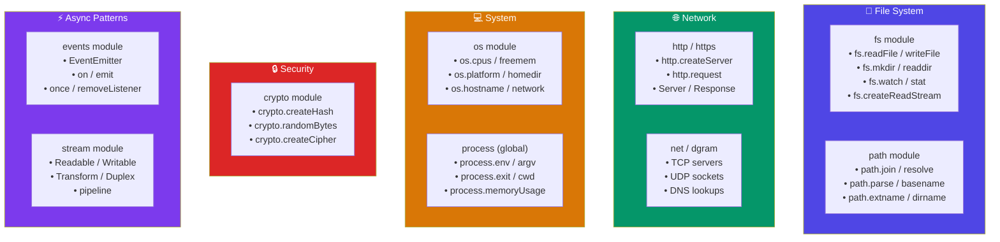
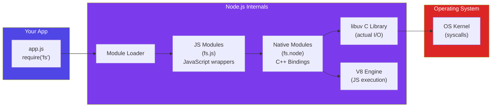
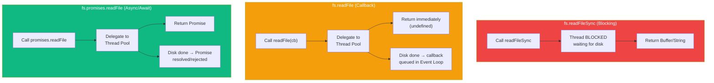
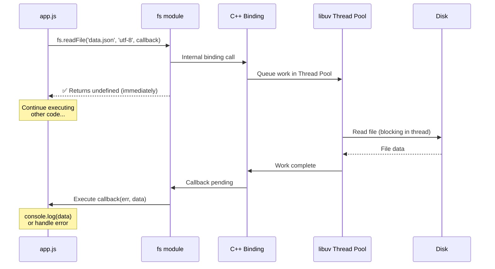

# Core Built-in Modules

## 📖 Introduction

Node.js ships with a rich set of **built-in modules** — also called **core modules** — that provide essential functionality without installing any external packages. These modules are compiled into Node.js and are available immediately:

```javascript
const fs = require('fs');         // File System
const path = require('path');     // File Paths
const http = require('http');     // HTTP Server/Client
const os = require('os');         // Operating System
const crypto = require('crypto'); // Cryptography
const util = require('util');     // Utilities
const events = require('events'); // Event Emitter
const stream = require('stream'); // Streams
const buffer = require('buffer'); // Binary Data
const process = require('process');// Process Info (global)

// Plus more: child_process, cluster, dns, net, dgram, readline, zlib, ...
```

> 💡 **Did You Know?** There are **40+ built-in modules** in Node.js. You can list them all: `require('module').builtinModules`

## 🤔 Why Do We Need This?

Built-in modules are the **standard library** of Node.js. They provide:

| Need | Built-in Module | Without It |
|------|----------------|------------|
| Read/write files | `fs` | Couldn't interact with the file system |
| Serve HTTP | `http` / `https` | No web server capability |
| Hash passwords | `crypto` | Must install `bcrypt` for basics |
| Get OS info | `os` | Platform-specific workarounds |
| Parse file paths | `path` | Manual string parsing (bug-prone) |

## ⚠️ Problem Statement

Before understanding core modules, developers often:

```javascript
// ❌ Manually parsing file paths (brittle!)
const fullPath = '/users/john/docs/../../file.txt';
const parts = fullPath.split('/');  // This is WRONG on Windows!

// ❌ Writing sync code when async is needed
const data = fs.readFileSync('large-file.txt'); // Blocks everything!

// ❌ Reinventing the wheel
// Writing your own crypto instead of using built-in crypto module
```

> **Core modules exist so you don't have to reinvent the wheel.** Every built-in module is battle-tested by millions of developers.

## 📚 Real World Story

**The npm package `is-odd` (3.3k downloads/week)**

A developer published a package to check if a number is odd:

```javascript
// is-odd package (11 lines, 3 dependencies!)
const isNumber = require('is-number');
module.exports = function isOdd(value) {
  const n = Math.abs(value);
  if (!isNumber(n)) throw new TypeError('expected a number');
  return !(n % 2 === 0);
};
```

This package depends on `is-number`, which has its own dependencies. **A total of 3 packages for something `n % 2 !== 0` does in one line.**

**Lesson:** Before reaching for npm, check if Node.js's built-in modules or plain JavaScript can do the job. The built-in `util.types` module can check types without any dependencies.

> *"The best code is the code you don't have to install."*

## 🍕 Real World Analogy

**A Toolbox vs Buying Tools Individually**

| Built-in Module | Toolbox Analogy |
|----------------|----------------|
| `fs` | Hammer and screwdriver (file operations) |
| `path` | Measuring tape (path manipulation) |
| `http` | Plumbing kit (network communication) |
| `os` | Thermometer and gauges (system info) |
| `crypto` | Lock and key set (security) |
| `events` | Doorbell (emit + listen) |

You wouldn't buy a separate brand-name tool for every job — your toolbox has what you need. Similarly, Node.js's built-in modules cover 80% of common tasks.

## 👁️ Visual Explanation

```
BUILT-IN MODULES OVERVIEW
═══════════════════════════

                         ┌──────────────────┐
                         │   PROCESS        │
                         │  (global)        │
                         │  argv, env, exit  │
                         └──────┬───────────┘
                                │
┌──────────┐   ┌──────────┐   ┌┴──────────┐   ┌──────────┐   ┌──────────┐
│   FS     │   │   PATH   │   │   HTTP    │   │   OS     │   │  CRYPTO  │
│          │   │          │   │           │   │          │   │          │
│ readFile │   │  join    │   │ createSrv │   │ platform │   │  hash    │
│ writeFile│   │ resolve  │   │   req     │   │   cpus   │   │  random  │
│  mkdir   │   │  parse   │   │   res     │   │   mem    │   │  cipher  │
│  readdir │   │ basename │   │   listen  │   │   homedir│   │  sign    │
└──────────┘   └──────────┘   └──────────┘   └──────────┘   └──────────┘
                                │
              ┌──────────┐   ┌─┴──────────┐   ┌──────────┐
              │  EVENTS  │   │   STREAM   │   │  UTIL    │
              │          │   │            │   │          │
              │   on     │   │ readable   │   │ promisify│
              │  emit    │   │ writable   │   │  types   │
              │  once    │   │ transform  │   │ inherits │
              │  remove  │   │ pipeline   │   │  format  │
              └──────────┘   └────────────┘   └──────────┘
```

## 📊 Mermaid Diagram 1: Core Modules by Category



## ⚙️ Internal Working: Module Loading Architecture



## 🏗️ Architecture: The fs Module (Synchronous vs Promise vs Callback)



## 👣 Step-by-Step Flow: Reading a File with fs



## 📝 Syntax: Most Common Built-in Module APIs

```javascript
// ─── FS (File System) ───────────────────────────────
const fs = require('fs');
const fsp = require('fs').promises;  // Promise-based

// Read
fs.readFile('file.txt', 'utf-8', (err, data) => {});
const data = await fsp.readFile('file.txt', 'utf-8');

// Write
fs.writeFile('file.txt', 'content', (err) => {});
await fsp.writeFile('file.txt', 'content');

// Directory
fs.mkdir('dir', { recursive: true }, (err) => {});
fs.readdir('dir', (err, files) => {});

// Info
fs.stat('file.txt', (err, stats) => {});  // size, mtime, isFile(), isDirectory()

// ─── PATH ───────────────────────────────────────────
const path = require('path');
path.join('users', 'john', 'docs');          // 'users/john/docs' (cross-platform)
path.resolve('src', '..', 'dist');           // '/abs/path/dist'
path.parse('/users/john/file.txt');
// { root: '/', dir: '/users/john', base: 'file.txt', ext: '.txt', name: 'file' }

// ─── HTTP ───────────────────────────────────────────
const http = require('http');
http.createServer((req, res) => {});
http.get('http://api.example.com', (res) => {});

// ─── OS ─────────────────────────────────────────────
const os = require('os');
os.platform();    // 'win32', 'darwin', 'linux'
os.cpus();        // Array of CPU info
os.freemem();     // Free RAM in bytes
os.homedir();     // User's home directory
os.hostname();    // Machine name

// ─── CRYPTO ─────────────────────────────────────────
const crypto = require('crypto');
crypto.createHash('sha256').update('data').digest('hex');
crypto.randomBytes(32);  // Secure random bytes
crypto.randomUUID();     // Generate UUID v4

// ─── UTIL ───────────────────────────────────────────
const util = require('util');
util.promisify(someCallbackFunction);  // Convert callback → promise
util.types.isDate(new Date());         // Type checking
util.inspect(obj);                     // Pretty-print objects
```

## 🟢 Basic Example: File System Operations

```javascript
const fs = require('fs');
const path = require('path');

// ─── CREATE A DIRECTORY ─────────────────────────────
const dataDir = path.join(__dirname, 'data');

// Create directory (recursive = creates parent dirs too)
fs.mkdir(dataDir, { recursive: true }, (err) => {
  if (err) {
    console.error('Failed to create directory:', err.message);
    return;
  }
  console.log('✅ Directory created:', dataDir);
  
  // ─── WRITE A FILE ───────────────────────────────
  const userData = JSON.stringify(
    { id: 1, name: 'Alice', email: 'alice@example.com' },
    null,
    2
  );
  
  const filePath = path.join(dataDir, 'user.json');
  
  fs.writeFile(filePath, userData, 'utf-8', (err) => {
    if (err) {
      console.error('Failed to write file:', err.message);
      return;
    }
    console.log('✅ File written:', filePath);
    
    // ─── READ THE FILE BACK ──────────────────────
    fs.readFile(filePath, 'utf-8', (err, data) => {
      if (err) {
        console.error('Failed to read file:', err.message);
        return;
      }
      
      const user = JSON.parse(data);
      console.log('📖 Read user:', user.name);
      console.log('📖 Email:', user.email);
    });
  });
});
```

> 🧠 **Memory Trick:** fs methods come in 3 flavors: **Sync** (blocking), **Callback** (async), **Promise** (modern). When in doubt, use Promise (`fs.promises`).

## 🟡 Intermediate Example: HTTP Server with Route Matching

```javascript
const http = require('http');
const url = require('url');
const fs = require('fs');
const path = require('path');

// ─── SIMPLE ROUTER ──────────────────────────────────
const routes = {
  'GET /': (req, res) => {
    res.writeHead(200, { 'Content-Type': 'text/html' });
    res.end('<h1>🏠 Home</h1><a href="/about">About</a>');
  },
  
  'GET /about': (req, res) => {
    res.writeHead(200, { 'Content-Type': 'text/html' });
    res.end('<h1>📖 About</h1><p>Learning Node.js built-in modules!</p>');
  },
  
  'GET /api/time': (req, res) => {
    const now = new Date();
    res.writeHead(200, { 'Content-Type': 'application/json' });
    res.end(JSON.stringify({
      iso: now.toISOString(),
      unix: now.getTime(),
      timezone: Intl.DateTimeFormat().resolvedOptions().timeZone,
    }));
  },
  
  'POST /api/echo': (req, res) => {
    let body = '';
    req.on('data', chunk => body += chunk);
    req.on('end', () => {
      res.writeHead(200, { 'Content-Type': 'application/json' });
      res.end(JSON.stringify({
        received: body,
        parsed: tryParseJSON(body),
        headers: req.headers,
      }));
    });
  },
};

function tryParseJSON(str) {
  try { return JSON.parse(str); }
  catch { return null; }
}

// ─── SERVER ─────────────────────────────────────────
const server = http.createServer((req, res) => {
  const routeKey = `${req.method} ${req.url}`;
  const handler = routes[routeKey];
  
  if (handler) {
    handler(req, res);
  } else {
    res.writeHead(404, { 'Content-Type': 'text/plain' });
    res.end('404 — Not Found');
  }
});

const PORT = 3000;
server.listen(PORT, () => {
  console.log(`🚀 Server: http://localhost:${PORT}`);
  console.log(`   Routes:`);
  Object.keys(routes).forEach(r => console.log(`   ${r}`));
});
```

## 🔴 Advanced Example: File Watcher with Event Emitter

```javascript
const fs = require('fs');
const path = require('path');
const { EventEmitter } = require('events');
const crypto = require('crypto');

// ─── FILE WATCHER WITH EVENT EMITTER ───────────────
class FileWatcher extends EventEmitter {
  constructor(directory, options = {}) {
    super();
    this.directory = path.resolve(directory);
    this.interval = options.interval || 1000;
    this.fileHashes = new Map();
    this.watchTimer = null;
    this.running = false;
  }
  
  async start() {
    if (this.running) return;
    this.running = true;
    
    console.log(`🔍 Watching: ${this.directory}`);
    
    // Initial scan
    await this.scan();
    
    // Periodic scan
    this.watchTimer = setInterval(() => this.scan(), this.interval);
    this.watchTimer.unref();  // Don't keep process alive
    
    this.emit('started', this.directory);
  }
  
  stop() {
    this.running = false;
    if (this.watchTimer) {
      clearInterval(this.watchTimer);
      this.watchTimer = null;
    }
    this.emit('stopped');
  }
  
  async scan() {
    try {
      const files = await fs.promises.readdir(this.directory);
      
      for (const file of files) {
        const filePath = path.join(this.directory, file);
        const stats = await fs.promises.stat(filePath);
        
        if (!stats.isFile()) continue;
        
        const hash = await this.hashFile(filePath);
        const previousHash = this.fileHashes.get(filePath);
        
        if (previousHash === undefined) {
          this.emit('file-added', { file, filePath, hash, stats });
        } else if (previousHash !== hash) {
          this.emit('file-changed', { file, filePath, hash, stats });
        }
        
        this.fileHashes.set(filePath, hash);
      }
      
      // Check for deleted files
      for (const [filePath] of this.fileHashes) {
        if (!files.includes(path.basename(filePath))) {
          this.emit('file-removed', { file: path.basename(filePath), filePath });
          this.fileHashes.delete(filePath);
        }
      }
    } catch (err) {
      this.emit('error', err);
    }
  }
  
  hashFile(filePath) {
    return new Promise((resolve, reject) => {
      const hash = crypto.createHash('md5');
      const stream = fs.createReadStream(filePath);
      
      stream.on('data', chunk => hash.update(chunk));
      stream.on('end', () => resolve(hash.digest('hex')));
      stream.on('error', reject);
    });
  }
}

// ─── USAGE ──────────────────────────────────────────
const watcher = new FileWatcher('./watch-dir', { interval: 2000 });

watcher.on('file-added', ({ file }) => console.log('➕ Added:', file));
watcher.on('file-changed', ({ file }) => console.log('✏️ Changed:', file));
watcher.on('file-removed', ({ file }) => console.log('➖ Removed:', file));
watcher.on('error', (err) => console.error('❌ Error:', err.message));

watcher.start();

// Stop after 30 seconds (for demo)
setTimeout(() => watcher.stop(), 30000);
```

## 🏭 Production Example: Config Loader with Validation

```javascript
const fs = require('fs');
const path = require('path');
const crypto = require('crypto');
const os = require('os');

// ─── PRODUCTION CONFIG LOADER ───────────────────────
class ConfigLoader {
  constructor(options = {}) {
    this.configDir = options.configDir || process.cwd();
    this.env = process.env.NODE_ENV || 'development';
    this.cache = new Map();
    this.cacheTTL = options.cacheTTL || 60000; // 1 minute
  }
  
  /**
   * Load config with environment-specific overrides
   * Priority: default < environment < local < environment variable
   */
  async load(name) {
    const cacheKey = `${name}:${this.env}`;
    
    // Check cache
    if (this.cache.has(cacheKey)) {
      const entry = this.cache.get(cacheKey);
      if (Date.now() - entry.timestamp < this.cacheTTL) {
        return entry.data;
      }
      this.cache.delete(cacheKey);
    }
    
    // Load config files in priority order
    const files = [
      path.join(this.configDir, `${name}.json`),
      path.join(this.configDir, `${name}.${this.env}.json`),
      path.join(this.configDir, `${name}.local.json`),
    ];
    
    let config = {};
    for (const file of files) {
      try {
        const fileConfig = JSON.parse(
          await fs.promises.readFile(file, 'utf-8')
        );
        config = { ...config, ...fileConfig };
        console.log(`📄 Loaded config: ${path.basename(file)}`);
      } catch (err) {
        if (err.code !== 'ENOENT') {
          console.warn(`⚠️  Error loading ${file}: ${err.message}`);
        }
      }
    }
    
    // Environment variable overrides (highest priority)
    const prefix = `${name.toUpperCase()}_`;
    for (const [key, value] of Object.entries(process.env)) {
      if (key.startsWith(prefix)) {
        const configKey = key.slice(prefix.length).toLowerCase();
        config[configKey] = tryParse(value);
      }
    }
    
    // Cache and return
    this.cache.set(cacheKey, { data: config, timestamp: Date.now() });
    return config;
  }
  
  /**
   * Generate a content hash for config integrity
   */
  getConfigHash(config) {
    return crypto
      .createHash('sha256')
      .update(JSON.stringify(config))
      .digest('hex');
  }
  
  /**
   * Get system metadata
   */
  getSystemInfo() {
    return {
      hostname: os.hostname(),
      platform: os.platform(),
      cpus: os.cpus().length,
      memory: os.totalmem(),
      nodeVersion: process.version,
      pid: process.pid,
      env: this.env,
    };
  }
}

function tryParse(value) {
  try { return JSON.parse(value); }
  catch { return value; }
}

// ─── USAGE ──────────────────────────────────────────
async function main() {
  const loader = new ConfigLoader();
  
  // Load database config
  const dbConfig = await loader.load('database');
  console.log('📊 DB Config:', dbConfig);
  
  // Load app config
  const appConfig = await loader.load('app');
  console.log('⚙️  App Config:', appConfig);
  
  // Log system info
  console.log('🖥️  System:', loader.getSystemInfo());
}

main().catch(console.error);
```

## ⚙️ How It Works Internally: fs Module Architecture

```
fs.readFile() in JavaScript
│
├─ 1. fs.js (JavaScript)
│     Validate arguments
│     Create a FSReqCallback object
│     Call internal binding: binding.readFile()
│
├─ 2. node_file.cc (C++ binding)
│     Convert JS call to C++ call
│     Create a uv_fs_t request
│     Call libuv: uv_fs_read()
│
├─ 3. libuv (C library)
│     If async → queue work in Thread Pool
│     Thread calls OS: read() syscall
│     Thread blocks on I/O (this is fine, it's a thread)
│     I/O completes → callback queued in Event Loop
│
└─ 4. Event Loop (C)
      Picks up completed callback
      Calls fs.js callback with data
```

## 📦 Performance Notes

| Module | Performance Consideration |
|--------|--------------------------|
| **fs** | Sync methods block the Event Loop. Use async for production. |
| **crypto** | CPU-intensive (especially scrypt, pbkdf2). Offload to Worker Threads for heavy use. |
| **zlib** | Compression is CPU-intensive. Use streams for large files. |
| **http** | Headers parsed as strings. Large headers can be a DoS vector. |
| **path** | All operations are sync and very fast (pure string manipulation). |
| **os** | Quick system calls, no async versions needed. |

> 📦 **Performance Note:** The `crypto` module uses libuv's thread pool. If you're doing many crypto operations (e.g., hashing passwords in a signup flow), increase `UV_THREADPOOL_SIZE` or use Worker Threads.

## 🔒 Security Notes

| Module | Risk | Mitigation |
|--------|------|------------|
| **fs** | Path traversal | Use `path.resolve()` and validate against an allowed directory |
| **crypto** | Weak algorithms | Use SHA-256+ for hashing, PBKDF2/scrypt/bcrypt for passwords |
| **http** | Slow loris attack | Set timeouts: `server.timeout = 30000` |
| **child_process** | Command injection | Never use `exec()` with user input. Use `execFile()` instead |
| **vm** | Sandbox escape | `vm` module is NOT a security sandbox. Use worker threads for isolation |

> 🔒 **Security Note:** The `vm` module is often mistaken for a sandbox. It's NOT secure — scripts can escape the V8 context. Use `worker_threads` with `workerData` for actual isolation.

## ⚠️ Common Mistakes

```javascript
// ❌ MISTAKE 1: Not checking for ENOENT (file not found)
const data = fs.readFileSync('config.json'); // ⛔ Crash if not found!
// ✅ FIX:
try {
  const data = fs.readFileSync('config.json', 'utf-8');
} catch (err) {
  if (err.code === 'ENOENT') {
    console.log('Config not found, using defaults');
  } else {
    throw err;
  }
}

// ❌ MISTAKE 2: Using path concatenation instead of path.join
const fullPath = __dirname + '/' + 'data/' + file;  // ❌ Breaks on Windows!
const fullPath = path.join(__dirname, 'data', file); // ✅ Cross-platform!

// ❌ MISTAKE 3: Forgetting encoding with readFile
fs.readFile('file.txt', (err, data) => {
  console.log(data); // <Buffer ...> — not a string!
});
// ✅ FIX:
fs.readFile('file.txt', 'utf-8', (err, data) => { ... });

// ❌ MISTAKE 4: Using sync fs in request handlers
app.get('/data', (req, res) => {
  const data = fs.readFileSync('data.json'); //⛔ Blocks ALL requests!
});

// ❌ MISTAKE 5: Creating a new hash for every password attempt
// Instead: use crypto.timingSafeEqual() to prevent timing attacks
```

## 🚀 Best Practices

| # | Practice | Why |
|---|----------|-----|
| 1 | **Use `fs.promises` for all new code** | Cleaner async/await, avoids callback nesting |
| 2 | **Always check `err.code` for ENOENT** | File-not-found is expected, not exceptional |
| 3 | **Use `path.join()` for all path construction** | Cross-platform (Windows vs POSIX) |
| 4 | **Never use `child_process.exec()` with user input** | Risk of command injection |
| 5 | **Set HTTP server timeouts** | Prevents hanging connections |
| 6 | **Use `crypto.timingSafeEqual()` for password comparison** | Prevents timing attacks |
| 7 | **Call `.unref()` on timers that shouldn't keep process alive** | Enables graceful shutdown |
| 8 | **Use `os.freemem()` and `process.memoryUsage()` for health checks** | Monitor memory pressure |

## 🎯 Interview Questions

**Q1: What's the difference between `fs.readFile` and `fs.createReadStream`?**
`fs.readFile` loads the entire file into memory (buffer). `fs.createReadStream` reads the file in chunks, streaming data as it arrives. Use streams for large files (>100MB).

**Q2: How do you prevent path traversal attacks in Node.js?**
Use `path.resolve()` and check that the resolved path starts with the allowed directory:
```javascript
const safePath = path.resolve(baseDir, userInput);
if (!safePath.startsWith(baseDir)) throw new Error('Invalid path');
```

**Q3: What is `process.nextTick()` and why should you be careful with it?**
It schedules a callback to run in the microtask queue, before the Event Loop continues. Overusing it can starve I/O operations. Use `setImmediate()` for deferring work to the next Event Loop iteration.

**Q4: How does Node.js handle errors in async callback-based code?**
The convention is "error-first callbacks": `callback(err, result)`. If err is truthy, handle it. If null/undefined, proceed with result. This is why the first parameter of every callback is always `err`.

## 📝 MCQs

**1. Which module would you use to get the number of CPU cores?**
- A) `fs`
- B) `os` ✅
- C) `process`
- D) `cpu`

**2. What does `path.join('users', '..', 'docs')` return?**
- A) `'users/../docs'`
- B) `'docs'` ✅
- C) `'users/docs'`
- D) Throws an error

**3. Which method safely compares values to prevent timing attacks?**
- A) `crypto.compare()`
- B) `crypto.timingSafeEqual()` ✅
- C) `crypto.constantCompare()`
- D) `Buffer.compare()`

**4. What is the correct way to read a file as a string in Node.js?**
- A) `fs.readFile('file.txt')`
- B) `fs.readFile('file.txt', 'utf-8', cb)` ✅
- C) `fs.readFile('file.txt', { encoding: 'ascii' }, cb)`
- D) `fs.readFileSync('file.txt').toString()`

**5. Which `process` method returns memory usage statistics?**
- A) `process.memory()`
- B) `process.memoryUsage()` ✅
- C) `process.usage()`
- D) `process.resourceUsage()`

## 💻 Coding Challenge 1: File Organizer Script

Write a script that organizes files in a directory by extension:

```javascript
// organizer.js
const fs = require('fs');
const path = require('path');

async function organize(directory) {
  // 1. Read all files in the directory
  // 2. Group by extension
  // 3. Create subdirectories for each extension
  // 4. Move files into the appropriate subdirectory
}

organize('./downloads').then(() => console.log('✅ Organized!'));
```

**Expected output:**
```
downloads/
├── pdf/
│   ├── report.pdf
│   └── invoice.pdf
├── jpg/
│   ├── photo1.jpg
│   └── photo2.jpg
└── js/
    └── script.js
```

## 💻 Coding Challenge 2: HTTP Health Check Server

Create an HTTP server with a `/health` endpoint that returns:
- Server status (up/down)
- Uptime in seconds
- Memory usage (heap used / heap total)
- CPU load average
- Active connections

```javascript
// health-server.js
const http = require('http');
const os = require('os');

// Hint: process.uptime(), process.memoryUsage(), os.loadavg()
```

## 💻 Coding Challenge 3: Secure Password Hasher

Create a utility that hashes and verifies passwords using crypto:

```javascript
// password.js
const crypto = require('crypto');

function hashPassword(password) {
  // 1. Generate a random salt (16 bytes)
  // 2. Use pbkdf2 with 100,000 iterations
  // 3. Return: salt:hash (hex)
}

function verifyPassword(password, stored) {
  // 1. Parse salt and hash from stored string
  // 2. Hash the input with the same salt
  // 3. Use timingSafeEqual to compare
}
```

## 🧪 Mini Exercise: Debugging Built-in Module Usage

```javascript
// ─── BUGGY CODE ───
const fs = require('fs');
const path = require('path');

const directory = './data';
const user = { name: 'Alice', age: 30 };

// Bug 1: Directory might not exist
fs.writeFileSync(
  path.join(directory, 'user.json'), 
  user  // Bug 2: Can't write object directly
);

const data = fs.readFileSync(path.join(directory, 'user.json'));
console.log('Name:', data.name);  // Bug 3: data is a Buffer, not parsed
```

**Find and fix all 3 bugs.**

## 🌍 Real World Problem

**Problem:** Your Node.js application processes CSV files uploaded by users. Each file can be up to 500MB. Currently, you use `fs.readFile()` which causes the server to run out of memory with large files.

**Questions:**
1. Why does `fs.readFile()` crash on 500MB files?
2. What alternative approach should you use?
3. How would you process the CSV line-by-line without loading the entire file?
4. What built-in modules would you use?

## 🏗️ Mini Project: File System Explorer CLI

Build a CLI tool that explores and displays the file system:

```javascript
#!/usr/bin/env node
// explore.js
const fs = require('fs');
const path = require('path');

const [directory = '.'] = process.argv.slice(2);

async function explore(dir, depth = 0) {
  const entries = await fs.promises.readdir(dir, { withFileTypes: true });
  
  for (const entry of entries) {
    const fullPath = path.join(dir, entry.name);
    const indent = '│  '.repeat(depth);
    const prefix = entry.isDirectory() ? '📁' : '📄';
    
    if (entry.isDirectory()) {
      console.log(`${indent}${prefix} ${entry.name}/`);
      await explore(fullPath, depth + 1);
    } else {
      const stats = await fs.promises.stat(fullPath);
      const size = formatBytes(stats.size);
      console.log(`${indent}${prefix} ${entry.name} (${size})`);
    }
  }
}

function formatBytes(bytes) {
  const units = ['B', 'KB', 'MB', 'GB'];
  let size = bytes;
  let unitIndex = 0;
  while (size >= 1024 && unitIndex < units.length - 1) {
    size /= 1024;
    unitIndex++;
  }
  return `${size.toFixed(1)} ${units[unitIndex]}`;
}

explore(path.resolve(directory)).catch(console.error);
```

```bash
# Usage
node explore.js .
# 📁 src/
# │  📄 app.js (2.3 KB)
# │  📄 server.js (1.1 KB)
# │  📁 routes/
# │  │  📄 users.js (3.7 KB)
# │  │  📄 products.js (2.1 KB)
# 📁 node_modules/
# 📄 package.json (456 B)
```

## 📖 Summary

| Module | Purpose | Key Methods |
|--------|---------|-------------|
| `fs` | File System | `readFile`, `writeFile`, `mkdir`, `readdir`, `stat` |
| `path` | File Paths | `join`, `resolve`, `parse`, `basename`, `extname` |
| `http` | HTTP | `createServer`, `request`, `get` |
| `os` | OS Info | `platform`, `cpus`, `freemem`, `homedir`, `hostname` |
| `crypto` | Cryptography | `createHash`, `randomBytes`, `pbkdf2`, `timingSafeEqual` |
| `util` | Utilities | `promisify`, `types`, `inspect` |
| `events` | Event Emitter | `EventEmitter`, `on`, `emit`, `once` |
| `process` | Process (global) | `env`, `argv`, `exit`, `memoryUsage`, `cwd`, `nextTick` |

## 📋 Cheat Sheet

```javascript
// ─── FS ─────────────────────────────────────────────
fs.readFileSync('f', 'utf-8');                          // Blocking
const data = await fs.promises.readFile('f', 'utf-8');   // Async
fs.createReadStream('f');                                // Streaming
fs.watch('f', (event, filename) => {});                  // File watcher

// ─── PATH ────────────────────────────────────────────
path.join('a', 'b', 'c');            // 'a/b/c' (cross-platform)
path.resolve('dist');                // '/abs/path/dist'
path.parse('/a/b.txt');              // { dir, base, name, ext, root }

// ─── HTTP ────────────────────────────────────────────
http.createServer((req, res) => {
  res.writeHead(200, { 'Content-Type': 'text/plain' });
  res.end('OK');
}).listen(3000);

// ─── CRYPTO ──────────────────────────────────────────
crypto.createHash('sha256').update('data').digest('hex');
crypto.randomBytes(32).toString('hex');
crypto.randomUUID();
crypto.timingSafeEqual(Buffer.from('a'), Buffer.from('a'));

// ─── OS ──────────────────────────────────────────────
os.cpus().length;           // CPU core count
os.freemem();               // Free memory in bytes
os.totalmem();              // Total memory

// ─── UTIL ────────────────────────────────────────────
const readFile = util.promisify(fs.readFile);
```

## 📚 Further Reading

- [Node.js File System Docs](https://nodejs.org/api/fs.html)
- [Node.js Path Docs](https://nodejs.org/api/path.html)
- [Node.js HTTP Docs](https://nodejs.org/api/http.html)
- [Node.js Crypto Docs](https://nodejs.org/api/crypto.html)
- [Node.js OS Docs](https://nodejs.org/api/os.html)
- [Node.js Process Docs](https://nodejs.org/api/process.html)

## 🔗 Related Topics

| Topic | Link |
|-------|------|
| Modules: CommonJS vs ESM | [Previous](/DSA-Notes-Problems/nodejs/fundamentals/modules-commonjs-vs-esm) |
| Installation & Setup | [Next: Setup Guide](/DSA-Notes-Problems/nodejs/fundamentals/installation-and-setup) |
| Event Emitter Deep Dive | [Event Emitter](/DSA-Notes-Problems/nodejs/core/event-emitter) |
| Streams & Buffers | [Streams](/DSA-Notes-Problems/nodejs/core/streams-and-buffers) |
| Error Handling | [Error Handling](/DSA-Notes-Problems/nodejs/core/error-handling) |
