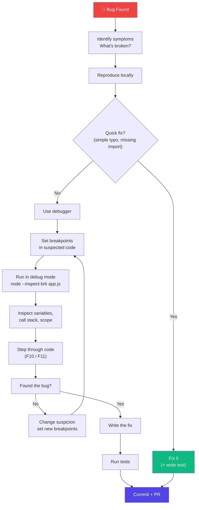
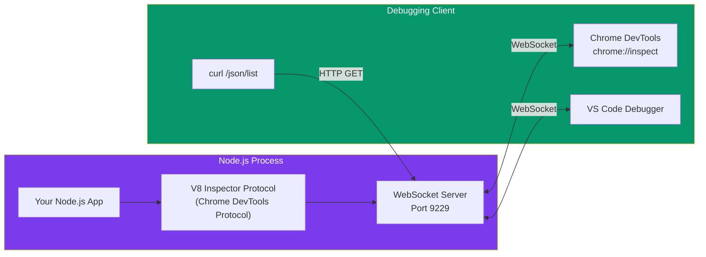
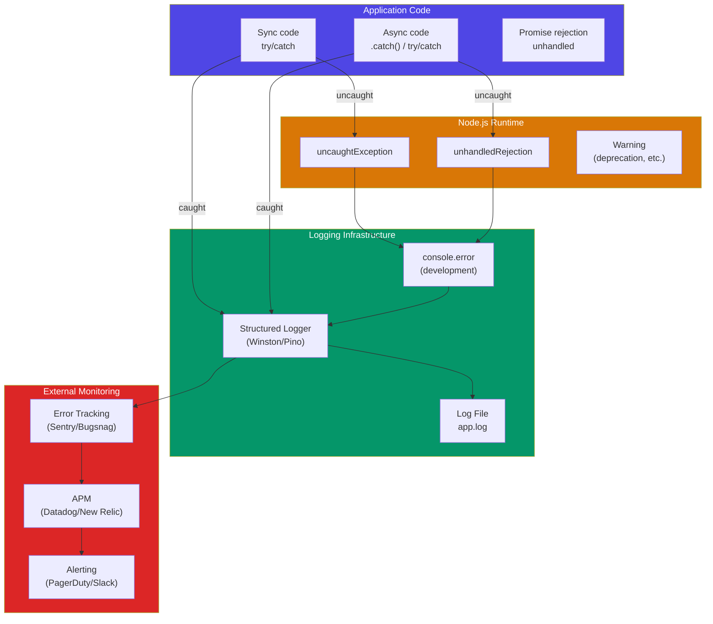
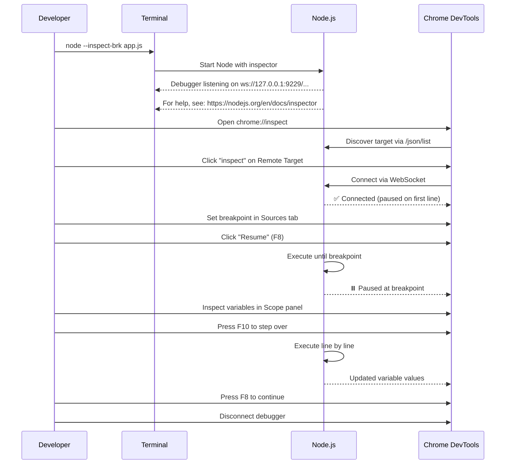

# Debugging Node.js Applications

## 📖 Introduction

Debugging is the skill that separates junior from senior engineers. Node.js provides several debugging approaches: from simple `console.log` to Chrome DevTools integration, VS Code debugger, and production-grade error monitoring.

## 🤔 Why Do We Need This?

Bugs happen. The question is how efficiently you find and fix them:

| Approach | Time to Find Bug | Confidence in Fix |
|----------|-----------------|-------------------|
| Random `console.log` everywhere | Hours | Low |
| `console.log` with data inspection | ~30 min | Medium |
| Breakpoint debugger | ~5 min | High |
| Logging + metrics + tracing | Seconds (production) | Very High |

> **Professionals use a professional debugger.** `console.log` is the training wheels.

## ⚠️ Problem Statement

Debugging Node.js is harder than debugging browser JavaScript:

```
Browser JS:
  window → DevTools (F12) → Console + Sources + Network → EASY

Node.js:
  Terminal → ??? → ??? → ???

Common struggles:
  - "I don't know where the error is"
  - "I can't inspect variables at runtime"
  - "The error stack trace points to node_modules"
  - "It works on my machine but not in production"
```

## 📚 Real World Story

**The Silent Crash That Cost $300K**

A startup's Node.js payment service would crash randomly at 2 AM. The error was never caught:
```javascript
app.post('/charge', async (req, res) => {
  const result = await stripe.charges.create(req.body);
  // ⛔ If this throws, there's no error handler!
  // The process crashes. Users lose their orders.
});
```

They had no error logging, no monitoring, no unhandledRejection handler. After weeks of intermittent failures and lost revenue, they added:
- Global error handlers
- Structured logging with Winston
- Error tracking with Sentry
- Health check endpoints

The problem was fixed in **one day** with proper debugging infrastructure.

> *"Without logs, the server is a black box."*

## 🍕 Real World Analogy

| Debugging Method | Analogy |
|-----------------|---------|
| `console.log` | Checking if milk is fresh by sniffing the carton |
| Breakpoint debugger | Security camera that pauses and zooms in |
| Structured logging | A flight recorder (black box) |
| Error monitoring | A smoke alarm that calls your phone |
| Distributed tracing | GPS tracking every step of a package |

## 👁️ Visual Explanation

```
DEBUGGING TOOL PYRAMID
════════════════════════

                    ╱╲
                   ╱  ╲
                  ╱ APM ╲          ← Production: Datadog, New Relic
                 ╱────────╲
                ╱  Error   ╲       ← Production: Sentry, Bugsnag
               ╱  Tracking  ╲
              ╱──────────────╲
             ╱   Structured  ╲    ← Production: Winston, Pino
            ╱     Logging     ╲
           ╱────────────────────╲
          ╱   Chrome DevTools    ╲  ← Staging: --inspect
         ╱   Remote Debugging    ╲
        ╱──────────────────────────╲
       ╱      VS Code Debugger      ╲  ← Development: F5
      ╱──────────────────────────────╲
     ╱       console.log/error       ╲  ← Quick prototyping
    ╱──────────────────────────────────╲
```

## 📊 Mermaid Diagram 1: Debugging Workflow



## ⚙️ Internal Working: The --inspect Flag



When you run `node --inspect app.js`:
1. Node.js opens a WebSocket server on port 9229
2. The V8 Inspector Protocol is exposed over WebSocket
3. Chrome DevTools or VS Code connects to this WebSocket
4. You can set breakpoints, inspect variables, step through code

## 🏗️ Architecture: Error Handling Flow



## 👣 Step-by-Step Flow: Debugging with Chrome DevTools



## 📝 Syntax: Debugging Commands

```bash
# ─── RUN WITH DEBUGGER ──────────────────────────────
node --inspect app.js           # Start with inspector (doesn't pause)
node --inspect-brk app.js       # Start and PAUSE on first line
node --inspect=0.0.0.0:9229 app.js  # Allow remote connections

# ─── AUTO-RESTART MODE ──────────────────────────────
node --watch app.js             # Restart on file changes (Node 18+)
node --watch --inspect app.js   # Debug + auto-restart

# ─── BREAK ON EXCEPTION ─────────────────────────────
node --inspect --experimental-loader ./debug.js app.js

# ─── NODE OPTIONS ───────────────────────────────────
NODE_OPTIONS="--inspect" node app.js  # Useful in Docker
NODE_OPTIONS="--max-old-space-size=4096" node app.js  # Increase memory

# ─── STACK TRACE ────────────────────────────────────
node --stack-trace-limit=100 app.js  # Show more stack frames
```

```javascript
// ─── BUILT-IN DEBUG CONSOLE ───────────────────────
console.log('Simple log');              // Basic output
console.error('Error message');         // stderr (red)
console.warn('Warning');                // stderr (yellow)
console.table([{a: 1}, {a: 2}]);       // Tabular data
console.dir(obj, { depth: null });     // Deep inspect
console.time('label');                  // Start timer
console.timeEnd('label');              // End timer + duration
console.trace('Trace here');           // Print stack trace
console.assert(condition, 'msg');       // Conditional error
```

> 💡 **Did You Know?** `console.time()` and `console.timeEnd()` are the simplest way to measure performance without external tools.

## 🟢 Basic Example: Using console Methods

```javascript
// ─── CONSOLE.TABLE ──────────────────────────────────
const users = [
  { id: 1, name: 'Alice', role: 'admin' },
  { id: 2, name: 'Bob', role: 'user' },
  { id: 3, name: 'Charlie', role: 'moderator' },
];

console.table(users, ['id', 'name']);  // Show only id and name columns

// Output:
// ┌─────────┬─────┬───────────┐
// │ (index) │ id  │   name    │
// ├─────────┼─────┼───────────┤
// │    0    │  1  │ 'Alice'   │
// │    1    │  2  │ 'Bob'     │
// │    2    │  3  │ 'Charlie' │
// └─────────┴─────┴───────────┘

// ─── CONSOLE.TIME ───────────────────────────────────
console.time('DB query');
// Simulate database query
setTimeout(() => {
  console.timeEnd('DB query');  // "DB query: 100ms"
}, 100);

// ─── CONSOLE.TRACE ──────────────────────────────────
function getUser(id) {
  if (!id) {
    console.trace('getUser called without id!');
    return null;
  }
  return { id, name: 'Alice' };
}

getUser();  // Shows stack trace: where was this called from?
```

## 🟡 Intermediate Example: VS Code Debugger Configuration

```json
// .vscode/launch.json
{
  "version": "0.2.0",
  "configurations": [
    {
      "name": "Debug Server",
      "type": "node",
      "request": "launch",
      "program": "${workspaceFolder}/src/server.js",
      "runtimeArgs": ["--watch"],
      "env": {
        "NODE_ENV": "development",
        "PORT": "3000",
        "DEBUG": "app:*"
      },
      "envFile": "${workspaceFolder}/.env",
      "skipFiles": [
        "<node_internals>/**",
        "${workspaceFolder}/node_modules/**"
      ],
      "resolveSourceMapLocations": [
        "${workspaceFolder}/**",
        "!**/node_modules/**"
      ],
      "console": "integratedTerminal",
      "internalConsoleOptions": "neverOpen"
    },
    {
      "name": "Debug Tests",
      "type": "node",
      "request": "launch",
      "program": "${workspaceFolder}/node_modules/.bin/jest",
      "args": ["--runInBand", "--no-cache"],
      "env": { "NODE_ENV": "test" },
      "skipFiles": ["<node_internals>/**"],
      "console": "integratedTerminal"
    },
    {
      "name": "Attach to Process",
      "type": "node",
      "request": "attach",
      "port": 9229,
      "restart": true,
      "localRoot": "${workspaceFolder}",
      "remoteRoot": "/app"
    }
  ]
}
```

```javascript
// src/server.js — Example with debugger statement
const http = require('http');
const logger = require('./utils/logger');

const server = http.createServer((req, res) => {
  // Press F5 in VS Code to start debugging
  // This will pause execution here
  debugger;  // Programmatic breakpoint
  
  logger.info(`Request: ${req.method} ${req.url}`);
  
  if (req.url === '/debug') {
    // The debugger is useful here to inspect req object
    // Check: req.headers, req.method, req.url
    res.writeHead(200, { 'Content-Type': 'application/json' });
    res.end(JSON.stringify({ debug: true, headers: req.headers }));
  } else {
    res.writeHead(200);
    res.end('OK');
  }
});

server.listen(3000);
```

## 🔴 Advanced Example: Structured Logging with Pino

```javascript
// logger.js — Production-grade structured logging
const pino = require('pino');
const os = require('os');
const { randomUUID } = require('crypto');

// Create a child logger that adds context to every log
const logger = pino({
  level: process.env.LOG_LEVEL || 'info',
  
  // Pretty print in development, JSON in production
  transport: process.env.NODE_ENV !== 'production'
    ? { target: 'pino-pretty', options: { colorize: true } }
    : undefined,
  
  // Base fields added to every log entry
  base: {
    pid: process.pid,
    hostname: os.hostname(),
    service: process.env.SERVICE_NAME || 'my-app',
  },
  
  // Redact sensitive fields
  redact: {
    paths: ['req.headers.authorization', 'req.body.password', 'req.body.ssn'],
    censor: '[REDACTED]',
  },
  
  // Safe serializers for objects
  serializers: {
    req: pino.stdSerializers.req,
    res: pino.stdSerializers.res,
    err: pino.stdSerializers.err,
  },
});

// ─── USAGE ──────────────────────────────────────────
// Basic logging
logger.info('Server starting');
logger.warn('Deprecated API called: /v1/users');
logger.error({ err: new Error('DB connection failed') }, 'Database error');

// Structured logging (add context objects)
logger.info({ 
  userId: 123, 
  action: 'purchase',
  amount: 49.99,
  currency: 'USD',
}, 'Purchase completed');

// Child loggers with persistent context
const requestLogger = logger.child({
  requestId: randomUUID(),
  endpoint: '/api/users',
});

requestLogger.info('Processing request');
// Output includes: requestId and endpoint in every log
```

```javascript
// middleware/request-logger.js — HTTP request logging middleware
function requestLogger(req, res, next) {
  const start = Date.now();
  
  // Generate unique request ID
  req.id = req.headers['x-request-id'] || randomUUID();
  req.log = logger.child({ requestId: req.id });
  
  req.log.info({ 
    method: req.method, 
    url: req.url,
    ip: req.ip,
    userAgent: req.headers['user-agent'],
  }, 'Incoming request');
  
  // Log response when finished
  res.on('finish', () => {
    const duration = Date.now() - start;
    
    const logLevel = res.statusCode >= 500 ? 'error' 
      : res.statusCode >= 400 ? 'warn' 
      : 'info';
    
    req.log[logLevel]({
      statusCode: res.statusCode,
      duration: `${duration}ms`,
      contentLength: res.getHeader('content-length'),
    }, 'Request completed');
  });
  
  next();
}
```

## 🏭 Production Example: Global Error Handler with Monitoring

```javascript
// ─── PRODUCTION ERROR HANDLING ──────────────────────
const pino = require('pino');
const Sentry = require('@sentry/node');

// Initialize Sentry
Sentry.init({
  dsn: process.env.SENTRY_DSN,
  environment: process.env.NODE_ENV,
  tracesSampleRate: 0.1,  // Sample 10% of requests
});

const logger = pino();

// ─── 1. GLOBAL UNHANDLED REJECTIONS ───────────────
process.on('unhandledRejection', (reason, promise) => {
  logger.error({ 
    err: reason instanceof Error ? reason : new Error(String(reason)),
    promise,
  }, 'UNHANDLED PROMISE REJECTION');
  
  // Send to Sentry
  Sentry.captureException(reason, {
    extra: { type: 'unhandledRejection' },
  });
  
  // In Node 15+, the process WILL crash
  // Gracefully shut down
  shutdown('unhandledRejection');
});

// ─── 2. GLOBAL UNCAUGHT EXCEPTIONS ─────────────────
process.on('uncaughtException', (err) => {
  logger.error({ err }, 'UNCAUGHT EXCEPTION');
  
  Sentry.captureException(err, {
    extra: { type: 'uncaughtException' },
  });
  
  // uncaughtException means the app is in an unstable state
  // Always shutdown after logging!
  shutdown('uncaughtException');
});

// ─── 3. GRACEFUL SHUTDOWN ──────────────────────────
function shutdown(signal) {
  logger.info({ signal }, 'Initiating graceful shutdown');
  
  // Give pending requests 10 seconds to complete
  server.close(() => {
    logger.info('HTTP server closed');
    
    // Close database connections
    db.end(() => {
      Sentry.flush(2000).then(() => {
        process.exit(1);  // Exit with error code
      });
    });
  });
  
  // Force exit after timeout
  setTimeout(() => {
    logger.error('Forced shutdown after timeout');
    process.exit(1);
  }, 10000);
}

// ─── 4. EXPRESS ERROR MIDDLEWARE ───────────────────
app.use((err, req, res, next) => {
  // Log the error
  logger.error({
    err,
    requestId: req.id,
    method: req.method,
    url: req.url,
  }, 'Request error');
  
  // Send to Sentry with context
  Sentry.withScope((scope) => {
    scope.setUser({ id: req.user?.id });
    scope.setExtra('requestId', req.id);
    scope.setTag('endpoint', req.url);
    Sentry.captureException(err);
  });
  
  // Don't leak error details to client
  res.status(err.statusCode || 500).json({
    error: process.env.NODE_ENV === 'production'
      ? 'Internal Server Error'
      : err.message,
    requestId: req.id,  // Useful for correlating logs
  });
});
```

## ⚙️ How It Works Internally: The Debugger Protocol

When `node --inspect` starts:
1. Node.js starts a TCP server on port 9229
2. It implements the **Chrome DevTools Protocol (CDP)** over WebSocket
3. The inspector can pause execution, evaluate expressions, set breakpoints
4. The debugger uses V8's built-in debugging API (not Node.js specific)

```
CDP Commands (examples):
{"id":1,"method":"Debugger.enable"}
{"id":2,"method":"Debugger.setBreakpointByUrl","params":{"lineNumber":42,"url":"file:///app/server.js"}}
{"id":3,"method":"Runtime.evaluate","params":{"expression":"JSON.stringify(req.headers)"}}
```

## 📦 Performance Notes

| Debugging Method | Performance Impact | When to Use |
|-----------------|-------------------|-------------|
| `console.log` | Low (but adds noise) | Development quick checks |
| `--inspect` | Moderate (pauses execution) | Step-by-step debugging |
| `debugger;` statement | None (unless debugger attached) | Conditional breakpoints |
| Structured logging (Pino) | ~10μs per log | Production (very fast) |
| Winston | ~100μs per log | Production (slower but richer) |
| Sentry/Bugsnag | ~50ms per error | Production (async, non-blocking) |

> 📦 **Performance Note:** Pino claims to be 5x faster than Winston because it produces JSON directly without intermediate objects. For high-throughput apps, Pino is the standard.

## 🔒 Security Notes

| Practice | Why |
|----------|-----|
| **Never leave `--inspect` in production** | Remote code execution via debugger |
| **Don't log sensitive data** | Passwords, tokens, SSNs should be redacted |
| **Use `redact` in logger config** | Pino/Winston support automatic redaction |
| **Limit stack traces in production** | Don't leak internal paths to users |
| **Set `NODE_ENV=production`** | Disables debug output, suppresses warnings |

> 🔒 **Security Note:** In production, never expose the inspector port. If you must debug a production issue, use `node --inspect=127.0.0.1:9229` to bind only to localhost, and SSH tunnel to access it.

## ⚠️ Common Mistakes

```javascript
// ❌ MISTAKE 1: Logging sensitive data
console.log('User:', user);  // ⛔ Might log password, SSN!
logger.info({ user });       // ⛔ Without redact config

// ✅ Use redact in production logger
const logger = pino({ redact: ['user.password', 'user.ssn'] });

// ❌ MISTAKE 2: Not handling promise rejections
app.post('/pay', async (req, res) => {
  const result = await processPayment(req.body);  // ⛔ If throws, crashes!
  res.json(result);
});

// ✅ Always add .catch() for async handlers
app.post('/pay', async (req, res, next) => {
  try {
    const result = await processPayment(req.body);
    res.json(result);
  } catch (err) {
    next(err);  // Pass to Express error handler
  }
});

// ❌ MISTAKE 3: Leaving debugger statements in production
app.get('/data', (req, res) => {
  debugger;  // ⛔ Will pause if inspector is connected!
  res.json(data);
});

// ✅ Use conditional debugger
if (process.env.DEBUG_MODE) debugger;

// ❌ MISTAKE 4: console.log instead of structured logging
console.log('User logged in:', userId);  // Hard to search in logs
logger.info({ userId, event: 'login' }, 'User logged in');  // Searchable
```

## 🚀 Best Practices

| # | Practice | Why |
|---|----------|-----|
| 1 | **Use `--inspect-brk` for debugging** | Pauses on first line for setup |
| 2 | **Always handle unhandledRejection** | Node 15+ crashes on unhandled rejections |
| 3 | **Use structured logging in production** | JSON logs are searchable in log aggregators |
| 4 | **Add request IDs to every log** | Correlate logs across microservices |
| 5 | **Set up error monitoring on day 1** | Sentry/Bugsnag catch what you miss |
| 6 | **Log at appropriate levels** | trace → debug → info → warn → error → fatal |
| 7 | **Never log secrets** | Use redact or env-specific logging |
| 8 | **Include context in log messages** | What, where, when, who |

## 🎯 Interview Questions

**Q1: How do you debug a Node.js application in production?**
I'd use structured logging (Pino/Winston) with a log aggregator, error tracking (Sentry/Bugsnag), and APM tools (Datadog/New Relic). For specific issues, I'd SSH tunnel to the inspector port or add targeted logs with a feature flag.

**Q2: What's the difference between `uncaughtException` and `unhandledRejection`?**
`uncaughtException` catches synchronous errors that weren't caught by try/catch. `unhandledRejection` catches Promise rejections without a .catch(). Both should be logged and trigger graceful shutdown.

**Q3: How do you trace a request across multiple microservices?**
Use a correlation ID (request ID) generated at the API gateway, passed via HTTP headers, and included in every log entry. Tools like OpenTelemetry provide distributed tracing.

## 📝 MCQs

**1. Which command starts Node.js with the debugger paused on the first line?**
- A) `node --inspect app.js`
- B) `node --inspect-brk app.js` ✅
- C) `node --debug app.js`
- D) `node --debug-brk app.js`

**2. What port does the Node.js inspector listen on by default?**
- A) 3000
- B) 8080
- C) 9229 ✅
- D) 5858

**3. Which method prints a stack trace to the console?**
- A) `console.stack()`
- B) `console.trace()` ✅
- C) `console.debug()`
- D) `console.error()`

**4. What should you do when an `uncaughtException` occurs?**
- A) Log it and continue running
- B) Log it, cleanup, and exit ✅
- C) Ignore it (Node handles it)
- D) Restart the process

**5. Which logging library is known for being the fastest (lowest overhead)?**
- A) Winston
- B) Pino ✅
- C) Morgan
- D) Bunyan

## 💻 Coding Challenge 1: Request Logger Middleware

Create a middleware that logs every HTTP request with: method, url, duration, status code, and a unique request ID.

## 💻 Coding Challenge 2: Error Monitoring Client

Simulate an error monitoring client that catches errors, sends them to a remote server, and shows a notification.

## 💻 Coding Challenge 3: Debugging a Memory Leak

```javascript
// memory-leak.js — Find the leak!
const http = require('http');

const cache = {};

const server = http.createServer((req, res) => {
  const id = Date.now();
  
  // This data is NEVER cleaned up
  cache[id] = new Array(1000000).fill('data');
  
  res.end('OK');
});

server.listen(3000);
```

**Hint:** The `cache` object grows indefinitely. Use Chrome DevTools Memory tab to find it.

## 🧪 Mini Exercise: Debugging

```javascript
// buggy-server.js
const http = require('http');
const server = http.createServer((req, res) => {
  // Bug 1: No error handling for JSON.parse
  const data = JSON.parse(req.body || '{}');
  
  // Bug 2: req.body is never parsed
  res.end(data.name.toUpperCase());  // Bug 3: data.name might be undefined!
});

// Bug 4: No port specified
server.listen();

// Bug 5: No error handler for uncaught exceptions
// Bug 6: No error handler for unhandled rejections
```

**Fix all 6 bugs using proper debugging techniques.**

## 🌍 Real World Problem (Interview Coding Challenge)

**Problem:** Your Node.js microservice crashes randomly at 3 AM. There are no logs, no monitoring, and no error handlers. Users report "500 Internal Server Error" but you can't reproduce it.

**Questions:**
1. What debugging infrastructure would you add IMMEDIATELY?
2. How would you capture the error before the process crashes?
3. How would you trace the specific request that caused the crash?
4. How would you prevent this from happening again?
5. What's your plan to monitor this in the future?

## 🏗️ Mini Project: Debug Dashboard

Build a simple web dashboard that displays:
- Live log stream (WebSocket push)
- Error counts by type
- Request rate (RPS)
- Memory usage over time
- Recent error stack traces

## 📖 Summary

| Tool | Use Case | Command/Setup |
|------|----------|--------------|
| console.log/table/time | Quick debugging | Built-in |
| Chrome DevTools | Full debugging | `node --inspect-brk` + chrome://inspect |
| VS Code Debugger | Integrated debugging | `launch.json` + F5 |
| Pino | Production logging | `npm install pino` |
| Sentry | Error tracking | `npm install @sentry/node` |
| requestId | Request tracing | UUID in middleware |
| unhandledRejection handler | Catch promise errors | `process.on('unhandledRejection', ...)` |

## 📋 Cheat Sheet

```bash
# ─── DEBUG START ────────────────────────────────────
node --inspect-brk app.js    # Debug + pause on first line
node --inspect app.js        # Debug without pause
chrome://inspect             # Open in Chrome

# ─── VS CODE LAUNCH.JSON ────────────────────────────
# Use "node" type, set program, envFile

# ─── CONSOLE ────────────────────────────────────────
console.log()       # stdout
console.error()     # stderr
console.table()     # Tabular data
console.time() / .timeEnd()  # Duration
console.trace()     # Stack trace

# ─── PROCESS EVENTS ─────────────────────────────────
process.on('uncaughtException', handler)   # Sync errors
process.on('unhandledRejection', handler)  # Promise errors
process.on('warning', handler)             # Deprecations
process.on('SIGTERM', handler)             # Graceful shutdown

# ─── LOG LEVELS (Pino/Winston) ──────────────────────
# fatal > error > warn > info > debug > trace
```

## 📚 Further Reading

- [Node.js Debugging Guide](https://nodejs.org/en/learn/getting-started/debugging)
- [Chrome DevTools Protocol](https://chromedevtools.github.io/devtools-protocol/)
- [Pino Logger Documentation](https://getpino.io/)
- [Sentry Node.js Docs](https://docs.sentry.io/platforms/node/)
- [Node.js Error Handling Best Practices](https://www.joyent.com/node-js/production/design/errors)

## 🔗 Related Topics

| Topic | Link |
|-------|------|
| Node.js with TypeScript | [Next](/DSA-Notes-Problems/nodejs/fundamentals/nodejs-with-typescript) |
| Installation & Setup | [Previous](/DSA-Notes-Problems/nodejs/fundamentals/installation-and-setup) |
| Error Handling in Node.js | [Error Handling](/DSA-Notes-Problems/nodejs/core/error-handling) |
| Testing Node.js Apps | [Testing](/DSA-Notes-Problems/nodejs/production/testing) |
| Production Architecture | [Production](/DSA-Notes-Problems/nodejs/production/production-architecture) |
