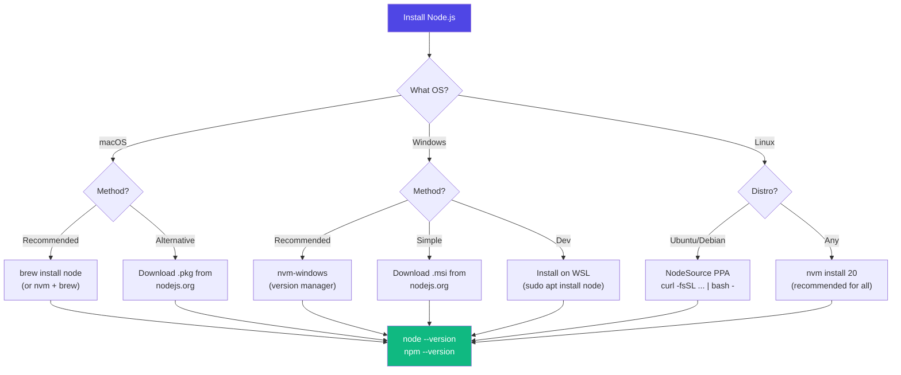
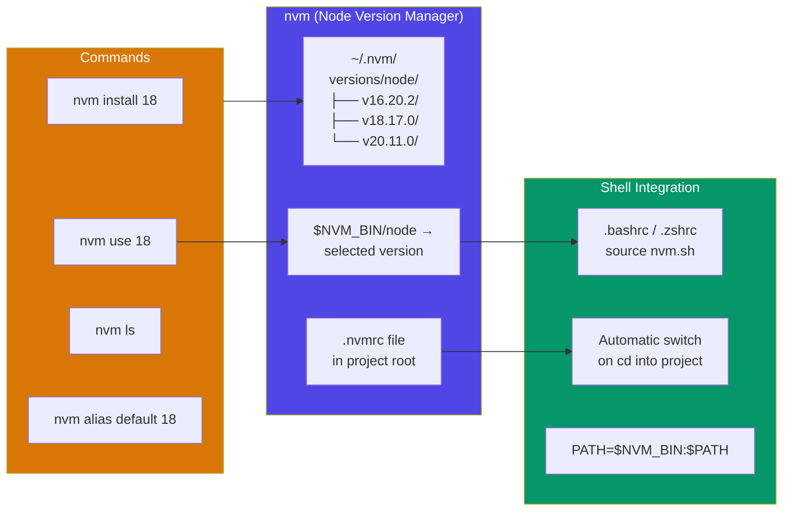
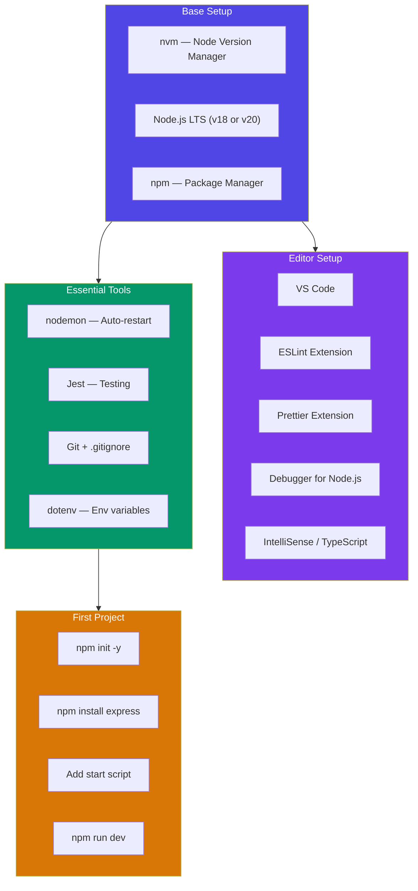
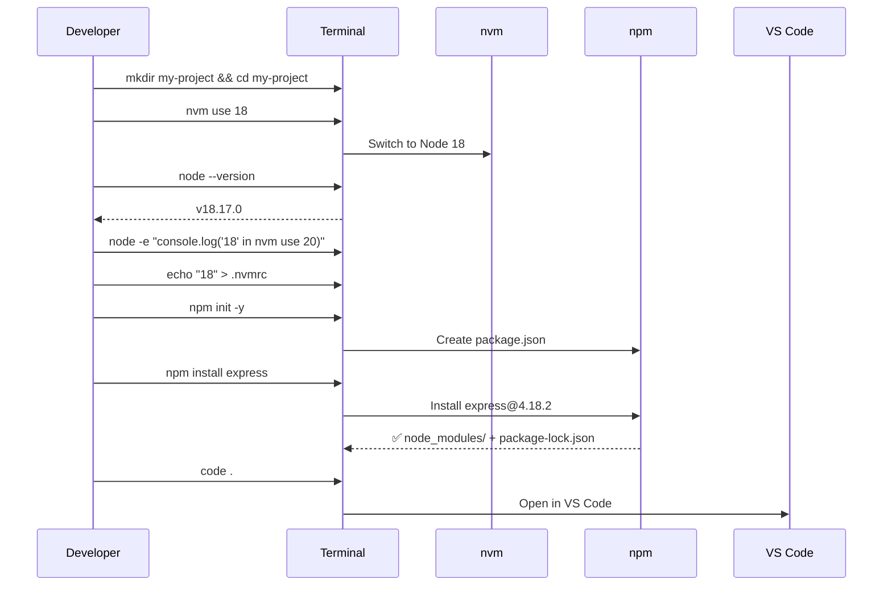

# Installation & Setup

## 📖 Introduction

Setting up Node.js correctly from the start prevents countless headaches. This guide covers **installation across all platforms**, version management, IDE configuration, and common troubleshooting.

## 🤔 Why Do We Need This?

A proper Node.js setup means:

| Bad Setup | Good Setup |
|-----------|------------|
| One global Node.js version | Use `nvm` to switch versions per project |
| `sudo npm install -g` everything | Use `npx` and local installs |
| Conflicting dependencies between projects | Isolated `node_modules` per project |
| Can't run multiple Node.js versions | `nvm use 18` and `nvm use 20` side-by-side |

## ⚠️ Problem Statement

The Node.js ecosystem moves fast:

```
Project A requires Node 16 (legacy)
Project B requires Node 18 (LTS)
Project C requires Node 20 (latest)

Without a version manager, you need:
1. Install one version
2. Work on Project A
3. Uninstall
4. Install another version
5. Work on Project B
6. 😡 This is terrible!

With a version manager (nvm):
nvm use 16   # Switch to Node 16
nvm use 18   # Switch to Node 18
nvm use 20   # Switch to Node 20
```

## 📚 Real World Story

**The Node.js Version Horror**

A junior developer installed Node.js from the official website (v20) and started a new project. The company's deployment environment used Node 16. The project used `array.toSorted()` (available in Node 18+) and crashed in production.

**Result:** A production outage because of a Node.js version mismatch.

**Lesson:** Always check the Node.js version requirements of your deployment environment before starting a project. Use `.nvmrc` and `engines` in `package.json`.

## 🍕 Real World Analogy

**Shoe Sizes**

| Concept | Analogy |
|---------|---------|
| Different Node versions | Different shoe sizes |
| nvm | A shoe rack with every size |
| package.json `engines` field | Writing your shoe size on your shoes |
| CI/CD deployment | Wearing the right shoes for the right occasion |
| `node --version` | Checking your current shoe size |

## 👁️ Visual Explanation

```
NODE.JS VERSION MANAGER (nvm)
═══════════════════════════════

Without nvm:
┌──────────────────────────────────────────┐
│ Global: Node v18.17.0                    │
│                                          │
│  Project A (needs 16) → ❌ Can't run    │
│  Project B (needs 18) → ✅ Works         │
│  Project C (needs 20) → ❌ Can't run    │
└──────────────────────────────────────────┘

With nvm:
┌──────────────────────────────────────────┐
│ nvm list:                                │
│  ➡ v16.20.2 (default)                    │
│     v18.17.0 (LTS)                       │
│     v20.11.0 (latest)                    │
│                                          │
│  Project A: nvm use 16 → ✅      │
│  Project B: nvm use 18 → ✅      │
│  Project C: nvm use 20 → ✅      │
└──────────────────────────────────────────┘
```

## 📊 Mermaid Diagram 1: Installation Decision Tree



## ⚙️ Internal Working: What Happens When You Install Node.js

```
Installing Node.js creates:
───────────────────────────

/usr/local/bin/       (or C:\Program Files\nodejs\)
├── node              ← Node.js runtime (V8 + libuv)
├── npm               ← Package manager
├── npx               ← Package runner (Node 14+)
└── corepack          ← Package manager manager (Node 16+)

node is a compiled binary that includes:
- V8 JavaScript engine
- libuv (Event Loop + Thread Pool)
- Node.js built-in modules (compiled in)
- Initialization scripts

The ELF/Mach-O/PE binary is ~80MB on disk.
```

## 🔄 Mermaid Diagram 2: Version Manager Architecture



## 🏗️ Architecture: Development Environment Setup



## 👣 Step-by-Step Flow: Setting Up a New Project



## 📝 Syntax: Essential Setup Commands

```bash
# ─── INSTALL nvm (macOS/Linux) ─────────────────────
curl -o- https://raw.githubusercontent.com/nvm-sh/nvm/v0.39.7/install.sh | bash

# Restart terminal or:
source ~/.bashrc  # or ~/.zshrc

# ─── INSTALL nvm-windows (Windows) ─────────────────
# Download from: https://github.com/coreybutler/nvm-windows/releases
# Install the .exe, then restart terminal

# ─── INSTALL NODE via nvm ──────────────────────────
nvm install 18          # Install Node 18
nvm install 20          # Install Node 20
nvm install --lts       # Install latest LTS
nvm alias default 18    # Set default version

# ─── SWITCH NODE VERSIONS ──────────────────────────
nvm use 18              # Switch to Node 18
nvm use 20              # Switch to Node 20
nvm ls                  # List installed versions
nvm current             # Show current version

# ─── VERIFY INSTALLATION ───────────────────────────
node --version          # v18.17.0
npm --version           # 9.6.7
npx --version           # 9.6.7
which node              # /Users/me/.nvm/versions/node/v18.17.0/bin/node
```

```bash
# ─── INITIALIZE A PROJECT ──────────────────────────
echo "18" > .nvmrc      # Pin Node version
npm init -y             # Create package.json

# ─── INSTALL DEPENDENCIES ──────────────────────────
npm install express     # Production dependency
npm install -D jest     # Dev dependency
npm ci                  # Clean install (for CI)

# ─── RUN THE PROJECT ───────────────────────────────
node app.js             # Run directly
node --watch app.js     # Auto-restart (Node 18+)
npx nodemon app.js      # Alternative auto-restart
```

```json
// package.json — Essential fields
{
  "name": "my-project",
  "version": "1.0.0",
  "private": true,          // Prevent accidental publish
  "type": "module",          // Use ES Modules
  "engines": {
    "node": ">=18.0.0",     // Minimum Node version
    "npm": ">=9.0.0"
  },
  "scripts": {
    "start": "node src/server.js",
    "dev": "node --watch src/server.js",
    "test": "node --experimental-vm-modules node_modules/.bin/jest"
  }
}
```

## 🟢 Basic Example: Verify Your Setup

```javascript
// verify.js — Run to confirm your installation works
const fs = require('fs');
const path = require('path');
const os = require('os');
const crypto = require('crypto');

console.log('═══════════════════════════════════');
console.log('   Node.js Setup Verification');
console.log('═══════════════════════════════════\n');

// Version info
console.log(`✅ Node.js  : ${process.version}`);
console.log(`✅ npm       : ${require('child_process').execSync('npm --version').toString().trim()}`);
console.log(`✅ Platform  : ${os.platform()} (${os.arch()})`);
console.log(`✅ CWD       : ${process.cwd()}\n`);

// Test core modules
console.log('📦 Core Modules:');
fs.writeFileSync('test.txt', 'Hello Node.js!');
const content = fs.readFileSync('test.txt', 'utf-8');
console.log(`   fs: "${content}"`);
fs.unlinkSync('test.txt');

const hash = crypto.createHash('sha256').update('test').digest('hex');
console.log(`   crypto: SHA256('test') = ${hash}`);
console.log(`   path: ${path.join('a', 'b', 'c')}`);
console.log(`   os: ${os.cpus().length} CPUs, ${Math.round(os.freemem() / 1024 / 1024)}MB free\n`);

// Create a simple HTTP server (run briefly)
const http = require('http');
const server = http.createServer((req, res) => {
  res.end('OK');
});
server.listen(0, () => {
  const port = server.address().port;
  console.log(`✅ http: Server started on port ${port}`);
  server.close();
  console.log('✅ Setup verification complete! 🎉');
});
```

## 🟡 Intermediate Example: VS Code Debugging Setup

```json
// .vscode/launch.json — Debugger configuration
{
  "version": "0.2.0",
  "configurations": [
    {
      "type": "node",
      "request": "launch",
      "name": "Debug Server",
      "program": "${workspaceFolder}/src/server.js",
      "runtimeArgs": ["--watch"],
      "env": {
        "NODE_ENV": "development",
        "PORT": "3000"
      },
      "envFile": "${workspaceFolder}/.env",
      "skipFiles": ["<node_internals>/**"],
      "outFiles": ["${workspaceFolder}/dist/**/*.js"]
    },
    {
      "type": "node",
      "request": "attach",
      "name": "Attach to Process",
      "port": 9229,
      "restart": true
    }
  ]
}
```

```json
// .vscode/extensions.json — Recommended extensions
{
  "recommendations": [
    "dbaeumer.vscode-eslint",
    "esbenp.prettier-vscode",
    "ms-vscode.vscode-typescript-next",
    "usernamehw.errorlens"
  ]
}
```

```javascript
// .vscode/settings.json — Workspace settings
{
  "editor.formatOnSave": true,
  "editor.defaultFormatter": "esbenp.prettier-vscode",
  "editor.codeActionsOnSave": {
    "source.fixAll.eslint": true
  },
  "files.exclude": {
    "node_modules/": true,
    "dist/": true
  },
  "javascript.updateImportsOnFileMove.enabled": "always",
  "typescript.updateImportsOnFileMove.enabled": "always"
}
```

> 🚀 **Best Practice:** Commit your `.vscode/` folder (with launch.json and extensions.json) to Git. This ensures every developer on your team has the same debugging and formatting setup.

## 🔴 Advanced Example: Dockerized Node.js Development

```dockerfile
# Dockerfile — Multi-stage build
# Stage 1: Development
FROM node:20-alpine AS development

WORKDIR /app

# Install system dependencies
RUN apk add --no-cache curl git

# Copy package files
COPY package*.json ./
RUN npm ci

# Copy source code
COPY . .

EXPOSE 3000

CMD ["node", "--watch", "src/server.js"]

# Stage 2: Production build
FROM node:20-alpine AS production

WORKDIR /app

COPY package*.json ./
RUN npm ci --omit=dev && npm cache clean --force

COPY --from=development /app/dist ./dist

USER node

EXPOSE 3000

HEALTHCHECK --interval=30s --timeout=3s --start-period=5s --retries=3 \
  CMD node -e "require('http').get('http://localhost:3000/health', r => {process.exit(r.statusCode === 200 ? 0 : 1)})"

CMD ["node", "dist/server.js"]
```

```yaml
# docker-compose.yml
version: '3.8'

services:
  app:
    build:
      context: .
      target: development
    volumes:
      - .:/app          # Hot reload with mounted source
      - /app/node_modules # Don't override container's node_modules
    ports:
      - "3000:3000"
    environment:
      - NODE_ENV=development
      - PORT=3000
    command: node --watch src/server.js

  db:
    image: postgres:16-alpine
    environment:
      POSTGRES_DB: myapp
      POSTGRES_PASSWORD: devpassword
    ports:
      - "5432:5432"
    volumes:
      - pgdata:/var/lib/postgresql/data

volumes:
  pgdata:
```

```bash
# Start development environment
docker compose up

# Rebuild after package changes
docker compose up --build

# Run in background
docker compose up -d

# View logs
docker compose logs -f app
```

## 🏭 Production Example: CI/CD Pipeline Setup

```yaml
# .github/workflows/ci.yml
name: Node.js CI

on:
  push:
    branches: [main, develop]
  pull_request:
    branches: [main]

jobs:
  test:
    runs-on: ubuntu-latest

    strategy:
      matrix:
        node-version: [18.x, 20.x]

    steps:
      - uses: actions/checkout@v4

      - name: Use Node.js ${{ matrix.node-version }}
        uses: actions/setup-node@v4
        with:
          node-version: ${{ matrix.node-version }}
          cache: 'npm'

      - name: Install dependencies
        run: npm ci

      - name: Lint
        run: npm run lint

      - name: Type check
        run: npm run typecheck

      - name: Run tests
        run: npm run test -- --coverage

      - name: Upload coverage
        uses: codecov/codecov-action@v3
```

```yaml
# .github/dependabot.yml
version: 2
updates:
  - package-ecosystem: "npm"
    directory: "/"
    schedule:
      interval: "weekly"
    open-pull-requests-limit: 10
    labels:
      - "dependencies"
      - "automated"
```

## ⚙️ How It Works Internally: npm Cache

```
When you run npm install, npm:
1. Checks local cache: ~/.npm/_cacache/
2. If cached → extracts from cache (fast)
3. If not cached → fetches from registry
4. Saves to cache for future use
5. Extracts to node_modules/

npm cache path:
  macOS/Linux: ~/.npm/_cacache/
  Windows: %AppData%/npm-cache/

Clear cache if corrupted:
  npm cache clean --force
```

## 📦 Performance Notes

| Setup Decision | Performance Impact |
|---------------|-------------------|
| `npm ci` vs `npm install` | `npm ci` is 2-5x faster in CI |
| Node Alpine image | ~80% smaller Docker images but native modules need build tools |
| `--omit=dev` in production | Reduces node_modules by 50-80% |
| `npm cache` | Speeds up repeated installs significantly |
| `.nvmrc` + `engines` | Prevents version mismatch bugs early |

## 🔒 Security Notes

| Practice | Why |
|----------|-----|
| **Use LTS versions in production** | LTS receives security patches for 30 months |
| **Pin Node version in package.json** | `"engines": { "node": ">=18.0.0" }` |
| **Never `sudo npm install -g`** | Granting npm root access is risky |
| **Use `npm audit` regularly** | Catch known vulnerabilities |
| **Verify checksums** | `npm install` verifies package integrity via SRI |
| **Use `.npmrc` with strict settings** | `engine-strict=true`, `audit-level=high` |

## ⚠️ Common Mistakes

```bash
# ❌ MISTAKE 1: Using wrong Node version for project
# Project needs Node 18, you run Node 20
# .nvmrc solution:
echo "18" > .nvmrc  # Create this file!
nvm use              # Auto-reads .nvmrc

# ❌ MISTAKE 2: Installing packages globally
npm install -g eslint  # ❌ Avoid!
npx eslint src/        # ✅ Use npx!

# ❌ MISTAKE 3: Not using .gitignore
# node_modules/ and .env should be ignored!

# ❌ MISTAKE 4: Installing production dependencies in CI
docker build .
  npm install  # ❌ Installs devDependencies too!
  npm ci --omit=dev  # ✅ Production only

# ❌ MISTAKE 5: Running Node as root in containers
FROM node:20
COPY . .
RUN npm ci
CMD ["node", "server.js"]  # ❌ Runs as root!

# ✅ FIX:
FROM node:20-alpine
USER node                  # ✅ Run as non-root
```

## 🚀 Best Practices

| # | Practice | Why |
|---|----------|-----|
| 1 | **Use nvm** | Switch Node versions per project |
| 2 | **Create .nvmrc** | Documents required Node version |
| 3 | **Use `npm ci` in CI** | Deterministic, faster installs |
| 4 | **Set `"private": true`** | Prevents accidental publishing |
| 5 | **Specify `engines` field** | Blocks install on unsupported Node versions |
| 6 | **Use `.gitignore` from the start** | Prevents committing node_modules |
| 7 | **Set up ESLint + Prettier** | Consistent code style |
| 8 | **Use `node --watch` instead of nodemon** | One less dependency |

## 🎯 Interview Questions

**Q1: What is nvm and why should you use it?**
nvm (Node Version Manager) lets you install and switch between multiple Node.js versions. Essential for working on projects with different version requirements.

**Q2: How do you set up a Node.js project from scratch?**
1. `nvm use 18` (set Node version)
2. `mkdir project && cd project`
3. `npm init -y` (create package.json)
4. `npm install express` (add dependencies)
5. Set up `scripts`, `engines`, and `.gitignore`

**Q3: What's the difference between LTS and Current releases?**
LTS (Long Term Support) versions are stable with 30 months of security patches. Current versions get the latest features but only 6 months of support. Always use LTS in production.

## 📝 MCQs

**1. Which command installs Node.js version 18 using nvm?**
- A) `nvm install node@18`
- B) `nvm install 18` ✅
- C) `nvm use 18`
- D) `npm install node@18`

**2. What file should you create to specify the Node.js version for a project?**
- A) `.node-version`
- B) `.nvmrc` ✅
- C) `node.config`
- D) `engines.json`

**3. Which npm command is recommended for CI/CD pipelines?**
- A) `npm install`
- B) `npm ci` ✅
- C) `npm update`
- D) `npm run build`

**4. Why should you avoid `npm install -g`?**
- A) It's slower than local installs
- B) Leads to version conflicts between projects ✅
- C) Global packages are not secure
- D) npm doesn't support global installs

**5. What Node.js built-in feature (Node 18+) replaces nodemon?**
- A) `--hot`
- B) `--watch` ✅
- C) `--live`
- D) `--restart`

## 💻 Coding Challenge 1: Setup Script

Create a bash script that automates the setup of a new Node.js project:

```bash
#!/bin/bash
# setup-node-project.sh

# Takes a project name as argument
# 1. Creates project directory
# 2. Creates .nvmrc with "18"
# 3. Runs npm init -y
# 4. Installs express
# 5. Creates src/server.js with a basic HTTP server
# 6. Creates .gitignore
# 7. Initializes git repo
# 8. Runs git add + git commit

# Usage: ./setup-node-project.sh my-api
```

## 💻 Coding Challenge 2: Dockerized Node App

Create a Dockerfile and docker-compose.yml for a Node.js app with:
- Multi-stage build (dev + prod)
- Health check endpoint
- Non-root user in production
- Volume mounts for hot reloading in development

## 💻 Coding Challenge 3: CI Pipeline

Create a GitHub Actions workflow that:
- Runs on push to main and pull requests
- Tests on Node 18 and Node 20
- Runs linting, type checking, and tests
- Caches npm dependencies
- Reports test coverage

## 🧪 Mini Exercise: Debugging Setup Issues

A developer says their Node.js app can't find a module:

```
internal/modules/cjs/loader.js:818
  throw err;
  ^

Error: Cannot find module 'express'
```

**Possible causes:**
1. `npm install` was never run
2. Installed in a different directory
3. Node version mismatch (modules compiled for different ABI)
4. Global install instead of local
5. node_modules was deleted or corrupted

**Fix each cause.**

## 🌍 Real World Problem

**Problem:** Your company deploys 20+ Node.js microservices. Each one uses a different Node.js version (16, 18, 20). Developers frequently deploy code tested on one version to a production environment running another, causing runtime errors.

**Questions:**
1. How would you standardize versions across services?
2. How would you enforce the version in CI/CD?
3. How would you manage the migration from Node 16 to 18?
4. What tooling would you put in place?

## 🏗️ Mini Project: Development Environment Scaffolder

Build a CLI tool that scaffolds a complete Node.js development environment:

```javascript
#!/usr/bin/env node
// scaffold.js

const fs = require('fs');
const path = require('path');

const projectName = process.argv[2] || 'my-app';

console.log(`🚀 Scaffolding: ${projectName}`);

// Create directory structure
const dirs = [
  'src',
  'src/routes',
  'src/middleware',
  'src/services',
  'src/utils',
  'tests',
  'scripts',
];

dirs.forEach(dir => {
  fs.mkdirSync(path.join(projectName, dir), { recursive: true });
  console.log(`📁 Created: ${dir}/`);
});

// Create .nvmrc
fs.writeFileSync(path.join(projectName, '.nvmrc'), '18\n');

// Create .gitignore
fs.writeFileSync(path.join(projectName, '.gitignore'), `
node_modules/
dist/
.env
*.log
.DS_Store
coverage/
`.trim());

// Create .env.example
fs.writeFileSync(path.join(projectName, '.env.example'), `
NODE_ENV=development
PORT=3000
DATABASE_URL=postgres://localhost:5432/myapp
`.trim());

// Create src/server.js
fs.writeFileSync(path.join(projectName, 'src', 'server.js'), `
const http = require('http');

const PORT = process.env.PORT || 3000;

const server = http.createServer((req, res) => {
  res.writeHead(200, { 'Content-Type': 'application/json' });
  res.end(JSON.stringify({ status: 'ok', time: new Date().toISOString() }));
});

server.listen(PORT, () => {
  console.log(\`🚀 Server running on http://localhost:\${PORT}\`);
});
`.trim());

// Create package.json
const pkg = {
  name: projectName,
  version: '1.0.0',
  private: true,
  type: 'module',
  engines: { node: '>=18.0.0' },
  scripts: {
    start: 'node src/server.js',
    dev: 'node --watch src/server.js',
    test: 'node --test tests/',
  },
};

fs.writeFileSync(
  path.join(projectName, 'package.json'),
  JSON.stringify(pkg, null, 2)
);

console.log('\n✅ Project scaffolded successfully!');
console.log(`\nNext steps:`);
console.log(`  cd ${projectName}`);
console.log(`  npm install`);
console.log(`  npm run dev`);
```

## 📖 Summary

| Step | Action | Command/File |
|------|--------|-------------|
| 1 | Install nvm | `curl -o- ... install.sh \| bash` |
| 2 | Install Node | `nvm install 18` |
| 3 | Pin version | `echo "18" > .nvmrc` |
| 4 | Create project | `npm init -y` |
| 5 | Add deps | `npm install express` |
| 6 | Configure IDE | `.vscode/launch.json` |
| 7 | Git ignore | `node_modules/` in `.gitignore` |
| 8 | CI pipeline | GitHub Actions with `npm ci` |

## 📋 Cheat Sheet

```bash
# ─── NVM ─────────────────────────────────────────────
nvm install 18          # Install Node 18
nvm use 18              # Switch to Node 18
nvm ls                  # List installed
nvm current             # Current version
nvm alias default 18    # Set default

# ─── NPM ─────────────────────────────────────────────
npm init -y             # Create package.json
npm install <pkg>       # Install dependency
npm ci                  # Clean install (CI)
npm audit               # Check vulnerabilities
npm outdated            # List outdated packages

# ─── RUN ─────────────────────────────────────────────
node app.js             # Run
node --watch app.js     # Run with auto-restart
node --inspect app.js   # Debug mode

# ─── PROJECT FILES ───────────────────────────────────
echo "18" > .nvmrc      # Pin Node version
# .gitignore: node_modules/ dist/ .env *.log

# ─── DOCKER ──────────────────────────────────────────
docker compose up -d    # Start services
docker compose logs -f  # Follow logs
```

## 📚 Further Reading

- [Node.js Official Install Guide](https://nodejs.org/en/download/package-manager/)
- [nvm GitHub Repository](https://github.com/nvm-sh/nvm)
- [nvm-windows GitHub Repository](https://github.com/coreybutler/nvm-windows)
- [Node.js Releases (LTS Schedule)](https://nodejs.org/en/about/previous-releases)
- [Docker + Node.js Best Practices](https://nodejs.org/en/learn/getting-started/nodejs-with-docker)

## 🔗 Related Topics

| Topic | Link |
|-------|------|
| Introduction to Node.js | [Previous](/DSA-Notes-Problems/nodejs/fundamentals/introduction) |
| REPL & CLI Basics | [Next](/DSA-Notes-Problems/nodejs/fundamentals/repl-and-cli) |
| npm & package.json | [npm Deep Dive](/DSA-Notes-Problems/nodejs/fundamentals/npm-and-package-json) |
| Debugging Node.js | [Debugging](/DSA-Notes-Problems/nodejs/fundamentals/debugging) |
| Docker for Node.js | [Production Deployment](/DSA-Notes-Problems/nodejs/production/deployment) |
