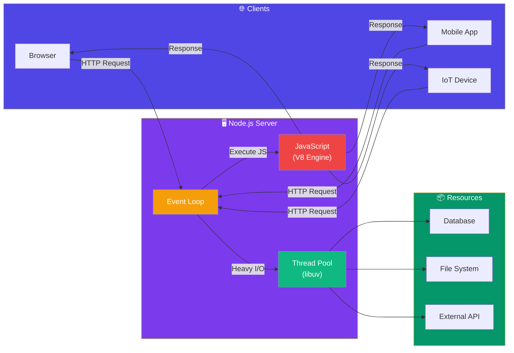
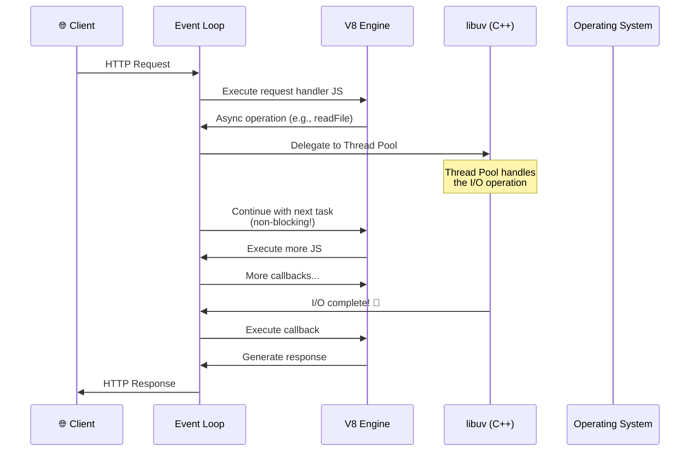
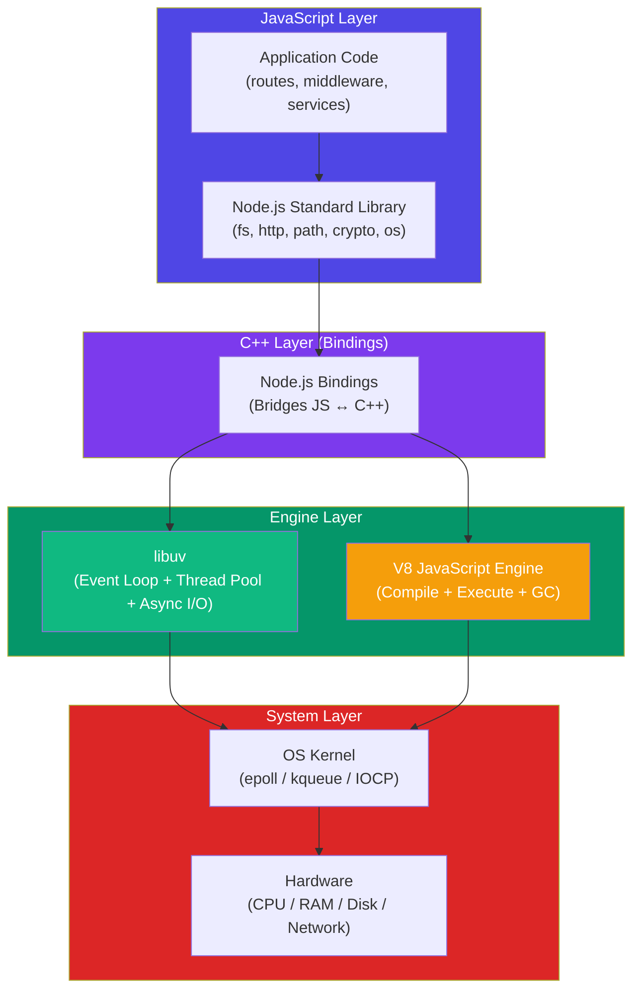
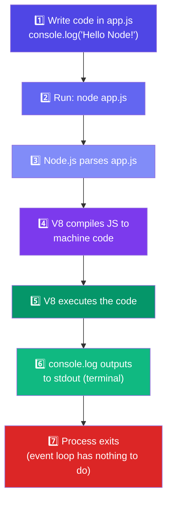

# Introduction to Node.js

## 📖 Introduction

Node.js is an **open-source, cross-platform JavaScript runtime environment** that executes JavaScript code **outside a web browser**. Created by **Ryan Dahl** in 2009, it lets developers build server-side applications — from REST APIs and real-time chat systems to CLI tools and microservices — using the same language that powers the frontend.

> **Node.js is to JavaScript what the JVM is to Java.**

## 🤔 Why Do We Need Node.js?

Before Node.js, backend development required learning a completely different language:

| Era | Frontend Language | Backend Language | Context Switch |
|-----|------------------|-----------------|----------------|
| 2000s | JavaScript | PHP / Java / Ruby / Python | 🚫 Had to learn two languages |
| 2010s+ | JavaScript | **JavaScript (Node.js)** | ✅ One language everywhere |

Node.js solved three critical problems:

1. **Language unification** — Use JavaScript across the entire stack
2. **Handling concurrent traffic** — Traditional servers struggled with thousands of simultaneous connections
3. **Real-time capabilities** — Chat, live updates, and collaboration tools needed bidirectional communication

## ⚠️ Problem Statement

Traditional web servers (Apache, IIS) used a **multi-threaded, blocking I/O** model:

```
Client 1 → Thread 1 (blocked while reading DB) → Wasted RAM
Client 2 → Thread 2 (blocked while reading DB) → Wasted RAM
Client 3 → Thread 3 (blocked while reading DB) → Wasted RAM
...
```

This approach is:

- **Memory-intensive** — Each thread consumes ~2MB of RAM. 10,000 concurrent users = 20GB RAM
- **CPU-inefficient** — Threads sit idle while waiting for I/O (database, files, network)
- **Hard to scale** — Context switching between thousands of threads kills performance

## 📚 Real World Story

**The Netflix Migration**

In 2014, Netflix's user onboarding flow was painfully slow. The UI took **over 60 seconds** to load because each API call waited for the previous one to complete in a blocking manner.

Netflix migrated their frontend layer from Java to Node.js. The result? **Startup time dropped by 70%** and the application became **200x faster** for initial rendering.

Why? Node.js's non-blocking, event-driven architecture allowed Netflix to fire multiple API calls simultaneously instead of waiting for each one sequentially.

> *"Node.js dramatically reduced startup time and improved the overall developer experience."*
> — **Netflix Technology Blog**

## 🍕 Real World Analogy

**A Restaurant Kitchen**

Think of traditional servers like a restaurant where each customer gets a dedicated chef:

| Concept | Traditional Server | Node.js Server |
|---------|-------------------|----------------|
| **Customers** | Client requests | Client requests |
| **Chefs** | Threads | Single thread + Event Loop |
| **Cooking** | Processing the request | Processing the request |
| **Waiting for ingredients** | Chef stands idle (blocking I/O) | Chef starts next order (non-blocking) |
| **Oven timer dings** | Chef was already waiting | Event fires, chef returns to finish |

Node.js is the **one smart chef** who starts cooking your dish, then immediately starts another while the oven works. When the timer dings, they circle back. This tiny change makes the entire restaurant handle **100x more customers** with fewer chefs.

## 👁️ Visual Explanation

```
┌─────────────────────────────────────────────────────────────────┐
│                                                                    │
│   Traditional Server (Multi-Threaded Blocking)                     │
│                                                                    │
│   Request 1 → ┌─[Thread 1]─────────────┐                         │
│               │  Wait for DB... idle... │  ← Wasted CPU & RAM    │
│               └─────────────────────────┘                         │
│   Request 2 → ┌─[Thread 2]─────────────┐                         │
│               │  Wait for DB... idle... │  ← Wasted               │
│               └─────────────────────────┘                         │
│                                                                    │
│   ─ ─ ─ ─ ─ ─ ─ ─ ─ ─ ─ ─ ─ ─ ─ ─ ─ ─ ─ ─ ─ ─ ─ ─ ─ ─ ─ ─ ─│
│                                                                    │
│   Node.js Server (Single-Threaded Non-Blocking)                    │
│                                                                    │
│   Request 1 → ┌─[Event Loop]──────────────────────┐              │
│               │  Start DB call → move on          │              │
│               │  Start DB call → move on          │  ← Efficient  │
│               │  DB done → callback → response    │              │
│               └────────────────────────────────────┘              │
│                                                                    │
└─────────────────────────────────────────────────────────────────┘
```

## 📊 Mermaid Diagram 1: Client-Server Architecture



## ⚙️ Internal Working

Node.js is much more than just "JavaScript on a server." It's a carefully architected system with three layers:

```
┌─────────────────────────────────────────────────────┐
│                  Your Node.js App                    │
│  (app.js, routes, controllers, services, models)    │
├─────────────────────────────────────────────────────┤
│           Node.js Built-in APIs (JS)                │
│  fs | http | path | crypto | os | stream | events   │
├─────────────────────────────────────────────────────┤
│                   V8 Engine (C++)                   │
│   Compiles JavaScript → Machine Code                │
│   Manages Memory (Heap + Stack)                     │
├─────────────────────────────────────────────────────┤
│                   libuv (C Library)                  │
│   Event Loop | Thread Pool | Async I/O | Timers     │
└─────────────────────────────────────────────────────┘
┌─────────────────────────────────────────────────────┐
│               Operating System                       │
│         Windows / macOS / Linux                      │
└─────────────────────────────────────────────────────┘
```

1. **V8 Engine** — Google's JavaScript engine (same as Chrome). Compiles JS to optimized machine code
2. **libuv** — C library that provides the Event Loop and Thread Pool for async I/O
3. **Node.js Bindings** — C++/JavaScript bridges that expose libuv capabilities to JS
4. **Built-in APIs** — JavaScript libraries (fs, http, path, etc.) that you `require()` or `import`

## 🔄 Mermaid Diagram 2: How Node.js Processes a Request



## 🏗️ Architecture



## 👣 Step-by-Step Flow: Hello World in Node.js



> 💡 **Did You Know?** Node.js is built on the same V8 engine that powers Google Chrome. This means every performance improvement Google makes to Chrome also benefits Node.js!

## 📝 Syntax

### Install Node.js

```bash
# Check if Node.js is installed
node --version   # v20.x or higher
npm --version    # 10.x or higher

# macOS (Homebrew)
brew install node

# Ubuntu/Debian
curl -fsSL https://deb.nodesource.com/setup_20.x | sudo -E bash -
sudo apt-get install -y nodejs

# Windows
# Download installer from https://nodejs.org
```

### Run a Node.js File

```bash
node app.js              # Run a file
node --watch app.js      # Auto-restart on changes (Node 18+)
node -e "console.log(1)" # Run inline code
```

### Create and Run Your First Server

```javascript
// app.js — A basic HTTP server
const http = require('http');

const server = http.createServer((req, res) => {
  res.writeHead(200, { 'Content-Type': 'text/plain' });
  res.end('Hello, Node.js!\n');
});

server.listen(3000, () => {
  console.log('Server running at http://localhost:3000/');
});
```

## 🟢 Basic Example: Reading a File

```javascript
// Import the file system module
const fs = require('fs');    // CommonJS syntax
// import fs from 'fs';      // ES Module syntax

// Read a file synchronously (blocking)
const data = fs.readFileSync('notes.txt', 'utf-8');
console.log(data);            // Prints file contents
console.log('Done!');         // Runs AFTER file is read

// Read a file asynchronously (non-blocking)
fs.readFile('notes.txt', 'utf-8', (err, data) => {
  if (err) {
    console.error('Error reading file:', err.message);
    return;
  }
  console.log(data);          // Prints file contents
});
console.log('Done!');         // Runs IMMEDIATELY, BEFORE file is read
```

> 🧠 **Memory Trick:** Sync = Stop (blocking). Async = Away (non-blocking). If you see "Sync" in the name, the program pauses there.

## 🟡 Intermediate Example: HTTP Module with Routing

```javascript
const http = require('http');

// Create a server with basic routing
const server = http.createServer((req, res) => {
  const { method, url } = req;
  
  // Parse the URL
  const [path, queryString] = url.split('?');
  
  // Set common headers
  res.setHeader('Content-Type', 'application/json');
  
  // Simple router
  if (method === 'GET' && path === '/') {
    res.writeHead(200);
    res.end(JSON.stringify({ message: 'Welcome to Node.js!' }));
    
  } else if (method === 'GET' && path === '/users') {
    const users = [
      { id: 1, name: 'Alice' },
      { id: 2, name: 'Bob' },
    ];
    res.writeHead(200);
    res.end(JSON.stringify(users));
    
  } else if (method === 'POST' && path === '/users') {
    let body = '';
    
    // Data comes in chunks
    req.on('data', (chunk) => {
      body += chunk.toString();
    });
    
    req.on('end', () => {
      const newUser = JSON.parse(body);
      console.log('Created user:', newUser);
      res.writeHead(201);
      res.end(JSON.stringify({ success: true, user: newUser }));
    });
    
  } else {
    // 404 handler
    res.writeHead(404);
    res.end(JSON.stringify({ error: 'Route not found' }));
  }
});

// Start the server
const PORT = 3000;
server.listen(PORT, () => {
  console.log(`🚀 Server listening on http://localhost:${PORT}`);
});
```

**Line-by-line explanation:**

| Line | What it does |
|------|-------------|
| `const http = require('http')` | Imports Node.js's built-in HTTP module |
| `http.createServer((req, res) => { ... })` | Creates a server. The callback runs on every request |
| `req.on('data', (chunk) => { ... })` | Listens for incoming data chunks (POST body) |
| `req.on('end', () => { ... })` | Fires when all data has been received |
| `res.writeHead(201)` | Sets HTTP status code (201 = Created) |
| `server.listen(PORT, callback)` | Binds the server to a port and starts listening |

## 🔴 Advanced Example: Static File Server with MIME Types

```javascript
const http = require('http');
const fs = require('fs');
const path = require('path');

const PORT = 3000;
const PUBLIC_DIR = path.join(__dirname, 'public');

// Map file extensions to MIME types
const MIME_TYPES = {
  '.html': 'text/html',
  '.css':  'text/css',
  '.js':   'application/javascript',
  '.json': 'application/json',
  '.png':  'image/png',
  '.jpg':  'image/jpeg',
  '.svg':  'image/svg+xml',
  '.ico':  'image/x-icon',
};

const server = http.createServer((req, res) => {
  // Security: Prevent directory traversal attacks
  const sanitizedPath = path.normalize(req.url).replace(/^(\.\.[/\\])+/, '');
  
  // Resolve the file path
  const filePath = path.join(PUBLIC_DIR, sanitizedPath);
  
  // Get file extension for MIME type
  const ext = path.extname(filePath);
  const contentType = MIME_TYPES[ext] || 'application/octet-stream';
  
  // Read and serve the file
  fs.readFile(filePath, (err, data) => {
    if (err) {
      if (err.code === 'ENOENT') {
        // File not found → 404
        res.writeHead(404, { 'Content-Type': 'text/html' });
        res.end('<h1>404 - File Not Found</h1>');
      } else {
        // Server error → 500
        res.writeHead(500);
        res.end('500 Internal Server Error');
      }
      return;
    }
    
    // Success → serve the file
    res.writeHead(200, { 'Content-Type': contentType });
    res.end(data);
  });
});

server.listen(PORT, () => {
  console.log(`📁 Static server serving ${PUBLIC_DIR}`);
  console.log(`   http://localhost:${PORT}`);
});
```

## 🏭 Production Example: Express-Like Router with Middleware

```javascript
// mini-express.js — A simplified Express.js core built with http module
class MiniExpress {
  constructor() {
    this.routes = [];
    this.middlewares = [];
  }
  
  use(fn) {
    this.middlewares.push(fn);
  }
  
  get(path, handler) {
    this.routes.push({ method: 'GET', path, handler });
  }
  
  post(path, handler) {
    this.routes.push({ method: 'POST', path, handler });
  }
  
  // Match routes using path-to-regexp style matching
  matchRoute(method, url) {
    for (const route of this.routes) {
      if (route.method !== method) continue;
      
      // Simple path matching (supports :params)
      const routeParts = route.path.split('/');
      const urlParts = url.split('/');
      
      if (routeParts.length !== urlParts.length) continue;
      
      const params = {};
      let matched = true;
      
      for (let i = 0; i < routeParts.length; i++) {
        if (routeParts[i].startsWith(':')) {
          params[routeParts[i].slice(1)] = urlParts[i];
        } else if (routeParts[i] !== urlParts[i]) {
          matched = false;
          break;
        }
      }
      
      if (matched) return { handler: route.handler, params };
    }
    return null;
  }
  
  handleRequest(req, res) {
    const { method, url } = req;
    
    // Enhanced response object
    res.json = (data) => {
      res.writeHead(200, { 'Content-Type': 'application/json' });
      res.end(JSON.stringify(data));
    };
    
    res.status = (code) => {
      res.statusCode = code;
      return res;
    };
    
    // Parse query string
    const urlObj = new URL(url, `http://${req.headers.host}`);
    req.query = Object.fromEntries(urlObj.searchParams);
    
    // Run middlewares
    let idx = 0;
    const next = () => {
      if (idx < this.middlewares.length) {
        this.middlewares[idx++](req, res, next);
      } else {
        this.finalHandler(req, res);
      }
    };
    next();
  }
  
  finalHandler(req, res) {
    const matched = this.matchRoute(req.method, req.url.split('?')[0]);
    
    if (matched) {
      req.params = matched.params;
      matched.handler(req, res);
    } else {
      res.status(404).json({ error: 'Not Found' });
    }
  }
  
  listen(port, callback) {
    const server = http.createServer((req, res) => this.handleRequest(req, res));
    server.listen(port, callback);
  }
}

// ─── USAGE ──────────────────────────────────────────
const app = new MiniExpress();

// Middleware: Logger
app.use((req, res, next) => {
  console.log(`[${new Date().toISOString()}] ${req.method} ${req.url}`);
  next();
});

// Middleware: JSON Body Parser
app.use((req, res, next) => {
  if (req.method === 'POST' || req.method === 'PUT') {
    let body = '';
    req.on('data', chunk => body += chunk);
    req.on('end', () => {
      try { req.body = JSON.parse(body); }
      catch { req.body = {}; }
      next();
    });
  } else {
    next();
  }
});

// Routes
app.get('/users/:id', (req, res) => {
  res.json({ userId: req.params.id, query: req.query });
});

app.post('/users', (req, res) => {
  res.status(201).json({ created: req.body });
});

app.listen(3000, () => console.log('🚀 MiniExpress running on :3000'));
```

> 🚀 **Best Practices:** In production, use Express.js or Fastify instead of raw `http`. This example shows you CAN build your own, but battle-tested frameworks handle edge cases you'll miss.

## ⚙️ How It Works Internally

When you run `node app.js`:

1. **Parsing** — Node.js reads `app.js`, V8 parses it into an Abstract Syntax Tree (AST)
2. **Compilation** — V8 compiles the AST to bytecode, then to optimized machine code
3. **Execution** — The JavaScript code starts running
4. **Event Loop** — If there are pending async operations, the Event Loop keeps the process alive
5. **Process Exit** — When there's nothing left to do, Node.js exits with code 0

```
node app.js
│
├─ 1. Initialize V8 Engine
├─ 2. Parse JavaScript → AST
├─ 3. Compile AST → Bytecode
├─ 4. Execute Bytecode
│     │
│     ├─ Sync operations → Execute immediately
│     ├─ Async operations → Delegate to libuv
│     │
│     └─ Error? → Throws exception or crashes
│
├─ 5. Enter Event Loop (if pending operations)
│     └─ Loop until nothing pending
│
└─ 6. Exit process
```

## 📦 Performance Notes

| Aspect | Details |
|--------|---------|
| **Startup time** | ~50ms for a simple script (V8 code cache helps) |
| **Memory usage** | ~10-30MB for a basic server (vs. 100MB+ for Java/PHP) |
| **Max concurrent connections** | 10,000+ on a single server with proper tuning |
| **Throughput** | ~50,000 req/s for a simple "Hello World" server (single core) |
| **Bottleneck** | CPU-intensive tasks block the Event Loop (use Worker Threads) |

> 📦 **Performance Note:** Node.js excels at I/O-bound workloads (APIs, databases, file serving). It struggles with CPU-bound tasks (image processing, video encoding, complex calculations) without Worker Threads.

## 🔒 Security Notes

| Risk | Mitigation |
|------|-----------|
| **Directory traversal** | Always sanitize user-provided paths with `path.normalize()` |
| **Remote Code Execution (RCE)** | Never `eval()` user input. Use `JSON.parse()` instead |
| **Denial of Service (DoS)** | Set request body limits. Use `express.json({ limit: '10kb' })` |
| **Prototype pollution** | Use `Object.create(null)` for dictionaries. Validate JSON input |
| **Supply chain attacks** | Audit dependencies: `npm audit`. Use `--omit=dev` in production |

> 🔒 **Security Note:** Node.js is only as secure as its dependencies. Run `npm audit` regularly and keep your runtime updated (use LTS versions in production).

## ⚠️ Common Mistakes

```javascript
// ❌ MISTAKE 1: Not handling errors in async code
const fs = require('fs');
fs.readFile('missing.txt', 'utf-8', (err, data) => {
  // Missing error check! If file doesn't exist, data is undefined
  console.log(data.toUpperCase()); // 💥 TypeError: Cannot read property of undefined
});

// ✅ CORRECT: Always check for errors first
fs.readFile('missing.txt', 'utf-8', (err, data) => {
  if (err) {
    console.error('Failed to read file:', err.message);
    return;
  }
  console.log(data.toUpperCase());
});

// ❌ MISTAKE 2: Blocking the Event Loop
const http = require('http');
const server = http.createServer((req, res) => {
  // This takes 5 seconds and blocks ALL other requests!
  const end = Date.now() + 5000;
  while (Date.now() < end) {}  // Busy wait
  res.end('Done');
});

// ✅ CORRECT: Use async operations or offload to Worker Threads
const { Worker } = require('worker_threads');

// ❌ MISTAKE 3: Using fs.readFileSync inside request handler
app.get('/data', (req, res) => {
  const data = fs.readFileSync('big-file.json'); // ⛔ Blocks ALL users!
  res.json(JSON.parse(data));
});

// ✅ CORRECT: Use async version
app.get('/data', async (req, res) => {
  const data = await fs.promises.readFile('big-file.json', 'utf-8');
  res.json(JSON.parse(data));
});

// ❌ MISTAKE 4: Forgetting process exits if Event Loop is idle
node -e "console.log('Hello')"
// Prints "Hello" and then exits immediately

// If you want it to stay alive, keep something pending:
node -e "console.log('Hi'); setInterval(() => {}, 1000)"
```

## 🚀 Best Practices

| # | Practice | Why |
|---|----------|-----|
| 1 | **Always use LTS versions in production** | LTS = Long Term Support. 3 years of security patches |
| 2 | **Prefer async versions of I/O functions** | Sync versions block the Event Loop |
| 3 | **Use `fs.promises` instead of callback-based `fs`** | Cleaner async/await syntax |
| 4 | **Use `--watch` in development** (Node 18+) | Auto-restart on file changes without nodemon |
| 5 | **Set `NODE_ENV=production` in production** | Enables optimizations, disables debug output |
| 6 | **Handle process signals gracefully** | `SIGTERM` → close server, clean up, exit |
| 7 | **Use `path.join()` and `path.resolve()`** | Cross-platform path handling |
| 8 | **Always specify character encoding** | `fs.readFile('file.txt', 'utf-8', cb)` |

> 🧠 **Memory Trick:** T.H.I.N.K. before every line of Node.js code: **T**hreads (is it blocking?), **H**andlers (errors caught?), **I**dle (will process exit?), **N**on-blocking (async version?), **K**ontext (is `this` correct?).

## 🎯 Interview Questions

**Q1: What is Node.js and how is it different from browser JavaScript?**

Node.js is a JavaScript runtime built on Chrome's V8 engine. Unlike browser JS, Node.js has no DOM, no `window` object, but adds server-side APIs: `fs`, `http`, `path`, `crypto`, `os`, `process`, etc.

**Q2: How does Node.js handle concurrent requests with a single thread?**

Node.js uses an event-driven, non-blocking I/O model. The Event Loop delegates I/O operations to libuv's thread pool. When I/O completes, a callback is queued and executed. The single thread never waits — it just moves to the next task.

**Q3: What is the difference between Node.js and Express.js?**

Node.js is the runtime (like the English language). Express.js is a framework built on top of Node.js (like a dictionary of common phrases). Node.js handles raw HTTP; Express adds routing, middleware, error handling, and more.

## 📝 MCQs

**1. What does Node.js use to execute JavaScript code?**
- A) SpiderMonkey
- B) V8 Engine ✅
- C) JavaScriptCore
- D) Chakra

**2. Who created Node.js?**
- A) Brendan Eich
- B) Ryan Dahl ✅
- C) Guido van Rossum
- D) James Gosling

**3. Which of the following is NOT a built-in Node.js module?**
- A) `fs`
- B) `http`
- C) `express` ✅ (Express is third-party)
- D) `path`

**4. What is libuv's role in Node.js?**
- A) Compiling JavaScript to machine code
- B) Providing the Event Loop and Thread Pool ✅
- C) Parsing HTTP requests
- D) Managing npm packages

**5. Which command runs a Node.js file with auto-restart on changes?**
- A) `node app.js`
- B) `node --watch app.js` ✅
- C) `node --inspect app.js`
- D) `node --restart app.js`

## 💻 Coding Challenge 1: Basic Server

Create an HTTP server that responds with "Hello, [name]!" where `name` comes from the URL query parameter. If no name is provided, respond with "Hello, World!"

```javascript
// Expected output:
// GET /?name=Alice → "Hello, Alice!"
// GET /           → "Hello, World!"
// Use only the built-in 'http' module
```

<details>
<summary>💡 Hint</summary>

Use `url.parse()` or `new URL()` to extract query parameters.

</details>

## 💻 Coding Challenge 2: File Server

Create a server that serves files from a `public` directory. 
- If the file exists, serve it with the correct MIME type.
- If not, return a 404 page.
- Prevent directory traversal attacks.

## 💻 Coding Challenge 3: JSON API

Build a small JSON API that maintains an in-memory list of "tasks":
- `GET /tasks` — returns all tasks
- `POST /tasks` — adds a task (send `{ "title": "..." }` in body)
- `DELETE /tasks/:id` — removes a task by id

## 🧪 Mini Exercise: Debugging

Find and fix the bugs in this code:

```javascript
const http = require('http');

const server = http.createServer((req, res) => {
  res.writeHead(200, { 'Content-Type': 'application/json' });
  
  if (req.url === '/data') {
    const data = fs.readFileSync('data.json');       // Bug 1: 'fs' not imported
    res.end(data);                                     // Bug 2: data is Buffer, need toString()
  }
  
  if (req.url === '/time') {
    setInterval(() => {                                // Bug 3: setInterval never clears
      res.end(new Date().toISOString());               // Bug 4: Can't res.end() twice
    }, 1000);
  }
  
  res.end(JSON.stringify({ error: 'Not found' }));    // Bug 5: Always runs this too!
});

server.listen(3000);
```

**Bugs to fix:**
1. Missing `const fs = require('fs');`
2. `data` is a Buffer — use `.toString()` or `utf-8` encoding
3. `setInterval` never clears — causes memory leak
4. Cannot call `res.end()` inside `setInterval` (connection hangs)
5. Fallback `res.end()` always runs after route handlers (no `return`)

## 📖 Summary

| Concept | Key Takeaway |
|---------|-------------|
| **What is Node.js?** | JavaScript runtime for server-side development |
| **Who created it?** | Ryan Dahl (2009) |
| **Key innovation** | Non-blocking, event-driven I/O |
| **Core components** | V8 Engine + libuv + Node.js Bindings |
| **Best for** | I/O-bound applications (APIs, real-time, streaming) |
| **Not best for** | CPU-intensive tasks (image processing, ML) |
| **npm ecosystem** | 2M+ packages available |

> 📖 **Summary:** Node.js is JavaScript's ticket out of the browser. Its single-threaded, event-driven architecture handles thousands of concurrent connections with minimal resources — making it the dominant choice for modern backend development.

## 📋 Cheat Sheet

```javascript
// ─── RUNNING NODE ────────────────────────────────────
node app.js               // Run file
node --watch app.js       // Auto-restart
node -e "console.log(1)"  // Run inline

// ─── BUILT-IN MODULES (most common) ─────────────────
const fs = require('fs');         // File system
const http = require('http');     // HTTP server/client
const path = require('path');     // File paths
const os = require('os');         // OS info
const crypto = require('crypto'); // Cryptography

// ─── BASIC HTTP SERVER ───────────────────────────────
const server = http.createServer((req, res) => {
  res.writeHead(200, { 'Content-Type': 'application/json' });
  res.end(JSON.stringify({ ok: true }));
});
server.listen(3000);

// ─── READING FILES ───────────────────────────────────
fs.readFile('file.txt', 'utf-8', (err, data) => {});
const data = await fs.promises.readFile('file.txt', 'utf-8');

// ─── GLOBAL OBJECTS ──────────────────────────────────
console.log(__dirname);  // Current directory path
console.log(__filename); // Current file path
console.log(process);    // Process information
```

## 📚 Further Reading

- [Node.js Official Documentation](https://nodejs.org/en/docs/)
- [Node.js Learning Guide](https://nodejs.org/en/learn/)
- [V8 Engine Blog](https://v8.dev/)
- [libuv Design Overview](https://docs.libuv.org/en/v1.x/design.html)
- [Node.js at Netflix](https://netflixtechblog.com/node-js-in-production-at-netflix-693db92e9ebd)

## 🔗 Related Topics

| Topic | Link |
|-------|------|
| Installation & Setup | Next → |
| Node.js Architecture & Event Loop | [Architecture](/DSA-Notes-Problems/nodejs/fundamentals/architecture) |
| npm & package.json | [npm Deep Dive](/DSA-Notes-Problems/nodejs/fundamentals/npm-and-package-json) |
| JavaScript Fundamentals | [JavaScript](/DSA-Notes-Problems/javascript) |
| Express.js Framework | [Express](/DSA-Notes-Problems/nodejs/web/express-framework) |
| Asynchronous Programming | [Async](/DSA-Notes-Problems/nodejs/core/async-programming) |
