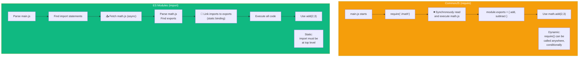
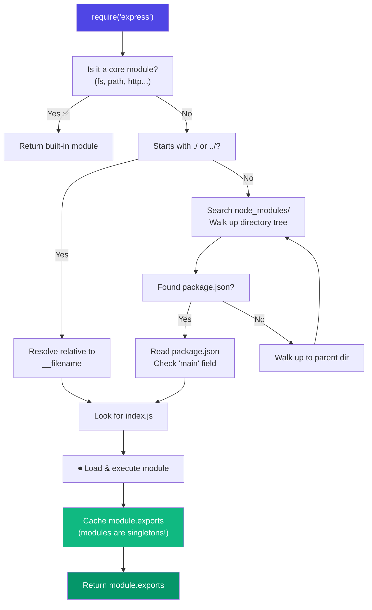
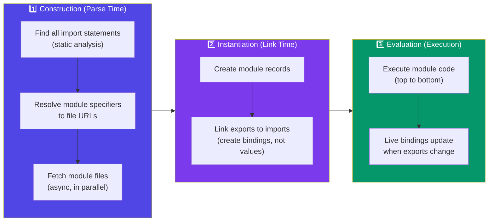
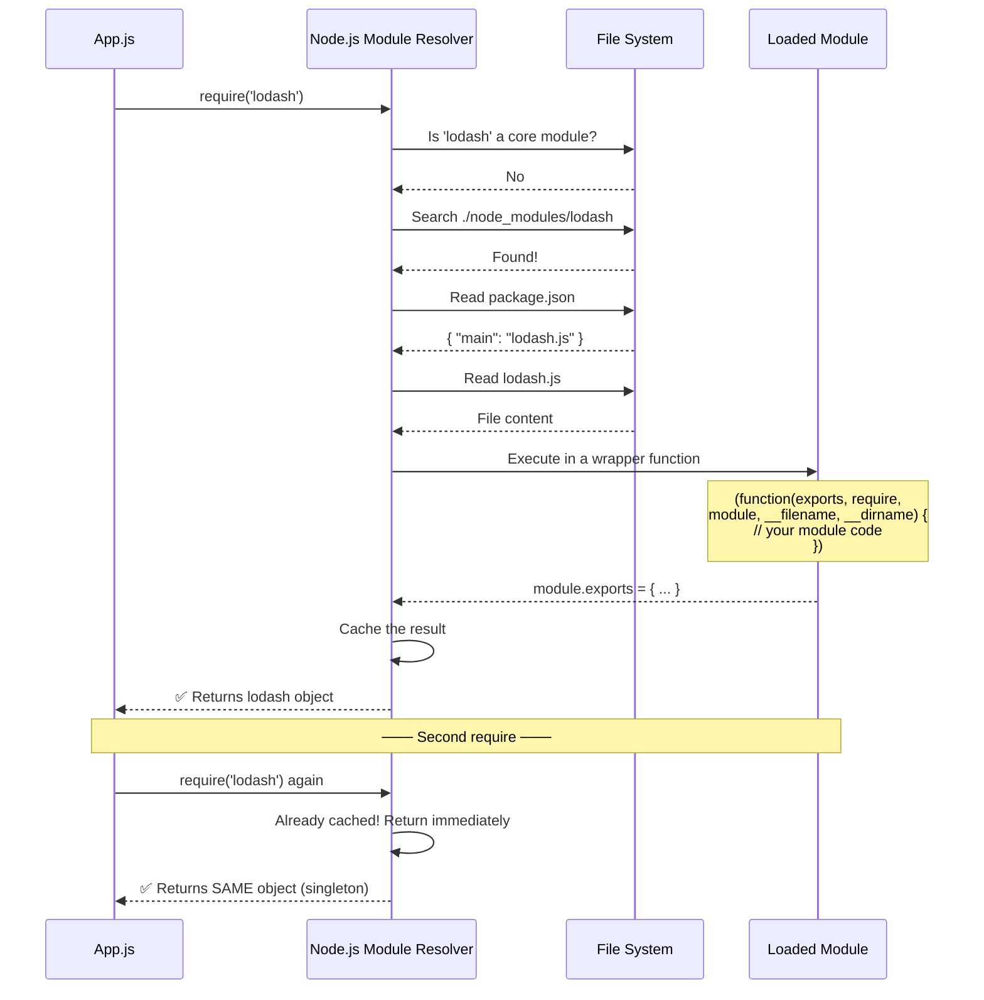

# Modules: CommonJS vs ESM

## 📖 Introduction

Node.js supports **two module systems**:

| System | Syntax | Default | File Extension |
|--------|--------|---------|----------------|
| **CommonJS (CJS)** | `require()` / `module.exports` | ✅ Default (pre-Node 16) | `.js`, `.cjs` |
| **ES Modules (ESM)** | `import` / `export` | ✅ Default (Node 18+ with `"type": "module"`) | `.mjs`, `.js` (with `"type": "module"`) |

Understanding both is essential — you'll encounter CJS in legacy codebases and ESM in modern projects.

> 💡 **Did You Know?** ESM is the official JavaScript standard (ECMAScript 2015). CommonJS was Node.js's invention that the JavaScript community later standardized around.

## 🤔 Why Do We Need This?

Modules solve a fundamental problem: **code organization**.

```
Without modules (global scope hell):
────────────────────────────────────
var user = "Alice";       // global.js
var user = "Bob";         // orders.js — 💥 OVERWROTE user!
console.log(user);        // "Bob" — introduced a bug!

With modules (encapsulated scope):
───────────────────────────────────
// user.js — exports a value
export const user = "Alice";

// orders.js — has its own scope
const user = "Bob"; // Only exists inside orders.js!
```

## ⚠️ Problem Statement

**The Great Module Divide** — Node.js was built on CommonJS (2010), but JavaScript standardized on ES Modules (2015). This created a painful split:

```
CommonJS project wants to use an ESM-only library:
  
  const pkg = require('esm-only-pkg');
  // ⛔ Error [ERR_REQUIRE_ESM]: require() of ES Module not supported!
  
  You now need to:
  - Convert your entire project to ESM, OR
  - Use dynamic import(), OR
  - Find a CJS-compatible alternative

This is the most common frustration for Node.js developers today.
```

## 📚 Real World Story

**The npm Ecosystem Migration (2015–2024)**

In 2015, ES Modules were standardized. But npm had 500,000+ packages written in CommonJS. A massive migration began:

| Year | % of npm packages supporting ESM | Key Event |
|------|----------------------------------|-----------|
| 2015 | 0% | ES Modules standardized |
| 2017 | 5% | Node.js adds experimental ESM support |
| 2020 | 20% | Node 12 stabilizes ESM (`--experimental-modules` → stable) |
| 2022 | 50% | Node 16 LTS — ESM is production-ready |
| 2024 | 75%+ | Most new packages are ESM-first |

The migration took **nearly a decade** — a reminder of how hard ecosystem transitions are.

> *"We are in the awkward teenage years of the JavaScript module transition."*
> — **Rich Harris** (creator of Svelte)

## 🍕 Real World Analogy

**Shipping Containers vs. Hand-Loaded Trucks**

| Concept | CommonJS | ES Modules |
|---------|----------|------------|
| **Loading method** | Open box, take items out as needed (dynamic) | Check manifest first, take everything at once (static) |
| **When items are loaded** | At the moment you ask for them (runtime) | Before the truck leaves (parse time) |
| **Can you change your mind?** | Yes, load items conditionally | No, everything is decided upfront |
| **Tree-shaking** | Hard (truck already left) | Easy (manifest shows everything) |
| **Analogy** | Hand-loading a delivery truck | Standardized shipping containers |

## 👁️ Visual Explanation

```
COMMON JS (require)
══════════════════════

┌─────────────────────────────────────┐
│  main.js                            │
│                                     │
│  const math = require('./math');    │
│  │                                  │
│  ▼ Synchronous, runtime              │
│                                     │
│  1. Read math.js from disk           │
│  2. Execute all code in math.js      │
│  3. Grab module.exports              │
│  4. Assign to `math`                 │
│  5. Continue execution               │
└─────────────────────────────────────┘

ES MODULES (import)
══════════════════════

┌─────────────────────────────────────┐
│  main.js                            │
│                                     │
│  import { add } from './math.js';   │
│  │                                  │
│  ▼ Static, parse time                │
│                                     │
│  1. Parse all imports FIRST          │
│  2. Fetch math.js (before main runs) │
│  3. Parse math.js, find exports      │
│  4. Link imports to exports          │
│  5. Execute all code in order        │
│  6. Make `add` available             │
└─────────────────────────────────────┘
```

## 📊 Mermaid Diagram 1: Module Systems Comparison



## ⚙️ Internal Working: How require() Resolves Modules



## 🏗️ Architecture: ESM Lifecycle (3 Phases)



## 👣 Step-by-Step Flow: Module Resolution



## 📝 Syntax

### CommonJS (CJS)

```javascript
// ─── EXPORTING ──────────────────────────────────────

// method 1: Export individual properties
module.exports.add = (a, b) => a + b;
module.exports.subtract = (a, b) => a - b;

// method 2: Export a single value (overwrites module.exports)
module.exports = {
  add: (a, b) => a + b,
  subtract: (a, b) => a - b,
};

// method 3: Shorthand export
exports.add = (a, b) => a + b;   // ❗ exports !== module.exports
// exports = { add: ... } would BREAK the reference!

// ─── IMPORTING ──────────────────────────────────────
const math = require('./math');           // Full import
const { add, subtract } = require('./math'); // Destructured
const path = require('path');             // Core module
const express = require('express');       // npm package
```

### ES Modules (ESM)

```javascript
// ─── NAMED EXPORTS ──────────────────────────────────
// math.js
export const add = (a, b) => a + b;
export function subtract(a, b) { return a - b; }
export const PI = 3.14159;

// ─── DEFAULT EXPORT ─────────────────────────────────
export default class Calculator {
  add(a, b) { return a + b; }
  subtract(a, b) { return a - b; }
}

// ─── IMPORTING ──────────────────────────────────────
import { add, subtract, PI } from './math.js';  // Named
import Calculator from './math.js';              // Default
import * as math from './math.js';               // Namespace

// ─── RENAMING ──────────────────────────────────────
import { add as sum, subtract as diff } from './math.js';
export { add as sum, subtract as diff };

// ─── RE-EXPORTING ───────────────────────────────────
export { add, subtract } from './math.js';
export * from './math.js';                           // Re-export all
export * as math from './math.js';                   // Re-export as namespace
```

## 🟢 Basic Example: Creating and Using a Module

```javascript
// ─── CJS STYLE ──────────────────────────────────────
// greetings.js
function greet(name) {
  return `Hello, ${name}!`;
}

function farewell(name) {
  return `Goodbye, ${name}!`;
}

module.exports = { greet, farewell };

// app.js
const { greet, farewell } = require('./greetings');
console.log(greet('Alice'));    // "Hello, Alice!"
console.log(farewell('Bob'));   // "Goodbye, Bob!"

// ─── ESM STYLE ──────────────────────────────────────
// greetings.js
export function greet(name) {
  return `Hello, ${name}!`;
}

export function farewell(name) {
  return `Goodbye, ${name}!`;
}

// app.js
import { greet, farewell } from './greetings.js';  // Note: must include .js!
console.log(greet('Alice'));
console.log(farewell('Bob'));
```

> 🧠 **Memory Trick:** CJS = `require` (you request it at runtime). ESM = `import` (you import it before anything runs). Think: CJS = "I need this now" (dynamic), ESM = "I need this" (static).

## 🟡 Intermediate Example: Dynamic Imports and Circular Dependencies

```javascript
// ─── DYNAMIC IMPORT (works in both CJS and ESM) ────
// ✅ Use dynamic import for conditionally loading modules

async function loadFormatter(locale) {
  if (locale === 'de') {
    // Dynamic import() — works everywhere
    const { format } = await import('./formatters/de.js');
    return format;
  } else {
    const { format } = await import('./formatters/en.js');
    return format;
  }
}

// ─── CJS: require vs import() compatibility ─────────
// In a CJS file, you can use import() to load ESM modules:
async function loadESMModule() {
  // ⛔ This FAILS: const eslint = require('eslint');
  // ✅ This WORKS: 
  const eslint = await import('eslint');
  return eslint;
}

// ─── ESM: __dirname equivalent ──────────────────────
// In CJS, you have __dirname and __filename
// In ESM, you need to construct them:
import { fileURLToPath } from 'url';
import { dirname } from 'path';

const __filename = fileURLToPath(import.meta.url);
const __dirname = dirname(__filename);

console.log(__dirname);  // Works!
```

## 🔴 Advanced Example: Hybrid Package (CJS + ESM)

```javascript
// package.json — Ship both CJS and ESM
{
  "name": "my-hybrid-package",
  "version": "1.0.0",
  "main": "./dist/cjs/index.js",       // CJS entry
  "module": "./dist/esm/index.js",      // ESM entry (bundlers)
  "exports": {
    ".": {
      "import": "./dist/esm/index.js",  // ESM consumers
      "require": "./dist/cjs/index.js"  // CJS consumers
    },
    "./utils": {
      "import": "./dist/esm/utils.js",
      "require": "./dist/cjs/utils.js"
    }
  },
  "files": ["dist/"]
}
```

```javascript
// src/index.js — Write in ESM, compile to both
export function add(a, b) { return a + b; }
export function multiply(a, b) { return a * b; }

// ─── Build script ───────────────────────────────────
// 1. Compile ESM: tsc src/ --outDir dist/esm --module esnext
// 2. Compile CJS: tsc src/ --outDir dist/cjs --module commonjs
// 3. Package.json handles routing consumers to the right format

// ─── Consumer usage ─────────────────────────────────
// CJS consumer:
const { add } = require('my-hybrid-package');  // ✅ Works

// ESM consumer:
import { add } from 'my-hybrid-package';        // ✅ Works
```

## 🏭 Production Example: Large-Scale Module Migration

```javascript
// ─── MIGRATION STRATEGY: CJS → ESM ──────────────────

// Step 1: Add to package.json
{
  "type": "module",                        // All .js files become ESM
  "scripts": {
    "build": "tsc",
    "start": "node dist/server.js"
  }
}

// Step 2: Rename CJS-only files to .cjs
// config/database.cjs — Keep as CJS (uses module.exports)
module.exports = {
  host: process.env.DB_HOST,
  port: 5432,
};

// Step 3: Convert imports one-by-one
// BEFORE (CJS):
const express = require('express');
const { Pool } = require('pg');
const config = require('./config/database.cjs');
const { validateUser } = require('./middleware/validation');

// AFTER (ESM):
import express from 'express';
import pg from 'pg';
import config from './config/database.cjs';  // .cjs works in ESM!
import { validateUser } from './middleware/validation.js';  // Must include .js!
const { Pool } = pg;

// Step 4: Handle __dirname (not available in ESM)
// BEFORE:
const publicPath = path.join(__dirname, 'public');

// AFTER:
import { fileURLToPath } from 'url';
import { dirname, join } from 'path';
const __filename = fileURLToPath(import.meta.url);
const __dirname = dirname(__filename);
const publicPath = join(__dirname, 'public');

// Step 5: Replace require.resolve()
// BEFORE: require.resolve('some-package')
// AFTER: import.meta.resolve('some-package')  // Node 20+

// Step 6: Handle dynamic requires
// BEFORE:
let validator;
if (process.env.VALIDATION === 'strict') {
  validator = require('./validators/strict');
} else {
  validator = require('./validators/loose');
}

// AFTER:
let validator;
if (process.env.VALIDATION === 'strict') {
  validator = await import('./validators/strict.js');
} else {
  validator = await import('./validators/loose.js');
}
```

> 🚀 **Best Practice:** Migrate gradually from CJS to ESM. Use `.cjs` extension for files that must stay CommonJS. Use `"type": "module"` in package.json to default all `.js` files to ESM.

## ⚙️ How It Works Internally: CJS Wrapper Function

When Node.js loads a CommonJS module, it wraps the code in a function:

```javascript
// What you write (math.js):
const add = (a, b) => a + b;
module.exports = { add };

// What Node.js EXECUTES:
(function(exports, require, module, __filename, __dirname) {
  const add = (a, b) => a + b;
  module.exports = { add };
  
  // return module.exports;  ← implicit
});
```

This wrapper is what gives CJS modules their **isolated scope** — variables declared inside a module don't leak to the global scope.

### ESM: Static Module Record

```javascript
// What you write (math.js):
export const add = (a, b) => a + b;

// What the ESM loader creates:
// Module Record:
// {
//   [[Module]]: {
//     add: <live binding to add variable>
//   },
//   [[RequestedModules]]: [],
//   [[Evaluated]]: false
// }
```

ESM creates **live bindings** — if the exported value changes, the importer sees the change. CJS copies the value at require-time.

## 📦 Performance Notes

| Aspect | CommonJS | ES Modules |
|--------|----------|------------|
| **Load speed** | Synchronous (blocking) | Async (parallel fetches) |
| **Tree-shaking** | ❌ Difficult | ✅ Natural (static structure) |
| **Caching** | ✅ Module instances are cached | ✅ Module instances are cached |
| **Dead code elimination** | ❌ Hard to analyze statically | ✅ Easy (static imports) |
| **Top-level await** | ❌ Not supported | ✅ Supported (Node 14+) |

> 📦 **Performance Note:** ESM enables better tree-shaking because imports are static. This means bundlers like webpack/Rollup can eliminate unused exports, reducing bundle size by up to 80% in some cases.

## 🔒 Security Notes

| Risk | CJS | ESM |
|------|-----|-----|
| **Prototype pollution** via `exports` | Possible if you do `exports = badValue` | Less susceptible (static bindings) |
| **Module injection** | `require` can be monkey-patched | `import` is immutable at runtime |
| **Data exfiltration** via dynamic require | Harder to audit (dynamic paths) | Easier to audit (static paths) |
| **Import map hijacking** | N/A | Possible in browser ESM, less in Node.js |

## ⚠️ Common Mistakes

```javascript
// ❌ MISTAKE 1: Forgetting .js extension in ESM imports
import { add } from './math';   // ❌ ERR: Cannot find module
import { add } from './math.js'; // ✅ Correct!

// ❌ MISTAKE 2: Using require() on ESM-only packages
const chalk = require('chalk');  // ❌ ERR_REQUIRE_ESM
const chalk = await import('chalk'); // ✅ Use dynamic import

// ❌ MISTAKE 3: Circular dependencies in CJS (returns partial object)
// a.js: const b = require('./b');  // Gets a partial object!
// b.js: const a = require('./a');  // Gets a partial object!
// ✅ FIX: Restructure to avoid circular deps, or use lazy require()

// ❌ MISTAKE 4: Overriding exports reference
exports = { add: (a, b) => a + b };  // ❌ Breaks the reference!
module.exports = { add: (a, b) => a + b }; // ✅ Correct!

// ❌ MISTAKE 5: Using import inside conditionals (ESM)
if (condition) {
  import { add } from './math.js'; // ❌ SyntaxError: Unexpected token
}
// ✅ Use dynamic import() for conditional loading
if (condition) {
  const { add } = await import('./math.js'); // ✅ Works!
}

// ❌ MISTAKE 6: Mixing require and import in the same .js file
// Only possible with special flags or .mjs/.cjs separation
```

## 🚀 Best Practices

| # | Practice | Why |
|---|----------|-----|
| 1 | **Use ESM for new projects** | ESM is the standard. CJS is legacy. |
| 2 | **Specify `"type": "module"` in package.json** | Makes all `.js` files ESM by default |
| 3 | **Always include file extensions in ESM imports** | `import './foo.js'` not `import './foo'` |
| 4 | **Use `.cjs` extension for CJS-only files** | Explicitly marks files as CommonJS |
| 5 | **Use `.mjs` for standalone ESM files** | Explicitly marks files as ES Module |
| 6 | **Prefer named exports over default exports** | Better tree-shaking, better IDE autocomplete |
| 7 | **Ship hybrid packages (CJS + ESM)** | Support both consumers |
| 8 | **Avoid circular dependencies** | Design modules as a DAG (directed acyclic graph) |

## 🎯 Interview Questions

**Q1: What's the difference between CommonJS and ES Modules?**
CJS uses `require()` / `module.exports` (synchronous, runtime, dynamic). ESM uses `import` / `export` (asynchronous, parse-time, static). ESM enables tree-shaking, top-level await, and better dead code elimination.

**Q2: Why does `import` need the file extension but `require` doesn't?**
`require()` resolves files by trying extensions automatically (.js, .json, .node). ESM `import` is explicit — the spec requires full specifiers including extensions for browser compatibility.

**Q3: What are live bindings in ESM?**
ESM exports are live bindings — the importing module sees changes to the exported value. CJS copies the value at require time. This means ESM exports can be thought of as "reference to the variable" rather than "copy of the value."

**Q4: How do you handle `__dirname` in ESM?**
```javascript
import { fileURLToPath } from 'url';
import { dirname } from 'path';
const __filename = fileURLToPath(import.meta.url);
const __dirname = dirname(__filename);
```

## 📝 MCQs

**1. Which module system uses synchronous loading?**
- A) ES Modules
- B) CommonJS ✅
- C) Both
- D) Neither

**2. What is the correct file extension for a CommonJS file when `"type": "module"` is set?**
- A) `.mjs`
- B) `.cjs` ✅
- C) `.mjs`
- D) `.esm`

**3. What happens when you reassign `exports` in CommonJS?**
- A) The module exports the new value
- B) It breaks the reference to `module.exports` ✅
- C) Node.js throws an error
- D) Nothing, exports is read-only

**4. Which feature is ONLY available in ESM?**
- A) `module.exports`
- B) `require()`
- C) Top-level `await` ✅
- D) `__dirname`

**5. What does `import.meta.url` provide in ESM?**
- A) The current module's version
- B) The file URL of the current module ✅
- C) The parent module's URL
- D) The npm registry URL

## 💻 Coding Challenge 1: CJS to ESM Conversion

Convert this CommonJS module to ES Modules:

```javascript
// validator.cjs
const fs = require('fs');
const path = require('path');

function validateEmail(email) {
  const regex = /^[^\s@]+@[^\s@]+\.[^\s@]+$/;
  return regex.test(email);
}

function validateAge(age) {
  return Number.isInteger(age) && age >= 0 && age <= 150;
}

module.exports = { validateEmail, validateAge };
module.exports.DEFAULT_CONFIG = {
  strict: true,
  locale: 'en-US',
};
```

Expected ESM output:
```javascript
// validator.js
import fs from 'fs';
import path from 'path';

export function validateEmail(email) { ... }
export function validateAge(age) { ... }
export const DEFAULT_CONFIG = { ... };
```

## 💻 Coding Challenge 2: Hybrid Package

Create a package.json that supports both CJS and ESM consumers, with different entry points for each.

## 💻 Coding Challenge 3: Dynamic Import Router

Create a route loader that dynamically imports route handlers based on the URL:

```javascript
// router.js — ESM version
export async function loadRoute(path) {
  // Dynamically import the matching route handler
  // e.g., /users → import('./routes/users.js')
  // e.g., /products → import('./routes/products.js')
}
```

## 🧪 Mini Exercise: Debugging Module Issues

```javascript
// === app.js (CommonJS) ===
const { getLogger } = require('./logger');
console.log(getLogger()); // 💥 TypeError: getLogger is not a function

// === logger.js ===
function getLogger() {
  return {
    info: (msg) => console.log(`[INFO] ${msg}`),
    error: (msg) => console.log(`[ERROR] ${msg}`),
  };
}

exports = { getLogger };  // ← BUG!
```

**Find the bug:** `exports = { getLogger }` breaks the reference to `module.exports`. Fix: `module.exports = { getLogger }` or `exports.getLogger = getLogger`.

## 🌍 Real World Problem

**Problem:** Your team maintains a library used by 50+ internal services. Half use CJS, half use ESM. Currently you ship only CJS, and ESM consumers use `await import('your-lib')` everywhere, which is ugly and breaks type inference.

**Questions:**
1. How would you ship both CJS and ESM builds?
2. What `exports` field configuration supports both?
3. How do you test both formats in CI?
4. What build tools support dual output?

## 🏗️ Mini Project: Module Bundler

Create a simple module bundler that resolves dependencies and bundles them into a single file:

```javascript
// mini-bundler.js
const fs = require('fs');
const path = require('path');

function bundle(entryPoint) {
  const modules = {};
  const queue = [entryPoint];
  
  while (queue.length > 0) {
    const filePath = queue.shift();
    if (modules[filePath]) continue;
    
    const code = fs.readFileSync(filePath, 'utf-8');
    modules[filePath] = code;
    
    // Find all require() calls
    const requireRegex = /require\(['"](.+?)['"]\)/g;
    let match;
    while ((match = requireRegex.exec(code)) !== null) {
      const depPath = path.resolve(path.dirname(filePath), match[1]);
      // Handle extensionless requires
      const resolved = resolveModule(depPath);
      if (resolved && !modules[resolved]) {
        queue.push(resolved);
      }
    }
  }
  
  return modules;
}

function resolveModule(basePath) {
  const extensions = ['.js', '.json', '.node'];
  for (const ext of extensions) {
    const fullPath = basePath + ext;
    if (fs.existsSync(fullPath)) return fullPath;
  }
  // Check for index.js
  const indexPath = path.join(basePath, 'index.js');
  if (fs.existsSync(indexPath)) return indexPath;
  return null;
}

// Usage
const modules = bundle('./src/app.js');
console.log('📦 Bundled modules:', Object.keys(modules));
```

## 📖 Summary

| Concept | CommonJS | ES Modules |
|---------|----------|------------|
| **Syntax** | `require()` / `module.exports` | `import` / `export` |
| **Loading** | Synchronous (runtime) | Asynchronous (parse time) |
| **File extensions** | `.js`, `.cjs` | `.js`, `.mjs` |
| **Dynamic** | ✅ Yes, anywhere | ✅ Via `import()` |
| **Tree-shaking** | ❌ Difficult | ✅ Excellent |
| **Top-level await** | ❌ No | ✅ Yes |
| **Live bindings** | ❌ No (value copy) | ✅ Yes (reference) |
| **Use for** | Legacy code, config files | Modern apps, libraries |

## 📋 Cheat Sheet

```javascript
// ─── COMMONJS ───────────────────────────────────────
module.exports = { foo };      // Export
exports.bar = bar;             // Export (shorthand)
const x = require('./foo');     // Import
const { a, b } = require('./x');// Destructured import

// ─── ES MODULES ─────────────────────────────────────
export const foo = 1;           // Named export
export default Foo;             // Default export
export { foo as bar };          // Rename export
import { foo } from './foo.js'; // Named import
import Foo from './foo.js';     // Default import
import * as X from './foo.js';  // Namespace import
import('./foo.js');             // Dynamic import

// ─── FILE EXTENSION RULES ───────────────────────────
// .js → ESM if "type": "module", else CJS
// .mjs → Always ESM
// .cjs → Always CommonJS

// ─── ESM UTILITIES ──────────────────────────────────
import { fileURLToPath } from 'url';
import { dirname } from 'path';
const __filename = fileURLToPath(import.meta.url);
const __dirname = dirname(__filename);

// ─── PACKAGE.JSON EXPORTS ───────────────────────────
{
  "exports": {
    "import": "./dist/esm/index.js",
    "require": "./dist/cjs/index.js"
  }
}
```

## 📚 Further Reading

- [Node.js Modules: CommonJS](https://nodejs.org/api/modules.html)
- [Node.js Modules: ECMAScript Modules](https://nodejs.org/api/esm.html)
- [ES Modules in Node.js — A Practical Guide](https://www.sitepoint.com/javascript-modules/)
- [Modules: ECMAScript Spec](https://tc39.es/ecma262/#sec-modules)
- [Publishing Dual CJS/ESM Packages](https://www.sensedeep.com/blog/posts/2021/how-to-create-single-source-npm-module.html)

## 🔗 Related Topics

| Topic | Link |
|-------|------|
| npm & package.json | [Previous](/DSA-Notes-Problems/nodejs/fundamentals/npm-and-package-json) |
| Core Built-in Modules | [Next](/DSA-Notes-Problems/nodejs/fundamentals/core-modules) |
| Async Programming | [Async](/DSA-Notes-Problems/nodejs/core/async-programming) |
| Building & Publishing Packages | [Advanced](/DSA-Notes-Problems/nodejs/advanced/publishing-packages) |
| TypeScript & Node.js | [TypeScript](/DSA-Notes-Problems/nodejs/fundamentals/nodejs-with-typescript) |
