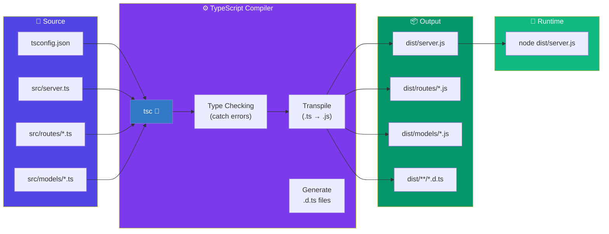
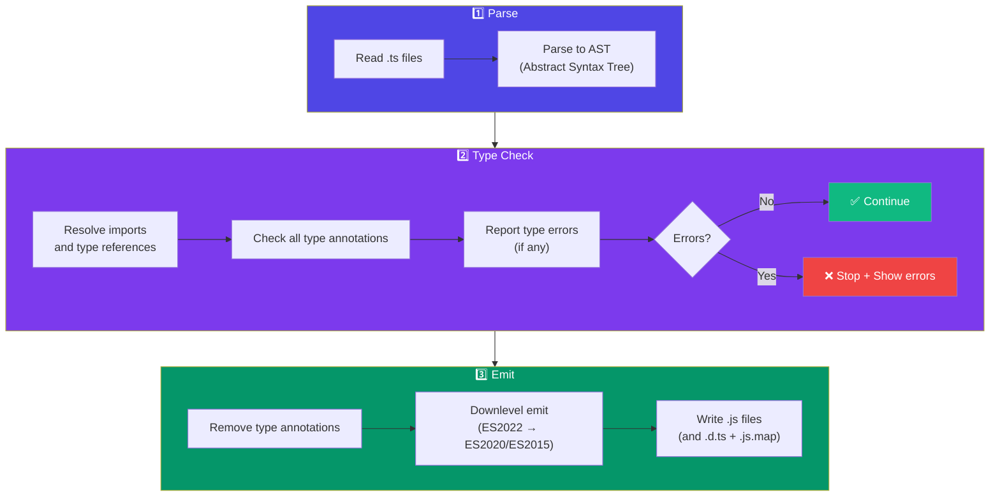
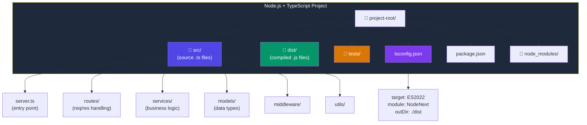

# Node.js with TypeScript

## 📖 Introduction

**TypeScript** adds static typing to JavaScript — catching bugs at compile time instead of runtime. Combined with Node.js, it provides the best developer experience for building scalable, maintainable backend applications.

## 🤔 Why Do We Need This?

| Without TypeScript | With TypeScript |
|-------------------|-----------------|
| `user.name` → crashes if user is undefined | `user?.name` — TypeScript warns you |
| `"2" + 2` → "22" (silent bug) | ❌ Type error at compile time |
| Refactoring breaks callers silently | Refactoring shows ALL broken references |
| No IDE autocomplete for complex objects | Full IntelliSense with type definitions |

## ⚠️ Problem Statement

```javascript
// JavaScript: Bug discovered at RUNTIME (potentially in production)
function calculateTotal(price, quantity) {
  return price * quantity;
}

calculateTotal("10", 2);
// "10" * 2 = 20 (works accidentally with numbers)
// But: calculateTotal("abc", 2) = NaN — discovered at runtime!

// TypeScript: Bug discovered at COMPILE TIME
function calculateTotal(price: number, quantity: number): number {
  return price * quantity;
}

calculateTotal("10", 2);
// ❌ Error: Argument of type 'string' is not assignable to parameter of type 'number'
```

## 📚 Real World Story

**Airbnb's TypeScript Migration**

Airbnb migrated their Node.js backend from JavaScript to TypeScript over 18 months. Results:
- **Bugs reduced by 38%** in production
- **Developer onboarding time cut in half**
- **Code review time reduced by 20%** (types serve as documentation)
- **Refactoring confidence** — they could rename APIs without fear of breaking callers

> *"TypeScript is the best investment we made in our codebase's future."*
> — Airbnb Engineering

## 🍕 Real World Analogy

| Concept | Analogy |
|---------|---------|
| JavaScript | A handshake deal — trust but no guarantees |
| TypeScript | A signed contract — everything is documented upfront |
| Type definitions | An instruction manual for each function |
| `any` type | "Trust me, it'll work" (famous last words) |

## 👁️ Visual Explanation

```
JAVASCRIPT EXECUTION FLOW
═══════════════════════════

Write Code → Runtime → ⛔ Bug found (too late!)

TYPESCRIPT EXECUTION FLOW
═══════════════════════════

Write Code → TypeScript Compiler → ✅ Bug caught here!
                          ↓
                  Clean JavaScript
                          ↓
                       Runtime → ✅ Smooth sailing
```

## 📊 Mermaid Diagram 1: TypeScript Build Pipeline



## ⚙️ Internal Working: How TypeScript Compiles to Node.js



## 🏗️ Architecture: TypeScript Project Structure



## 👣 Step-by-Step Flow: Setting Up TypeScript with Node.js

```mermaid
sequenceDiagram
    participant Dev as Developer
    terminal NPM as npm
    terminal TSC as tsc
    participant Node as Node.js

    Dev->>NPM: npm init -y
    Dev->>NPM: npm install -D typescript @types/node
    Dev->>NPM: npx tsc --init
    Note over TSC: Creates tsconfig.json
    
    Dev->>TSC: Edit tsconfig.json:\ntarget: "ES2022"\nmodule: "NodeNext"\noutDir: "./dist"
    Dev->>Dev: Write src/server.ts
    
    Dev->>NPM: Add build script:\n"build": "tsc"
    Dev->>NPM: Add start script:\n"start": "node dist/server.js"
    
    Dev->>TSC: npm run build
    TSC->>TSC: Type check + compile
    TSC-->>Dev: dist/server.js generated
    
    Dev->>Node: npm start
    Node-->>Dev: 🚀 Server running
```

## 📝 Syntax: TypeScript with Node.js

```typescript
// ─── BASIC TYPES ────────────────────────────────────
const name: string = 'Alice';
const age: number = 30;
const isActive: boolean = true;
const tags: string[] = ['admin', 'user'];
const config: Record<string, unknown> = { key: 'value' };

// ─── INTERFACES FOR DATA MODELS ────────────────────
interface User {
  id: number;
  name: string;
  email: string;
  role: 'admin' | 'user' | 'moderator';
  createdAt: Date;
  metadata?: Record<string, unknown>;  // Optional
}

// ─── TYPES FOR FUNCTIONS ────────────────────────────
type AsyncHandler<T> = (req: Request, res: Response) => Promise<T>;
type Middleware = (req: Request, res: Response, next: NextFunction) => void;

// ─── GENERICS ───────────────────────────────────────
async function fetchFromDB<T>(query: string): Promise<T[]> {
  const result = await pool.query(query);
  return result.rows as T[];
}

const users = await fetchFromDB<User>('SELECT * FROM users');

// ─── UTILITY TYPES ──────────────────────────────────
type PartialUser = Partial<User>;          // All fields optional
type PublicUser = Omit<User, 'password'>;  // Remove password
type UserPreview = Pick<User, 'id' | 'name'>;  // Only id and name
type ReadonlyUser = Readonly<User>;        // All fields readonly

// ─── TYPE GUARDS ────────────────────────────────────
function isError(err: unknown): err is Error {
  return err instanceof Error && typeof err.message === 'string';
}
```

## 🟢 Basic Example: Hello World with TypeScript

```typescript
// src/hello.ts
function greet(name: string): string {
  return `Hello, ${name}!`;
}

const message: string = greet('TypeScript');
console.log(message);  // "Hello, TypeScript!"
```

```json
// tsconfig.json — Minimal setup
{
  "compilerOptions": {
    "target": "ES2022",
    "module": "NodeNext",
    "moduleResolution": "NodeNext",
    "outDir": "./dist",
    "rootDir": "./src",
    "strict": true,
    "esModuleInterop": true,
    "skipLibCheck": true,
    "forceConsistentCasingInFileNames": true
  },
  "include": ["src/**/*"],
  "exclude": ["node_modules", "dist"]
}
```

```bash
# Build and run
npx tsc                  # Compile TypeScript → JavaScript
node dist/hello.js       # "Hello, TypeScript!"
```

## 🟡 Intermediate Example: Express Server with TypeScript

```typescript
// src/server.ts
import express, { Request, Response, NextFunction } from 'express';
import { User, CreateUserDTO, UserResponse } from './types';

const app = express();
app.use(express.json());

// ─── TYPED REQUEST HANDLER ──────────────────────────
app.get('/users/:id', async (req: Request<{ id: string }>, res: Response<UserResponse>) => {
  try {
    const user = await findUserById(Number(req.params.id));
    
    if (!user) {
      res.status(404).json({ error: 'User not found' });
      return;
    }
    
    res.json({
      id: user.id,
      name: user.name,
      email: user.email,
    });
  } catch (err) {
    const error = err as Error;
    res.status(500).json({ error: error.message });
  }
});

// ─── TYPED ERROR HANDLER ────────────────────────────
app.use((err: Error, req: Request, res: Response, next: NextFunction) => {
  console.error(err.stack);
  res.status(500).json({ error: 'Internal Server Error' });
});

app.listen(3000, () => console.log('🚀 Server running on :3000'));
```

```typescript
// src/types.ts — Shared type definitions
export interface User {
  id: number;
  name: string;
  email: string;
  password: string;
  createdAt: Date;
}

export interface CreateUserDTO {
  name: string;
  email: string;
  password: string;
}

export interface UserResponse {
  id: number;
  name: string;
  email: string;
}

// Express response type
export type ApiResponse<T> = 
  | { data: T; error?: never }
  | { data?: never; error: string };
```

## 🔴 Advanced Example: Generic Repository Pattern

```typescript
// src/repository.ts — Generic CRUD repository
import { Pool, QueryResult } from 'pg';

export class Repository<T extends { id: number }> {
  constructor(
    private pool: Pool,
    private tableName: string
  ) {}

  async findById(id: number): Promise<T | null> {
    const result: QueryResult<T> = await this.pool.query(
      `SELECT * FROM ${this.tableName} WHERE id = $1`,
      [id]
    );
    return result.rows[0] || null;
  }

  async findAll(limit = 100, offset = 0): Promise<T[]> {
    const result: QueryResult<T> = await this.pool.query(
      `SELECT * FROM ${this.tableName} LIMIT $1 OFFSET $2`,
      [limit, offset]
    );
    return result.rows;
  }

  async create(data: Omit<T, 'id'>): Promise<T> {
    const keys = Object.keys(data);
    const values = Object.values(data);
    const placeholders = keys.map((_, i) => `$${i + 1}`).join(', ');
    
    const result: QueryResult<T> = await this.pool.query(
      `INSERT INTO ${this.tableName} (${keys.join(', ')})
       VALUES (${placeholders})
       RETURNING *`,
      values
    );
    return result.rows[0];
  }

  async update(id: number, data: Partial<T>): Promise<T | null> {
    const keys = Object.keys(data);
    const values = Object.values(data);
    const setClause = keys.map((key, i) => `${key} = $${i + 2}`).join(', ');
    
    const result: QueryResult<T> = await this.pool.query(
      `UPDATE ${this.tableName}
       SET ${setClause}
       WHERE id = $1
       RETURNING *`,
      [id, ...values]
    );
    return result.rows[0] || null;
  }

  async delete(id: number): Promise<boolean> {
    const result: QueryResult = await this.pool.query(
      `DELETE FROM ${this.tableName} WHERE id = $1`,
      [id]
    );
    return (result.rowCount ?? 0) > 0;
  }
}

// ─── USAGE ──────────────────────────────────────────
interface User {
  id: number;
  name: string;
  email: string;
  createdAt: Date;
}

const userRepo = new Repository<User>(pool, 'users');
const user = await userRepo.findById(1);
```

## 🏭 Production Example: Full TypeScript Build Pipeline

```json
// package.json — Production-ready
{
  "name": "my-ts-api",
  "version": "1.0.0",
  "private": true,
  "type": "module",
  "scripts": {
    "dev": "tsx watch src/server.ts",
    "build": "tsc",
    "start": "node dist/server.js",
    "typecheck": "tsc --noEmit",
    "lint": "eslint src/",
    "test": "vitest run",
    "test:watch": "vitest",
    "clean": "rimraf dist/",
    "prebuild": "npm run clean && npm run typecheck && npm run lint",
    "prestart": "npm run build"
  },
  "devDependencies": {
    "@types/express": "^4.17.21",
    "@types/node": "^20.11.0",
    "tsx": "^4.7.0",
    "typescript": "^5.3.3",
    "vitest": "^1.2.0"
  },
  "dependencies": {
    "express": "^4.18.2"
  }
}
```

```json
// tsconfig.json — Production configuration
{
  "compilerOptions": {
    "target": "ES2022",
    "module": "NodeNext",
    "moduleResolution": "NodeNext",
    "outDir": "./dist",
    "rootDir": "./src",
    "strict": true,
    "noUncheckedIndexedAccess": true,
    "noImplicitReturns": true,
    "noFallthroughCasesInSwitch": true,
    "exactOptionalPropertyTypes": true,
    "forceConsistentCasingInFileNames": true,
    "esModuleInterop": true,
    "skipLibCheck": true,
    "declaration": true,
    "declarationMap": true,
    "sourceMap": true
  },
  "include": ["src/**/*"],
  "exclude": ["node_modules", "dist", "tests"]
}
```

```yaml
# .github/workflows/ci.yml — TypeScript CI pipeline
name: TypeScript CI

on: [push, pull_request]

jobs:
  typecheck:
    runs-on: ubuntu-latest
    steps:
      - uses: actions/checkout@v4
      - uses: actions/setup-node@v4
        with:
          node-version: 20
          cache: 'npm'
      - run: npm ci
      - run: npm run typecheck   # tsc --noEmit
      - run: npm run lint        # ESLint
      - run: npm run test        # Vitest
```

## ⚙️ How It Works Internally: TypeScript Compilation

```
TypeScript (.ts) → TypeScript Compiler (tsc) → JavaScript (.js)
                                                     │
                              ┌──────────────────────┘
                              ▼
                     ┌─────────────────┐
                     │ 1. Scanner      │
                     │ Tokenizes .ts   │
                     │ into tokens     │
                     └────────┬────────┘
                              ▼
                     ┌─────────────────┐
                     │ 2. Parser       │
                     │ Tokens → AST    │
                     │ (SourceFile)    │
                     └────────┬────────┘
                              ▼
                     ┌─────────────────┐
                     │ 3. Binder       │
                     │ Symbols + Scopes│
                     │ (SymbolTable)   │
                     └────────┬────────┘
                              ▼
                     ┌─────────────────┐
                     │ 4. Type Checker │
                     │ Verify types    │
                     │ Report errors   │ ← If errors, stop!
                     └────────┬────────┘
                              ▼
                     ┌─────────────────┐
                     │ 5. Emitter      │
                     │ AST → JS output │
                     │ (with sourcemap)│
                     └────────┬────────┘
                              ▼
                     ┌─────────────────┐
                     │ 6. Write files  │
                     │ .js + .d.ts     │
                     │ + .js.map       │
                     └─────────────────┘
```

## 📦 Performance Notes

| Aspect | Impact | Mitigation |
|--------|--------|-----------|
| **tsc compilation** | Slow for large projects (~15s for 100k LOC) | Use `tsc --noEmit` + `swc`/`esbuild` for transpilation |
| **tsx watch mode** | Fast (~200ms restarts) | Use `tsx watch` in development |
| **Type checking** | Only during build, zero runtime cost | Types are erased at compile time |
| **Declaration files** | Slow down compile time for libraries | Use `skipLibCheck: true` |
| **Project references** | Faster incremental builds | Split into `references` in tsconfig |

## 🔒 Security Notes

| Risk | Mitigation |
|------|-----------|
| **Type confusion** | Use `zod`/`io-ts` for runtime validation of API inputs |
| **`any` type escaping** | Enable `noImplicitAny` — never use `any` |
| **Third-party type errors** | Use `skipLibCheck: true` for node_modules |
| **Sensitive data in types** | Don't include secrets in shared type definitions |

## ⚠️ Common Mistakes

```typescript
// ❌ MISTAKE 1: Using 'any' everywhere (defeats the purpose!)
async function getUser(id: any): Promise<any> {
  const user: any = await db.query(id);
  return user;
}

// ✅ Correct: Properly typed
interface User { id: number; name: string; }
async function getUser(id: number): Promise<User | null> {
  const user = await db.query<User>(id);
  return user;
}

// ❌ MISTAKE 2: Not handling null/undefined
const user = await findUser(1);
console.log(user.name); // 💥 If user is undefined, crashes!

// ✅ Correct: Use optional chaining
console.log(user?.name);

// ❌ MISTAKE 3: Casting instead of type guarding
const data = JSON.parse(jsonString) as User;
// Runtime: data might not match User interface!

// ✅ Correct: Use runtime validation (zod)
import { z } from 'zod';
const UserSchema = z.object({ id: z.number(), name: z.string() });
const data = UserSchema.parse(JSON.parse(jsonString));

// ❌ MISTAKE 4: Forgetting async error types
app.get('/users', async (req, res) => {
  const users = await getUsers(); // ⛔ If this throws, Express catches nothing!
  res.json(users);
});

// ✅ Correct: Wrap async handlers
function asyncHandler(fn: Function) {
  return (req: Request, res: Response, next: NextFunction) => {
    Promise.resolve(fn(req, res, next)).catch(next);
  };
}
```

## 🚀 Best Practices

| # | Practice | Why |
|---|----------|-----|
| 1 | **Enable `strict: true`** | Catches most common type errors |
| 2 | **Use `tsx` for development** | Fast TypeScript execution without build step |
| 3 | **Use `tsc --noEmit` in CI** | Type checking without generating files |
| 4 | **Prefer interfaces over types** | Better error messages, extendable |
| 5 | **Use zod/valibot for runtime validation** | Types are compile-time only |
| 6 | **Never use `any`** | Use `unknown` + type guards instead |
| 7 | **Generate .d.ts for libraries** | Consumers get full type support |

## 🎯 Interview Questions

**Q1: Why use TypeScript with Node.js?**
Catches type errors at compile time, provides better IDE support, enables safe refactoring, serves as documentation, and reduces production bugs by ~38%.

**Q2: How does TypeScript work with Node.js?**
TypeScript compiles (.ts) to JavaScript (.js). Node.js runs the compiled JS. Types are erased at compile time — zero runtime overhead. Use `tsx` for development to skip the build step.

**Q3: What's the difference between `type` and `interface`?**
Interfaces can be extended (declaration merging), types are aliases that can represent unions/intersections. Prefer interfaces for object shapes, types for anything else.

## 📝 MCQs

**1. Which command compiles TypeScript to JavaScript?**
- A) `node tsc`
- B) `npx tsc` ✅
- C) `npm tsc`
- D) `ts-node`

**2. What does `strict: true` in tsconfig enable?**
- A) Only strict null checks
- B) All strict type-checking options ✅
- C) ES2022 target
- D) Source maps

**3. Which tool allows running TypeScript directly without compiling?**
- A) `tsc`
- B) `tsx` ✅
- C) `node-ts`
- D) `nodemon`

## 💻 Coding Challenge 1: Type Safe API

Create a type-safe Express route handler with proper typed request params, query, and response body.

## 💻 Coding Challenge 2: Generic Cache

Build a generic in-memory cache class with TypeScript generics:

```typescript
class Cache<T> {
  private store: Map<string, { value: T; expiresAt: number }> = new Map();
  
  constructor(private ttlMs: number = 60000) {}
  
  set(key: string, value: T): void {
    this.store.set(key, { value, expiresAt: Date.now() + this.ttlMs });
  }
  
  get(key: string): T | undefined {
    const entry = this.store.get(key);
    if (!entry) return undefined;
    if (Date.now() > entry.expiresAt) {
      this.store.delete(key);
      return undefined;
    }
    return entry.value;
  }
  
  delete(key: string): boolean {
    return this.store.delete(key);
  }
  
  clear(): void {
    this.store.clear();
  }
}
```

## 💻 Coding Challenge 3: Zod Validation Middleware

Create an Express middleware that validates request bodies using Zod schemas:

```typescript
import { z, ZodSchema } from 'zod';

function validate<T>(schema: ZodSchema<T>) {
  return (req: Request, res: Response, next: NextFunction) => {
    const result = schema.safeParse(req.body);
    if (!result.success) {
      return res.status(400).json({ 
        error: 'Validation failed', 
        details: result.error.issues 
      });
    }
    req.body = result.data;
    next();
  };
}

// Usage:
const UserSchema = z.object({
  name: z.string().min(2),
  email: z.string().email(),
  age: z.number().min(18),
});

app.post('/users', validate(UserSchema), createUser);
```

## 🧪 Mini Exercise: Debugging TypeScript Errors

Find and fix all TypeScript errors in this code:

```typescript
interface Product {
  id: number;
  name: string;
  price: number;
}

async function getProduct(id: string): Promise<Product> {
  const product = await db.query(`SELECT * FROM products WHERE id = ${id}`);
  return product;
}

function formatPrice(price: string) {
  return `$${price.toFixed(2)}`;
}

let total = 0;
total = '100';

const products = getProduct('abc');
products.then(p => console.log(p.name.toUpperCase()));
```

**Bugs to fix:**
1. SQL injection risk — use parameterized queries
2. `product` may be null/undefined — handle with `Product | null`
3. `price` param is `string` but `toFixed()` needs `number`
4. Assigning string to number variable
5. `p.name` may be undefined — use optional chaining

## 🌍 Real World Problem (Interview Coding Challenge)

**Problem:** Your team is migrating a 50,000-line JavaScript Node.js codebase to TypeScript. The codebase has no tests, no type definitions, and 15 developers working simultaneously.

**Questions:**
1. Big bang vs incremental migration — which strategy and why?
2. What tsconfig settings would you start with vs end with?
3. How would you prevent developers from using `any`?
4. How would you measure migration progress?

**Interview Tip:** This is commonly asked at Microsoft, Google, and Airbnb.

## 🏗️ Mini Project: tsconfig Generator CLI

Build a CLI that generates optimized tsconfig.json for different project types (API, CLI, Library, Monorepo).

## 📖 Summary

| Concept | Key Takeaway |
|---------|-------------|
| TypeScript | Adds static types to JavaScript |
| tsc | Compiles .ts → .js |
| tsx | Run TypeScript directly (dev only) |
| strict: true | Enables all strict checks |
| Zod | Runtime validation for API inputs |

## 📋 Cheat Sheet

```bash
npm install -D typescript @types/node
npx tsc --init                    # Create tsconfig.json
npx tsc                           # Compile
npx tsc --noEmit                  # Type check only
npm install -D tsx                # Dev runner
npx tsx src/server.ts             # Run directly
```

## 📚 Further Reading

- [TypeScript Handbook](https://www.typescriptlang.org/docs/)
- [Node.js + TypeScript Guide](https://nodejs.org/en/learn/getting-started/nodejs-with-typescript)

## 🔗 Related Topics

| Topic | Link |
|-------|------|
| Debugging Node.js | [Previous](/DSA-Notes-Problems/nodejs/fundamentals/debugging) |
| Core Concepts | [Next Module](/DSA-Notes-Problems/nodejs/core/async-programming) |
| Express.js | [Express](/DSA-Notes-Problems/nodejs/web/express-framework) |
