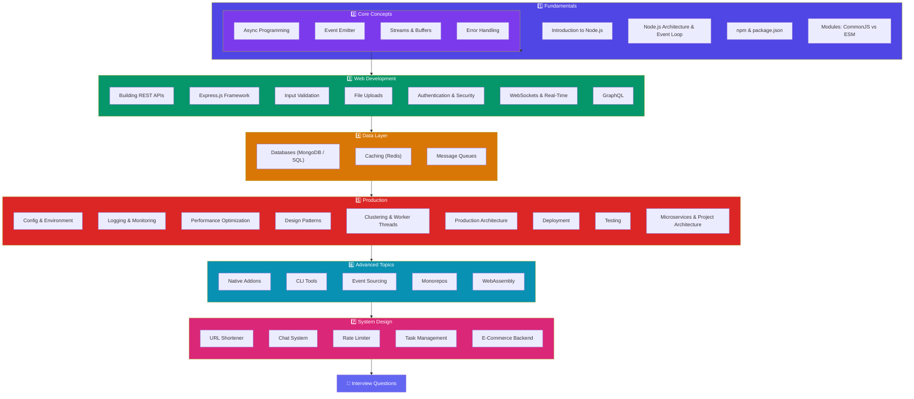

# Node.js

Complete Node.js guide covering the entire learning path — from runtime fundamentals and core modules to Express APIs, databases, caching, message queues, and production deployment.

## 📖 Learning Path

## Sections

### 1️⃣ Fundamentals

- [Introduction to Node.js](/DSA-Notes-Problems/nodejs/fundamentals/introduction)
- [Node.js Architecture](/DSA-Notes-Problems/nodejs/fundamentals/architecture)
- [npm & package.json](/DSA-Notes-Problems/nodejs/fundamentals/npm-and-package-json)
- [Modules: CommonJS vs ESM](/DSA-Notes-Problems/nodejs/fundamentals/modules-commonjs-vs-esm)
- [Core Concepts & Built-in Modules](/DSA-Notes-Problems/nodejs/fundamentals/core-modules)

### 2️⃣ Core Concepts

- [Async Programming](/DSA-Notes-Problems/nodejs/core/async-programming)
- [Event Emitter](/DSA-Notes-Problems/nodejs/core/event-emitter)
- [Streams & Buffers](/DSA-Notes-Problems/nodejs/core/streams-and-buffers)
- [Error Handling](/DSA-Notes-Problems/nodejs/core/error-handling)

### 3️⃣ Web Development

- [Building REST APIs](/DSA-Notes-Problems/nodejs/web/building-apis)
- [Express.js Framework](/DSA-Notes-Problems/nodejs/web/express-framework)
- [Input Validation](/DSA-Notes-Problems/nodejs/web/validation)
- [File Uploads](/DSA-Notes-Problems/nodejs/web/file-uploads)
- [Authentication & Security](/DSA-Notes-Problems/nodejs/web/authentication-security)
- [WebSockets & Real-Time](/DSA-Notes-Problems/nodejs/web/websockets-realtime)
- [GraphQL](/DSA-Notes-Problems/nodejs/web/graphql)

### 4️⃣ Data Layer

- [Databases (MongoDB / SQL)](/DSA-Notes-Problems/nodejs/data/databases)
- [Caching (Redis)](/DSA-Notes-Problems/nodejs/data/caching)
- [Message Queues](/DSA-Notes-Problems/nodejs/data/message-queues)

### 5️⃣ Production

- [Configuration & Environment](/DSA-Notes-Problems/nodejs/production/config-and-environment)
- [Logging & Monitoring](/DSA-Notes-Problems/nodejs/production/logging-and-monitoring)
- [Performance Optimization](/DSA-Notes-Problems/nodejs/production/performance)
- [Design Patterns](/DSA-Notes-Problems/nodejs/production/design-patterns)
- [Clustering & Worker Threads](/DSA-Notes-Problems/nodejs/production/clustering-and-worker-threads)
- [Production Architecture](/DSA-Notes-Problems/nodejs/production/production-architecture)
- [Deployment](/DSA-Notes-Problems/nodejs/production/deployment)
- [Testing](/DSA-Notes-Problems/nodejs/production/testing)
- [Microservices & Project Architecture](/DSA-Notes-Problems/nodejs/production/project-architecture)

### 6️⃣ Advanced Topics

- [Native Addons (C++)](/DSA-Notes-Problems/nodejs/advanced/addons)
- [Building CLI Tools](/DSA-Notes-Problems/nodejs/advanced/cli-tools)
- [Event Sourcing & CQRS](/DSA-Notes-Problems/nodejs/advanced/event-sourcing)
- [Monorepos & Workspaces](/DSA-Notes-Problems/nodejs/advanced/monorepos)
- [WebAssembly (WASM)](/DSA-Notes-Problems/nodejs/advanced/wasm)

### 7️⃣ System Design

- [URL Shortener](/DSA-Notes-Problems/nodejs/system-design/url-shortener)
- [Real-Time Chat System](/DSA-Notes-Problems/nodejs/system-design/chat-system)
- [Rate Limiter](/DSA-Notes-Problems/nodejs/system-design/rate-limiter)
- [Task Management App](/DSA-Notes-Problems/nodejs/system-design/task-management)
- [E-Commerce Backend](/DSA-Notes-Problems/nodejs/system-design/ecommerce-backend)

### 🎯 Interview

- [Node.js Interview Questions](/DSA-Notes-Problems/nodejs/interview-questions)
