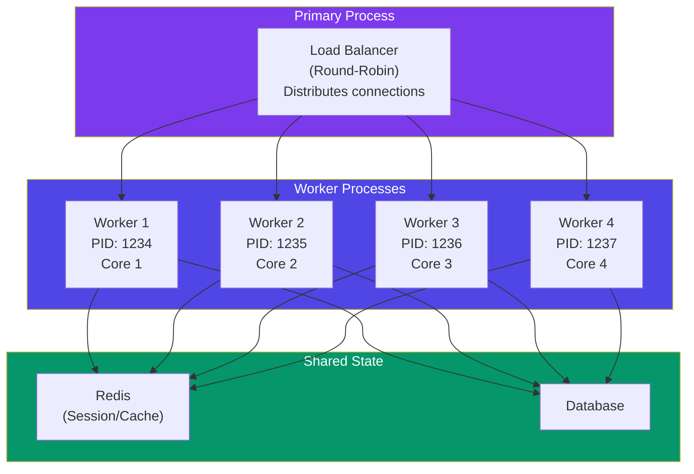
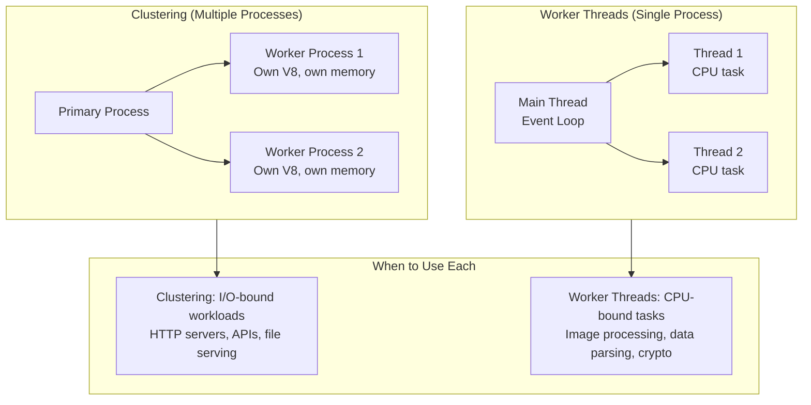

# Clustering & Worker Threads

## 📖 Introduction

Node.js runs JavaScript on a **single thread**, but modern servers have multiple CPU cores. **Clustering** and **Worker Threads** let you utilize all cores for better performance and throughput.

- **Clustering**: Multiple Node.js processes (one per CPU core), each handling requests independently. The OS distributes incoming connections across workers.
- **Worker Threads**: Multiple threads within a single process, sharing memory. Used for CPU-intensive tasks that would block the Event Loop.

## 🤔 Why Do We Need This?

```javascript
// Single process — uses only 1 core on a 16-core server!
// Under load: 1 core at 100%, 15 cores idle, requests queued

// Clustering — all 16 cores utilized
// Under load: 16x throughput, each core handles ~1/16 of requests
```

Without clustering:
- A 16-core server performs the same as a 1-core machine
- 75% of server capacity is wasted
- One slow request blocks all others (Event Loop blocking)

## ⚠️ Problem Statement

1. **CPU underutilization** — Single process = single core, even on multi-core servers
2. **Event Loop blocking** — CPU-intensive tasks (image processing, PDF generation) block ALL requests
3. **State sharing** — Clustered processes have separate memory — can't share in-memory state
4. **Graceful restart** — Restarting workers without dropping connections requires coordination
5. **Resource management** — Each worker consumes memory — need to balance concurrency vs memory

## 📚 Real World Story

**Netflix** runs Node.js in a clustered configuration, with each microservice process forked across all available CPU cores. Their API gateway handles 2+ billion requests per day using clustering behind a load balancer.

They also use Worker Threads for CPU-intensive tasks like subtitle processing, thumbnail generation, and content transcoding. By moving these tasks off the main thread, their API servers remain responsive even under heavy processing loads.

The key lesson: clustering handles I/O-bound workloads (most web APIs), while Worker Threads handle CPU-bound workloads.

## 🍕 Real World Analogy

| Concept | Restaurant Analogy |
|---------|-------------------|
| **Single thread** | One chef cooking everything |
| **Clustering** | Multiple chefs, each with their own station |
| **Worker Thread** | A sous chef helping with prep work |
| **IPC** | Chefs calling orders across stations |
| **Sticky session** | Regular customers always served by the same chef |

## 👁️ Visual Explanation

```
Single Process (1 core used):                 Clustered (all cores used):
                                                 
┌──────────────────┐                           ┌──────────────────┐
│ Node.js Process  │                           │   Load Balancer   │
│ (1 CPU core)     │                           │   (OS kernel)     │
│                  │                           └────────┬─────────┘
│ Requests → Queue│                                    │
│ ┌─► 1           │                    ┌───────────────┼────────────────┐
│ └─► 2           │                    ▼               ▼                ▼
│ └─► 3           │               ┌──────────┐ ┌──────────┐ ┌──────────┐
│ └─► 4           │               │ Worker 1 │ │ Worker 2 │ │ Worker N │
│ └─► 5           │               │ (Core 1) │ │ (Core 2) │ │ (Core N) │
│                 │               └──────────┘ └──────────┘ └──────────┘
│ 15 cores idle!  │               All cores utilized!
└──────────────────┘
```

## 📊 Mermaid Diagram 1: Clustering Architecture



## ⚙️ Internal Working: How Cluster Module Distributes Connections

The `cluster` module uses `child_process.fork()` internally:

1. **Primary process** starts and calls `cluster.fork()` N times (one per core)
2. Each forked worker runs the same code, listening on the same port
3. The primary process doesn't handle requests — it just manages workers
4. The OS kernel (via `SO_REUSEADDR`) distributes incoming connections using round-robin
5. If a worker crashes, the primary detects this and forks a replacement

```javascript
cluster.fork() → child_process.fork() → new Node.js process → shares same port
                          │                      │
                    Round-robin at           Separate V8,
                    kernel level             separate memory
```

## 🔄 Mermaid Diagram 2: Worker Threads vs Clustering



## 📝 Syntax

### Clustering

```javascript
const cluster = require('cluster');
const os = require('os');

if (cluster.isPrimary) {
  const numCPUs = os.cpus().length;
  console.log(`Primary ${process.pid} spawning ${numCPUs} workers`);

  for (let i = 0; i < numCPUs; i++) {
    cluster.fork();
  }

  cluster.on('exit', (worker, code, signal) => {
    console.log(`Worker ${worker.process.pid} died`);
    cluster.fork(); // Auto-restart
  });
} else {
  // Worker — all workers share port 3000
  const server = http.createServer((req, res) => {
    res.end(`Handled by worker ${process.pid}`);
  });
  server.listen(3000);
}
```

### Worker Threads

```javascript
// main.js
const { Worker } = require('worker_threads');

function runWorker(data) {
  return new Promise((resolve, reject) => {
    const worker = new Worker('./worker.js', { workerData: data });
    worker.on('message', resolve);
    worker.on('error', reject);
    worker.on('exit', (code) => {
      if (code !== 0) reject(new Error(`Worker stopped with exit code ${code}`));
    });
  });
}
```

## 🟢 Basic Example: Clustering an Express App

```javascript
const express = require('express');
const cluster = require('cluster');
const os = require('os');

if (cluster.isPrimary) {
  const numCPUs = os.cpus().length;
  console.log(`Primary process ${process.pid} is running`);

  // Fork workers
  for (let i = 0; i < numCPUs; i++) {
    cluster.fork();
  }

  // Handle worker crashes
  cluster.on('exit', (worker, code, signal) => {
    console.log(`Worker ${worker.process.pid} died. Restarting...`);
    cluster.fork();
  });

  // Graceful shutdown
  process.on('SIGTERM', () => {
    for (const id in cluster.workers) {
      cluster.workers[id].kill();
    }
    process.exit(0);
  });
} else {
  const app = express();

  app.get('/', (req, res) => {
    res.json({
      message: 'Hello from clustered Node.js!',
      pid: process.pid,
      workers: os.cpus().length,
    });
  });

  app.get('/health', (req, res) => {
    res.json({ status: 'healthy', pid: process.pid });
  });

  app.listen(3000, () => {
    console.log(`Worker ${process.pid} started`);
  });
}
```

**What's happening:**
- **Primary process** manages workers — doesn't handle requests
- **`os.cpus().length`** creates one worker per CPU core
- **Auto-restart** — workers are automatically replaced if they crash
- **Graceful shutdown** — SIGTERM kills all workers
- **Shared port** — all workers listen on port 3000, OS distributes connections

## 🟡 Intermediate Example: Worker Threads for Image Processing

```javascript
// image-worker.js
const { parentPort, workerData } = require('worker_threads');
const sharp = require('sharp');

async function processImage({ inputPath, outputPath, width, height, format }) {
  await sharp(inputPath)
    .resize(width, height, { fit: 'cover', position: 'centre' })
    .toFormat(format, { quality: 80 })
    .toFile(outputPath);

  return { outputPath, width, height, format };
}

processImage(workerData).then(result => {
  parentPort.postMessage(result);
}).catch(err => {
  parentPort.postMessage({ error: err.message });
});

// main.js — Express route that uses worker threads
const { Worker } = require('worker_threads');
const path = require('path');
const express = require('express');
const app = express();

function runWorker(data) {
  return new Promise((resolve, reject) => {
    const worker = new Worker(path.join(__dirname, 'image-worker.js'), {
      workerData: data,
    });

    worker.on('message', (result) => {
      if (result.error) return reject(new Error(result.error));
      resolve(result);
    });

    worker.on('error', reject);

    worker.on('exit', (code) => {
      if (code !== 0) {
        reject(new Error(`Worker exited with code ${code}`));
      }
    });
  });
}

app.post('/images/resize', async (req, res) => {
  try {
    const { imageId, sizes } = req.body;
    const results = await Promise.all(
      sizes.map(size =>
        runWorker({
          inputPath: `/tmp/uploads/${imageId}.jpg`,
          outputPath: `/tmp/processed/${imageId}_${size.name}.jpg`,
          ...size,
          format: 'jpeg',
        })
      )
    );
    res.json({ success: true, images: results });
  } catch (err) {
    res.status(500).json({ error: err.message });
  }
});
```

**What's happening:**
- **Worker Thread** processes the image without blocking the Event Loop
- **`Promise.all`** processes multiple sizes in parallel across multiple threads
- **Message passing** — results are communicated via `parentPort.postMessage()`
- **Error handling** — errors are captured and sent back to the main thread
- **Non-blocking** — the API remains responsive during image processing

## 🔴 Advanced Example: Worker Pool for CPU-Intensive Tasks

```javascript
// worker-pool.js
const { Worker } = require('worker_threads');
const os = require('os');

class WorkerPool {
  constructor(workerFile, poolSize = os.cpus().length) {
    this.workers = [];
    this.queue = [];
    this.active = new Map();

    // Create the pool
    for (let i = 0; i < poolSize; i++) {
      this.addWorker(workerFile);
    }
  }

  addWorker(workerFile) {
    const worker = new Worker(workerFile);
    const entry = { worker, busy: false };

    worker.on('message', (result) => {
      const callback = this.active.get(worker);
      this.active.delete(worker);
      entry.busy = false;
      callback(null, result);
      this.processQueue();
    });

    worker.on('error', (err) => {
      const callback = this.active.get(worker);
      this.active.delete(worker);
      entry.busy = false;
      callback(err);
      this.processQueue();
    });

    this.workers.push(entry);
  }

  execute(data) {
    return new Promise((resolve, reject) => {
      const callback = (err, result) => {
        if (err) reject(err);
        else resolve(result);
      };

      // Find an available worker
      const available = this.workers.find(w => !w.busy);
      if (available) {
        available.busy = true;
        this.active.set(available.worker, callback);
        available.worker.postMessage(data);
      } else {
        // Queue for later
        this.queue.push({ data, callback });
      }
    });
  }

  processQueue() {
    if (this.queue.length === 0) return;
    const available = this.workers.find(w => !w.busy);
    if (!available) return;

    const item = this.queue.shift();
    available.busy = true;
    this.active.set(available.worker, item.callback);
    available.worker.postMessage(item.data);
  }

  async close() {
    await Promise.all(this.workers.map(w => w.worker.terminate()));
    this.workers = [];
    this.queue = [];
  }
}

// Usage
const pool = new WorkerPool('./processor.js', 4);

app.post('/process', async (req, res) => {
  try {
    const result = await pool.execute({ task: req.body });
    res.json(result);
  } catch (err) {
    res.status(500).json({ error: err.message });
  }
});
```

**What's happening:**
- **Worker pool** manages a fixed set of workers (one per core)
- **Queue** — if all workers are busy, tasks are queued
- **Reuse** — workers are reused across requests (no creation overhead)
- **Round-robin** — work is distributed to available workers
- **Graceful shutdown** — `pool.close()` terminates all workers

## 🏭 Production Example: PM2 Clustering Configuration

```javascript
// ecosystem.config.js
module.exports = {
  apps: [{
    name: 'my-api',
    script: 'dist/server.js',
    instances: 'max',           // One worker per CPU core
    exec_mode: 'cluster',        // Cluster mode (not fork)
    watch: false,
    max_memory_restart: '1G',    // Restart if memory > 1GB
    kill_timeout: 5000,          // 5 seconds for graceful shutdown
    listen_timeout: 3000,        // Wait 3s for workers to start listening
    
    // Environment-specific settings
    env: {
      NODE_ENV: 'development',
      PORT: 3000,
    },
    env_production: {
      NODE_ENV: 'production',
      PORT: 3000,
    },
    
    // Logging
    error_file: 'logs/err.log',
    out_file: 'logs/out.log',
    log_file: 'logs/combined.log',
    merge_logs: true,
    
    // Auto-restart
    autorestart: true,
    restart_delay: 1000,
    
    // Graceful shutdown
    shutdown_with_message: true,
  }],
};
```

```bash
# Start with PM2 clustering
pm2 start ecosystem.config.js --env production
pm2 monit              # Monitor
pm2 reload all         # Zero-downtime reload
pm2 scale my-api 8     # Scale to 8 instances
```

## ⚙️ How It Works Internally: Node.js Cluster Module

The `cluster` module uses `child_process.fork()` to create worker processes. Each worker is a completely independent Node.js process with its own V8 instance, Event Loop, and memory space.

**Port sharing**: The primary process creates a server socket and passes the file descriptor (FD) to worker processes. All workers share the same FD, and the OS kernel distributes incoming connections using a round-robin algorithm (on most platforms).

**IPC**: Workers communicate with the primary via IPC (Inter-Process Communication), sending serialized JSON messages. This is used for cluster management (health checks, commands), not for sharing application state.

## 📦 Performance Notes

### Clustering vs Worker Threads

| Aspect | Clustering | Worker Threads |
|--------|------------|----------------|
| **Model** | Multiple processes | Multiple threads in one process |
| **Memory** | Separate (N × base memory) | Shared (lower overhead) |
| **Isolation** | High — one crash doesn't affect others | Medium — thread crash can crash process |
| **Communication** | IPC via messages | Shared ArrayBuffer + messages |
| **Use case** | I/O-bound (HTTP servers) | CPU-bound (computation) |
| **Memory cost** | ~30-40MB per worker | ~5-10MB per thread |

### When to Cluster

- HTTP APIs with moderate CPU usage
- Socket.IO servers (each worker handles connections)
- Any I/O-bound workload

### When to Use Worker Threads

- Image/video processing
- Data parsing (CSV, XML, large JSON)
- Cryptography (hashing, encryption)
- PDF generation

## 🔒 Security Notes

### Process Isolation

Clustering provides natural security isolation. If one worker is compromised:

- It can't access another worker's memory
- It can't read another worker's environment variables
- The primary can detect abnormal behavior and kill the worker

Worker threads share the same process — a vulnerability in a thread has access to the entire process memory.

## ⚠️ Common Mistakes

1. **❌ Clustering without external session store** — In-memory sessions don't work across workers. Use Redis or a database.

2. **❌ Too many workers** — `os.cpus().length` is the sweet spot. More workers than cores causes context switching overhead.

3. **❌ Blocking the Event Loop in a worker** — Each worker is still single-threaded! CPU work still blocks that worker's Event Loop.

4. **❌ Not handling worker crashes** — A worker crash takes down all active connections on that worker. Always auto-restart.

5. **❌ Using worker threads for I/O** — Node.js already handles I/O asynchronously. Worker threads are for CPU work only.

6. **❌ No graceful shutdown** — Killing workers abruptly drops active connections. Implement `SIGTERM` handling.

## 🚀 Best Practices

### Clustering

```javascript
// ✅ Production clustering setup
if (cluster.isPrimary) {
  const numCPUs = os.cpus().length;
  for (let i = 0; i < numCPUs; i++) cluster.fork();

  cluster.on('exit', (worker) => cluster.fork());

  // Graceful shutdown
  process.on('SIGTERM', () => {
    for (const id in cluster.workers) {
      cluster.workers[id].kill('SIGTERM');
    }
  });
} else {
  // Worker process
  process.on('SIGTERM', () => {
    server.close(() => process.exit(0));
  });
}
```

### Worker Threads

```javascript
// ✅ Use a worker pool, not one-off workers
// Creating a Worker is expensive (~10ms). Reuse them.

// ✅ Limit concurrency to CPU cores
const pool = new WorkerPool('./worker.js', os.cpus().length);

// ✅ Always handle errors in workers
worker.on('error', (err) => { /* handle */ });
worker.on('exit', (code) => { /* handle unexpected exit */ });
```

## 🎯 Interview Questions

**Q1: What's the difference between clustering and worker threads?**

Clustering creates multiple Node.js processes, each running the same code on different CPU cores. Each process has its own V8 instance, memory, and Event Loop. Worker threads create multiple threads within a single process, sharing memory. Clustering is for scaling I/O-bound workloads (HTTP servers). Worker threads are for offloading CPU-intensive tasks that would block the Event Loop.

**Q2: How many cluster workers should you create?**

One per CPU core (`os.cpus().length`). More than that causes context switching overhead without benefit. Less than that leaves cores idle.

**Q3: How do you share state across cluster workers?**

Workers can't share in-memory state directly. Use an external store: Redis for session/cache, a database for persistent data, or a message queue for async communication.

**Q4: What happens when a cluster worker crashes?**

The primary process receives an `exit` event. Active connections handled by that worker are lost (they get an error or timeout). The primary should fork a new worker to replace the crashed one. Clients should retry their requests.

## 📝 MCQs

**1. How does Node.js distribute incoming connections across cluster workers?**
- A) Random assignment by the primary process
- B) Round-robin by the OS kernel ✅
- C) Each worker polls for new connections
- D) First available worker picks it up

**2. What is the recommended number of cluster workers?**
- A) 2 workers
- B) One per CPU core ✅
- C) 10 workers
- D) As many as memory allows

**3. Which is the correct use case for Worker Threads?**
- A) Handling HTTP requests
- B) Image processing ✅
- C) Database queries
- D) File system operations

**4. What happens to a worker's connections when it crashes?**
- A) They're transferred to another worker
- B) They're lost and clients get an error ✅
- C) They're queued until the worker restarts
- D) They're handled by the primary process

**5. How do you share session data across cluster workers?**
- A) Use global variables (they're shared)
- B) Store sessions in Redis ✅
- C) Use worker IPC
- D) Sessions are automatically shared

**Answer Key:** 1-B, 2-B, 3-B, 4-B, 5-B

## 💻 Coding Challenge 1: Clustered HTTP Server

Create an HTTP server that:
- Uses the cluster module to fork one worker per CPU core
- Each worker handles requests and returns its PID
- Auto-restarts crashed workers
- Logs when workers start, crash, and restart
- Implements graceful shutdown (SIGTERM)

## 💻 Coding Challenge 2: Prime Number Calculator with Worker Threads

Build a prime number calculator:
- An Express endpoint `GET /primes?limit=100000` calculates primes up to the limit
- The calculation runs in a Worker Thread (non-blocking)
- Use a worker pool to handle concurrent requests
- Return progress updates via server-sent events

## 💻 Coding Challenge 3: PM2 Production Setup

Create a PM2 ecosystem configuration that:
- Runs in cluster mode with 'max' instances
- Sets memory limit (restart at 512MB)
- Configures log files with rotation
- Implements zero-downtime reload
- Sets environment variables per environment
- Configures health check and startup script

## 🧪 Mini Exercise: Debugging Cluster Issues

This cluster setup has bugs. Find and fix them:

```javascript
const cluster = require('cluster');
const os = require('os');

if (cluster.isPrimary) {
  const numCPUs = os.cpus().length;
  // Bug 1: Not checking isPrimary — also forks in workers!
  cluster.fork(); // Bug 2: Only forks once!
  
  cluster.on('exit', (worker) => {
    // Bug 3: No auto-restart — workers don't come back!
    console.log('Worker died');
  });
}

// Bug 4: In-memory sessions — won't work across workers!
const sessions = {};
app.use(session({ store: sessions })); // Not shared!

// Bug 5: No graceful shutdown — killing workers drops connections
process.on('SIGTERM', () => {
  process.exit(0); // Immediate exit!
});
```

## 🌍 Real World Problem (Interview Coding Challenge)

**Problem:** You're designing the infrastructure for a video processing platform. Users upload videos that need to be transcoded to multiple formats (MP4, WebM), resolutions (360p, 720p, 1080p), and have thumbnails generated. Processing one video takes ~5 minutes of CPU time.

**Requirements:**
1. API server must remain responsive during video processing
2. 100+ concurrent video uploads must be supported
3. Processing must utilize all 16 CPU cores
4. If a processing task fails, it should be retried (not lost)
5. Memory usage per server must stay under 4GB

**Questions:**
1. Would you use clustering, worker threads, or a separate worker service?
2. How would you distribute processing across cores?
3. How do you handle a processing worker crashing mid-task?
4. How do you report progress back to the user?

**Interview Tip:** Discuss using a dedicated worker service with BullMQ queues. The API server is clustered for responsiveness. Workers run in separate processes (not threads) for crash isolation. Progress is reported via WebSocket or polling.

## 🏗️ Mini Project: Worker Thread Pool Library

Build a reusable worker thread pool:

**Core features:**
- Configurable pool size (default: CPU cores)
- Queue when all workers are busy
- Timeout for hung tasks
- Auto-restart crashed workers
- Progress reporting from worker to main thread

**Technical requirements:**
- Generic — works with any worker script
- Promise-based API
- Graceful shutdown
- Metrics (queue depth, active workers, completed tasks)

**Bonus features:**
- Priority queue
- Dynamic scaling (add/remove workers at runtime)
- Shared memory for large data transfers

## 📖 Summary

| Concept | Key Takeaway |
|---------|-------------|
| **Clustering** | Multiple processes, one per CPU core, for I/O-bound workloads |
| **Worker Threads** | Multiple threads in one process, for CPU-bound tasks |
| **Cluster.isPrimary** | Determines if code runs in primary or worker |
| **Auto-restart** | Always restart crashed workers |
| **Shared state** | Use Redis/DB, not in-memory (not shared across workers) |
| **Worker pool** | Reuse worker threads — creation is expensive |
| **PM2** | Production process manager with cluster mode |

## 📋 Cheat Sheet

```javascript
// Quick reference: Clustering & Worker Threads

// 1. Basic clustering
const cluster = require('cluster');
const os = require('os');
if (cluster.isPrimary) {
  os.cpus().forEach(() => cluster.fork());
  cluster.on('exit', () => cluster.fork());
} else {
  http.createServer(handler).listen(3000);
}

// 2. Worker thread
const { Worker } = require('worker_threads');
const worker = new Worker('./task.js', { workerData: data });
worker.on('message', (result) => {});
worker.on('error', (err) => {});

// 3. PM2 cluster mode
// pm2 start app.js -i max --name "myapp"

// 4. Graceful shutdown
process.on('SIGTERM', () => {
  server.close(() => process.exit(0));
});
```

## 📚 Further Reading

- [Node.js Cluster Documentation](https://nodejs.org/api/cluster.html)
- [Node.js Worker Threads](https://nodejs.org/api/worker_threads.html)
- [PM2 Cluster Mode](https://pm2.keymetrics.io/docs/usage/cluster-mode/)
- [Worker Pool Pattern](https://nodejs.org/en/learn/asynchronous-work/worker-threads)

## 🔗 Related Topics

- [Deployment & CI/CD](./deployment) — Deploying clustered apps
- [Performance Optimization](./performance) — Scaling with clustering
- [Configuration & Environment](./config-and-environment) — Environment config
- [Monitoring](./logging-and-monitoring) — Monitoring cluster health
