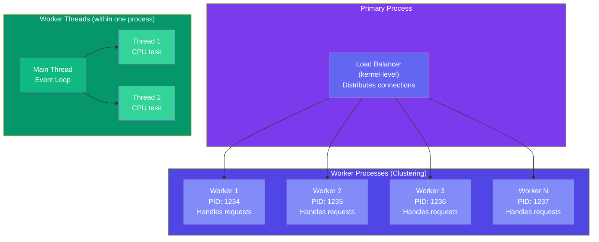

## Clustering & Worker Threads

Node.js runs JavaScript on a **single thread**, but modern servers have multiple CPU cores. **Clustering** and **Worker Threads** let you utilize all cores for better performance.

### Clustering vs Worker Threads

| | Clustering | Worker Threads |
|---|---|---|
| Model | Multiple processes | Multiple threads in one process |
| Memory | Separate (each process has own memory) | Shared (can use SharedArrayBuffer) |
| Isolation | High — one crash doesn't affect others | Medium — thread crash can crash the process |
| Use case | High-traffic HTTP servers | CPU-intensive computations |
| Communication | IPC via messages | message passing + shared memory |

### Cluster / Worker Threads Model



### Clustering

**Used by**: Netflix, LinkedIn to handle millions of requests

```javascript
const cluster = require('cluster');
const os = require('os');
const http = require('http');

if (cluster.isPrimary) {
  const numCPUs = os.cpus().length;
  console.log(`Spawning ${numCPUs} workers...`);
  
  for (let i = 0; i < numCPUs; i++) {
    cluster.fork();
  }
  
  cluster.on('exit', (worker, code, signal) => {
    console.log(`Worker ${worker.process.pid} died. Restarting...`);
    cluster.fork(); // Auto-restart
  });

} else {
  http.createServer((req, res) => {
    res.writeHead(200);
    res.end(`Handled by worker PID: ${process.pid}`);
  }).listen(3000);
}
```

### Worker Threads

**Clustering** creates multiple processes. **Worker Threads** create multiple threads within ONE process — use for CPU-intensive work like image processing, data parsing, or cryptography.

```javascript
const { Worker, isMainThread, parentPort, workerData } = require('worker_threads');

// worker.js
if (!isMainThread) {
  // This code runs in the worker thread
  const { numbers } = workerData;
  const result = numbers.reduce((sum, n) => sum + n, 0);
  parentPort.postMessage({ result });
}

// main.js
if (isMainThread) {
  const bigArray = Array.from({ length: 1000000 }, (_, i) => i);
  
  const worker = new Worker(__filename, {
    workerData: { numbers: bigArray }
  });
  
  worker.on('message', ({ result }) => console.log('Sum:', result));
  worker.on('error', (err) => console.error(err));
  worker.on('exit', (code) => {
    if (code !== 0) console.error(`Worker stopped with exit code ${code}`);
  });
}
```

### Practical: CPU-Intensive Task with Worker Threads

```javascript
const { Worker } = require('worker_threads');
const path = require('path');

function runWorker(workerData) {
  return new Promise((resolve, reject) => {
    const worker = new Worker(path.join(__dirname, 'processor.js'), { workerData });
    
    worker.on('message', resolve);
    worker.on('error', reject);
    worker.on('exit', (code) => {
      if (code !== 0) reject(new Error(`Worker exited with code ${code}`));
    });
  });
}

// Express route using worker thread
app.post('/process-images', async (req, res) => {
  try {
    const result = await runWorker({ images: req.body.images });
    res.json({ success: true, result });
  } catch (err) {
    res.status(500).json({ error: err.message });
  }
});
```

### Related Topics

> 🔍 These topics that were previously in this page now have dedicated pages:
> - **[Caching (Redis)](/DSA-Notes-Problems/nodejs/data/caching)** — Redis, cache-aside, read-through patterns
> - **[WebSockets & Real-Time](/DSA-Notes-Problems/nodejs/web/websockets-realtime)** — Socket.io, rooms, broadcasting
> - **[Message Queues](/DSA-Notes-Problems/nodejs/data/message-queues)** — BullMQ, RabbitMQ, pub/sub

### Key Takeaways

- **Clustering** forks multiple Node.js processes (one per CPU core) — load is balanced by the OS
- **Worker Threads** create threads within a single process — share memory, ideal for CPU tasks
- Clustering provides **process isolation** — one worker crashing doesn't take down the rest
- Worker Threads use **message passing** (`postMessage` / `on('message')`) to communicate
- Use clustering for **I/O-bound** workloads (HTTP servers), worker threads for **CPU-bound** work
- Always handle worker crashes with `worker.on('exit')` and auto-restart in production
