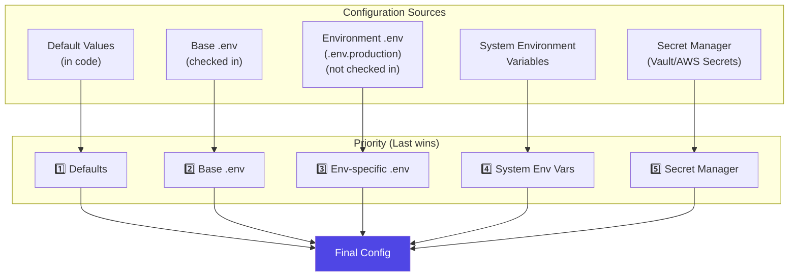
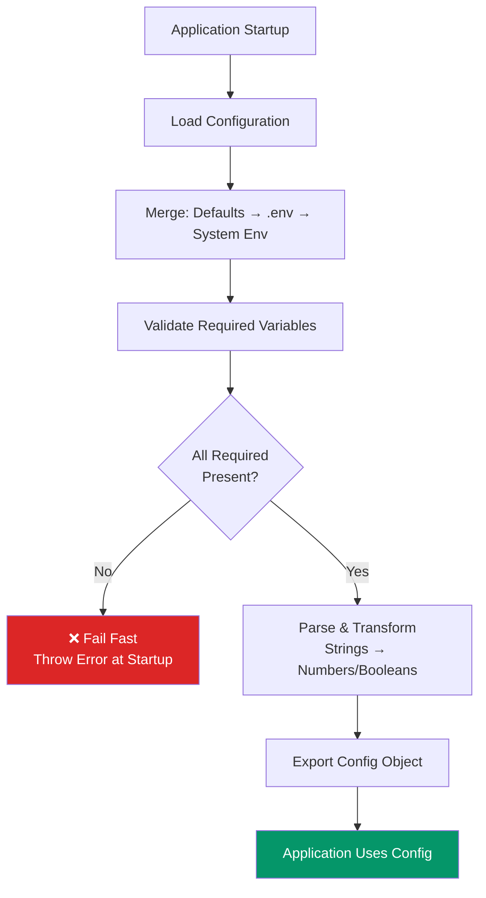
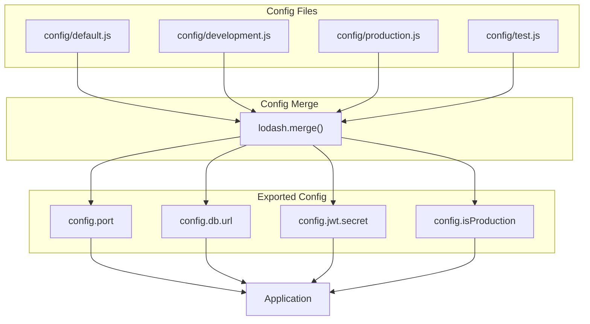
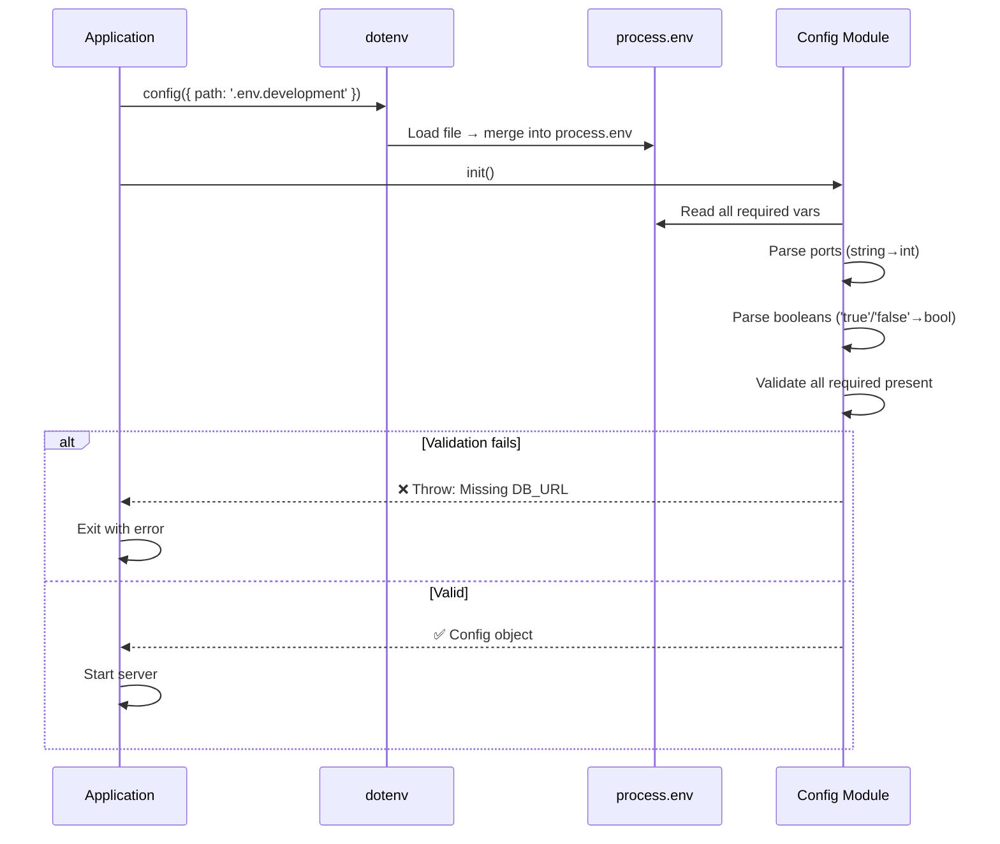

# Configuration & Environment

## 📖 Introduction

Proper configuration management keeps your Node.js application **secure** and **portable** across environments. The same codebase should run in development, staging, and production without modification — only the configuration changes. This principle, known as **the 12-Factor App**, is the foundation of modern cloud-native application design.

Environment variables, configuration files, secrets managers, and validation at startup form a robust configuration system that prevents "it works on my machine" problems and keeps credentials out of version control.

## 🤔 Why Do We Need This?

Hardcoding configuration values is the root of many production issues:

```javascript
// ❌ Hardcoded — won't work in production
const dbUrl = 'mongodb://localhost:27017/myapp';
const jwtSecret = 'super-secret-key';
const port = 3000;

// ✅ Environment-based — works everywhere
const dbUrl = process.env.DB_URL;
const jwtSecret = process.env.JWT_SECRET;
const port = process.env.PORT || 3000;
```

Without proper configuration management, you face: credentials leaked to version control, environment-specific bugs, manual configuration changes during deployment, and difficulty debugging production issues.

## ⚠️ Problem Statement

A production configuration system must solve:

1. **Secret management** — Database passwords, API keys, and JWT secrets must never be committed to Git
2. **Environment parity** — Dev, staging, and prod should use the same code with different config
3. **Validation** — Missing required config should be caught at startup, not at runtime
4. **Type safety** — Environment variables are strings — ports need parsing, booleans need conversion
5. **Secrets rotation** — Rotating secrets without downtime requires external secret managers
6. **Audit trail** — Who changed what configuration and when?

## 📚 Real World Story

**Heroku** popularized the 12-Factor App methodology and the use of environment variables for configuration. When you deploy a Node.js app to Heroku, you set config vars through their dashboard or CLI — Heroku injects them as environment variables at runtime. This means the same build artifact can be promoted from staging to production without any changes.

**GitHub** took this further with encrypted secrets in GitHub Actions. CI/CD pipelines access secrets through `${{ secrets.MY_SECRET }}`, which are injected at runtime and never exposed in logs. This pattern is now standard across all CI/CD platforms.

## 🍕 Real World Analogy

| Config Concept | Apartment Building Analogy |
|----------------|--------------------------|
| **Environment variables** | What's in the apartment (furniture config) |
| **.env file** | A list of what's in each apartment |
| **Code** | The building structure (unchanged between apartments) |
| **.env.example** | A sample inventory list (safely shared) |
| **Startup validation** | Checking all appliances work before renting |
| **Secrets manager** | A safe deposit box at the bank (not in the apartment) |

## 👁️ Visual Explanation

```
Development (local laptop):              Production (cloud server):
┌────────────────────────────┐           ┌────────────────────────────┐
│ .env file                  │           │ Environment Variables      │
│ DB_URL=localhost           │           │ (set via Heroku/AWS/CI)    │
│ JWT_SECRET=dev-secret      │           │ DB_URL=production-db.com   │
│ LOG_LEVEL=debug            │           │ JWT_SECRET=[vault]         │
└────────────────────────────┘           │ LOG_LEVEL=info             │
        │                                └────────────────────────────┘
        ▼                                           ▼
┌─────────────────────────────────────────────────────────────┐
│                  Same Application Code                       │
│          const db = new Database(process.env.DB_URL)         │
│          const port = process.env.PORT || 3000               │
└─────────────────────────────────────────────────────────────┘
```

## 📊 Mermaid Diagram 1: Configuration Sources



## ⚙️ Internal Working: How dotenv Loads Variables

The `dotenv` library reads a `.env` file and merges it into `process.env`. Here's what happens:

1. `dotenv.config()` reads the `.env` file as a UTF-8 text file
2. It parses each line: split on `=`, trim whitespace, handle quotes
3. It calls `Object.assign(process.env, parsed)` — merging into the existing environment
4. **Important**: `dotenv` does NOT overwrite existing environment variables (no override by default)
5. The parsed values are always **strings** — `PORT=3000` becomes `"3000"`, not `3000`

```javascript
// dotenv parses:
DB_URL=mongodb://localhost:27017/dev
PORT=3000
NODE_ENV=development
DEBUG=false

// Into process.env:
process.env.DB_URL = 'mongodb://localhost:27017/dev';
process.env.PORT = '3000';    // String, not number!
process.env.NODE_ENV = 'development';
process.env.DEBUG = 'false';  // String 'false', not boolean false!
```

This is why you must parse and validate config values after loading.

## 🔄 Mermaid Diagram 2: Configuration Validation Flow



## 🏗️ Architecture: Config Module



## 👣 Step-by-Step Flow: Configuration Resolution



## 📝 Syntax

### dotenv

```javascript
require('dotenv').config();                         // Load .env
require('dotenv').config({ path: '.env.production' }); // Specific file
require('dotenv').config({ override: true });        // Override existing vars

// Load multiple files (base + environment-specific)
require('dotenv').config({ path: '.env' });
require('dotenv').config({ path: `.env.${process.env.NODE_ENV}`, override: true });
```

### Config Module Pattern

```javascript
// config/index.js
const config = {
  env: process.env.NODE_ENV || 'development',
  port: parseInt(process.env.PORT, 10) || 3000,
  isProduction: process.env.NODE_ENV === 'production',
  db: {
    url: process.env.DB_URL,
    maxPoolSize: parseInt(process.env.DB_POOL_SIZE, 10) || 10,
  },
  jwt: {
    secret: process.env.JWT_SECRET,
    expiresIn: process.env.JWT_EXPIRES_IN || '15m',
  },
};
```

## 🟢 Basic Example: Using dotenv

```javascript
// .env (committed as .env.example, real .env in .gitignore)
PORT=3000
NODE_ENV=development
DB_URL=mongodb://localhost:27017/myapp
LOG_LEVEL=debug
JWT_SECRET=dev-secret-change-me

// app.js
require('dotenv').config();

// Now process.env has all values from .env + system env
const express = require('express');
const app = express();

const port = parseInt(process.env.PORT, 10) || 3000;
app.listen(port, () => {
  console.log(`Server running in ${process.env.NODE_ENV} mode on port ${port}`);
});

// Use environment-specific behavior
if (process.env.NODE_ENV === 'development') {
  app.use(require('morgan')('dev')); // Verbose logging in dev
}

// Logging based on LOG_LEVEL
if (process.env.LOG_LEVEL === 'debug') {
  console.log('Debug info:', process.env);
}
```

**What's happening:**
- **`.env` file** stores local configuration — never committed to Git
- **`require('dotenv').config()`** loads the file into `process.env`
- **`parseInt(port, 10)`** converts the string `"3000"` to the number `3000`
- **Environment-specific logic** — different behavior in dev vs production

## 🟡 Intermediate Example: Config Module with Validation

```javascript
// config/index.js
const path = require('path');

// Determine environment
const env = process.env.NODE_ENV || 'development';

// Load the appropriate .env file
require('dotenv').config({ path: path.resolve(__dirname, '../.env') });
require('dotenv').config({
  path: path.resolve(__dirname, `../.env.${env}`),
  override: true,
});

// Configuration object
const config = {
  env,
  port: parseInt(process.env.PORT, 10) || 3000,
  isProduction: env === 'production',
  isDevelopment: env === 'development',
  isTest: env === 'test',

  db: {
    url: process.env.DB_URL,
    options: {
      maxPoolSize: parseInt(process.env.DB_POOL_SIZE, 10) || 10,
      ssl: process.env.DB_SSL === 'true',
    },
  },

  redis: {
    url: process.env.REDIS_URL || 'redis://localhost:6379',
  },

  jwt: {
    secret: process.env.JWT_SECRET,
    expiresIn: process.env.JWT_EXPIRES_IN || '15m',
    refreshExpiresIn: process.env.REFRESH_EXPIRES_IN || '7d',
  },

  email: {
    host: process.env.EMAIL_HOST,
    port: parseInt(process.env.EMAIL_PORT, 10) || 587,
    user: process.env.EMAIL_USER,
    pass: process.env.EMAIL_PASS,
  },
};

// Validate required variables at startup
const requiredVars = ['DB_URL', 'JWT_SECRET'];
const missing = requiredVars.filter(name => !process.env[name]);

if (missing.length > 0) {
  console.error(`❌ Missing required environment variables: ${missing.join(', ')}`);
  process.exit(1); // Fail fast
}

// Validate email config if any email-related var is set
if (config.email.host && !config.email.user) {
  console.error('❌ EMAIL_HOST set but EMAIL_USER is missing');
  process.exit(1);
}

module.exports = config;
```

**What's happening:**
- **Multi-file loading** — base `.env` loaded first, then environment-specific overrides
- **Type conversion** — ports parsed to integers, `DB_SSL` string `"true"` converted to boolean
- **Sensible defaults** — `PORT || 3000`, `REDIS_URL || 'redis://localhost:6379'`
- **Fail-fast validation** — missing DB_URL or JWT_SECRET crashes the server immediately
- **Cross-field validation** — if EMAIL_HOST is set, EMAIL_USER must also be set

## 🔴 Advanced Example: Secrets Manager Integration

```javascript
// config/secrets.js
const { SecretsManager } = require('@aws-sdk/client-secrets-manager');
const redis = require('redis');

class SecretsService {
  constructor() {
    this.client = new SecretsManager({ region: process.env.AWS_REGION || 'us-east-1' });
    this.localCache = new Map();
  }

  async getSecret(secretId) {
    // Check local cache first
    if (this.localCache.has(secretId)) {
      return this.localCache.get(secretId);
    }

    try {
      const response = await this.client.getSecretValue({
        SecretId: secretId,
      });

      let secret;
      if (response.SecretString) {
        secret = JSON.parse(response.SecretString);
      } else {
        // Binary secret
        secret = Buffer.from(response.SecretBinary).toString('utf8');
      }

      // Cache for 5 minutes
      this.localCache.set(secretId, secret);
      setTimeout(() => this.localCache.delete(secretId), 5 * 60 * 1000);

      return secret;
    } catch (err) {
      console.error(`Failed to fetch secret ${secretId}:`, err.message);
      throw err;
    }
  }

  async loadAllSecrets() {
    const [dbSecret, jwtSecret, apiKeys] = await Promise.all([
      this.getSecret('prod/myapp/database'),
      this.getSecret('prod/myapp/jwt'),
      this.getSecret('prod/myapp/api-keys'),
    ]);

    return {
      db: dbSecret,
      jwt: jwtSecret,
      apiKeys: apiKeys,
    };
  }
}

// Usage in startup
async function startServer() {
  const secretsService = new SecretsService();
  const secrets = await secretsService.loadAllSecrets();

  const config = {
    port: parseInt(process.env.PORT, 10) || 3000,
    db: {
      url: secrets.db.url,
      password: secrets.db.password,
    },
    jwt: {
      secret: secrets.jwt.secret_key,
    },
    stripe: {
      secretKey: secrets.apiKeys.stripe_secret,
    },
  };

  // Never log secrets
  console.log('Server starting on port', config.port);

  const app = require('./app');
  app.listen(config.port);
}

startServer().catch(err => {
  console.error('Failed to start server:', err);
  process.exit(1);
});
```

**What's happening:**
- **AWS Secrets Manager** fetches secrets at startup from a secure, audited service
- **Local cache** with TTL prevents excessive API calls on repeated access
- **Parallel loading** of all secrets with `Promise.all` for faster startup
- **No logging of secrets** — the config object notes `port` but never `db.password`
- **Fail-fast** — if secrets can't be fetched, the server doesn't start

## 🏭 Production Example: Full Configuration System

```javascript
// config/index.js
const path = require('path');
const fs = require('fs');

class ConfigManager {
  constructor() {
    this.env = process.env.NODE_ENV || 'development';
    this.config = {};
  }

  load() {
    // 1. Load base config (defaults)
    const defaults = this.loadFile('default');

    // 2. Load environment-specific config
    const envConfig = this.loadFile(this.env);

    // 3. Merge configs (env overrides defaults)
    this.config = { ...defaults, ...envConfig };

    // 4. Load system environment variables
    this.applyEnvOverrides();

    // 5. Validate
    this.validate();

    // 6. Freeze to prevent accidental mutation
    Object.freeze(this.config);

    return this.config;
  }

  loadFile(name) {
    const filepath = path.resolve(__dirname, `./${name}.js`);
    if (fs.existsSync(filepath)) {
      return require(filepath);
    }
    return {};
  }

  applyEnvOverrides() {
    // Map of environment variable names to config paths
    const envMap = {
      PORT: 'port',
      DB_URL: 'db.url',
      REDIS_URL: 'redis.url',
      JWT_SECRET: 'jwt.secret',
      LOG_LEVEL: 'logging.level',
    };

    for (const [envVar, configPath] of Object.entries(envMap)) {
      if (process.env[envVar]) {
        const value = this.parseValue(envVar, process.env[envVar]);
        this.setNested(configPath, value);
      }
    }
  }

  parseValue(key, value) {
    if (key === 'PORT' || key.endsWith('_PORT')) {
      return parseInt(value, 10);
    }
    if (value === 'true') return true;
    if (value === 'false') return false;
    return value;
  }

  setNested(path, value) {
    const keys = path.split('.');
    let current = this.config;
    for (let i = 0; i < keys.length - 1; i++) {
      if (!current[keys[i]]) current[keys[i]] = {};
      current = current[keys[i]];
    }
    current[keys[keys.length - 1]] = value;
  }

  validate() {
    const required = [
      'db.url',
      'jwt.secret',
    ];

    const missing = required.filter(r => {
      const keys = r.split('.');
      let current = this.config;
      for (const key of keys) {
        if (current[key] === undefined || current[key] === null) return true;
        current = current[key];
      }
      return false;
    });

    if (missing.length > 0) {
      throw new Error(`Missing required config: ${missing.join(', ')}`);
    }
  }
}

module.exports = new ConfigManager().load();

// config/default.js
module.exports = {
  port: 3000,
  logging: { level: 'info' },
  pagination: { defaultLimit: 20, maxLimit: 100 },
};

// config/production.js
module.exports = {
  port: process.env.PORT || 8080,
  logging: { level: 'warn' },
  pagination: { defaultLimit: 50, maxLimit: 500 },
};
```

**What's happening:**
- **Layered loading** — defaults → environment-specific → system env overrides
- **Nested config paths** — `DB_URL` maps to `config.db.url`
- **Type parsing** — ports become integers, `"true"`/`"false"` strings become booleans
- **Array validation** — checks all required nested paths exist
- **Frozen config** — prevents accidental mutation at runtime
- **Override priority** — system environment variables always win

## ⚙️ How It Works Internally

### Environment Variable Resolution

When your application code references `process.env.PORT`, Node.js does:

1. **Check the process environment block** — each OS process has an environment block
2. **If not found**, return `undefined`
3. **If found**, return the string value (all env vars are strings)
4. **dotenv** simply reads a `.env` file and calls `process.env[KEY] = VALUE` for each line

### Priority order (highest wins):

| Priority | Source | Example |
|----------|--------|---------|
| 5 (highest) | System env var | `export PORT=5000` |
| 4 | Secret manager | `AWS Secrets Manager` |
| 3 | CI/CD injected | `GitHub Actions secrets` |
| 2 | `.env.{environment}` | `.env.production` |
| 1 (lowest) | Default in code | `const port = process.env.PORT \|\| 3000` |

## 📦 Performance Notes

### File Reading

- `dotenv.config()` sync reads the `.env` file once at startup — negligible cost (~1ms)
- Secrets manager calls add 100-500ms to startup time — fetch in parallel
- Environment variable access (`process.env.X`) is fast (~0.01μs) — no performance concern

### Startup Time Impact

```javascript
// Fast startup (~100ms total)
require('dotenv').config();
const config = require('./config');

// Slower startup if secrets manager is used (~500-1000ms)
const secrets = await secretsService.loadAllSecrets();
const config = { ...baseConfig, ...secrets };
```

## 🔒 Security Notes

### Critical Rules

1. **Never commit `.env` files with real secrets** — use `.env.example` with placeholder values

2. **Add `.env` to `.gitignore`** — this is the most common security mistake

```
# .gitignore
.env
.env.production
.env.*.local
```

3. **Rotate secrets immediately** if you suspect they're committed

4. **Use secret managers in production** — AWS Secrets Manager, HashiCorp Vault, Doppler

5. **Validate at startup** — not at runtime. A missing secret should prevent the server from starting

### Example: .env.example file

```bash
# .env.example (safe to commit)
PORT=3000
NODE_ENV=development
DB_URL=mongodb://localhost:27017/myapp
JWT_SECRET=change-this-in-production
LOG_LEVEL=debug
```

## ⚠️ Common Mistakes

1. **❌ Committing .env to Git** — Once committed, secrets are in the Git history forever. Use `.gitignore` and `.env.example`.

2. **❌ No default values** — `process.env.PORT` returns `undefined` if not set, causing `app.listen(undefined)` to fail silently. Always provide defaults.

3. **❌ Forgetting type conversion** — `process.env.PORT` is a string. `parseInt()` before using as a number.

4. **❌ Not validating required variables** — A missing `DB_URL` should crash the server at startup, not at the first database query.

5. **❌ Assuming NODE_ENV is set** — Many deployment platforms don't set `NODE_ENV`. Make it explicit in your deployment config.

## 🚀 Best Practices

### Configuration Checklist

```javascript
// app.js — production-ready startup

async function main() {
  // 1. Load configuration first
  const config = require('./config');

  // 2. Validate critical paths
  if (config.env === 'production' && !config.isTest) {
    // Production checks
  }

  // 3. Connect to services
  await db.connect(config.db.url);
  await cache.connect(config.redis.url);

  // 4. Start server
  const app = require('./app');
  app.listen(config.port, () => {
    console.log(`Server running on port ${config.port} (${config.env})`);
  });
}

main().catch(err => {
  console.error('Startup failed:', err);
  process.exit(1);
});
```

### 12-Factor App Config Principles

1. Store config in **environment variables**
2. Never group config as "environment constants" in the code
3. The same code should run in all environments
4. Each deployment can have different configuration without code changes

## 🎯 Interview Questions

**Q1: What is the 12-Factor App principle for configuration?**

Config should be stored in environment variables, not in the code. This ensures the same codebase can be deployed to different environments (dev, staging, prod) with different configurations. Environment variables never change between deploys but change between environments.

**Q2: How do you handle secrets management in a Node.js application?**

For development, use `.env` files (gitignored with `.env.example` committed as a template). For production, use a secrets manager like AWS Secrets Manager, HashiCorp Vault, or Doppler. These services encrypt secrets at rest and in transit, provide audit logs, and support automatic rotation.

**Q3: Why is it important to validate configuration at startup?**

Fail-fast principle: it's better to crash immediately at startup with a clear error message than to fail mysteriously at runtime when a missing configuration is first accessed. A missing `DB_URL` at 3 AM during a traffic spike is much harder to debug than a startup error with a clear message.

## 📝 MCQs

**1. What does `dotenv.config()` do?**
- A) Encrypts the .env file
- B) Loads .env variables into process.env ✅
- C) Validates environment variables
- D) Generates a new .env file

**2. What is the correct way to handle `process.env.PORT` as a number?**
- A) `process.env.PORT` (it's already a number)
- B) `parseInt(process.env.PORT, 10) || 3000` ✅
- C) `Number(process.env.PORT)`
- D) `process.env.PORT.toString()`

**3. Which file should be committed to Git for documentation purposes?**
- A) `.env`
- B) `.env.example` ✅
- C) `.env.production`
- D) `secrets.json`

**4. Why should you validate required environment variables at startup?**
- A) To improve runtime performance
- B) To fail fast with a clear message instead of failing at runtime ✅
- C) To reduce the application's memory footprint
- D) To automatically generate default values

**5. What is the best practice for managing secrets in production?**
- A) Store them in a config file committed to Git
- B) Use a secret manager (AWS Secrets Manager, Vault) ✅
- C) Hardcode them in the application code
- D) Store them in a database

**Answer Key:** 1-B, 2-B, 3-B, 4-B, 5-B

## 💻 Coding Challenge 1: Config Module

Build a configuration module that:
- Loads `.env` using dotenv
- Provides typed access: `config.port` (number), `config.debug` (boolean), `config.db.url` (string)
- Validates that `DB_URL` and `JWT_SECRET` are present
- Returns a frozen config object
- Has sensible defaults for all values

## 💻 Coding Challenge 2: Environment Detection

Build a utility that detects the current environment and provides environment-specific behavior:
- `isDev()`, `isProd()`, `isTest()` helper functions
- Automatically loads the correct `.env.{env}` file
- In production, requires SSL for database connections
- In development, enables verbose logging and hot reload
- In test, uses an in-memory database

## 💻 Coding Challenge 3: Secrets Manager Wrapper

Build a simple secrets manager wrapper that:
- Reads secrets from environment variables as fallback
- Supports AWS Secrets Manager as primary source
- Caches fetched secrets in memory with configurable TTL
- Has a `getSecret(path)` method that returns the secret value
- Handles errors gracefully (falls back to env vars)

## 🧪 Mini Exercise: Debugging Config Issues

This configuration has bugs. Find and fix them:

```javascript
const dotenv = require('dotenv');
dotenv.config();

const config = {
  port: process.env.PORT,           // Bug 1: Not parsed to number
  db: {
    url: process.env.DB_URL,
    // Bug 2: No fallback — what if DB_URL is not set?
  },
  jwt: {
    secret: process.env.JWT_SECRET,
  },
};

// Bug 3: No validation — what if JWT_SECRET is undefined?
// The server will start fine until someone tries to sign a token!

app.listen(config.port, () => {
  console.log(`Server running on port ${config.port}`);
  // Bug 4: config.port is a string — "3000" instead of 3000
});
```

## 🌍 Real World Problem (Interview Coding Challenge)

**Problem:** You're building a configuration system for a microservices platform with 20+ services. Each service has its own database, API keys, and service-specific settings. Operations team needs to rotate secrets without downtime.

**Requirements:**
1. Secrets must be centrally managed and audited
2. Each service gets only the secrets it needs (principle of least privilege)
3. Rotating a secret should not require redeploying the service
4. Configuration changes must be versioned and auditable
5. Missing configuration must fail fast at startup

**Questions:**
1. What architecture would you design for centralized configuration?
2. How would you implement zero-downtime secret rotation?
3. How do you ensure each service only accesses its own secrets?
4. How would you handle the "chicken and egg" problem of bootstrapping secrets?

**Interview Tip:** Discuss using a configuration service (like Consul or Vault) with a sidecar pattern. Each service gets a sidecar that fetches and caches its secrets. On rotation, the sidecar watches for changes and pushes updates via a local file or IPC. Bootstrap with a short-lived initial secret that's rotated immediately.

## 🏗️ Mini Project: Configuration Dashboard

Build a configuration management dashboard:

**Core features:**
- Web UI to view and edit environment variables
- Environment switching (dev/staging/prod)
- Config validation with real-time feedback
- Version history of config changes
- Export/import configuration

**Technical requirements:**
- Config stored in a database with change tracking
- API to update config (with validation)
- Support for nested config (JSON objects)
- Audit log of who changed what and when
- Environment comparison view

**Bonus features:**
- Secret masking (show *** for sensitive values)
- Config change notifications via webhook
- Rollback to previous version
- YAML/TOML support alongside JSON

## 📖 Summary

| Concept | Key Takeaway |
|---------|-------------|
| **12-Factor App** | Store config in environment variables, not in code |
| **dotenv** | Load `.env` files into `process.env` at startup |
| **Fail-fast** | Validate all required config at startup, crash with clear message |
| **Type safety** | Parse strings to numbers/booleans after loading |
| **Secrets management** | Use secret managers in production, `.env.example` for documentation |
| **Defaults** | Always provide sensible defaults for non-critical values |
| **.gitignore** | Never commit real secrets to version control |

## 📋 Cheat Sheet

```javascript
// Quick reference: Configuration

// 1. Load
require('dotenv').config({ path: '.env' });

// 2. Config object
const config = {
  port: parseInt(process.env.PORT, 10) || 3000,
  isProduction: process.env.NODE_ENV === 'production',
  db: { url: process.env.DB_URL },
  jwt: { secret: process.env.JWT_SECRET },
};

// 3. Validate
['DB_URL', 'JWT_SECRET'].forEach(name => {
  if (!process.env[name]) {
    throw new Error(`Missing required env var: ${name}`);
  }
});

// 4. Freeze
Object.freeze(config);

module.exports = config;
```

## 📚 Further Reading

- [The 12-Factor App — Config](https://12factor.net/config)
- [dotenv npm package](https://www.npmjs.com/package/dotenv)
- [AWS Secrets Manager](https://aws.amazon.com/secrets-manager/)
- [HashiCorp Vault](https://www.vaultproject.io/)
- [Doppler (secrets management)](https://www.doppler.com/)

## 🔗 Related Topics

- [Logging & Monitoring](./logging-and-monitoring) — Logging config at startup
- [Testing](./testing) — Test configuration
- [Deployment](./deployment) — Environment config in deployment
- [Security Hardening](./production-architecture) — Secrets management, encryption
