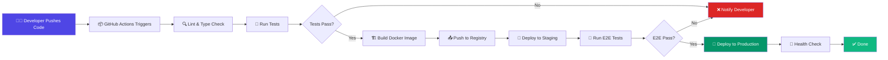
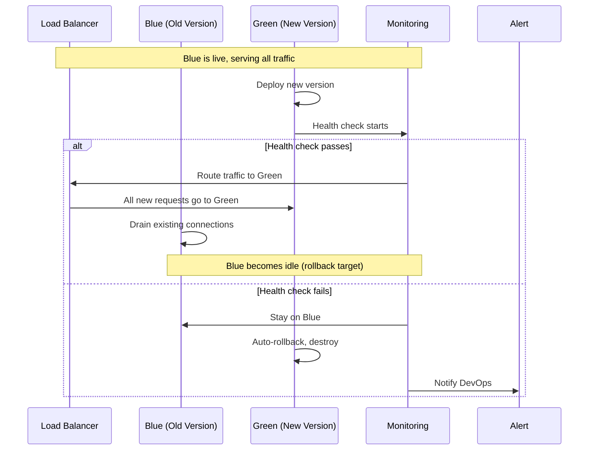

# Deployment & CI/CD

## 📖 Introduction

Deployment is the process of taking your application from a development environment to production where users can access it. A robust deployment pipeline includes: automated testing, building, containerization, configuration injection, and zero-downtime rollouts.

CI/CD (Continuous Integration / Continuous Deployment) automates this process — every commit to the main branch triggers automated tests, and if they pass, the code is automatically deployed to production.

## 🤔 Why Do We Need This?

Manual deployment is error-prone, slow, and inconsistent:

```bash
# ❌ Manual deployment (slow, error-prone)
ssh prod-server
git pull
npm install
# Hope nothing breaks!
pm2 restart all

# ✅ CI/CD (automated, reliable)
git push origin main
# → GitHub Actions runs tests
# → Builds Docker image
# → Deploys to production
# → Health check verifies it's working
```

## ⚠️ Problem Statement

A production deployment system must handle:

1. **Zero-downtime** — Users shouldn't see errors during deployment
2. **Rollback** — If something goes wrong, revert to the previous version instantly
3. **Environment injection** — Different config for dev/staging/prod without code changes
4. **Health verification** — Ensure the new version is healthy before routing traffic
5. **Secrets management** — API keys and passwords must be injected securely
6. **Database migrations** — Schema changes must be coordinated with deployments

## 📚 Real World Story

**Etsy** deploys 50+ times per day. Their continuous deployment pipeline was a key factor in their engineering culture transformation. Each developer pushes to main multiple times daily, and within minutes, their code is running in production.

Key to their success: **feature flags**. Not every deployment immediately enables the new feature. Code is deployed continuously, but features are turned on gradually (10%, 50%, 100% of users) and can be instantly disabled if problems arise. This decouples deployment from release.

## 🍕 Real World Analogy

| Deployment Concept | Airline Analogy |
|-------------------|----------------|
| **CI/CD pipeline** | Pre-flight checklist |
| **Build stage** | Assembling the plane |
| **Test stage** | Test flight |
| **Staging** | Training simulator |
| **Production** | Revenue flight |
| **Blue-green deploy** | Two parallel runways — switch between them |
| **Canary release** | Test a new engine on one plane first |
| **Rollback** | Return to the gate if something's wrong |
| **Health check** | Instrument panel showing all systems OK |

## 👁️ Visual Explanation

```
Deployment Pipeline Flow:

[Code Push] → [Tests] → [Build] → [Stage] → [Deploy] → [Verify]
    │            │          │         │          │          │
    │            ▼          │         │          │          │
    │       Tests fail      │         │          │          │
    │       ❌ Notify dev   │         │          │          │
    │                      │         │          │          │
    │                      ▼         │          │          │
    │                 Build image    │          │          │
    │                 Push to reg.   │          │          │
    │                                ▼          │          │
    │                           Deploy to       │          │
    │                           staging         │          │
    │                           Run E2E tests   │          │
    │                                           ▼          │
    │                                      Deploy to       │
    │                                      production      │
    │                                                      ▼
    │                                              Health check
    │                                              ✅ All good!
```

## 📊 Mermaid Diagram 1: CI/CD Pipeline



## ⚙️ Internal Working: How a CI/CD Pipeline Processes a Commit

1. **Trigger**: A push to the `main` branch triggers a webhook to GitHub Actions
2. **Checkout**: The CI runner clones the repository
3. **Setup**: Node.js is installed, dependencies are cached and installed (`npm ci`)
4. **Lint**: ESLint checks code quality, TypeScript checks types
5. **Test**: Jest runs unit + integration tests with coverage
6. **Build**: Docker image is built with the application code
7. **Push**: Image is pushed to a container registry (Docker Hub, ECR, GCR)
8. **Deploy staging**: Container is deployed to the staging environment
9. **E2E tests**: Cypress or Playwright tests run against the staging environment
10. **Deploy production**: If all checks pass, deployment to production begins

## 🔄 Mermaid Diagram 2: Blue-Green Deployment



## 📝 Syntax

### GitHub Actions CI/CD

```yaml
# .github/workflows/deploy.yml
name: Deploy
on:
  push:
    branches: [main]

jobs:
  test:
    runs-on: ubuntu-latest
    services:
      mongodb:
        image: mongo:7
        ports: ['27017:27017']
    steps:
      - uses: actions/checkout@v4
      - uses: actions/setup-node@v4
        with: { node-version: '20' }
      - run: npm ci
      - run: npm test -- --ci --coverage
      - run: npm run build

  deploy:
    needs: test
    runs-on: ubuntu-latest
    steps:
      - uses: actions/checkout@v4
      - name: Deploy to VPS
        uses: appleboy/ssh-action@v1
        with:
          host: ${{ secrets.HOST }}
          username: ${{ secrets.USERNAME }}
          key: ${{ secrets.SSH_KEY }}
          script: |
            cd /app
            git pull
            npm ci --production
            pm2 restart all
```

## 🟢 Basic Example: VPS Deployment with Nginx

```nginx
# /etc/nginx/sites-available/myapp
server {
    listen 80;
    server_name myapp.com;
    return 301 https://$host$request_uri;
}

server {
    listen 443 ssl http2;
    server_name myapp.com;

    ssl_certificate /etc/letsencrypt/live/myapp.com/fullchain.pem;
    ssl_certificate_key /etc/letsencrypt/live/myapp.com/privkey.pem;

    # Proxy API requests to Node.js
    location /api {
        proxy_pass http://localhost:3000;
        proxy_http_version 1.1;
        proxy_set_header Upgrade $http_upgrade;
        proxy_set_header Connection 'upgrade';
        proxy_set_header Host $host;
        proxy_set_header X-Real-IP $remote_addr;
        proxy_set_header X-Forwarded-For $proxy_add_x_forwarded_for;
        proxy_set_header X-Forwarded-Proto $scheme;

        # Timeouts
        proxy_connect_timeout 60s;
        proxy_read_timeout 60s;
    }

    # Serve static files directly
    location / {
        root /var/www/myapp/public;
        try_files $uri $uri/ /index.html;
        expires 1y;
        add_header Cache-Control "public, immutable";
    }
}
```

**What's happening:**
- **SSL termination** — Nginx handles HTTPS, Node.js handles HTTP internally
- **Reverse proxy** — `/api` requests are forwarded to Node.js on port 3000
- **Static files** — Served directly by Nginx (more efficient than Node.js)
- **WebSocket support** — `Upgrade` and `Connection` headers passed through
- **Timeouts** — 60s to prevent hanging connections

## 🟡 Intermediate Example: Docker Multi-Stage Build

```dockerfile
# Stage 1: Build
FROM node:20-alpine AS builder
WORKDIR /app
COPY package*.json ./
RUN npm ci
COPY . .
RUN npm run build

# Stage 2: Production
FROM node:20-alpine AS production
WORKDIR /app

# Create non-root user
RUN addgroup -g 1001 -S appgroup && \
    adduser -S appuser -u 1001 -G appgroup

# Copy built files
COPY --from=builder /app/dist ./dist
COPY --from=builder /app/node_modules ./node_modules
COPY --from=builder /app/package.json ./

USER appuser

EXPOSE 3000

HEALTHCHECK --interval=30s --timeout=3s --start-period=5s --retries=3 \
  CMD node -e "require('http').get('http://localhost:3000/health', (r) => process.exit(r.statusCode === 200 ? 0 : 1))"

CMD ["node", "dist/server.js"]
```

**What's happening:**
- **Multi-stage build** — build tools are in stage 1, only runtime in stage 2 (smaller image)
- **Non-root user** — security best practice (no root inside container)
- **HEALTHCHECK** — Docker checks every 30s, restarts if 3 consecutive failures
- **Alpine base** — minimal Linux (~5MB base) for small images

## 🔴 Advanced Example: Zero-Downtime Deployment Script

```bash
#!/bin/bash
# deploy.sh — zero-downtime deployment with PM2

set -e  # Exit on error

APP_NAME="myapp"
NEW_PORT=3001  # Temporary port for new version

echo "🚀 Starting deployment of $APP_NAME..."

# 1. Pull latest code
echo "📦 Pulling latest code..."
git pull origin main

# 2. Install dependencies
echo "📦 Installing dependencies..."
npm ci --production

# 3. Build
echo "🏗️ Building..."
npm run build

# 4. Start new version on alternate port
echo "🔄 Starting new version on port $NEW_PORT..."
PORT=$NEW_PORT NODE_ENV=production pm2 start dist/server.js \
  --name "${APP_NAME}-new" \
  --wait-ready \
  --listen-timeout 30000

# 5. Wait for health check
echo "💚 Waiting for health check..."
for i in {1..30}; do
  STATUS=$(curl -s -o /dev/null -w "%{http_code}" http://localhost:$NEW_PORT/health)
  if [ "$STATUS" == "200" ]; then
    echo "✅ Health check passed!"
    break
  fi
  if [ "$i" == "30" ]; then
    echo "❌ Health check failed! Rolling back..."
    pm2 delete "${APP_NAME}-new"
    exit 1
  fi
  sleep 1
done

# 6. Update Nginx to point to new version
echo "🔀 Updating Nginx configuration..."
sed -i "s/proxy_pass http:\/\/localhost:3000/proxy_pass http:\/\/localhost:$NEW_PORT/" /etc/nginx/sites-enabled/$APP_NAME
nginx -t && systemctl reload nginx

# 7. Stop old version
echo "🛑 Stopping old version..."
pm2 delete "$APP_NAME"
pm2 rename "${APP_NAME}-new" "$APP_NAME"

echo "✅ Deployment complete!"
```

**What's happening:**
- **Staged rollout** — new version starts on a different port
- **Health check** — verifies the new version is working before switching traffic
- **Nginx reload** — switches traffic without dropping connections
- **Rollback on failure** — if health check fails, the old version stays running
- **`--wait-ready`** — PM2 waits for the app to emit a "ready" message

## 🏭 Production Example: Full CI/CD with GitHub Actions

```yaml
# .github/workflows/deploy.yml
name: CI/CD Pipeline

on:
  push:
    branches: [main, staging]
  pull_request:
    branches: [main]

env:
  NODE_VERSION: '20'
  REGISTRY: ghcr.io
  IMAGE_NAME: ${{ github.repository }}

jobs:
  lint-and-test:
    runs-on: ubuntu-latest
    services:
      mongodb:
        image: mongo:7
        ports: ['27017:27017']
    steps:
      - uses: actions/checkout@v4
      - uses: actions/setup-node@v4
        with: { node-version: '${{ env.NODE_VERSION }}' }
      - run: npm ci
      - run: npm run lint
      - run: npm run typecheck
      - run: npm test -- --ci --coverage
        env:
          MONGO_URI: mongodb://localhost:27017/test
          JWT_SECRET: test-secret
      - uses: codecov/codecov-action@v3

  build-and-push:
    needs: lint-and-test
    if: github.ref == 'refs/heads/main'
    runs-on: ubuntu-latest
    permissions:
      contents: read
      packages: write
    steps:
      - uses: actions/checkout@v4
      - uses: docker/setup-buildx-action@v3
      - uses: docker/login-action@v3
        with:
          registry: ${{ env.REGISTRY }}
          username: ${{ github.actor }}
          password: ${{ secrets.GITHUB_TOKEN }}
      - uses: docker/build-push-action@v5
        with:
          push: true
          tags: ${{ env.REGISTRY }}/${{ env.IMAGE_NAME }}:${{ github.sha }}

  deploy-staging:
    needs: build-and-push
    if: github.ref == 'refs/heads/staging'
    runs-on: ubuntu-latest
    steps:
      - uses: actions/checkout@v4
      - run: |
          echo "Deploying to staging..."
          # Use your deployment tool (e.g., Helm, kubectl, SSH)
          # helm upgrade myapp ./helm --set image.tag=${{ github.sha }}

  deploy-production:
    needs: build-and-push
    if: github.ref == 'refs/heads/main'
    runs-on: ubuntu-latest
    environment: production
    steps:
      - run: |
          echo "Deploying to production..."
          # Deploy to production orchestrator
```

## ⚙️ How It Works Internally: Nginx as a Reverse Proxy

When a request arrives at Nginx:

1. **TCP connection**: Nginx accepts the TCP connection from the client
2. **TLS termination**: If HTTPS, Nginx decrypts the SSL/TLS layer
3. **Header parsing**: Nginx parses HTTP headers (Host, path, etc.)
4. **Location matching**: Nginx matches the URL against `location` blocks
5. **Proxy decision**: For `/api`, Nginx opens a new connection to `localhost:3000`
6. **Data forwarding**: Nginx streams request data to Node.js
7. **Response streaming**: Nginx streams the response back to the client

This adds ~1-5ms latency but provides: SSL termination, static file serving, load balancing, rate limiting, and security filtering.

## 📦 Performance Notes

### Deployment Strategies Comparison

| Strategy | Downtime | Rollback Speed | Complexity |
|----------|----------|----------------|------------|
| **Rolling update** | None | Medium | Medium |
| **Blue-green** | None | Instant | High |
| **Canary** | None | Instant | High |
| **Replace (stop-start)** | 5-30s | Slow | Low |

### Startup Time Optimization

```javascript
// Enable ready signal for PM2/Docker
app.listen(port, () => {
  if (process.send) process.send('ready'); // Signal PM2
  logger.info(`Server ready on port ${port}`);
});
```

## 🔒 Security Notes

### Deployment Security Checklist

1. **SSH keys** over passwords for server access
2. **Least privilege** — CI/CD tokens should only deploy, not manage infrastructure
3. **Secrets in CI** — use GitHub Actions secrets, not in code
4. **Signed commits** — require GPG signatures for deployments
5. **Audit trail** — every deployment logged with who, what, when
6. **Environment isolation** — production secrets never accessible from staging

## ⚠️ Common Mistakes

1. **❌ Manually deploying** — Always use CI/CD. Manual deployments are error-prone and unrepeatable.

2. **❌ No health checks** — Deployments that break the app go undetected until users complain.

3. **❌ Hardcoded environment config** — Same Docker image must work in all environments. Config goes in environment variables.

4. **❌ No rollback plan** — If the deployment fails, you need a way to revert instantly.

5. **❌ Deploying during peak hours** — Always deploy during low traffic, or use zero-downtime strategies.

6. **❌ Database migrations during deployment** — Schema changes can break the running version. Plan backward-compatible migrations.

## 🚀 Best Practices

### Deployment Checklist

- [ ] All tests pass in CI
- [ ] Docker image built and pushed to registry
- [ ] Health check endpoint configured
- [ ] Database migrations run separately (backward-compatible)
- [ ] Zero-downtime strategy (blue-green or rolling)
- [ ] Rollback plan ready
- [ ] Monitoring alerts configured
- [ ] Deployment logged and notified to team

### Production Dockerfile

```dockerfile
FROM node:20-alpine
WORKDIR /app
COPY package*.json ./
RUN npm ci --only=production && npm cache clean --force
COPY . .
USER node
EXPOSE 3000
HEALTHCHECK CMD wget --no-verbose --tries=1 --spider http://localhost:3000/health || exit 1
CMD ["node", "server.js"]
```

## 🎯 Interview Questions

**Q1: What's the difference between blue-green and canary deployments?**

Blue-green deploys a full copy of the new version alongside the old, then switches traffic at the load balancer. Canary gradually shifts traffic (e.g., 5% → 25% → 100%) to the new version, monitoring errors and latency at each step. Canary is safer because you can abort early if issues arise, but blue-green is simpler to implement.

**Q2: How do you achieve zero-downtime deployments with Node.js?**

Start the new version on a different port, verify health, update the reverse proxy (Nginx) to point to the new port, then gracefully shut down the old version. PM2 supports this with `--wait-ready` and the `process.send('ready')` signal. The key is having two running instances with a smooth traffic switch.

**Q3: How do you handle database migrations during deployment?**

Make migrations backward-compatible: add columns before removing old ones, and never break the existing version's queries. Run migrations as a separate step before deploying new code. Use a tool like `umzug` or `db-migrate` that tracks which migrations have been applied.

## 📝 MCQs

**1. What port does the new version use in a blue-green deployment?**
- A) The same port as the old version
- B) A different port to run alongside the old version ✅
- C) Port 80
- D) A random port

**2. What does the `HEALTHCHECK` instruction do in a Dockerfile?**
- A) Scans the container for vulnerabilities
- B) Checks if the app is healthy and restarts if not ✅
- C) Logs the container's health status
- D) Sends health data to a monitoring service

**3. What is a canary release?**
- A) Deploying to all servers at once
- B) Gradually shifting traffic to a new version ✅
- C) Using a separate staging environment
- D) Rolling back to a previous version

**4. Why is multi-stage Docker build useful?**
- A) It deploys to multiple servers at once
- B) It separates build tools from runtime, producing smaller images ✅
- C) It allows multiple versions to run simultaneously
- D) It runs tests in parallel

**5. Which deployment strategy has the fastest rollback?**
- A) Rolling update
- B) Blue-green ✅
- C) Replace
- D) Rolling restart

**Answer Key:** 1-B, 2-B, 3-B, 4-B, 5-B

## 💻 Coding Challenge 1: Docker Compose Setup

Create a `docker-compose.yml` for a Node.js app with:
- Node.js service (port 3000)
- MongoDB (port 27017)
- Redis (port 6379)
- Nginx reverse proxy (port 80)
- Volume mounts for persistent data
- Environment variables for configuration

## 💻 Coding Challenge 2: GitHub Actions CI Pipeline

Create a GitHub Actions workflow that:
- Runs on push and PR to main
- Caches node_modules for faster builds
- Runs lint, typecheck, and tests
- Builds and pushes Docker image to GitHub Container Registry
- Has separate deploy jobs for staging and production environments

## 💻 Coding Challenge 3: Zero-Downtime Deploy Script

Write a bash script that:
- Pulls latest code from Git
- Installs dependencies
- Starts new version on port 3001
- Runs health checks (up to 30 attempts)
- Updates Nginx to proxy to the new port
- Stops the old version

## 🧪 Mini Exercise: Debugging a Broken Deploy

```bash
# You run a deployment script that fails. Identify the issues:

#!/bin/bash
# Bug 1: No set -e — What if npm ci fails?
npm ci
# Bug 2: What if build fails silently?
npm run build  # Could fail without stopping
# Bug 3: Starting on the same port — crashes!
PORT=3000 node dist/server.js &
# Bug 4: No health check — how do we know it's working?
# Bug 5: If start fails, the old version is already stopped!
pm2 delete myapp  # Old version deleted before new one starts
```

## 🌍 Real World Problem (Interview Coding Challenge)

**Problem:** Design a deployment system for a global e-commerce platform with 50 microservices, deployed across 3 data centers (US, EU, Asia). The platform handles 10K requests/second and must maintain 99.99% uptime.

**Requirements:**
1. Zero-downtime deployments across all data centers
2. Rollback in under 30 seconds for any service
3. Database migrations must not cause downtime
4. Configuration per data center (different currencies, languages)
5. Canary deployments with automatic rollback on error rate increase

**Questions:**
1. What deployment architecture would you design?
2. How do you coordinate deployments across data centers?
3. How do you handle database schema changes without downtime?
4. What metrics do you monitor during a canary deployment to decide whether to proceed?

## 🏗️ Mini Project: Deployment Pipeline

Build a complete CI/CD pipeline for a Node.js application:

**Core features:**
- GitHub Actions workflow with lint, test, build stages
- Docker multi-stage build
- Docker Compose for local development
- Nginx reverse proxy configuration
- PM2 ecosystem config for production
- Zero-downtime deployment script

**Bonus features:**
- Slack notification on deployment success/failure
- Automatic rollback on health check failure
- Blue-green deployment with Nginx
- Database migration step in CI/CD

## 📖 Summary

| Concept | Key Takeaway |
|---------|-------------|
| **CI/CD** | Automate testing and deployment — every commit to main triggers the pipeline |
| **Blue-green** | Two environments, switch traffic instantly |
| **Canary** | Gradual traffic shift, monitor at each step |
| **Nginx** | Reverse proxy, SSL termination, static file serving |
| **Docker** | Containerize for consistent environments |
| **Health check** | Verify deployment succeeded before routing traffic |
| **Rollback** | Always have a plan to revert to the previous version |

## 📋 Cheat Sheet

```bash
# Quick reference: Deployment

# Nginx proxy config
location /api {
    proxy_pass http://localhost:3000;
    proxy_http_version 1.1;
    proxy_set_header Upgrade $http_upgrade;
    proxy_set_header Connection 'upgrade';
}

# Docker build
docker build -t myapp:latest .
docker run -p 3000:3000 -e DB_URL=mongodb://... myapp

# PM2
pm2 start server.js -i max
pm2 reload all  # Zero-downtime restart

# Docker Compose
docker compose up -d
docker compose logs -f

# CI/CD (GitHub Actions)
# .github/workflows/deploy.yml triggers on push to main
```

## 📚 Further Reading

- [GitHub Actions Documentation](https://docs.github.com/en/actions)
- [Docker Node.js Guide](https://docs.docker.com/language/nodejs/)
- [PM2 Process Manager](https://pm2.keymetrics.io/)
- [Nginx Reverse Proxy](https://docs.nginx.com/nginx/admin-guide/web-server/reverse-proxy/)
- [12-Factor App — Build, Release, Run](https://12factor.net/build-release-run)

## 🔗 Related Topics

- [Configuration & Environment](./config-and-environment) — Environment injection
- [Testing](./testing) — Automated testing in CI/CD
- [Containerization](./clustering-and-worker-threads) — Docker and clustering
- [Monitoring](./logging-and-monitoring) — Deployment monitoring
