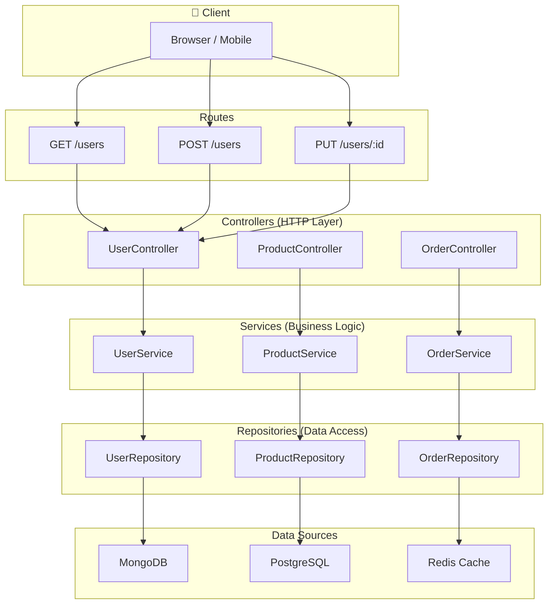
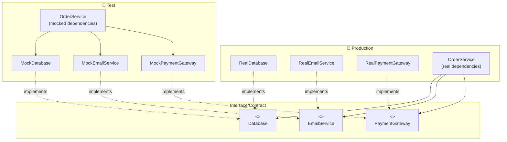

# Design Patterns in Node.js

## 📖 Introduction

Design patterns are proven, reusable solutions to common software design problems. In Node.js, patterns like **MVC**, **Repository**, and **Dependency Injection** help structure applications for maintainability, testability, and scalability.

Node.js's event-driven, asynchronous nature also enables patterns that are unique or particularly relevant: the **Observer** pattern (Event Emitters), the **Middleware** pattern (Express/Redux), and the **Revealing Module** pattern.

## 🤔 Why Do We Need This?

Without patterns, code becomes tightly coupled, hard to test, and difficult to change:

```javascript
// ❌ No pattern — everything in one file, tightly coupled
app.post('/users', async (req, res) => {
  // Business logic + HTTP handling + DB access mixed together!
  if (!req.body.email) return res.status(422).json({ error: 'Email required' });
  const exists = await db.query('SELECT * FROM users WHERE email = $1', [req.body.email]);
  if (exists.rows.length > 0) return res.status(409).json({ error: 'Exists' });
  const result = await db.query('INSERT INTO users (name, email) VALUES ($1, $2) RETURNING *', 
    [req.body.name, req.body.email]);
  await sendEmail(req.body.email, 'Welcome!');
  res.status(201).json(result.rows[0]);
});

// ✅ With MVC pattern — each concern has its place
// Controller: HTTP layer
// Service: Business logic
// Repository: Data access
```

## ⚠️ Problem Statement

Poor architecture leads to:

1. **Tight coupling** — Changing one thing breaks everything
2. **Un-testability** — Business logic embedded in HTTP handlers can't be unit tested
3. **Code duplication** — Similar logic scattered across multiple files
4. **Hard to change** — Swapping databases or adding features requires rewriting large sections
5. **No separation of concerns** — HTTP, business logic, and data access all mixed together

## 📚 Real World Story

**Uber's** microservice architecture is built on clear design patterns. Each service follows a layered architecture: API Gateway → Controller → Service → Data Access. This allowed them to scale from a monolith to 2,200+ microservices.

Their payment service, for example, uses the **Strategy pattern** to support multiple payment providers (Stripe, PayPal, Uber Cash). Adding a new payment provider requires adding a new strategy class — no changes to the existing payment processing logic.

## 🍕 Real World Analogy

| Pattern | Restaurant Analogy |
|---------|-------------------|
| **MVC** | Waiter (Controller) → Kitchen (Service) → Pantry (Model) |
| **Repository** | The pantry — you order ingredients, don't care where they're stored |
| **Dependency Injection** | The chef brings their own knives instead of using the restaurant's |
| **Singleton** | One oven for the entire kitchen |
| **Observer** | Waiters bring orders to the kitchen, kitchen rings bell when ready |
| **Factory** | A recipe that creates different dishes based on ingredients |

## 👁️ Visual Explanation

```
MVC Pattern Structure:

┌──────────┐     ┌──────────┐     ┌────────────┐     ┌──────────┐
│  Client   │────►│ Controller│────►│  Service    │────►│  Model    │
│ (HTTP req)│     │ (handles  │     │ (business   │     │ (data     │
│           │     │  routing) │     │  logic)    │     │  access)  │
└──────────┘     └──────────┘     └────────────┘     └──────────┘
                       │                                      │
                       │                                      │
                       ▼                                      ▼
                 ┌──────────┐                          ┌──────────┐
                 │  View    │                          │ Database │
                 │ (JSON    │                          │          │
                 │  response)│                          └──────────┘
                 └──────────┘
```

## 📊 Mermaid Diagram 1: MVC Pattern



## ⚙️ Internal Working: How Dependency Injection Works

Without DI, each class creates its own dependencies:

```javascript
class OrderService {
  constructor() {
    this.db = new Database();       // Hardcoded — can't change
    this.emailer = new Emailer();   // Hardcoded — can't mock
  }
}
```

With DI, dependencies are injected from outside:

```javascript
class OrderService {
  constructor(db, emailer) {
    this.db = db;                   // Injected — can swap implementations
    this.emailer = emailer;         // Injected — can mock for tests
  }
}

// In production:
new OrderService(new PostgresDB(), new SendGridEmailer());

// In tests:
new OrderService(new MockDB(), new MockEmailer());
```

This is the **Dependency Inversion Principle** (D of SOLID): depend on abstractions, not concretions.

## 🔄 Mermaid Diagram 2: Dependency Injection



## 📝 Syntax

### MVC Pattern

```javascript
// Model — data structure + DB interaction
const User = mongoose.model('User', userSchema);

// Repository — data access abstraction
class UserRepository {
  async findById(id) { return User.findById(id); }
  async create(data) { return User.create(data); }
}

// Service — business logic
class UserService {
  constructor(userRepo) { this.userRepo = userRepo; }
  async getUser(id) { /* business logic */ }
}

// Controller — HTTP handling
class UserController {
  constructor(userService) { this.userService = userService; }
  getUser = async (req, res, next) => { /* ... */ };
}
```

## 🟢 Basic Example: MVC Structure

```javascript
// models/User.js
const mongoose = require('mongoose');
const userSchema = new mongoose.Schema({
  name: { type: String, required: true },
  email: { type: String, required: true, unique: true },
});
module.exports = mongoose.model('User', userSchema);

// repositories/UserRepository.js
class UserRepository {
  async findAll() { return User.find().lean(); }
  async findById(id) { return User.findById(id).lean(); }
  async create(data) { return User.create(data); }
}

// services/UserService.js
class UserService {
  constructor(userRepo) {
    this.userRepo = userRepo;
  }
  async getAllUsers() {
    return this.userRepo.findAll();
  }
  async getUserById(id) {
    const user = await this.userRepo.findById(id);
    if (!user) throw new NotFoundError('User not found');
    return user;
  }
  async createUser(data) {
    const existing = await this.userRepo.findByEmail(data.email);
    if (existing) throw new ConflictError('Email already exists');
    return this.userRepo.create(data);
  }
}

// controllers/UserController.js
class UserController {
  constructor(userService) {
    this.userService = userService;
  }
  getUsers = async (req, res, next) => {
    try {
      const users = await this.userService.getAllUsers();
      res.json({ data: users });
    } catch (err) { next(err); }
  };
  getUser = async (req, res, next) => {
    try {
      const user = await this.userService.getUserById(req.params.id);
      res.json({ data: user });
    } catch (err) { next(err); }
  };
}

// routes/users.js
const router = express.Router();
const userRepo = new UserRepository();
const userService = new UserService(userRepo);
const userController = new UserController(userService);

router.get('/', userController.getUsers);
router.get('/:id', userController.getUser);

module.exports = router;
```

**What's happening:**
- **Model** — Mongoose schema (data shape)
- **Repository** — Database operations (single responsibility)
- **Service** — Business logic with validation and error handling
- **Controller** — HTTP layer (request/response handling)
- **Dependencies** are injected through constructors

## 🟡 Intermediate Example: Repository Pattern with Interface

```javascript
// repositories/interfaces/UserRepository.js
class IUserRepository {
  async findById(id) { throw new Error('Not implemented'); }
  async findByEmail(email) { throw new Error('Not implemented'); }
  async create(data) { throw new Error('Not implemented'); }
}

// repositories/MongoUserRepository.js
class MongoUserRepository extends IUserRepository {
  async findById(id) {
    const user = await User.findById(id).lean();
    return user ? this.toDomain(user) : null;
  }
  async findByEmail(email) {
    const user = await User.findOne({ email }).lean();
    return user ? this.toDomain(user) : null;
  }
  async create(data) {
    const user = await User.create(data);
    return this.toDomain(user.toObject());
  }
  toDomain(mongoDoc) {
    return {
      id: mongoDoc._id.toString(),
      name: mongoDoc.name,
      email: mongoDoc.email,
      createdAt: mongoDoc.createdAt,
    };
  }
}

// repositories/PostgresUserRepository.js
class PostgresUserRepository extends IUserRepository {
  constructor(pool) {
    super();
    this.pool = pool;
  }
  async findById(id) {
    const { rows } = await this.pool.query(
      'SELECT id, name, email, created_at FROM users WHERE id = $1', [id]
    );
    return rows[0] || null;
  }
  // ... same interface, different implementation
}

// Switching databases is now a one-line change:
// const userRepo = new MongoUserRepository();
// const userRepo = new PostgresUserRepository(pool);
```

**What's happening:**
- **Interface** defines the contract (`IUserRepository`)
- **Separate implementations** for MongoDB and PostgreSQL
- **Domain mapping** (`toDomain`) decouples DB schema from application logic
- **Swap databases** by changing one line of code

## 🔴 Advanced Example: Strategy Pattern for Payment Providers

```javascript
// strategies/PaymentStrategy.js
class PaymentStrategy {
  async charge(amount, currency, source) {
    throw new Error('Not implemented');
  }
  async refund(transactionId) {
    throw new Error('Not implemented');
  }
}

// strategies/StripeStrategy.js
class StripeStrategy extends PaymentStrategy {
  constructor(apiKey) {
    super();
    this.stripe = require('stripe')(apiKey);
  }
  async charge(amount, currency, source) {
    const payment = await this.stripe.paymentIntents.create({
      amount: Math.round(amount * 100), // cents
      currency,
      payment_method: source,
      confirm: true,
    });
    return { id: payment.id, status: payment.status, provider: 'stripe' };
  }
  async refund(transactionId) {
    const refund = await this.stripe.refunds.create({ payment_intent: transactionId });
    return { id: refund.id, status: refund.status };
  }
}

// strategies/PayPalStrategy.js
class PayPalStrategy extends PaymentStrategy {
  async charge(amount, currency, source) {
    // PayPal-specific implementation
  }
  async refund(transactionId) {
    // PayPal-specific implementation
  }
}

// PaymentService.js — uses strategy
class PaymentService {
  constructor(strategy) {
    this.strategy = strategy;
  }
  setStrategy(strategy) {
    this.strategy = strategy;
  }
  async processPayment(order) {
    return this.strategy.charge(order.total, order.currency, order.paymentSource);
  }
}

// Usage
const stripeStrategy = new StripeStrategy(process.env.STRIPE_KEY);
const paypalStrategy = new PayPalStrategy(process.env.PAYPAL_KEY);
const paymentService = new PaymentService(stripeStrategy);

// User pays with Stripe
await paymentService.processPayment(order);

// User chooses PayPal
paymentService.setStrategy(paypalStrategy);
await paymentService.processPayment(order);
```

**What's happening:**
- **Strategy pattern** — interchangeable algorithms for payment processing
- **New providers** added by creating a new strategy class — no changes to existing code
- **Runtime switching** — `setStrategy()` changes the payment method
- **Open/Closed Principle** — open for extension, closed for modification

## 🏭 Production Example: DI Container

```javascript
// container.js — Simple dependency injection container
class Container {
  constructor() {
    this.bindings = new Map();
    this.instances = new Map();
  }

  // Register a factory
  register(name, factory, { singleton = false } = {}) {
    this.bindings.set(name, { factory, singleton });
  }

  // Resolve a dependency
  resolve(name) {
    const binding = this.bindings.get(name);
    if (!binding) throw new Error(`No binding for ${name}`);

    if (binding.singleton) {
      if (!this.instances.has(name)) {
        this.instances.set(name, binding.factory(this));
      }
      return this.instances.get(name);
    }

    return binding.factory(this);
  }

  // Get or create automatically (convention over configuration)
  auto(name) {
    if (this.bindings.has(name)) return this.resolve(name);
    throw new Error(`No binding for ${name}. Register it with container.register().`);
  }
}

// app.js — Wire everything together
const container = new Container();

// Register database
container.register('db', () => new Database(process.env.DB_URL), { singleton: true });
container.register('cache', () => new RedisCache(process.env.REDIS_URL), { singleton: true });

// Register repositories
container.register('userRepo', (c) => new UserRepository(c.resolve('db')));
container.register('orderRepo', (c) => new OrderRepository(c.resolve('db')));

// Register services
container.register('userService', (c) => new UserService(c.resolve('userRepo'), c.resolve('cache')));
container.register('orderService', (c) => new OrderService(c.resolve('orderRepo'), c.resolve('userRepo')));

// Register controllers
container.register('userController', (c) => new UserController(c.resolve('userService')));

// Routes
const userController = container.resolve('userController');
router.get('/users', userController.getUsers);
```

**What's happening:**
- **Container** manages dependency resolution
- **Singleton** instances are created once and reused (database connections)
- **Auto-resolution** — dependencies are automatically injected based on registration
- **Lazy instantiation** — instances are created only when first needed

## ⚙️ How It Works Internally: The Middleware Pattern

Express middleware is a chain of functions. Each function receives the request, response, and a `next` function to pass control to the next middleware:

```javascript
// Middleware chain: logger → auth → router → errorHandler
app.use(logger);
app.use(auth);
app.use(router);
app.use(errorHandler);
```

Express composes these into a pipeline. Each middleware can:
- Modify `req` or `res`
- Send a response (end the chain)
- Call `next()` to pass to the next middleware
- Call `next(err)` to skip to error handlers

This is a real-world implementation of the **Chain of Responsibility** pattern.

## 📦 Performance Notes

### Pattern Overhead

| Pattern | Overhead | Benefit |
|---------|----------|---------|
| MVC | Low | Clear separation of concerns |
| Repository | Low | Swappable data sources |
| Dependency Injection | Minimal | Testability, flexibility |
| Strategy | Minimal | Open/Closed Principle |
| Singleton | None | Shared state, resource efficiency |

The performance cost of these patterns is negligible (<1%) compared to the maintainability benefits.

## 🔒 Security Notes

### Singleton Pattern Security

Singletons (used for database connections, caches) are convenient but can cause issues:
- They persist across requests — sensitive data shouldn't be stored in them
- Ensure connection strings are properly validated before passing to a singleton

### DI Container Security

- Never pass user input directly into a container resolution — it could be used to resolve unintended bindings
- Validate and sanitize configuration before passing to the container

## ⚠️ Common Mistakes

1. **❌ Over-engineering** — Using every pattern for every problem. Start simple, add patterns as complexity grows.

2. **❌ God objects** — A single service that does everything. Split by responsibility.

3. **❌ Skipping the service layer** — Business logic in controllers leads to untestable, duplicated code.

4. **❌ Tight coupling in constructors** — Creating dependencies inside constructors makes testing impossible.

5. **❌ Pattern for pattern's sake** — If a pattern doesn't solve a real problem you have, don't use it.

## 🚀 Best Practices

### When to Use Each Pattern

| Pattern | Use When |
|---------|----------|
| **MVC** | Building a web API or web app |
| **Repository** | Need to swap databases or mock for tests |
| **Dependency Injection** | Writing testable code with external dependencies |
| **Strategy** | Multiple algorithms for the same task (payment, auth) |
| **Observer (EventEmitter)** | Decoupled communication between components |
| **Singleton** | Shared resource (DB connection, logger config) |
| **Factory** | Complex object creation logic |

### Folder Structure

```
src/
  controllers/     ← HTTP handling (thin)
  services/        ← Business logic
  repositories/    ← Data access
  models/          ← Database schemas
  middleware/      ← Express middleware
  strategies/      ← Interchangeable algorithms
  utils/           ← Helper functions
  config/          ← Configuration
  container.js     ← DI container
```

## 🎯 Interview Questions

**Q1: What is the Repository pattern and why use it?**

The Repository pattern abstracts data access behind an interface. The service layer calls `userRepository.findById(id)` without knowing if the data comes from MongoDB, PostgreSQL, or an in-memory cache. Benefits: testability (mock the repository), flexibility (swap databases), and separation of concerns.

**Q2: What's the difference between MVC in a traditional web app vs a REST API?**

In traditional MVC, the View renders HTML templates. In a REST API, the View is the JSON serializer — the "view" is the response format. The Controller parses the request and calls the Service. The Service contains business logic. The Model represents the data structure.

**Q3: Explain Dependency Injection and why it's useful.**

DI is a pattern where a class receives its dependencies from outside rather than creating them internally. Instead of `new Database()` inside a service, the service receives a database instance through its constructor. This makes the service testable (mock the DB), flexible (swap implementations), and follows the Single Responsibility Principle.

**Q4: What is the Strategy pattern and when would you use it?**

The Strategy pattern defines a family of interchangeable algorithms. You have a context class that uses a strategy, and you can swap strategies at runtime. Example: payment processing (Stripe vs PayPal), authentication (JWT vs OAuth vs sessions), or file storage (local vs S3 vs GCS).

## 📝 MCQs

**1. What is the primary benefit of the Repository pattern?**
- A) Faster database queries
- B) Abstracting data access so you can swap databases ✅
- C) Reducing code size
- D) Automatic caching

**2. In MVC, what does the Service layer contain?**
- A) HTTP request handling
- B) Business logic ✅
- C) Database queries
- D) HTML templates

**3. What problem does Dependency Injection solve?**
- A) Slow database queries
- B) Tight coupling and difficulty testing ✅
- C) Memory leaks
- D) Network latency

**4. Which pattern allows swapping algorithms at runtime?**
- A) Singleton
- B) Strategy ✅
- C) Factory
- D) Observer

**5. Why should business logic NOT be in controllers?**
- A) Controllers are for HTTP handling only ✅
- B) Controllers are slower
- C) Business logic can't access databases
- D) It's against Express best practices

**Answer Key:** 1-B, 2-B, 3-B, 4-B, 5-A

## 💻 Coding Challenge 1: Implement MVC

Refactor a monolithic Express route into MVC:
- Take an existing route with mixed HTTP + business logic + DB queries
- Create a Controller, Service, and Repository
- The route should only call `controller.method()`
- Add error handling middleware

## 💻 Coding Challenge 2: Repository with Multiple Backends

Implement a UserRepository with two implementations:
- `MongoUserRepository` (Mongoose)
- `InMemoryUserRepository` (for testing)
- Both implement the same interface
- Write tests that use the InMemory implementation
- The tests should pass by swapping the repository instance

## 💻 Coding Challenge 3: Strategy Pattern for File Storage

Implement a file storage system with strategies:
- `LocalStorageStrategy` — saves to local filesystem
- `S3StorageStrategy` — uploads to AWS S3
- `FileService` that accepts any strategy
- `POST /files/upload` — upload a file using the configured strategy
- `GET /files/:id` — download using the configured strategy

## 🧪 Mini Exercise: Debugging Anti-Patterns

This code has architectural problems. Identify and fix them:

```javascript
// Problem: Everything is in one file, tightly coupled

// app.js — monolithic
app.post('/users', async (req, res) => {
  // Validation inline
  if (!req.body.email) return res.status(422).json({ error: 'Email required' });
  
  // DB query inline
  const exists = await db.query('SELECT * FROM users WHERE email = $1', [req.body.email]);
  if (exists.rows.length > 0) return res.status(409).json({ error: 'Exists' });
  
  // Create inline
  const result = await db.query('INSERT INTO users ...', [req.body.name, req.body.email]);
  
  // Email sending inline
  await sendEmail(req.body.email, 'Welcome');
  
  // Response inline
  res.status(201).json(result.rows[0]);
});

// Issues to identify:
// 1. No separation of concerns
// 2. Can't unit test business logic
// 3. Can't swap database
// 4. Can't mock email sending
// 5. No error handling middleware
// 6. Duplicate validation across routes
```

## 🌍 Real World Problem (Interview Coding Challenge)

**Problem:** You're building an API for a multi-tenant SaaS platform. Each tenant can have different: authentication methods (JWT, OAuth, SAML), storage backends (S3, GCS, Azure), and payment providers (Stripe, PayPal, Braintree). New tenants are onboarded weekly with different configurations.

**Requirements:**
1. Tenant-specific configuration without code changes
2. New auth/storage/payment providers must be easy to add
3. Each tenant's data must be isolated
4. The system must be testable without real providers

**Questions:**
1. How would you structure the code to support tenant-specific providers?
2. Which patterns would you use?
3. How would you handle provider configuration per tenant?
4. How would you test a tenant using a specific provider combination?

**Interview Tip:** Discuss using the **Strategy pattern** for interchangeable providers, **Abstract Factory** for creating provider combinations per tenant, and **Dependency Injection** for testability. Store tenant configurations in a database with provider-specific settings.

## 🏗️ Mini Project: E-Commerce Backend with Clean Architecture

Build an e-commerce API using MVC + Repository + DI patterns:

**Core features:**
- User registration, login, profile management
- Product CRUD with categories
- Shopping cart
- Order placement with payment
- Admin dashboard

**Architecture:**
- Controllers (thin HTTP layer)
- Services (business logic)
- Repositories (data access)
- Strategies (payment, shipping)
- DI container for wiring everything together

**Bonus features:**
- Event-driven architecture (EventEmitter for order events)
- CQRS pattern (separate read/write models)
- Unit tests with mocked repositories

## 📖 Summary

| Pattern | Purpose |
|---------|---------|
| **MVC** | Separate HTTP, business logic, and data access |
| **Repository** | Abstract data access for swappable backends |
| **Dependency Injection** | Loose coupling and testability |
| **Strategy** | Interchangeable algorithms (payment, storage, auth) |
| **Singleton** | Shared resource management (DB connections) |
| **Observer (EventEmitter)** | Decoupled event-driven communication |
| **Factory** | Abstract object creation |

## 📋 Cheat Sheet

```javascript
// Quick reference: Design Patterns

// MVC
class Controller { /* HTTP handling */ }
class Service { /* Business logic */ }
class Repository { /* Data access */ }

// Repository
class UserRepository {
  async findById(id) { return User.findById(id); }
}

// Dependency Injection
class Service {
  constructor(repo) { this.repo = repo; }
}

// Strategy
class PaymentStrategy { async charge(amount) {} }
class StripeStrategy extends PaymentStrategy {}
class PayPalStrategy extends PaymentStrategy {}

// Singleton
const db = new Database(); // Module.exports caches the instance

// Observer (EventEmitter)
class OrderNotifier extends EventEmitter {}
notifier.on('order.placed', (order) => sendEmail(order));
notifier.emit('order.placed', order);
```

## 📚 Further Reading

- [Design Patterns: Elements of Reusable Software (Gang of Four)](https://en.wikipedia.org/wiki/Design_Patterns)
- [Node.js Design Patterns (book)](https://www.nodejsdesignpatterns.com/)
- [SOLID Principles in JavaScript](https://medium.com/@richardeng/solid-principles-in-javascript-9b0fbbd46fc1)
- [Dependency Injection in Node.js](https://blog.risingstack.com/dependency-injection-in-node-js/)

## 🔗 Related Topics

- [Project Architecture](./project-architecture) — Real-world project structure
- [Testing](./testing) — Testability through DI and patterns
- [Building REST APIs](../web/building-apis) — MVC for APIs
- [Error Handling](../core/error-handling) — Error patterns in layered architecture
