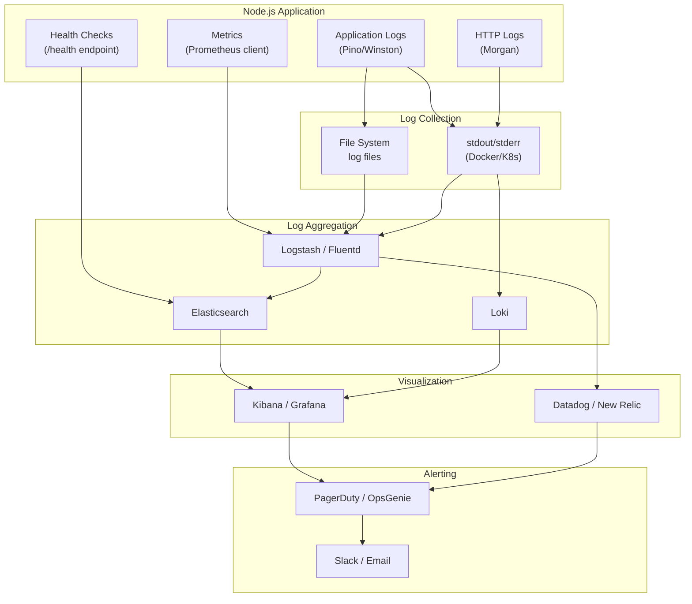
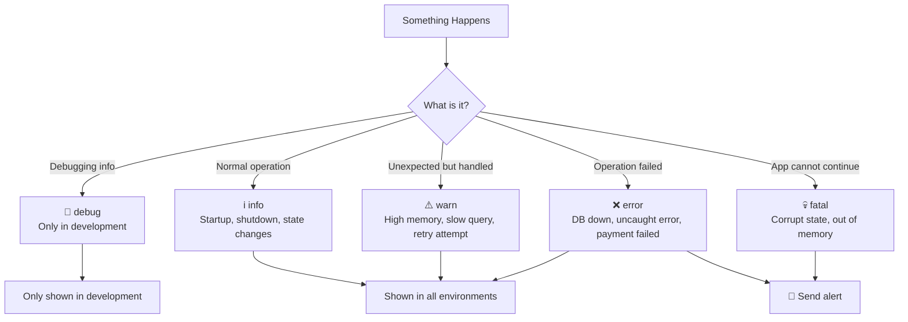
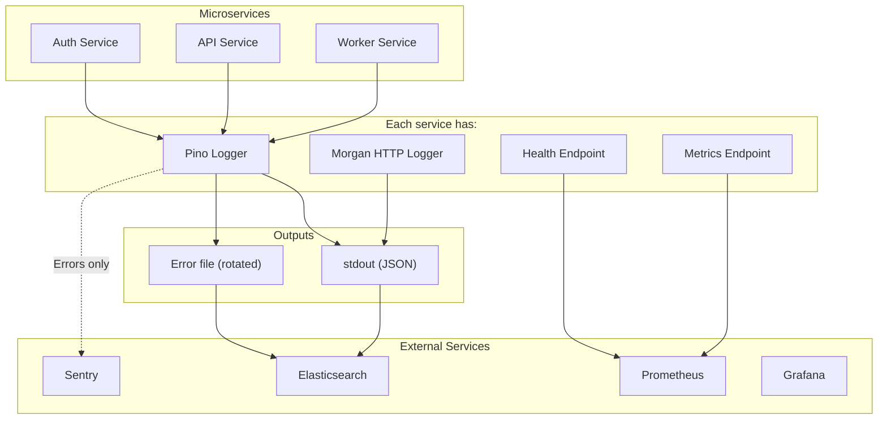
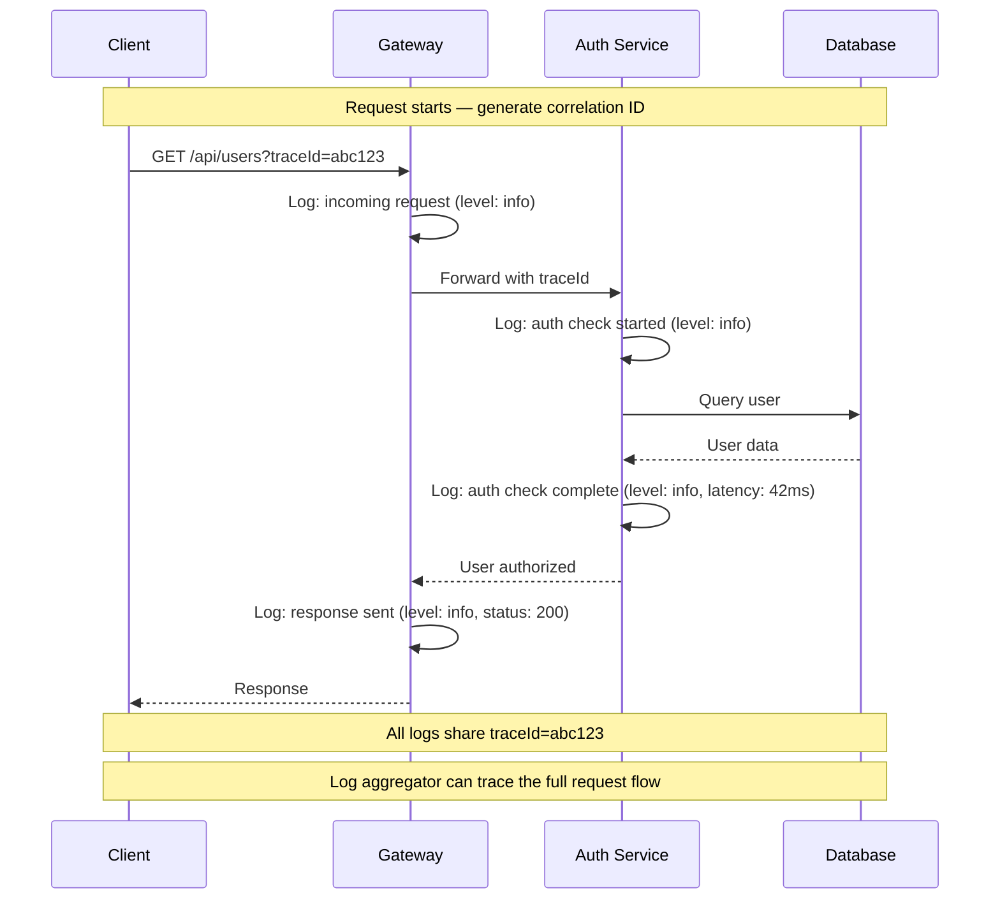

# Logging & Monitoring

## 📖 Introduction

Logging and monitoring are essential for understanding what your application is doing in production. When something goes wrong at 3 AM, you need to know exactly what happened — not through manual `console.log` debugging, but through structured, searchable, and alertable logs and metrics.

A proper observability stack includes:
- **Structured logging** — Machine-parseable JSON logs with context
- **Metrics** — Numerical measurements (request rate, latency, error rate)
- **Health checks** — Liveness and readiness endpoints for orchestrators
- **Error tracking** — Capture and aggregate runtime errors with stack traces
- **Alerting** — Notifications when metrics cross thresholds

## 🤔 Why Do We Need This?

```javascript
// ❌ console.log — not enough for production
console.log('User logged in:', userId);
console.log('Error:', err);

// These tell you something happened, but:
// - Can't search/filter by log level
// - No structured data (just text)
// - No timestamps by default
// - Can't trace a single request across services
// - No way to alert when error rates spike
```

> "Logging is not an afterthought. It is a first-class feature of production software."

## ⚠️ Problem Statement

A production observability system must solve:

1. **Searchability** — Logs must be structured (JSON) so log aggregators can index and search them
2. **Volume** — Production systems generate gigabytes of logs daily — need log levels and sampling
3. **Context** — A single request may span multiple services — need correlation IDs
4. **Sensitive data redaction** — Never log passwords, tokens, or PII
5. **Metric collection** — Track request rates, latencies, error rates, resource usage
6. **Alerting** — Notify the on-call engineer when something breaks

## 📚 Real World Story

**Datadog** processes petabytes of log data daily. Every log line is a JSON object with timestamp, service name, level, message, and structured context. Their agent runs on every server, collects logs and metrics, and ships them to their centralized platform.

When a Node.js service at Datadog has an issue, engineers can search for `service:auth level:error` and find all errors in the auth service. They can then follow the `traceId` across multiple services to understand the full request flow. This rich context is only possible with structured logging.

## 🍕 Real World Analogy

| Logging Concept | Flight Black Box Analogy |
|----------------|-------------------------|
| **Structured log** | Each sensor reading is a structured data point |
| **Log level** | Severity — from routine telemetry to critical alarm |
| **Context field** | Altitude, speed, heading — specific measurements |
| **Correlation ID** | Flight number — connects all events for one flight |
| **Metrics** | Altimeter, fuel gauge, engine temperature |
| **Alerting** | Warning lights in the cockpit |

## 👁️ Visual Explanation

```
Structured vs Unstructured Logging:

console.log:                                           Pino Logger:
"User 123 logged in from 192.168.1.1"                  {"level":30,"time":1712345678000,
                                                        "msg":"User logged in",
┌─────────────────────────────────────────────┐         "userId":123,
│ Can you grep for userId:123?                 │         "ip":"192.168.1.1",
│ Is "logged in" info or debug?                │         "service":"auth",
│ What timestamp format is that?                │         "requestId":"abc-123",
└─────────────────────────────────────────────┘         "latency":42}
                                                        ┌──────────────────────────────┐
                                                        │ Parseable by log aggregators │
                                                        │ Filterable by level/service  │
                                                        │ Searchable by userId          │
                                                        └──────────────────────────────┘
```

## 📊 Mermaid Diagram 1: Observability Stack



## ⚙️ Internal Working: How Pino Produces JSON Logs

Pino is the fastest Node.js logger because it minimizes serialization overhead:

1. **Fast path for strings**: If you call `logger.info('hello')`, Pino writes the minimal JSON directly
2. **Lazy serialization**: Objects passed as context are serialized only when writing to the stream
3. **Child loggers**: Creating a child logger doesn't copy the parent — it chains prototypes
4. **Streaming**: Pino writes to a transport stream. In production, use a transport like `pino/file` or pipe to `pino-syslog`

```javascript
// Pino's output format
{
  "level": 30,        // 30=info, 40=warn, 50=error
  "time": 1712345678000,
  "pid": 1234,
  "hostname": "server-1",
  "msg": "Server started",
  "service": "my-app"
}
```

## 🔄 Mermaid Diagram 2: Log Levels Decision Tree



## 🏗️ Architecture: Production Logging System



## 👣 Step-by-Step Flow: Request Logging and Tracing



## 📝 Syntax

### Pino

```javascript
const pino = require('pino');

// Basic setup
const logger = pino({
  level: process.env.LOG_LEVEL || 'info',
  transport: process.env.NODE_ENV !== 'production'
    ? { target: 'pino-pretty', options: { colorize: true } }
    : undefined,
});

// Logging
logger.info('Server started');
logger.info({ port: 3000 }, 'Server listening');
logger.warn({ user: 'alice' }, 'Login from unknown IP');
logger.error({ err }, 'Database connection failed');

// Child logger (adds context to all subsequent logs)
const child = logger.child({ service: 'auth', requestId: 'abc-123' });
child.info('User authenticated'); // Includes { service: 'auth', requestId: 'abc-123' }
```

### Winston

```javascript
const winston = require('winston');

const logger = winston.createLogger({
  level: process.env.LOG_LEVEL || 'info',
  format: winston.format.combine(
    winston.format.timestamp(),
    winston.format.errors({ stack: true }),
    winston.format.json(),
  ),
  defaultMeta: { service: 'my-api' },
  transports: [
    new winston.transports.Console({ format: winston.format.json() }),
    new winston.transports.File({ filename: 'logs/error.log', level: 'error', maxsize: 5242880 }),
  ],
});
```

## 🟢 Basic Example: Structured Logging with Pino

```javascript
const express = require('express');
const pino = require('pino');
const { v4: uuidv4 } = require('uuid');

const app = express();
const logger = pino({
  level: process.env.LOG_LEVEL || 'info',
  redact: {
    paths: ['password', 'token', 'authorization', 'headers.authorization'],
    censor: '[REDACTED]',
  },
});

// Request ID middleware
app.use((req, res, next) => {
  req.id = uuidv4();
  req.log = logger.child({ requestId: req.id });
  next();
});

// Morgan → Pino integration
const morgan = require('morgan');
app.use(morgan('combined', {
  stream: { write: (msg) => logger.info(msg.trim()) },
}));

app.get('/users', async (req, res) => {
  req.log.info('Fetching users list');

  try {
    const users = await User.find({}).lean();
    req.log.info({ count: users.length }, 'Users fetched successfully');
    res.json({ data: users });
  } catch (err) {
    req.log.error({ err }, 'Failed to fetch users');
    res.status(500).json({ error: 'Internal server error' });
  }
});

app.listen(3000, () => {
  logger.info({ port: 3000 }, 'Server started');
});
```

**What's happening:**
- **Redaction** — passwords and tokens are automatically replaced with `[REDACTED]` in logs
- **Per-request logger** — `req.log` adds `requestId` to every log line
- **Morgan → Pino** — HTTP request logs go through Pino for consistent formatting
- **Structured context** — `{ count: users.length }` adds searchable metadata

## 🟡 Intermediate Example: Health Check Endpoint

```javascript
const os = require('os');
const mongoose = require('mongoose');
const redis = require('ioredis');

// Simple health check
app.get('/health', async (req, res) => {
  const health = {
    status: 'healthy',
    uptime: process.uptime(),
    timestamp: Date.now(),
    memory: {
      heapUsed: Math.round(process.memoryUsage().heapUsed / 1024 / 1024) + 'MB',
      heapTotal: Math.round(process.memoryUsage().heapTotal / 1024 / 1024) + 'MB',
    },
    cpu: os.loadavg(),
  };
  res.json(health);
});

// Detailed health check with dependency checks
app.get('/health/detailed', async (req, res) => {
  const checks = {
    server: { status: 'ok' },
    database: { status: 'unknown' },
    redis: { status: 'unknown' },
  };

  // Check MongoDB
  try {
    await mongoose.connection.db.admin().ping();
    checks.database = { status: 'ok', responseTime: '5ms' };
  } catch (err) {
    checks.database = { status: 'error', message: err.message };
  }

  // Check Redis
  try {
    const start = Date.now();
    await redis.ping();
    checks.redis = { status: 'ok', responseTime: `${Date.now() - start}ms` };
  } catch (err) {
    checks.redis = { status: 'error', message: err.message };
  }

  const allHealthy = Object.values(checks).every(c => c.status === 'ok');
  res.status(allHealthy ? 200 : 503).json({
    status: allHealthy ? 'healthy' : 'degraded',
    checks,
  });
});
```

**What's happening:**
- **Two endpoints**: `/health` (simple) for load balancers, `/health/detailed` (with dependency checks) for operators
- **Response time metrics** — how long each dependency took to respond
- **Status code** — 200 if healthy, 503 if degraded (load balancers stop routing traffic on 503)
- **Memory reporting** — heap usage in human-readable format

## 🔴 Advanced Example: Prometheus Metrics

```javascript
const promClient = require('prom-client');

// Collect default metrics (CPU, memory, event loop, garbage collection)
promClient.collectDefaultMetrics();

// HTTP request counter
const httpRequestCounter = new promClient.Counter({
  name: 'http_requests_total',
  help: 'Total number of HTTP requests',
  labelNames: ['method', 'path', 'status'],
});

// Request duration histogram
const httpRequestDuration = new promClient.Histogram({
  name: 'http_request_duration_seconds',
  help: 'HTTP request duration in seconds',
  labelNames: ['method', 'path'],
  buckets: [0.01, 0.05, 0.1, 0.5, 1, 5], // Buckets for latency distribution
});

// Active requests gauge
const activeRequests = new promClient.Gauge({
  name: 'http_requests_active',
  help: 'Number of active HTTP requests',
});

// Error counter
const errorCounter = new promClient.Counter({
  name: 'http_errors_total',
  help: 'Total number of HTTP errors',
  labelNames: ['method', 'path', 'status', 'type'],
});

// Middleware to record metrics
app.use((req, res, next) => {
  activeRequests.inc();
  const start = Date.now();

  res.on('finish', () => {
    const duration = (Date.now() - start) / 1000;
    const path = req.route?.path || req.path;

    httpRequestCounter.inc({ method: req.method, path, status: res.statusCode });
    httpRequestDuration.observe({ method: req.method, path }, duration);

    if (res.statusCode >= 400) {
      errorCounter.inc({
        method: req.method,
        path,
        status: res.statusCode,
        type: res.statusCode >= 500 ? 'server' : 'client',
      });
    }

    activeRequests.dec();
  });

  next();
});

// Metrics endpoint for Prometheus
app.get('/metrics', async (req, res) => {
  res.set('Content-Type', promClient.register.contentType);
  res.end(await promClient.register.metrics());
});
```

**What's happening:**
- **Default metrics** — Prometheus client collects CPU, memory, event loop lag, and GC stats
- **Counter** — monotonically increasing values (request count)
- **Histogram** — distribution of values (request latency across buckets)
- **Gauge** — values that go up and down (active connections)
- **Labels** — dimensions to slice data by (method, path, status)
- **Metrics endpoint** — Prometheus scrapes this endpoint every 15s

## 🏭 Production Example: Error Tracking with Sentry

```javascript
const Sentry = require('@sentry/node');
const { ProfilingIntegration } = require('@sentry/profiling-node');
const pino = require('pino');

// Initialize Sentry
Sentry.init({
  dsn: process.env.SENTRY_DSN,
  environment: process.env.NODE_ENV,
  tracesSampleRate: process.env.NODE_ENV === 'production' ? 0.1 : 1.0,
  integrations: [new ProfilingIntegration()],
  beforeSend(event) {
    // Don't send events in development
    if (process.env.NODE_ENV === 'development') return null;
    return event;
  },
});

// Logger setup
const logger = pino({
  level: process.env.LOG_LEVEL || 'info',
  redact: ['password', 'token'],
});

// Sentry request handler (adds request context)
app.use(Sentry.Handlers.requestHandler());
app.use(Sentry.Handlers.tracingHandler());

// Routes
app.get('/api/orders/:id', async (req, res) => {
  try {
    const order = await Order.findById(req.params.id);
    if (!order) {
      return res.status(404).json({ error: 'Order not found' });
    }
    res.json(order);
  } catch (err) {
    // Log structured error
    logger.error({
      err,
      orderId: req.params.id,
      userId: req.user?.id,
    }, 'Failed to fetch order');

    // Send to Sentry
    Sentry.captureException(err, {
      tags: { orderId: req.params.id },
      user: { id: req.user?.id },
    });

    res.status(500).json({ error: 'Internal server error' });
  }
});

// Sentry error handler (must be last)
app.use(Sentry.Handlers.errorHandler({
  shouldHandleError(error) {
    return error.status >= 500;
  },
}));

// 404 handler
app.use((req, res) => {
  res.status(404).json({ error: 'Not found' });
});
```

**What's happening:**
- **Sentry captures** runtime errors with full stack traces, request data, and user context
- **Performance tracing** — traces slow requests and database queries (sampled at 10% in production)
- **Profiling** — CPU profiling data for performance analysis
- **Environment filtering** — no Sentry events in development
- **Dual logging** — errors logged both to Pino (for local debugging) and Sentry (for centralized error tracking)

## ⚙️ How It Works Internally: Log Levels

| Level | Value | When to use |
|-------|-------|-------------|
| `trace` | 10 | Detailed debugging — function entry/exit |
| `debug` | 20 | Development debugging only |
| `info` | 30 | Normal operation — startup, shutdown, state changes |
| `warn` | 40 | Unexpected but handled — retry, rate limit, slow query |
| `error` | 50 | Operation failed — DB down, payment failed |
| `fatal` | 60 | App cannot continue — corrupt state, out of memory |

Setting `level: 'warn'` means only `warn`, `error`, and `fatal` are logged — `info` and below are suppressed.

## 📦 Performance Notes

### Logger Performance Benchmarks

| Logger | Ops/sec (simple message) | Relative speed |
|--------|-------------------------|----------------|
| `console.log` | ~50,000 | Baseline |
| Pino | ~40,000 | ~80% of console |
| Winston | ~10,000 | ~20% of console |
| Bunyan | ~15,000 | ~30% of console |

Pino is the fastest structured logger because it uses minimal serialization and streams directly.

### Log Volume Management

```javascript
// Avoid logging in hot paths (every request)
for (const item of items) {
  logger.debug({ item }); // 1000 items = 1000 log lines!
}

// ✅ Log at appropriate aggregation level
logger.info({ count: items.length }, 'Processed items');
```

## 🔒 Security Notes

### Never Log Sensitive Data

```javascript
// ❌ Logging passwords and tokens
logger.info({ password: req.body.password }, 'Login attempt');

// ✅ Redact sensitive fields
const logger = pino({
  redact: ['password', 'token', 'secret', 'authorization'],
});

// ❌ Logging entire request objects (may contain auth headers)
logger.info({ req }, 'Request received');
```

### Log Injection Prevention

If user input can appear in log messages, an attacker can inject fake log entries:

```javascript
// ❌ User input in log message — attacker can inject newlines
logger.info(`User ${req.body.name} registered`); // "User John\n[ERROR] System breached" 

// ✅ Use structured fields — values are escaped
logger.info({ userName: req.body.name }, 'User registered');
```

## ⚠️ Common Mistakes

1. **❌ Using `console.log` in production** — No structure, no levels, no redaction, no searchability

2. **❌ Logging sensitive data** — Passwords, tokens, and PII in logs are a security breach. Always redact.

3. **❌ Logging too much** — Every `console.log` in a hot path becomes millions of log lines per day

4. **❌ No log rotation** — Without rotation, log files grow unboundedly and fill the disk

5. **❌ Not using health checks** — Orchestrators (Kubernetes, ECS) need health checks to restart unhealthy instances

6. **❌ No correlation IDs** — Without a request ID across services, debugging a multi-service request is impossible

## 🚀 Best Practices

### Logging Checklist

```javascript
// ✅ Production logging setup
const logger = pino({
  level: process.env.LOG_LEVEL || 'info',
  redact: ['password', 'token', 'secret'],
  formatters: {
    level(label, number) { return { level: label }; },
  },
});

// ✅ Always use child loggers for request context
req.log = logger.child({ requestId: req.id, method: req.method, url: req.url });

// ✅ Log at appropriate levels
req.log.info({ userId: user.id }, 'User authenticated');
req.log.warn({ ip: req.ip }, 'Failed login attempt');      // Expected but notable
req.log.error({ err }, 'Database connection failed');       // Requires investigation
```

### Monitoring Checklist

- [ ] Health check endpoint (`/health`) returns 200/503
- [ ] Metrics endpoint (`/metrics`) for Prometheus scraping
- [ ] Error tracking (Sentry or similar) configured
- [ ] Log aggregation (ELK, Loki, or Datadog) connected
- [ ] Alerting rules configured (error rate > 1%, p99 latency > 1s)
- [ ] Dashboard created (Grafana) for key metrics

## 🎯 Interview Questions

**Q1: What is structured logging and why is it important?**

Structured logging outputs log entries in a machine-parseable format (JSON) with named fields. Unlike `console.log` which outputs plain text, structured logs can be indexed, searched, and filtered by log aggregators like Elasticsearch. Fields like `level`, `timestamp`, `requestId`, and `userId` make it possible to find specific events, correlate them across services, and create dashboards.

**Q2: What's the difference between a liveness probe and a readiness probe?**

A **liveness probe** checks if the application is alive (not crashed or deadlocked). If it fails, the orchestrator restarts the container. A **readiness probe** checks if the application is ready to serve traffic. If it fails, the orchestrator stops sending traffic but doesn't restart. Readiness probes check dependencies (database, Redis) while liveness probes only check the process.

**Q3: How would you trace a request across multiple microservices?**

Use a **correlation ID** (also called trace ID or request ID). Generate a UUID at the entry point (API gateway), pass it in HTTP headers (`X-Request-ID` or `X-Trace-ID`) to downstream services, and include it in all log entries. Log aggregators can then search for all log lines with a specific trace ID to reconstruct the full request flow.

## 📝 MCQs

**1. What is the primary advantage of structured logging over console.log?**
- A) Faster performance
- B) Machine-parseable JSON format for search and aggregation ✅
- C) Smaller log files
- D) Automatic error alerts

**2. Which log level should you use for a transaction that failed but was handled gracefully?**
- A) debug
- B) info
- C) warn ✅
- D) fatal

**3. What does a readiness health check determine?**
- A) Whether the application is alive
- B) Whether the application is ready to accept traffic ✅
- C) Whether the database connection is encrypted
- D) Whether the server has enough memory

**4. How do you prevent sensitive data from appearing in logs?**
- A) Never log anything
- B) Use Pino's `redact` option to mask sensitive fields ✅
- C) Delete logs after 1 hour
- D) Only log in development

**5. Which Prometheus metric type is best for tracking request duration?**
- A) Counter
- B) Gauge
- C) Histogram ✅
- D) Summary

**Answer Key:** 1-B, 2-C, 3-B, 4-B, 5-C

## 💻 Coding Challenge 1: Structured Logging Middleware

Build an Express middleware that:
- Adds a request ID to every request (UUID)
- Creates a Pino child logger with request context
- Logs incoming request (method, url, headers)
- Logs outgoing response (status, duration, content-length)
- Redacts sensitive headers (authorization, cookie)
- Adds `X-Request-Id` response header

## 💻 Coding Challenge 2: Health Check System

Build a comprehensive health check system:
- `/health` — Simple liveness check
- `/health/ready` — Readiness check (checks DB, Redis, external APIs)
- Each check has a timeout (5s max)
- Degraded checks return 503 with details
- Failed checks trigger a log warning
- Cache health check results for 10s (don't check on every request)

## 💻 Coding Challenge 3: Prometheus Metrics Dashboard

Build a metrics system:
- Track total requests, active requests, and request duration
- Track error rate by status code and endpoint
- Collect Node.js process metrics (memory, CPU, event loop lag)
- Expose metrics at `/metrics` in Prometheus format
- Create a simple HTML dashboard showing key metrics

## 🧪 Mini Exercise: Debugging Logging Issues

This logging setup has bugs. Find and fix them:

```javascript
const express = require('express');
const app = express();

// Bug 1: No structured logger — using console.log
app.get('/users', async (req, res) => {
  console.log('Getting users'); // Can't search, filter, or set levels
  
  // Bug 2: Logging sensitive data!
  console.log('Auth header:', req.headers.authorization);
  
  try {
    const users = await User.find({});
    res.json(users);
  } catch (err) {
    // Bug 3: Logging error without context
    console.log('Error:', err.message);
    // Bug 4: No request ID — can't correlate logs
    res.status(500).json({ error: 'Failed' });
  }
});

// Bug 5: No health check endpoint!
// Kubernetes can't tell if this app is healthy
```

## 🌍 Real World Problem (Interview Coding Challenge)

**Problem:** You're building the observability system for a real-time trading platform. The system includes 15 microservices handling orders, market data, user accounts, and notifications. When a trade fails, you need to know exactly what happened across all services within milliseconds.

**Requirements:**
1. Every request must be traceable across all 15 services
2. Log volume is 1TB/day — must be searchable within seconds
3. Alert when trade latency exceeds 100ms (p99)
4. No sensitive data (passwords, API keys) can appear in logs
5. Dashboard must show real-time trade volume and error rates

**Questions:**
1. What logging infrastructure would you design (tools, architecture)?
2. How would you implement distributed tracing across 15 services?
3. What metrics would you track for a trading system?
4. How would you handle 1TB/day of logs while keeping search fast?

**Interview Tip:** Discuss using OpenTelemetry for distributed tracing, structured JSON logging with correlation IDs, Prometheus + Grafana for metrics, and log sampling (store 100% of errors, 1% of debug events).

## 🏗️ Mini Project: Application Monitoring Dashboard

Build a monitoring dashboard for a Node.js application:

**Core features:**
- Real-time request rate, error rate, and latency charts
- Health status for all dependencies (DB, Redis, external APIs)
- Log viewer with search, filter by level, and date range
- Alert configuration (threshold + notification)
- Uptime history chart

**Technical requirements:**
- Use Prometheus client for metric collection
- WebSocket (Socket.IO) for real-time dashboard updates
- Pino for structured logging
- Store historical metrics in a time-series database (or PostgreSQL with time intervals)

**Bonus features:**
- Anomaly detection (auto-alert when metrics deviate from baseline)
- Slack/PagerDuty integration for alerts
- Correlation ID search across microservices
- Service map visualization

## 📖 Summary

| Concept | Key Takeaway |
|---------|-------------|
| **Structured logging** | JSON format with named fields — searchable by log aggregators |
| **Log levels** | debug, info, warn, error, fatal — filter by severity |
| **Pino** | Fastest Node.js logger, JSON output, child loggers for context |
| **Health checks** | Liveness (is alive) and readiness (can serve traffic) |
| **Metrics** | Prometheus counters, histograms, gauges for observability |
| **Error tracking** | Sentry for centralized error collection and alerting |
| **Redaction** | Never log passwords, tokens, or PII |
| **Correlation ID** | Trace a request across services with a shared UUID |

## 📋 Cheat Sheet

```javascript
// Quick reference: Logging & Monitoring

// 1. Pino setup
const pino = require('pino');
const logger = pino({
  level: process.env.LOG_LEVEL || 'info',
  redact: ['password', 'token'],
});

// 2. Log levels
logger.debug('Debug info');                      // Only in dev
logger.info({ port: 3000 }, 'Server started');   // Normal ops
logger.warn('High memory');                       // Notable
logger.error({ err }, 'Failed');                  // Alert-worthy

// 3. Health check
app.get('/health', (req, res) => {
  res.json({ status: 'healthy', uptime: process.uptime() });
});

// 4. Prometheus metrics
const promClient = require('prom-client');
promClient.collectDefaultMetrics();
const counter = new promClient.Counter({ name: 'requests_total', help: '...' });
counter.inc({ method: 'GET', path: '/users' });

// 5. Metrics endpoint
app.get('/metrics', async (req, res) => {
  res.set('Content-Type', promClient.register.contentType);
  res.end(await promClient.register.metrics());
});
```

## 📚 Further Reading

- [Pino Documentation](https://getpino.io/)
- [Winston Documentation](https://github.com/winstonjs/winston)
- [Prometheus Node.js Client](https://github.com/siimon/prom-client)
- [Sentry Node.js SDK](https://docs.sentry.io/platforms/node/)
- [Morgan HTTP Logger](https://github.com/expressjs/morgan)
- [OpenTelemetry Node.js](https://opentelemetry.io/docs/instrumentation/js/)

## 🔗 Related Topics

- [Configuration & Environment](./config-and-environment) — Log levels as config
- [Testing](./testing) — Test logging output
- [Performance Optimization](./performance) — Performance metrics
- [Security Hardening](./production-architecture) — Security monitoring
