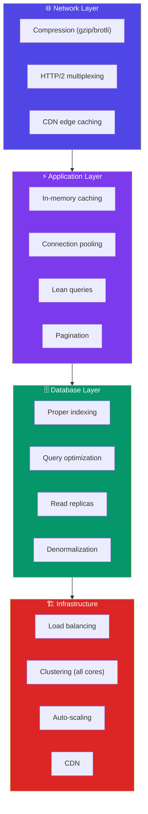
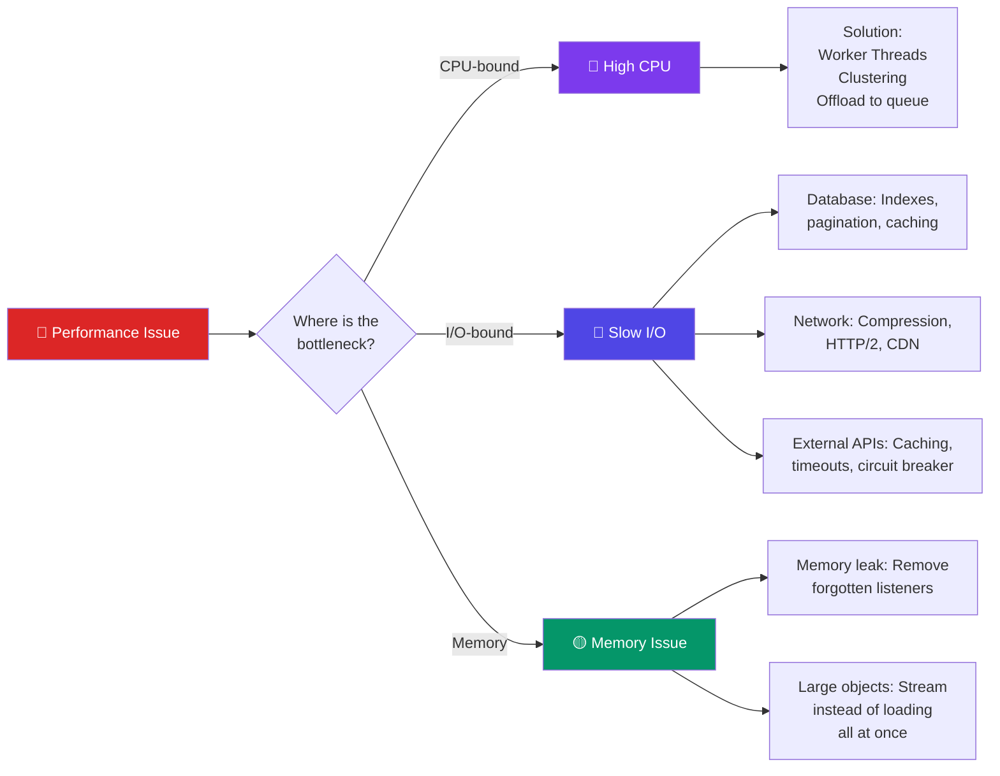

# Performance Optimization

## 📖 Introduction

Performance is a feature. A fast application retains users, improves conversion rates, and reduces infrastructure costs. Node.js applications have unique performance characteristics — single-threaded Event Loop, asynchronous I/O, and JavaScript's dynamic nature mean optimization requires understanding how Node.js works under the hood.

Performance optimization is not about making everything as fast as possible — it's about identifying and fixing the bottlenecks that matter. The Pareto principle applies: 80% of performance gains come from fixing 20% of the bottlenecks.

## 🤔 Why Do We Need This?

```javascript
// ❌ Unoptimized: returns everything, no caching
app.get('/products', async (req, res) => {
  const products = await Product.find({}); // Loads ALL products!
  res.json(products);
});

// At 100K products: ~500ms response, 50MB memory
// Users get a slow page, server runs out of memory

// ✅ Optimized: pagination, lean(), caching
app.get('/products', async (req, res) => {
  const products = await Product.find({})
    .select('name price')
    .lean()
    .limit(20);
  res.json(products);
});
// ~5ms response, 2KB memory — 100x faster!
```

## ⚠️ Problem Statement

Performance issues in Node.js usually fall into one of these categories:

1. **Blocking the Event Loop** — CPU-intensive operations that prevent Node.js from handling other requests
2. **Database queries** — N+1 queries, missing indexes, returning too much data
3. **Memory leaks** — Growing heap usage that eventually causes OOM crashes
4. **Inefficient algorithms** — O(n²) operations on large datasets
5. **Unoptimized network** — Large payloads, no compression, no caching
6. **No load shedding** — Server crashes under high load instead of degrading gracefully

## 📚 Real World Story

**LinkedIn** migrated from a monolithic Rails app to Node.js for their mobile backend. The result was dramatic: they went from 30 servers to 3, and performance improved 2-10x for different endpoints. The key insight was that Node.js's asynchronous I/O was a better fit for their workload than Rails' synchronous model.

But they also hit performance issues: memory leaks from unclosed event listeners, blocking operations in request handlers, and unoptimized MongoDB queries. Their optimization journey taught the industry that Node.js performance requires proactive monitoring and profiling.

## 🍕 Real World Analogy

| Performance Concept | Factory Analogy |
|--------------------|----------------|
| **Event Loop** | The factory conveyor belt |
| **Blocking operation** | A worker stopping the conveyor to do a task |
| **Memory leak** | Boxes piling up that never get disposed |
| **Compression** | Folding clothes before packing (smaller boxes) |
| **Caching** | A shelf of frequently-used tools near the assembly line |
| **Load balancing** | Multiple parallel conveyor belts |
| **Pagination** | Only moving the parts you need, not the whole warehouse |

## 👁️ Visual Explanation

```
Event Loop Blocking:

Without blocking (fast):                  With blocking (slow):

┌───────────┬───────────┬───────────┐    ┌───────────────────────────────┐
│ Request 1  │ Request 2  │ Request 3  │    │ Blocking Task (e.g., image    │
│ (2ms)      │ (3ms)      │ (2ms)      │    │ processing) takes 500ms       │
└───────────┴───────────┴───────────┘    │                               │
                                          │  Request 1 ───► Waiting 500ms │
All requests processed quickly            │  Request 2 ───► Waiting 500ms │
because no single task blocks.            │  Request 3 ───► Waiting 500ms │
                                          └───────────────────────────────┘
                                          ALL requests are delayed!
```

## 📊 Mermaid Diagram 1: Performance Optimization Areas



## ⚙️ Internal Working: How Node.js Handles Concurrent Requests

Node.js uses a single thread with an Event Loop. Understanding this is key to optimization:

1. **Request arrives** — Node.js adds it to the Event Loop queue
2. **I/O operations** — Database queries, file reads, and network calls are delegated to libuv's thread pool (4 threads by default)
3. **Callback queued** — When I/O completes, the callback is added to the Event Loop
4. **Event Loop tick** — Node.js processes callbacks one by one

**Performance implication**: If any JavaScript operation takes 100ms, it blocks ALL other requests for 100ms. CPU-intensive work must be offloaded to Worker Threads or a separate service.

## 🔄 Mermaid Diagram 2: Performance Bottleneck Categories



## 📝 Syntax

### Compression

```javascript
const compression = require('compression');
app.use(compression({
  threshold: 1024,        // Only compress > 1KB
  level: 6,                // Compression level (1-9, 6 is good balance)
  brotli: true,            // Use Brotli if available (better than gzip)
}));
```

### Query Optimization (Mongoose)

```javascript
// ❌ Slow
const users = await User.find({}).populate('orders');

// ✅ Fast
const users = await User.find({})
  .select('name email')     // Only needed fields
  .lean()                    // Plain JS objects (no Mongoose overhead)
  .limit(20)                 // Always paginate
  .hint({ email: 1 });      // Force index
```

## 🟢 Basic Example: Compression and Pagination

```javascript
const express = require('express');
const compression = require('compression');

const app = express();

// Enable compression
app.use(compression({ threshold: 1024 }));

// Paginated endpoint
app.get('/products', async (req, res) => {
  const page = Math.max(1, parseInt(req.query.page) || 1);
  const limit = Math.min(100, parseInt(req.query.limit) || 20);
  const skip = (page - 1) * limit;

  const [products, total] = await Promise.all([
    Product.find({})
      .select('name price category')
      .lean()
      .skip(skip)
      .limit(limit)
      .sort({ createdAt: -1 }),
    Product.countDocuments({}),
  ]);

  res.json({
    data: products,
    pagination: {
      page,
      limit,
      total,
      totalPages: Math.ceil(total / limit),
      hasNext: page < Math.ceil(total / limit),
    },
  });
});
```

**What's happening:**
- **Compression** reduces response size by 60-80%
- **`.select()`** only fetches needed fields (reduces data transfer)
- **`.lean()`** returns plain JS objects (no Mongoose document overhead — 3-5x faster)
- **`.skip().limit()`** prevents returning all documents
- **`Promise.all`** runs query + count in parallel
- **`Math.min(limit, 100)`** prevents abuse (client can't ask for 100K records)

## 🟡 Intermediate Example: Caching Layer

```javascript
const NodeCache = require('node-cache');
const cache = new NodeCache({ stdTTL: 300, checkperiod: 60 });

// Caching middleware
function cacheMiddleware(duration) {
  return (req, res, next) => {
    const key = `cache:${req.originalUrl}`;
    const cached = cache.get(key);
    if (cached) return res.json(cached);

    const originalJson = res.json.bind(res);
    res.json = (data) => {
      if (res.statusCode < 400) cache.set(key, data, duration);
      return originalJson(data);
    };
    next();
  };
}

app.get('/products/popular', cacheMiddleware(300), async (req, res) => {
  const products = await Product.find({ views: { $gte: 1000 } })
    .select('name price views')
    .lean()
    .limit(50);
  res.json(products);
});
```

**What's happening:**
- **In-memory cache** stores popular products
- **Cache hit** returns instantly (~0.1ms vs 5-50ms DB query)
- **Cache skip on error** — only caches successful responses (status < 400)

## 🔴 Advanced Example: Profiling and Debugging Performance

```javascript
// Monitor Event Loop lag
const start = Date.now();
setInterval(() => {
  const delay = Date.now() - start - 1000;
  if (delay > 50) {
    console.warn(`Event Loop blocked for ${delay}ms`);
  }
}, 1000);

// Express response time tracking
app.use((req, res, next) => {
  const start = Date.now();
  res.on('finish', () => {
    const duration = Date.now() - start;
    if (duration > 1000) {
      console.warn(`Slow route: ${req.method} ${req.path} (${duration}ms)`);
    }
  });
  next();
});

// Use async hooks for request context
const async_hooks = require('async_hooks');
const store = new Map();

const hook = async_hooks.createHook({
  init(asyncId, type, triggerAsyncId) {
    if (store.has(triggerAsyncId)) {
      store.set(asyncId, store.get(triggerAsyncId));
    }
  },
  destroy(asyncId) {
    store.delete(asyncId);
  },
});
hook.enable();

// Memory usage monitoring
setInterval(() => {
  const usage = process.memoryUsage();
  const heapUsedMB = Math.round(usage.heapUsed / 1024 / 1024);
  const heapTotalMB = Math.round(usage.heapTotal / 1024 / 1024);

  if (heapUsedMB > 500) {
    console.warn(`High memory usage: ${heapUsedMB}MB / ${heapTotalMB}MB`);
  }
}, 30000);

// Garbage collection monitoring (run with --expose-gc)
if (global.gc) {
  setInterval(() => {
    global.gc();
    const usage = process.memoryUsage();
    console.log(`GC: heapUsed=${Math.round(usage.heapUsed / 1024 / 1024)}MB`);
  }, 60000);
}
```

**What's happening:**
- **Event Loop lag** — detects blocking operations
- **Slow route logging** — identifies endpoints that need optimization
- **Async hooks** — maintains request context across async operations
- **Memory monitoring** — alerts when heap grows beyond threshold
- **GC monitoring** — tracks garbage collection impact

## 🏭 Production Example: Load Testing with autocannon

```javascript
// load-test.js
const autocannon = require('autocannon');

async function runLoadTest() {
  const result = await autocannon({
    url: 'http://localhost:3000',
    connections: 100,       // 100 concurrent connections
    duration: 30,           // Run for 30 seconds
    requests: [
      { method: 'GET', path: '/api/products' },
      { method: 'GET', path: '/api/products?page=2' },
      { method: 'GET', path: '/api/users/profile' },
    ],
    headers: {
      'Authorization': 'Bearer test-token',
    },
  });

  console.log(`Requests/sec: ${result.requests.average}`);
  console.log(`Latency (mean): ${result.latency.average}ms`);
  console.log(`Latency (p99): ${result.latency.p99}ms`);
  console.log(`Error rate: ${result.errors} errors`);
  console.log(`Timeouts: ${result.timeouts} timeouts`);
}

runLoadTest();
```

**Output:**
```
Running 30s test @ http://localhost:3000
100 connections

┌─────────┬────────┬────────┬────────┬────────┬───────────┬──────────┬────────┐
│ Stat    │ 2.5%   │ 50%    │ 97.5%  │ 99%    │ Avg       │ Stdev    │ Max    │
├─────────┼────────┼────────┼────────┼────────┼───────────┼──────────┼────────┤
│ Latency │ 12ms   │ 25ms   │ 80ms   │ 120ms  │ 32ms      │ 18ms     │ 245ms  │
└─────────┴────────┴────────┴────────┴────────┴───────────┴──────────┴────────┘
┌───────────┬─────────┬─────────┬─────────┬────────┬─────────┬─────────┬────────┐
│ Stat      │ 1%      │ 2.5%    │ 50%     │ 97.5%  │ Avg     │ Stdev   │ Min    │
├───────────┼─────────┼─────────┼─────────┼────────┼─────────┼─────────┼────────┤
│ Req/Sec   │ 1500    │ 1800    │ 2200    │ 2800   │ 2150    │ 350     │ 1200   │
└───────────┴─────────┴─────────┴─────────┴────────┴─────────┴─────────┴────────┘
```

## ⚙️ How It Works Internally: Event Loop Lag

The Event Loop processes tasks in phases:

```
timers → pending I/O → idle/prepare → poll → check → close callbacks → (repeat)
```

If any callback takes too long, all subsequent phases are delayed. This is called **Event Loop lag**. You can measure it:

```javascript
function measureLag() {
  const now = Date.now();
  setImmediate(() => {
    const lag = Date.now() - now - 1; // -1 for setImmediate overhead
    if (lag > 50) console.warn(`Event Loop lag: ${lag}ms`);
  });
}
```

## 📦 Performance Notes

### Common Optimization Impact

| Optimization | Impact | Effort |
|-------------|--------|--------|
| `.lean()` in Mongoose | 3-5x faster queries | Low (one method call) |
| Compression (gzip) | 60-80% smaller responses | Low (one middleware) |
| Database indexes | 10-100x faster queries | Medium (need to analyze) |
| Pagination | Prevents OOM on large datasets | Low |
| In-memory caching | 10-100x faster reads | Medium |
| Connection pooling | 10x faster connection setup | Low (configure pool size) |
| Clustering | N-cores × throughput | Medium |
| Worker threads | Unblocks Event Loop | High (architectural change) |

## 🔒 Security Notes

### Performance and Security

- **Rate limiting** — protects against DoS attacks (also improves performance under attack)
- **Timeout middleware** — prevents hanging connections from consuming resources
- **Request size limits** — prevents memory exhaustion from large payloads
- **Circuit breaker** — stops calling failing services, preventing cascading failures

## ⚠️ Common Mistakes

1. **❌ Returning all data without pagination** — `Product.find({})` at 100K documents = 50MB response + crashed server

2. **❌ N+1 queries** — Fetching related data in a loop instead of using `populate()` or JOINs

3. **❌ Not using indexes** — A query on 1M documents without an index scans all 1M

4. **❌ Blocking the Event Loop** — `JSON.parse(largeString)`, `crypto.pbkdf2`, image processing on the main thread

5. **❌ Memory leaks** — Adding event listeners without removing them, accumulating data in global objects

6. **❌ No caching** — Every request hitting the database, even for data that rarely changes

## 🚀 Best Practices

### Performance Checklist

```javascript
// ✅ Lean queries
await Model.find(filter).select('field1 field2').lean().limit(20);

// ✅ Proper indexes
schema.index({ field1: 1, field2: -1 });

// ✅ Compression
app.use(compression({ threshold: 1024 }));

// ✅ Caching
const cached = await cache.get(key) || await fetchAndCache(key, fetchFn);

// ✅ Pagination
const items = await Model.find(filter).skip(skip).limit(limit);

// ✅ Connection pooling
await mongoose.connect(uri, { maxPoolSize: 10 });

// ✅ Event loop monitoring
setInterval(() => { /* check lag */ }, 1000);
```

### Regular Performance Audits

1. Run load tests monthly (autocannon, k6, wrk)
2. Monitor p99 latency in production
3. Profile slow endpoints with `clinic.js` or `0x`
4. Analyze database query performance with `explain()`
5. Review memory usage trends

## 🎯 Interview Questions

**Q1: How does Node.js handle 10,000 concurrent requests with a single thread?**

Node.js doesn't process them simultaneously — it processes them concurrently. Each request involves I/O (database, file system, network), which Node.js delegates to libuv's thread pool or the OS kernel (epoll, kqueue). While waiting for I/O to complete, Node.js processes other requests. The Event Loop efficiently switches between waiting requests, so 10,000 concurrent connections are mostly waiting on I/O, not consuming CPU.

**Q2: What is Event Loop lag and how do you detect it?**

Event Loop lag occurs when a synchronous operation blocks the Event Loop from processing other callbacks. You detect it by measuring the time between scheduling a `setImmediate` or `setTimeout` and when it actually fires. A lag of >50ms indicates a problem.

**Q3: How do you optimize a slow MongoDB query?**

Use `.explain()` to analyze the query, check for `COLLSCAN` (collection scan), add appropriate indexes, use `.select()` to fetch only needed fields, use `.lean()` to skip Mongoose document hydration, and paginate with `.skip().limit()` or cursor-based pagination.

**Q4: What causes memory leaks in Node.js and how do you find them?**

Common causes: global variables, forgotten event listeners, closures holding references, setInterval without clearInterval, and growing caches without eviction. Find them using: `heapdump` to take snapshots, Chrome DevTools Memory tab to compare snapshots, and `clinic.js` for automated detection.

## 📝 MCQs

**1. What does Mongoose's `.lean()` method do?**
- A) Returns plain JavaScript objects instead of Mongoose documents ✅
- B) Compresses the query result
- C) Removes duplicate documents
- D) Limits the query to one result

**2. Which compression library reduces response size by 60-80%?**
- A) `helmet`
- B) `compression` (gzip/brotli) ✅
- C) `morgan`
- D) `cors`

**3. What is Event Loop lag?**
- A) The time it takes the server to start
- B) The delay when a blocking operation prevents other callbacks from running ✅
- C) The time between HTTP requests
- D) The database query time

**4. Which of these is the most common cause of memory leaks in Node.js?**
- A) Using `const` instead of `let`
- B) Forgotten event listeners and intervals ✅
- C) Too many files in the project
- D) Using async/await

**5. What tool would you use to load test a Node.js API?**
- A) ESLint
- B) autocannon ✅
- C) Prettier
- D) nodemon

**Answer Key:** 1-A, 2-B, 3-B, 4-B, 5-B

## 💻 Coding Challenge 1: Query Optimization

Given a slow endpoint, optimize it:
- Original: Returns ALL products with ALL fields, no pagination
- Optimize: Add pagination, field selection, lean(), and caching
- Measure the performance difference

## 💻 Coding Challenge 2: Memory Leak Detection

Create a script that:
- Deliberately creates a memory leak (forgotten setInterval + accumulating array)
- Monitors heap usage every second
- Logs a warning when heap exceeds a threshold
- Allows manual GC trigger (with --expose-gc)

## 💻 Coding Challenge 3: Load Testing Script

Write a load test with autocannon that:
- Tests 3 endpoints with different request mixes
- Runs for 60 seconds with 50 concurrent connections
- Reports: req/s, p50, p99 latency, error rate
- Exits with code 1 if p99 > 500ms (CI failure)

## 🧪 Mini Exercise: Debugging Performance Issues

This code has performance problems. Find and fix them:

```javascript
// Bug 1: No pagination — loads ALL users
app.get('/users', async (req, res) => {
  const users = await User.find({}).populate('orders');
  // Bug 2: .populate() on 10K users = 10,001 queries!
  // Bug 3: No .lean() — creating Mongoose docs for every user
  // Bug 4: No caching — every request hits the database
  res.json(users);
});

// Bug 5: Blocking the Event Loop
app.get('/report', (req, res) => {
  const data = [];
  for (let i = 0; i < 10000000; i++) { data.push(i); }
  // 10M iterations = ~200ms blocking — all other requests delayed!
  res.json({ sum: data.reduce((a, b) => a + b, 0) });
});
```

## 🌍 Real World Problem (Interview Coding Challenge)

**Problem:** You're optimizing a real-time analytics dashboard that updates every 5 seconds. The dashboard queries a 10M-row database, aggregates data, and serves it to 500 concurrent users. Currently, each request takes 3 seconds, and the server CPU is at 95%.

**Requirements:**
1. Dashboard must load in under 500ms
2. Data must be no more than 5 seconds stale
3. Server must handle 1000 concurrent users
4. Cost cannot increase (must work with existing infrastructure)

**Questions:**
1. What's the bottleneck — CPU, I/O, or memory?
2. What caching strategy would you use?
3. How would you optimize the aggregation query?
4. What architecture changes would you make?

**Interview Tip:** Discuss materialized views (pre-computed aggregates), Redis caching with background refresh, and connection pooling. The key insight: don't aggregate 10M rows on every request — pre-compute and cache.

## 🏗️ Mini Project: Performance Audit Dashboard

Build a performance monitoring tool:

**Core features:**
- Track request duration per endpoint
- Monitor Event Loop lag
- Track memory usage over time
- Log slow queries (>500ms)
- Display real-time metrics on a dashboard

**Technical requirements:**
- Prometheus client for metric collection
- Grafana or simple HTML dashboard
- Event Loop lag detection
- Heap memory monitoring
- Alert on threshold breach

**Bonus features:**
- CPU profiling integration
- Database query analysis
- Flame graph generation
- Auto-scaling recommendations

## 📖 Summary

| Concept | Key Takeaway |
|---------|-------------|
| **Event Loop** | Single-threaded — don't block it with CPU work |
| **Lean queries** | `.lean()`, `.select()`, pagination — essential for DB performance |
| **Caching** | Reduce DB load by 80-90% for read-heavy data |
| **Compression** | gzip/brotli reduces response size by 60-80% |
| **Indexes** | 10-100x faster queries with proper database indexes |
| **Memory leaks** | Remove event listeners, clear intervals, cap cache size |
| **Profiling** | Measure before optimizing — fix the real bottlenecks first |

## 📋 Cheat Sheet

```javascript
// Quick reference: Performance

// 1. Compression
app.use(require('compression')({ threshold: 1024 }));

// 2. Database
Model.find(filter).select('fields').lean().limit(20).skip(0);

// 3. Indexes
schema.index({ field: 1 });

// 4. Caching
const cached = cache.get(key) || await fetchAndCache(key);

// 5. Pagination
const page = Math.max(1, +req.query.page);
const limit = Math.min(100, +req.query.limit || 20);

// 6. Event loop lag tracking
setInterval(() => {
  const lag = Date.now() - start;
  if (lag > 50) console.warn(`Lag: ${lag}ms`);
}, 1000);

// 7. Clustering
const cluster = require('cluster');
if (cluster.isPrimary) {
  require('os').cpus().forEach(() => cluster.fork());
}
```

## 📚 Further Reading

- [Node.js Performance Best Practices](https://nodejs.org/en/learn/diagnostics)
- [Mongoose Performance](https://mongoosejs.com/docs/guide.html#indexes)
- [Clinic.js — Node.js Performance Profiling](https://clinicjs.org/)
- [autocannon — Load Tester](https://github.com/mcollina/autocannon)
- [Chrome DevTools Node.js Profiling](https://nodejs.org/en/learn/getting-started/debugging)

## 🔗 Related Topics

- [Caching with Redis](../data/caching) — Distributed caching strategies
- [Clustering & Worker Threads](./clustering-and-worker-threads) — Multi-core utilization
- [Monitoring](./logging-and-monitoring) — Performance metrics and alerting
- [Working with Databases](../data/databases) — Database query optimization
