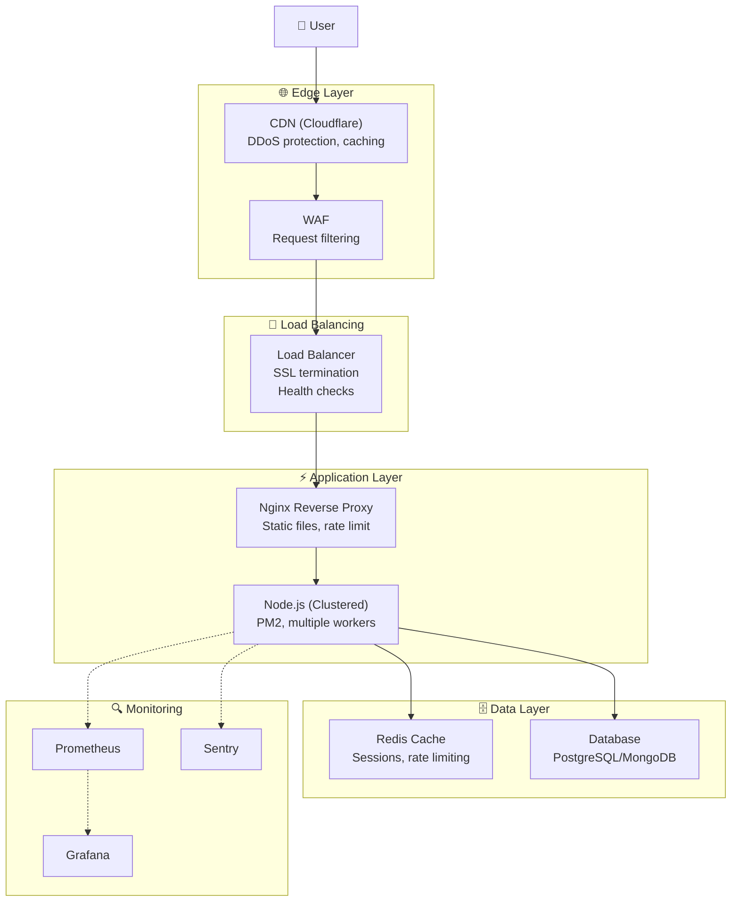
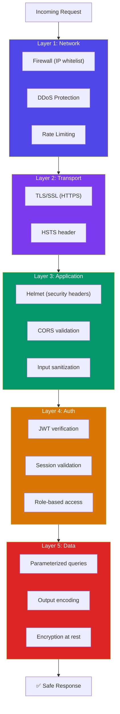

# Production Architecture & Security Hardening

## 📖 Introduction

A production Node.js application needs more than just code. It needs a robust architecture that handles failures, scales under load, and withstands attacks. This module covers the infrastructure layer: Docker containerization, PM2 process management, Nginx reverse proxy, and security hardening against common vulnerabilities.

The **OWASP Top 10** and the **12-Factor App** methodology are the foundations of production-ready architecture.

## 🤔 Why Do We Need This?

```javascript
// ❌ Development-only setup — not production ready
const app = express();
app.use(cors());                    // Wide open CORS
app.use(morgan('dev'));              // Verbose logging
app.listen(3000);                    // No graceful shutdown

// In production, you need:
// ✅ Rate limiting, helmet, CORS restriction
// ✅ Graceful shutdown (SIGTERM handler)
// ✅ Health checks for orchestrator
// ✅ Process manager (PM2 or Docker)
// ✅ Structured logging
// ✅ Request size limits
```

## ⚠️ Problem Statement

A production system must handle:

1. **Failures** — Server crashes, network blips, database disconnections
2. **Load spikes** — Traffic that's 10-100x normal during launches or events
3. **Attacks** — DDoS, SQL injection, XSS, CSRF, brute force
4. **Resource constraints** — Memory limits, CPU limits, disk space
5. **Deployment** — Zero-downtime, rollbacks, environment management
6. **Observability** — Knowing what's happening when things go wrong

## 📚 Real World Story

**Twilio** runs Node.js in production across thousands of servers, handling billions of API calls. Their architecture emphasizes: defense in depth (security at every layer), graceful degradation (if one service fails, others continue), and immutable infrastructure (servers are replaced, never modified).

When a security vulnerability is discovered (like the `event-stream` package incident), Twilio's security team can quickly identify affected services, patch them, and redeploy — all because of their containerized, automated infrastructure.

## 🍕 Real World Analogy

| Architecture Concept | Bank Security Analogy |
|---------------------|----------------------|
| **Rate limiting** | ATM limits daily withdrawals |
| **Helmet (security headers)** | Security camera + alarm system |
| **Input validation** | ID check before entering |
| **Graceful shutdown** | Emergency procedures (not a panic stampede) |
| **Health checks** | Security guard patrols |
| **Load balancing** | Multiple teller windows |
| **Docker isolation** | Safety deposit boxes (separate compartments) |

## 👁️ Visual Explanation

```
Production Architecture:

User → CDN → WAF → Load Balancer → Nginx → Node.js → Database
         │       │        │           │        │          │
         │   Rate limit  │       SSL term.   Cluster     Pool
         │   WAF rules   │       Static      Workers    Connection
         │   DDoS protect│       files       PM2        Replicas
         │               │                              │
         │               │                              │
         ▼               ▼                              ▼
    Cloudflare       AWS ALB                         Redis/MongoDB
```

## 📊 Mermaid Diagram 1: Production Stack



## ⚙️ Internal Working: How a Request Flows Through Production Infrastructure

1. **User** → DNS resolves to CDN (Cloudflare)
2. **CDN** → Caches static assets, filters DDoS traffic
3. **WAF** → Inspects request for SQL injection, XSS, path traversal
4. **Load Balancer** → Terminates SSL, checks health, routes to healthy servers
5. **Nginx** → Serves static files directly, proxies API to Node.js
6. **Node.js** → Authenticates, validates, processes, and responds
7. **Response** flows back through the same chain

## 🔄 Mermaid Diagram 2: Security Layers



## 📝 Syntax

### Express Security Middleware

```javascript
const helmet = require('helmet');
const rateLimit = require('express-rate-limit');
const cors = require('cors');

// Security headers
app.use(helmet());

// CORS — restrict origin
app.use(cors({ origin: process.env.CLIENT_URL }));

// Rate limiting
const limiter = rateLimit({
  windowMs: 15 * 60 * 1000,  // 15 minutes
  max: 100,                    // 100 requests per window
  message: { error: 'Too many requests' },
});
app.use('/api', limiter);
```

### Graceful Shutdown

```javascript
process.on('SIGTERM', async () => {
  console.log('SIGTERM received. Starting graceful shutdown...');
  server.close(async () => {
    await mongoose.disconnect();
    await redis.quit();
    process.exit(0);
  });
});
```

## 🟢 Basic Example: Security Hardening an Express App

```javascript
const express = require('express');
const helmet = require('helmet');
const rateLimit = require('express-rate-limit');
const cors = require('cors');
const { body, validationResult } = require('express-validator');

const app = express();

// 1. Security headers
app.use(helmet());

// 2. CORS — only allow your frontend
app.use(cors({
  origin: process.env.CLIENT_URL || 'http://localhost:3000',
  credentials: true,
}));

// 3. Request size limit
app.use(express.json({ limit: '10kb' }));

// 4. Rate limiting
const limiter = rateLimit({
  windowMs: 15 * 60 * 1000,
  max: 100,
  standardHeaders: true,
  legacyHeaders: false,
});
app.use('/api', limiter);

// 5. Strict rate limit for auth endpoints
const authLimiter = rateLimit({
  windowMs: 15 * 60 * 1000,
  max: 5,
  message: { error: 'Too many login attempts. Try again later.' },
});
app.use('/api/auth/login', authLimiter);

// 6. Input validation
app.post('/api/users', [
  body('email').isEmail().normalizeEmail(),
  body('password').isLength({ min: 8 }),
], (req, res) => {
  const errors = validationResult(req);
  if (!errors.isEmpty()) {
    return res.status(422).json({ errors: errors.array() });
  }
  // Process request...
});

app.listen(3000);
```

**What's happening:**
- **Helmet** sets 15+ security headers (CSP, HSTS, X-Frame-Options, etc.)
- **CORS** restricts which domains can access the API
- **Rate limiting** prevents brute force and DoS attacks
- **Request size limit** prevents memory exhaustion from large payloads
- **Input validation** sanitizes and validates user input
- **Auth-specific rate limit** — stricter limits for login endpoints

## 🟡 Intermediate Example: Graceful Shutdown

```javascript
const express = require('express');
const http = require('http');

const app = express();
const server = http.createServer(app);

// Graceful shutdown handler
async function shutdown(signal) {
  console.log(`\n${signal} received. Starting graceful shutdown...`);

  // 1. Stop accepting new connections
  server.close(() => {
    console.log('HTTP server closed');
  });

  // 2. Give existing requests time to complete (max 30 seconds)
  const forceExit = setTimeout(() => {
    console.error('Forced shutdown after timeout');
    process.exit(1);
  }, 30000);

  try {
    // 3. Close database connections
    await mongoose.disconnect();
    console.log('MongoDB disconnected');

    // 4. Close Redis connection
    await redis.quit();
    console.log('Redis disconnected');

    // 5. Close queue connections
    await emailQueue.close();
    console.log('Queues closed');

    clearTimeout(forceExit);
    console.log('Graceful shutdown complete');
    process.exit(0);
  } catch (err) {
    console.error('Error during shutdown:', err);
    process.exit(1);
  }
}

// Listen for shutdown signals
process.on('SIGTERM', () => shutdown('SIGTERM'));
process.on('SIGINT', () => shutdown('SIGINT'));

// Health check for orchestrator
app.get('/health', (req, res) => {
  res.json({ status: 'healthy' });
});

// Readiness check — are we accepting connections?
app.get('/ready', async (req, res) => {
  try {
    await mongoose.connection.db.admin().ping();
    await redis.ping();
    res.json({ status: 'ready' });
  } catch (err) {
    res.status(503).json({ status: 'not ready', error: err.message });
  }
});

server.listen(3000, () => {
  console.log('Server started. Ready for connections.');
  // Signal to PM2 that the app is ready
  if (process.send) process.send('ready');
});
```

**What's happening:**
- **SIGTERM** (Kubernetes, ECS, PM2 sends this) triggers graceful shutdown
- **server.close()** stops accepting new connections, drains existing ones
- **Force timeout** prevents hanging forever if a request doesn't complete
- **Orderly cleanup** — databases, caches, queues are closed in order
- **Health/ready endpoints** — orchestrator uses these for lifecycle management

## 🔴 Advanced Example: Docker Security Best Practices

```dockerfile
# Dockerfile with security hardening

# Stage 1: Build
FROM node:20-alpine AS builder
WORKDIR /app

# Copy only package files first (layer caching)
COPY package*.json ./
RUN npm ci

# Copy source and build
COPY . .
RUN npm run build

# Stage 2: Run (minimal)
FROM node:20-alpine AS production
WORKDIR /app

# Security: Create non-root user
RUN addgroup -g 1001 -S appgroup && \
    adduser -S appuser -u 1001 -G appgroup

# Security: Only copy production files
COPY --from=builder --chown=appuser:appgroup /app/dist ./dist
COPY --from=builder --chown=appuser:appgroup /app/node_modules ./node_modules
COPY --from=builder --chown=appuser:appgroup /app/package.json ./

# Security: Switch to non-root user
USER appuser

# Security: Mark port for documentation
EXPOSE 3000

# Security: Health check
HEALTHCHECK --interval=30s --timeout=3s --start-period=5s --retries=3 \
  CMD wget --no-verbose --tries=1 --spider http://localhost:3000/health || exit 1

# Use tini to handle signals properly
RUN apk add --no-cache tini
ENTRYPOINT ["/sbin/tini", "--"]
CMD ["node", "dist/server.js"]
```

```yaml
# docker-compose.yml with security settings
version: '3.8'

services:
  app:
    build:
      context: .
      target: production
    ports:
      - "3000:3000"
    environment:
      - NODE_ENV=production
      - DB_URL=mongodb://mongo:27017/myapp
    depends_on:
      mongo:
        condition: service_healthy
    restart: unless-stopped
    security_opt:
      - no-new-privileges:true
    cap_drop:
      - ALL
    cap_add:
      - NET_BIND_SERVICE
    read_only: true
    tmpfs:
      - /tmp
    healthcheck:
      test: ["CMD", "node", "-e", "require('http').get('http://localhost:3000/health')"]
      interval: 30s
      timeout: 5s
      retries: 3
      start_period: 15s

  mongo:
    image: mongo:7
    environment:
      - MONGO_INITDB_ROOT_USERNAME=admin
      - MONGO_INITDB_ROOT_PASSWORD=${MONGO_PASSWORD}
    volumes:
      - mongo-data:/data/db
    healthcheck:
      test: echo 'db.runCommand("ping").ok' | mongosh --quiet
      interval: 30s

volumes:
  mongo-data:
```

**What's happening:**
- **Non-root user** — limits damage from container compromise
- **`--chown`** — ensures files have correct ownership for the non-root user
- **`read_only: true`** — container filesystem is read-only (except tmpfs)
- **`cap_drop: ALL`** — removes all kernel capabilities, adds only necessary ones
- **`no-new-privileges`** — prevents privilege escalation
- **`tini`** — proper init process handles signals (SIGTERM forwarded to Node)
- **Health checks** — orchestrator verifies the app is working

## 🏭 Production Example: Full Security Audit Checklist

```javascript
// security-audit.js — Run this checklist before production deployment

const securityChecks = {
  'Dependencies': async () => {
    const { exec } = require('child_process');
    // Check for known vulnerabilities
    return new Promise((resolve) => {
      exec('npm audit --audit-level=high', (err, stdout) => {
        resolve(stdout.includes('found 0 vulnerabilities') ? '✅ PASS' : '❌ FAIL');
      });
    });
  },

  'Security Headers': () => {
    const checks = [
      'content-security-policy',
      'x-frame-options',
      'x-content-type-options',
      'strict-transport-security',
    ];
    // Run against deployed endpoint
    return `Check ${checks.length} headers configured`;
  },

  'Rate Limiting': () => {
    const checks = ['/api', '/api/auth/login'];
    return `Rate limit enabled on ${checks.join(', ')}`;
  },

  'Input Validation': () => {
    const checks = ['All POST/PUT endpoints', 'SQL injection prevention', 'XSS sanitization'];
    return `${checks.length} validation checks`;
  },

  'Authentication': () => {
    const checks = ['JWT expiration', 'Password hashing (bcrypt)', 'Failed login lockout'];
    return `${checks.length} auth checks`;
  },

  'Infrastructure': () => {
    const checks = [
      'Graceful shutdown configured',
      'Health check endpoint',
      'Non-root user in Docker',
      'Read-only filesystem in container',
      'Secrets from environment variables',
    ];
    return `${checks.length} infra checks`;
  },

  'Monitoring': () => {
    const checks = ['Structured logging', 'Error tracking (Sentry)', 'Metrics endpoint', 'Alerting configured'];
    return `${checks.length} monitoring checks`;
  },
};

// Production readiness score
async function runSecurityAudit() {
  console.log('🔒 Running Production Security Audit...\n');
  let passed = 0;
  const total = Object.keys(securityChecks).length;

  for (const [category, check] of Object.entries(securityChecks)) {
    const result = await check();
    if (result.startsWith('✅')) passed++;
    console.log(`${result} - ${category}`);
  }

  console.log(`\n📊 Score: ${passed}/${total} (${Math.round(passed/total*100)}%)`);
  if (passed < total) {
    console.log('⚠️  Fix failing checks before deploying to production.');
  }
}

runSecurityAudit();
```

## ⚙️ How It Works Internally: PM2 Process Management

PM2 is a production process manager for Node.js:

1. **Daemon mode** — PM2 runs as a background service
2. **Process management** — starts, stops, restarts, and monitors processes
3. **Cluster mode** — forks one worker per CPU core
4. **Zero-downtime reload** — restarts workers one at a time
5. **Watch mode** — restarts on file changes (development)
6. **Startup hook** — `pm2 startup` configures PM2 to start on system boot

PM2 sends **SIGTERM** for graceful shutdown, waits for `process.send('ready')` to confirm readiness, and monitors memory/CPU for auto-restart.

## 📦 Performance Notes

### Security vs Performance Tradeoffs

| Security Measure | Performance Impact | Necessity |
|-----------------|-------------------|-----------|
| Helmet headers | Negligible (<0.1ms) | ✅ Always |
| Rate limiting | Negligible (in-memory) | ✅ Always |
| Input validation | 0.1-1ms per request | ✅ Always |
| SSL termination | 1-5ms (may be offloaded) | ✅ Always |
| CORS check | Negligible | ✅ Always |
| SQL param queries | Negligible | ✅ Always |
| JWT verification | 0.5-2ms per request | ✅ Always |
| CSP headers | Negligible | ✅ Recommended |

## 🔒 Security Notes

### OWASP Top 10 for Node.js

| # | Vulnerability | Node.js Mitigation |
|---|---------------|-------------------|
| 1 | Injection | Parameterized queries, express-validator |
| 2 | Broken Auth | bcrypt, JWT with short expiry, rate limit login |
| 3 | Sensitive Data | helmet, HTTPS only, encrypt at rest |
| 4 | XXE | Disable XML parsing unless needed |
| 5 | Broken Access | Role-based middleware, validate JWT claims |
| 6 | Misconfiguration | Environment-specific config, fail-secure defaults |
| 7 | XSS | helmet CSP, output encoding, sanitize-html |
| 8 | Insecure Deserialization | Validate JSON.parse, avoid eval |
| 9 | Known Vulnerabilities | npm audit, Snyk, Dependabot |
| 10 | Logging | Structured logging, never log secrets |

### Security Checklist

- [ ] `npm audit` — fix high/critical vulnerabilities
- [ ] Helmet middleware configured
- [ ] CORS restricted to specific origins
- [ ] Rate limiting on all endpoints (stricter on auth)
- [ ] Request size limits (`express.json({ limit: '10kb' })`)
- [ ] Input validation on all POST/PUT/PATCH endpoints
- [ ] SQL injection prevention (parameterized queries)
- [ ] bcrypt for password hashing (cost factor 12)
- [ ] JWT with short expiry (15m) + refresh tokens
- [ ] HTTPS only (HSTS header)
- [ ] Graceful shutdown (SIGTERM handler)
- [ ] Health check endpoints (`/health`, `/ready`)
- [ ] Non-root user in Docker
- [ ] Secrets in environment variables (not code)
- [ ] Structured logging (no sensitive data)
- [ ] Error tracking (Sentry or similar)

## ⚠️ Common Mistakes

1. **❌ No rate limiting** — Attackers can brute force login endpoints at thousands of requests/second

2. **❌ CORS set to `*`** — Any website can make API calls from users' browsers

3. **❌ No request size limit** — A 500MB JSON payload crashes the server with an OOM error

4. **❌ No graceful shutdown** — Killing the process abruptly drops active connections

5. **❌ Running as root in Docker** — If the container is compromised, the attacker has root access

6. **❌ Unrestricted file upload** — Attackers can upload malicious files (use file type validation + scan)

## 🚀 Best Practices

### Production Readiness Checklist

```javascript
// app.js — Final production template

const express = require('express');
const helmet = require('helmet');
const cors = require('cors');
const rateLimit = require('express-rate-limit');
const compression = require('compression');

const app = express();

// 1. Security
app.use(helmet());
app.use(cors({ origin: process.env.CLIENT_URL }));
app.use(express.json({ limit: '10kb' }));

// 2. Performance
app.use(compression());

// 3. Rate limiting
app.use('/api', rateLimit({ windowMs: 15 * 60 * 1000, max: 100 }));

// 4. Routes
app.use('/api/users', require('./routes/users'));
app.use('/api/auth', require('./routes/auth'));

// 5. Error handler (last!)
app.use((err, req, res, next) => {
  logger.error({ err }, 'Unhandled error');
  res.status(err.status || 500).json({
    error: process.env.NODE_ENV === 'production'
      ? 'Internal server error'
      : err.message,
  });
});
```

## 🎯 Interview Questions

**Q1: How do you protect a Node.js API from brute force login attacks?**

Implement rate limiting with stricter limits on auth endpoints (5 requests per 15 minutes per IP), use bcrypt with cost factor 12 (slow hashing), implement account lockout after N failed attempts, add CAPTCHA after failed attempts, and use JWT with short expiry.

**Q2: What is Helmet and what does it do?**

Helmet is an Express middleware that sets security-related HTTP headers. It adds: `Content-Security-Policy` (prevents XSS), `X-Frame-Options` (prevents clickjacking), `Strict-Transport-Security` (enforces HTTPS), `X-Content-Type-Options` (prevents MIME sniffing), and more. It's the easiest way to fix many web vulnerabilities.

**Q3: How do you implement graceful shutdown in a Node.js app?**

Listen for `SIGTERM` and `SIGINT` signals. When received: stop accepting new connections (`server.close()`), set a force-shutdown timeout (30s), close database connections, close Redis, close queues, then exit. This ensures in-flight requests complete and no data is lost. Kubernetes uses SIGTERM before killing pods.

## 📝 MCQs

**1. What is the primary purpose of the Helmet middleware?**
- A) Compress HTTP responses
- B) Set security-related HTTP headers ✅
- C) Log HTTP requests
- D) Validate request bodies

**2. What HTTP status code should a readiness check return when dependencies are unavailable?**
- A) 200
- B) 503 ✅
- C) 404
- D) 500

**3. Why should you NOT run a Node.js container as root?**
- A) It's slower
- B) If compromised, the attacker has root access ✅
- C) It can't log to stdout
- D) It prevents health checks

**4. What is the recommended bcrypt cost factor for password hashing?**
- A) 4
- B) 10-12 ✅
- C) 20
- D) 1

**5. Which signal does Kubernetes send to gracefully shut down a pod?**
- A) SIGKILL
- B) SIGTERM ✅
- C) SIGINT
- D) SIGHUP

**Answer Key:** 1-B, 2-B, 3-B, 4-B, 5-B

## 💻 Coding Challenge 1: Security Hardening

Take a basic Express app and harden it:
- Add Helmet with custom CSP
- Add CORS restricted to a specific origin
- Add rate limiting (100/min general, 5/min for auth)
- Add request size limit
- Add input validation for all endpoints
- Verify with curl/Postman that security headers are present

## 💻 Coding Challenge 2: Graceful Shutdown

Implement a graceful shutdown system:
- Listen for SIGTERM and SIGINT
- Close HTTP server (stop accepting connections)
- Wait for active requests (track with a counter)
- Close database, Redis, and queue connections
- Force exit after 30s timeout
- Test by sending SIGTERM during a slow request

## 💻 Coding Challenge 3: Security Audit Script

Create a security audit script that checks:
- All required security middleware is present (Helmet, CORS, rate limit)
- Graceful shutdown is implemented
- Health check endpoints exist
- No secrets in code (check for hardcoded passwords/tokens)
- npm audit passes

## 🧪 Mini Exercise: Debugging Security Issues

This production app has security problems. Find and fix them:

```javascript
const express = require('express');
const app = express();

// Bug 1: No Helmet — missing security headers!
// Bug 2: CORS allows any origin!
app.use(cors());

// Bug 3: No rate limiting — anyone can brute force!
app.post('/api/auth/login', async (req, res) => {
  // Bug 4: No request size limit
  // Bug 5: No input validation
  const user = await User.findOne({ email: req.body.email });
  
  // Bug 6: The error message reveals too much!
  if (!user) return res.status(401).json({ error: 'Email not found' });
  
  // Bug 7: No bcrypt — plain text password comparison!
  if (req.body.password !== user.password) {
    return res.status(401).json({ error: 'Wrong password' });
  }
});
```

## 🌍 Real World Problem (Interview Coding Challenge)

**Problem:** Your Node.js API is being attacked. You're seeing: 100K requests/second to `/api/auth/login` from thousands of different IPs, requests with SQL injection patterns in the query strings, and attempts to upload PHP files to your upload endpoint.

**Requirements:**
1. Stop the current attack without taking the API down
2. Implement permanent protections against each attack vector
3. Add monitoring to detect future attacks early
4. Must not break legitimate users

**Questions:**
1. What immediate actions would you take to stop the attack?
2. What permanent protections would you implement?
3. How would you differentiate between a DDoS and a brute force attack?
4. How would you validate file uploads to prevent malicious files?

**Interview Tip:** Discuss WAF rules for immediate blocking, rate limiting with IP reputation, file type validation with magic bytes, and anomaly detection monitoring.

## 📖 Summary

| Concept | Key Takeaway |
|---------|-------------|
| **Helmet** | Security headers — CSP, HSTS, X-Frame-Options |
| **Rate limiting** | Prevent brute force and DoS attacks |
| **Graceful shutdown** | Handle SIGTERM, drain connections, cleanup |
| **Docker security** | Non-root user, read-only FS, dropped capabilities |
| **Input validation** | Never trust user input — validate and sanitize |
| **OWASP Top 10** | Know the top vulnerabilities and their mitigations |
| **Health checks** | Liveness (is running) + Readiness (can serve) |
| **Secrets** | Environment variables or secret managers, never in code |

## 📋 Cheat Sheet

```javascript
// Quick reference: Production Architecture & Security

// 1. Security
const helmet = require('helmet');
app.use(helmet());
app.use(cors({ origin: process.env.CLIENT_URL }));
app.use(express.json({ limit: '10kb' }));

// 2. Rate limiting
const rateLimit = require('express-rate-limit');
app.use('/api', rateLimit({ windowMs: 15*60*1000, max: 100 }));

// 3. Graceful shutdown
process.on('SIGTERM', async () => {
  server.close(() => process.exit(0));
  await mongoose.disconnect();
});

// 4. Health checks
app.get('/health', (req, res) => res.json({ status: 'healthy' }));
app.get('/ready', async (req, res) => {
  try { await db.ping(); res.json({ status: 'ready' }); }
  catch { res.status(503).json({ status: 'not ready' }); }
});

// 5. Docker
// FROM node:20-alpine
// RUN adduser -S appuser && USER appuser
// HEALTHCHECK CMD node health.js

// 6. Input validation
const { body, validationResult } = require('express-validator');
app.post('/api/users', body('email').isEmail(), handler);
```

## 📚 Further Reading

- [OWASP Top 10](https://owasp.org/www-project-top-ten/)
- [Helmet.js Documentation](https://helmetjs.github.io/)
- [Node.js Security Best Practices](https://nodejs.org/en/learn/getting-started/security-best-practices)
- [Docker Security](https://docs.docker.com/engine/security/)
- [PM2 Process Manager](https://pm2.keymetrics.io/)

## 🔗 Related Topics

- [Deployment & CI/CD](./deployment) — Deployment pipeline and Docker
- [Monitoring](./logging-and-monitoring) — Security monitoring and alerting
- [Configuration & Environment](./config-and-environment) — Secrets management
- [Authentication & Security](../web/authentication-security) — JWT, OAuth, sessions
- [Clustering](./clustering-and-worker-threads) — PM2 cluster mode
