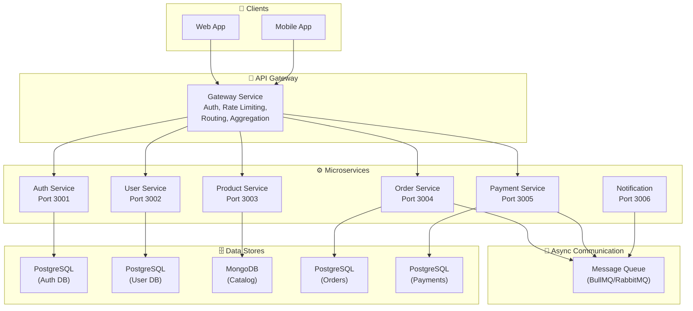
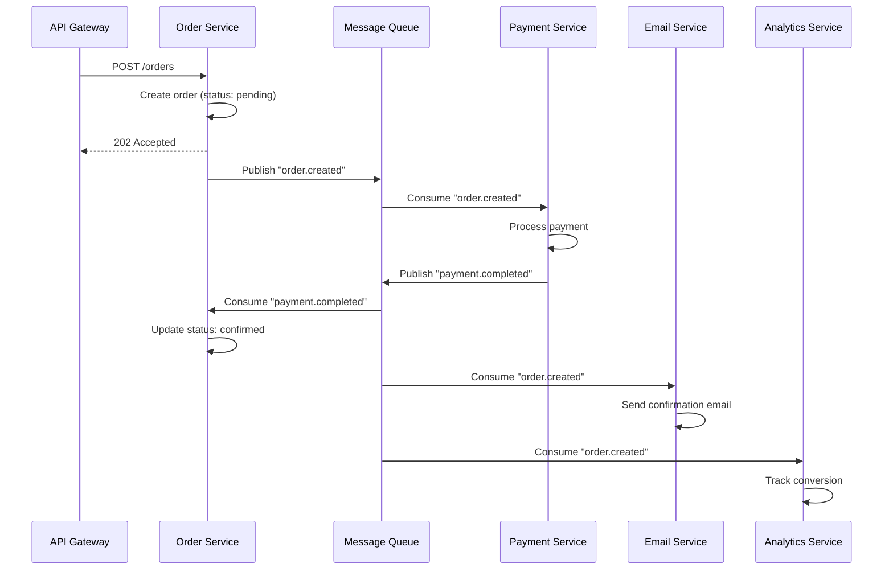

# Real-World Project Architecture

## 📖 Introduction

Real-world Node.js applications go beyond a single server. They involve multiple services, databases, message queues, and communication patterns. This module covers architectural patterns for building scalable, maintainable systems — from folder structure to microservices.

The key question is: **monolith vs microservices**? The answer depends on your team size, scale requirements, and organizational structure. Both approaches are valid, and many successful systems start as monoliths and gradually extract microservices as needed.

## 🤔 Why Do We Need This?

```javascript
// ❌ Monolithic pitfalls
// - Everything in one folder
// - No separation of concerns
// - Can't scale independent parts
// - One team's changes affect everyone

// ✅ Well-architected systems
// - Clear boundaries between components
// - Independent deployment
// - Scaling per component
// - Team autonomy
```

## ⚠️ Problem Statement

1. **Monolith vs Microservices** — When to split and when to keep together
2. **Service communication** — HTTP, gRPC, message queues, or events
3. **Data ownership** — Which service owns which data
4. **Deployment coordination** — How to deploy independently without breaking dependencies
5. **Observability** — Tracing requests across service boundaries
6. **Consistency** — Maintaining data consistency across services (eventual vs strong)

## 📚 Real World Story

**Uber** started as a monolith (one Node.js API). As the company grew, they extracted microservices one at a time: payments, pricing, dispatch, driver management. Each extraction was driven by a specific need — the payments team needed to deploy independently, the pricing algorithm needed to scale separately.

Their current architecture has 2,200+ microservices, but they didn't start there. They followed a pattern: identify the boundary, extract the service, establish the API contract, and redirect traffic. This incremental approach avoided the "big bang" rewrite that kills many architecture migrations.

## 🍕 Real World Analogy

| Architecture Concept | City Planning Analogy |
|---------------------|----------------------|
| **Monolith** | A single building with everything inside |
| **Microservices** | A city with specialized buildings (post office, bank, hospital) |
| **API Gateway** | The city's main entrance with a directory |
| **Service mesh** | The road network connecting buildings |
| **Message queue** | The postal service — async delivery |
| **Database per service** | Each building has its own storage room |

## 👁️ Visual Explanation

```
Monolith → Microservices Evolution:

Phase 1: Monolith               Phase 2: Extracted Services
┌─────────────────────┐         ┌──────────┐                     
│  Node.js App         │         │ Auth API │──┐                  
│                      │         └──────────┘  │                  
│  Auth │ Products │   │         ┌────────────┐ │  ┌──────────┐  
│  Orders│ Payments │   │         │ Product API│ ├──► API Gateway│
│  Users │ Emails   │   │         └────────────┘ │  └──────────┘  
└─────────────────────┘         ┌──────────┐  │                  
                                │ Order API│──┘                  
                                └──────────┘                     
```

## 📊 Mermaid Diagram 1: Microservices Architecture



## ⚙️ Internal Working: API Gateway Pattern

An API Gateway is a single entry point that:

1. **Accepts** all client requests
2. **Authenticates** and authorizes (verify JWT, extract user)
3. **Routes** to the appropriate microservice
4. **Rate limits** per client and endpoint
5. **Aggregates** responses from multiple services (if needed)
6. **Transforms** protocols (HTTP → gRPC, WebSocket → SSE)

In Node.js, popular API gateways include: Express Gateway, Kong (with Node.js plugins), and custom gateways built with Express or Fastify.

## 🔄 Mermaid Diagram 2: Event-Driven Communication



## 📝 Syntax

### API Gateway Pattern (Express)

```javascript
// gateway.js
const express = require('express');
const { createProxyMiddleware } = require('http-proxy-middleware');

const app = express();

// Auth middleware (applied to all routes)
app.use(async (req, res, next) => {
  const token = req.headers.authorization?.split(' ')[1];
  if (!token) return res.status(401).json({ error: 'Unauthorized' });
  try {
    req.user = jwt.verify(token, process.env.JWT_SECRET);
    next();
  } catch {
    res.status(401).json({ error: 'Invalid token' });
  }
});

// Route to services
app.use('/api/users', createProxyMiddleware({
  target: 'http://user-service:3002',
  changeOrigin: true,
}));

app.use('/api/products', createProxyMiddleware({
  target: 'http://product-service:3003',
  changeOrigin: true,
}));

app.use('/api/orders', createProxyMiddleware({
  target: 'http://order-service:3004',
  changeOrigin: true,
}));
```

## 🟢 Basic Example: Project Folder Structure

```
src/
├── config/              # Configuration
│   ├── index.js         # Central config export
│   ├── database.js      # DB connection config
│   └── redis.js         # Redis connection config
│
├── middleware/           # Express middleware
│   ├── auth.js          # JWT verification
│   ├── validate.js      # Request validation
│   ├── errorHandler.js  # Central error handler
│   └── rateLimiter.js   # Rate limiting
│
├── controllers/          # HTTP layer (thin)
│   ├── auth.controller.js
│   ├── user.controller.js
│   └── product.controller.js
│
├── services/             # Business logic
│   ├── auth.service.js
│   ├── user.service.js
│   └── product.service.js
│
├── repositories/         # Data access
│   ├── user.repository.js
│   └── product.repository.js
│
├── models/               # Database schemas
│   ├── user.model.js
│   └── product.model.js
│
├── routes/               # Express routes
│   ├── index.js          # Route aggregator
│   ├── auth.routes.js
│   └── product.routes.js
│
├── utils/                # Helpers
│   ├── logger.js         # Pino setup
│   ├── errors.js         # Custom error classes
│   └── helpers.js        # Utility functions
│
├── validators/           # Request validation schemas
│   ├── auth.validator.js
│   └── product.validator.js
│
├── events/               # Event handlers
│   ├── handlers.js
│   └── publisher.js
│
├── app.js               # Express setup
└── server.js            # Entry point
```

**What's happening:**
- **Separation by concern** — each layer has its own folder
- **Thin controllers** — routing only, business logic in services
- **Repositories** — data access abstraction
- **Middlewares** — cross-cutting concerns (auth, validation, error handling)
- **Events** — async communication handlers

## 🟡 Intermediate Example: Service Discovery with Consul

```javascript
// service-discovery.js
const Consul = require('consul');
const consul = new Consul({ host: 'consul-server', port: 8500 });

class ServiceRegistry {
  async register(serviceName, port) {
    const id = `${serviceName}-${process.pid}-${port}`;

    await consul.agent.service.register({
      id,
      name: serviceName,
      port,
      check: {
        http: `http://localhost:${port}/health`,
        interval: '10s',
        timeout: '5s',
        deregistercriticalserviceafter: '30s',
      },
    });

    // Deregister on shutdown
    process.on('SIGTERM', async () => {
      await consul.agent.service.deregister(id);
    });

    return id;
  }

  async discover(serviceName) {
    // Fetch healthy service instances
    const services = await consul.agent.service.list();
    const instances = Object.values(services)
      .filter(s => s.Service === serviceName && s.Checks.every(c => c.Status === 'passing'));

    if (instances.length === 0) {
      throw new Error(`No healthy instances of ${serviceName}`);
    }

    // Simple round-robin
    const index = Math.floor(Math.random() * instances.length);
    const instance = instances[index];
    return `http://${instance.Address}:${instance.Port}`;
  }
}

// Usage
const registry = new ServiceRegistry();
await registry.register('user-service', 3002);

// Gateway discovers service
const userServiceUrl = await registry.discover('user-service');
```

**What's happening:**
- **Service registration** — each service registers itself with Consul on startup
- **Health checks** — Consul monitors service health, removes unhealthy instances
- **Service discovery** — the gateway queries Consul for healthy instances
- **Round-robin** — simple load balancing across instances
- **Auto-deregistration** — services clean up on graceful shutdown

## 🔴 Advanced Example: Saga Pattern for Distributed Transactions

```javascript
// saga.js — Coordinates distributed transactions across services

class Saga {
  constructor() {
    this.steps = [];
    this.compensations = [];
  }

  step(name, execute, compensate) {
    this.steps.push({ name, execute, compensate });
    return this;
  }

  async execute(initialData) {
    const context = { data: initialData, completedSteps: [] };

    for (const step of this.steps) {
      try {
        console.log(`Executing: ${step.name}`);
        const result = await step.execute(context.data);
        context.data = { ...context.data, ...result };
        context.completedSteps.push(step);
      } catch (err) {
        console.error(`Step "${step.name}" failed:`, err.message);
        await this.rollback(context);
        throw new Error(`Saga failed at step "${step.name}": ${err.message}`);
      }
    }

    return context.data;
  }

  async rollback(context) {
    console.log('Rolling back saga...');
    for (const step of context.completedSteps.reverse()) {
      try {
        if (step.compensate) {
          console.log(`Compensating: ${step.name}`);
          await step.compensate(context.data);
        }
      } catch (err) {
        console.error(`Compensation for "${step.name}" failed:`, err);
      }
    }
  }
}

// Order processing saga
const createOrderSaga = new Saga()
  .step(
    'Reserve inventory',
    async (data) => {
      const result = await axios.post('http://inventory-service/reserve', data);
      return { reservationId: result.data.reservationId };
    },
    async (data) => {
      await axios.post('http://inventory-service/release', { reservationId: data.reservationId });
    }
  )
  .step(
    'Charge payment',
    async (data) => {
      const result = await axios.post('http://payment-service/charge', {
        amount: data.total,
        token: data.paymentToken,
      });
      return { paymentId: result.data.paymentId };
    },
    async (data) => {
      await axios.post('http://payment-service/refund', { paymentId: data.paymentId });
    }
  )
  .step(
    'Create order',
    async (data) => {
      const result = await axios.post('http://order-service/create', data);
      return { orderId: result.data.orderId };
    }
    // No compensation needed — order only created if payment and inventory succeed
  );

// API endpoint
app.post('/orders', async (req, res) => {
  try {
    const result = await createOrderSaga.execute(req.body);
    res.status(201).json({ orderId: result.orderId });
  } catch (err) {
    res.status(500).json({ error: err.message });
  }
});
```

**What's happening:**
- **Saga pattern** coordinates a distributed transaction across services
- Each step has a **compensation** (rollback action) — e.g., refund if charge succeeded
- If any step fails, **all previous steps are compensated** in reverse order
- No distributed lock needed — each service handles its own rollback
- **Eventual consistency** — the system reaches a consistent state after rollback

## 🏭 Production Example: Event-Driven Microservices Backend

```javascript
// event-bus.js
const Redis = require('ioredis');
const { EventEmitter } = require('events');

class EventBus {
  constructor(redisUrl) {
    this.publisher = new Redis(redisUrl);
    this.subscriber = new Redis(redisUrl);
    this.localEmitter = new EventEmitter();
    this.handlers = new Map();
  }

  async publish(event, data) {
    const message = JSON.stringify({
      event,
      data,
      timestamp: Date.now(),
      id: require('crypto').randomUUID(),
    });

    // Publish to Redis (cross-service)
    await this.publisher.publish('events', message);

    // Also emit locally (same process)
    this.localEmitter.emit(event, data);
  }

  subscribe(event, handler) {
    if (!this.handlers.has(event)) {
      this.handlers.set(event, []);
    }
    this.handlers.get(event).push(handler);

    // Local subscription
    this.localEmitter.on(event, handler);
  }

  async start() {
    // Subscribe to Redis channel
    await this.subscriber.subscribe('events');

    this.subscriber.on('message', (channel, message) => {
      const { event, data } = JSON.parse(message);

      // Call all handlers for this event
      const handlers = this.handlers.get(event) || [];
      for (const handler of handlers) {
        handler(data).catch(err => {
          console.error(`Handler for ${event} failed:`, err);
        });
      }
    });
  }

  async close() {
    await this.subscriber.unsubscribe();
    await this.publisher.quit();
    await this.subscriber.quit();
  }
}

// order-service/index.js
const eventBus = new EventBus(process.env.REDIS_URL);

// Publish event when order is created
async function createOrder(data) {
  const order = await Order.create(data);

  await eventBus.publish('order.created', {
    orderId: order.id,
    userId: order.userId,
    total: order.total,
    items: order.items,
    email: order.email,
  });

  return order;
}

// inventory-service/index.js
eventBus.subscribe('order.created', async (data) => {
  console.log(`Reserving inventory for order ${data.orderId}`);
  for (const item of data.items) {
    await Inventory.decrement(item.productId, item.quantity);
  }
});

// email-service/index.js
eventBus.subscribe('order.created', async (data) => {
  console.log(`Sending confirmation email to ${data.email}`);
  await sendEmail(data.email, 'order-confirmation', { orderId: data.orderId });
});

// analytics-service/index.js
eventBus.subscribe('order.created', async (data) => {
  await Analytics.track('order_created', {
    orderId: data.orderId,
    total: data.total,
    items: data.items.length,
  });
});
```

**What's happening:**
- **Event-driven architecture** — services communicate through events, not direct HTTP calls
- **Redis Pub/Sub** — cross-service event propagation
- **Local emitter** — same-process handlers for efficiency
- **Loose coupling** — adding a new service just means subscribing to events
- **"Fire and forget"** — the order service doesn't wait for inventory/email/analytics

## ⚙️ How It Works Internally: Monolith vs Microservices Decision

**Start with a monolith** if:
- Team < 10 people
- Application has clear boundaries (can extract later)
- You're still figuring out the domain
- Deployment complexity would slow you down

**Extract microservices** when:
- A specific component needs to scale independently (e.g., video processing)
- A team needs to deploy independently
- A component has different data storage requirements
- The monolith has become too large for any one person to understand

## 📦 Performance Notes

### Communication Pattern Comparison

| Pattern | Latency | Coupling | Complexity | Use Case |
|---------|---------|----------|------------|----------|
| **HTTP/REST** | 5-50ms | Tight | Low | Request-response, CRUD |
| **gRPC** | 1-10ms | Tight (proto) | Medium | High-performance, typed |
| **Message Queue** | 10-500ms | Loose | Medium | Async processing, decoupling |
| **Event Bus** | 1-100ms | Very loose | High | Event-driven, broadcasting |

## 🔒 Security Notes

### Microservices Security

- **Service-to-service auth** — Use mutual TLS (mTLS) or service tokens
- **API Gateway authentication** — Auth at the gateway, pass user context via headers
- **Network policies** — Services should only talk to authorized peers (Kubernetes network policies)
- **Secrets per service** — Each service gets only the secrets it needs

## ⚠️ Common Mistakes

1. **❌ Premature microservices** — Splitting before understanding the domain boundaries creates distributed monoliths (coupled services with sync communication)

2. **❌ Shared database across services** — This defeats the purpose of microservices. Each service should own its data.

3. **❌ Sync communication chains** — Service A calls B, B calls C, C calls D → any failure takes down the chain

4. **❌ No monitoring** — Without distributed tracing, debugging across 10+ services is nearly impossible

5. **❌ Ignoring data consistency** — Every service updating the same customer's address differently

## 🚀 Best Practices

### Monolith-First Approach

1. Build a well-structured monolith (MVC, Repository, DI)
2. Define clear module boundaries with interfaces
3. Use event-driven communication even within the monolith
4. Extract services when a specific boundary requires it
5. Never do a "big bang" microservices rewrite

### Microservices Principles

- **Database per service** — No shared databases
- **API-first** — Define the contract before implementing
- **Eventual consistency** — Accept that data may be briefly inconsistent
- **Independent deployment** — Each service can be deployed without coordinating
- **Observability by default** — Logging, metrics, and tracing built-in

## 🎯 Interview Questions

**Q1: When would you choose a monolith over microservices?**

Start with a monolith when: team < 10 people, you're still discovering domain boundaries, deployment complexity would be overhead, and the application is moderate in size. A well-structured monolith with clear module boundaries can later be extracted into microservices as needed. Premature microservices create a "distributed monolith" — the worst of both worlds.

**Q2: How do services communicate in a microservices architecture?**

Two main patterns: synchronous (HTTP/gRPC) and asynchronous (message queues/events). Use synchronous for request-response operations that need immediate results. Use asynchronous for operations that can be processed later (email, analytics, notifications). Prefer async communication to reduce coupling and improve resilience.

**Q3: What is the Saga pattern and when would you use it?**

The Saga pattern manages distributed transactions across multiple services. Instead of a single ACID transaction, a saga is a sequence of local transactions with compensating actions for rollback. Use it when an operation spans multiple services (e.g., order processing: reserve inventory → charge payment → create order).

**Q4: What's the difference between an API Gateway and a service mesh?**

An API Gateway is an edge service that handles client-facing concerns: authentication, rate limiting, routing, and aggregation. A service mesh is an infrastructure layer for service-to-service communication: mTLS, retries, circuit breaking, and observability. They solve different problems — the gateway is for north-south traffic (client to service), the mesh is for east-west traffic (service to service).

## 📝 MCQs

**1. What is the recommended approach to adopting microservices?**
- A) Start with microservices from day one
- B) Start with a monolith, extract services as needed ✅
- C) Always use serverless functions
- D) Never use microservices

**2. What's the primary issue with a "distributed monolith"?**
- A) It's too fast
- B) Services are tightly coupled with synchronous calls ✅
- C) It uses too many databases
- D) It's hard to deploy

**3. What pattern should you use for distributed transactions across services?**
- A) Two-phase commit
- B) Saga pattern ✅
- C) Database triggers
- D) Shared database

**4. What is the role of an API Gateway?**
- A) Store application data
- B) Route requests to microservices ✅
- C) Run background jobs
- D) Manage database migrations

**5. How should data be managed in a microservices architecture?**
- A) Shared database for all services
- B) Database per service ✅
- C) All data in a single Redis instance
- D) Duplicate data everywhere

**Answer Key:** 1-B, 2-B, 3-B, 4-B, 5-B

## 💻 Coding Challenge 1: Simple API Gateway

Build an Express-based API gateway that:
- Routes `/users/*` to user-service:3002
- Routes `/products/*` to product-service:3003
- Adds authentication middleware (JWT verification)
- Adds rate limiting (100 req/min per client)
- Adds request logging with correlation IDs
- Returns 503 if a downstream service is unhealthy

## 💻 Coding Challenge 2: Event-Driven Microservices

Build two microservices that communicate via events:
- **Order Service**: Creates orders, publishes `order.created` events
- **Inventory Service**: Listens for `order.created`, decrements stock
- **Notification Service**: Listens for `order.created`, sends email
- Use Redis Pub/Sub or BullMQ for event propagation
- Each service has its own database

## 💻 Coding Challenge 3: Saga Pattern

Implement a booking saga for a travel booking system:
- Step 1: Reserve flight (compensation: release flight)
- Step 2: Reserve hotel (compensation: release hotel)
- Step 3: Reserve car (compensation: release car)
- Step 4: Process payment (compensation: refund)
- All steps must complete or all are compensated

## 🧪 Mini Exercise: Debugging Architecture Issues

This microservices architecture has problems. Identify and fix them:

```javascript
// Bug 1: Shared database — all services connect to the same Mongo
const MONGO_URL = 'mongodb://shared-db:27017/main';

// Bug 2: Synchronous call chains
// Order Service → Payment Service → Inventory Service → Notification Service
// If Notification is slow, EVERYTHING is slow!

// Bug 3: No fallback when a service is down
const result = await axios.get('http://inventory-service/check');
// What if inventory-service is down? The entire request fails!

// Bug 4: No distributed tracing
// When order-456 fails, which service caused it? No way to know!

// Bug 5: Hardcoded service URLs
const USER_SERVICE = 'http://localhost:3002'; // Doesn't work in production!
```

## 🌍 Real World Problem (Interview Coding Challenge)

**Problem:** You're designing the architecture for a food delivery platform (like DoorDash/Uber Eats). The system includes: restaurant management, menu browsing, ordering, payment, driver dispatch, real-time tracking, and ratings.

**Requirements:**
1. 1M+ daily orders across multiple cities
2. Real-time driver tracking (WebSocket)
3. Order placement must be atomic (payment + restaurant notification + driver dispatch)
4. Restaurants and drivers must scale independently
5. A failure in ratings shouldn't affect order placement

**Questions:**
1. Would you use monolith or microservices? Why?
2. How would you split services and what communication patterns would you use?
3. How do you handle the "order placement" distributed transaction?
4. How do you handle real-time location updates at scale?

**Interview Tip:** Discuss a microservices approach with clear domain boundaries: Restaurant Service, Order Service, Payment Service, Driver Service, Tracking Service (WebSocket). Use event-driven communication (Saga pattern for orders, Kafka/Redis Pub/Sub for tracking). Each service owns its database. The tracking service handles WebSocket connections independently.

## 📖 Summary

| Concept | Key Takeaway |
|---------|-------------|
| **Monolith-first** | Start simple, extract services when boundaries are clear |
| **API Gateway** | Single entry point for auth, routing, rate limiting |
| **Database per service** | No shared databases — independent data ownership |
| **Event-driven** | Async communication reduces coupling |
| **Saga pattern** | Coordinated rollback for multi-service operations |
| **Service discovery** | Dynamic location of service instances |
| **Observability** | Distributed tracing is essential across services |

## 📋 Cheat Sheet

```javascript
// Quick reference: Architecture Patterns

// 1. API Gateway proxy
app.use('/api/users', createProxyMiddleware({ target: 'http://user-service:3002' }));

// 2. Service discovery (Consul)
const url = await consul.discover('user-service');

// 3. Event bus (Redis Pub/Sub)
const pub = new Redis(); const sub = new Redis();
await pub.publish('events', JSON.stringify({ event: 'order.created', data }));
sub.on('message', (ch, msg) => handle(JSON.parse(msg)));

// 4. Saga pattern
const saga = new Saga()
  .step('reserve', execute, compensate)
  .step('charge', execute, compensate)
  .step('create', execute);

// 5. Database per service
// auth-service connects to auth-db
// order-service connects to order-db
// No service connects to another service's database!
```

## 📚 Further Reading

- [Microservices Patterns (Chris Richardson)](https://microservices.io/patterns/)
- [Building Microservices (Sam Newman)](https://samnewman.io/books/building-microservices/)
- [API Gateway Pattern](https://microservices.io/patterns/apigateway.html)
- [Saga Pattern](https://microservices.io/patterns/data/saga.html)
- [Event-Driven Architecture](https://martinfowler.com/articles/201701-event-driven.html)

## 🔗 Related Modules

- [Design Patterns](./design-patterns) — MVC, Repository, DI patterns
- [Deployment & CI/CD](./deployment) — Deploying microservices
- [Message Queues](../data/message-queues) — Async communication
- [WebSockets & Real-Time](../web/websockets-realtime) — Real-time tracking
- [Monitoring](./logging-and-monitoring) — Distributed tracing across services
