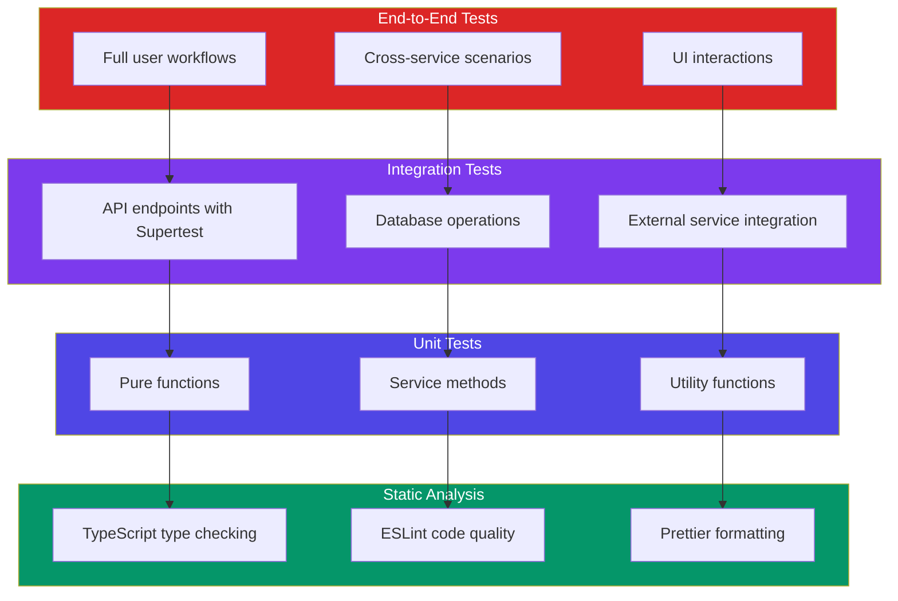
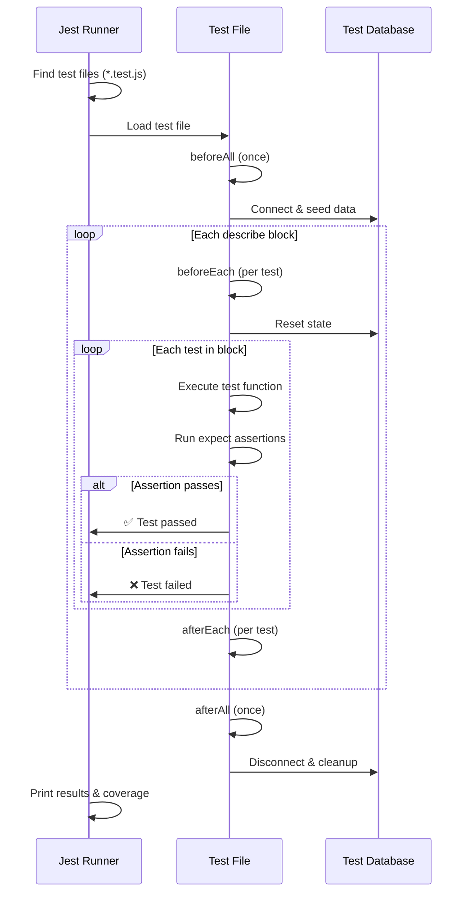

# Testing

## 📖 Introduction

Testing ensures your code works correctly, prevents regressions when you make changes, and serves as living documentation for how your code should behave. A well-tested Node.js application has tests at multiple levels: **unit tests** (individual functions), **integration tests** (API endpoints with real databases), and **end-to-end tests** (full user workflows).

Jest is the most popular testing framework for Node.js, offering a complete solution with assertions, mocking, code coverage, and watch mode.

## 🤔 Why Do We Need This?

Without tests, every change is risky:

```javascript
// You change this:
function calculateTotal(items) { /* ... */ }

// You wonder: "Did I break anything?"
// Without tests, you manually test every path
// With tests: `npm test` — 2 seconds, 100% confidence
```

Testing provides:
1. **Regression prevention** — Old bugs don't come back
2. **Refactoring confidence** — Change code structure without fear
3. **Documentation** — Tests show how code is supposed to behave
4. **Design feedback** — Hard-to-test code is often poorly designed
5. **CI/CD integration** — Automated testing catches issues before deployment

## ⚠️ Problem Statement

A production test suite must handle:

1. **Test isolation** — Tests must not depend on each other or leave state
2. **Database state** — Integration tests need a clean database every time
3. **External APIs** — Tests must not call real APIs (slow, unreliable, expensive)
4. **Asynchronous code** — Promises, timers, and event emitters must be handled correctly
5. **Coverage** — Knowing what's tested and what isn't
6. **Speed** — Tests must run fast enough to run on every commit

## 📚 Real World Story

**Netflix** runs millions of tests daily across their microservices. Their testing philosophy follows the **Testing Trophy** (not pyramid): static analysis → unit tests → integration tests → E2E tests. They emphasize integration tests over unit tests because microservices interact with databases, caches, and other services — and that's where most bugs live.

At Netflix, if a deployment breaks something, the first question is: "Why didn't our tests catch this?" They invest heavily in testing infrastructure because a single production bug can affect millions of streaming subscribers.

## 🍕 Real World Analogy

| Testing Concept | Bridge Building Analogy |
|----------------|------------------------|
| **Unit test** | Testing individual steel beams |
| **Integration test** | Testing how beams connect to each other |
| **E2E test** | Driving a truck across the completed bridge |
| **Mock** | Using a computer model instead of real materials |
| **Test runner** | The inspection team checking everything |
| **Coverage** | What percentage of the bridge was inspected |

## 👁️ Visual Explanation

```
Testing Trophy (Netflix approach):

           ╱  E2E Tests  ╲          ← Few, critical paths
          ╱  Integration Tests ╲     ← Many, most bugs here
         ╱   Unit Tests    ╲        ← Lots, fast
        ╱ Static Analysis  ╲        ← TypeScript, ESLint

Most bugs live in the integration between components,
not within individual functions.
```

## 📊 Mermaid Diagram 1: Testing Pyramid



## ⚙️ Internal Working: How Jest Finds and Runs Tests

Jest's test runner works as follows:

1. **Discovery**: Jest uses a file pattern to find test files (`*.test.js`, `*.spec.js`, `__tests__/`)
2. **Module transformation**: Files are transformed through Babel or `ts-jest` (TypeScript)
3. **Global setup**: `beforeAll` hooks run, test environment is configured
4. **Test execution**: Each `describe` block creates a scope, each `test` is executed
5. **Assertion checking**: `expect` statements are evaluated
6. **Cleanup**: `afterAll` hooks run, database connections close
7. **Coverage collection**: Istanbul instruments code and reports coverage

## 🔄 Mermaid Diagram 2: Test Lifecycle



## 📝 Syntax

### Jest

```javascript
// Basic test structure
describe('Calculator', () => {
  test('adds two numbers', () => {
    expect(1 + 2).toBe(3);
  });

  it('subtracts two numbers', () => {
    expect(5 - 3).toBe(2);
  });
});

// Hooks
beforeAll(() => { /* runs once before all tests */ });
afterAll(() => { /* runs once after all tests */ });
beforeEach(() => { /* runs before each test */ });
afterEach(() => { /* runs after each test */ });
```

### Supertest (HTTP integration testing)

```javascript
const request = require('supertest');
const app = require('../app');

it('returns users list', async () => {
  const response = await request(app)
    .get('/api/users')
    .set('Authorization', 'Bearer token')
    .expect(200);

  expect(response.body.data).toBeInstanceOf(Array);
});
```

## 🟢 Basic Example: Unit Testing a Service

```javascript
// services/cart.service.js
class CartService {
  calculateTotal(items) {
    return items.reduce((sum, item) => sum + item.price * item.quantity, 0);
  }

  applyDiscount(total, percent) {
    if (percent < 0 || percent > 100) {
      throw new Error('Discount must be between 0 and 100');
    }
    return total * (1 - percent / 100);
  }

  getShippingCost(total) {
    if (total > 100) return 0; // Free shipping over $100
    return 9.99;
  }
}

// tests/unit/cart.service.test.js
const CartService = require('../../services/cart.service');

describe('CartService', () => {
  let service;

  beforeEach(() => {
    service = new CartService();
  });

  describe('calculateTotal', () => {
    test('calculates total for multiple items', () => {
      const items = [
        { price: 10, quantity: 2 },
        { price: 5, quantity: 3 },
      ];
      expect(service.calculateTotal(items)).toBe(35);
    });

    test('returns 0 for empty cart', () => {
      expect(service.calculateTotal([])).toBe(0);
    });

    test('handles single item', () => {
      expect(service.calculateTotal([{ price: 25, quantity: 1 }])).toBe(25);
    });
  });

  describe('applyDiscount', () => {
    test('applies 10% discount correctly', () => {
      expect(service.applyDiscount(100, 10)).toBe(90);
    });

    test('applies 100% discount (free)', () => {
      expect(service.applyDiscount(50, 100)).toBe(0);
    });

    test('throws error for negative discount', () => {
      expect(() => service.applyDiscount(100, -5)).toThrow('Discount must be between 0 and 100');
    });
  });

  describe('getShippingCost', () => {
    test('free shipping over $100', () => {
      expect(service.getShippingCost(150)).toBe(0);
      expect(service.getShippingCost(100.01)).toBe(0);
    });

    test('charges shipping for orders under $100', () => {
      expect(service.getShippingCost(50)).toBe(9.99);
    });
  });
});
```

**What's happening:**
- **`describe` blocks** organize tests by method
- **`beforeEach`** creates a fresh instance for each test (isolation)
- **`test()`** describes what should happen
- **`expect().toBe()`** asserts exact equality
- **`expect().toThrow()`** tests error paths
- **Edge cases tested** — empty cart, single item, boundary values ($100.01)

## 🟡 Intermediate Example: Integration Testing with Supertest

```javascript
// tests/integration/auth.test.js
const request = require('supertest');
const mongoose = require('mongoose');
const app = require('../../src/app');
const User = require('../../src/models/User');

// Test database URL
const TEST_DB_URL = process.env.TEST_DB_URL || 'mongodb://localhost:27017/test';

beforeAll(async () => {
  // Connect to test database
  await mongoose.connect(TEST_DB_URL);
});

afterEach(async () => {
  // Clean up data after each test
  await User.deleteMany({});
});

afterAll(async () => {
  await mongoose.disconnect();
});

describe('POST /auth/register', () => {
  const validUser = {
    name: 'Test User',
    email: 'test@example.com',
    password: 'Password123!',
  };

  test('creates a new user and returns JWT', async () => {
    const response = await request(app)
      .post('/auth/register')
      .send(validUser)
      .expect(201);

    expect(response.body).toHaveProperty('accessToken');
    expect(response.body.user).toMatchObject({
      name: 'Test User',
      email: 'test@example.com',
    });
    expect(response.body.user).not.toHaveProperty('password');
  });

  test('returns 409 for duplicate email', async () => {
    await User.create(validUser);

    const response = await request(app)
      .post('/auth/register')
      .send(validUser)
      .expect(409);

    expect(response.body.error).toContain('already exists');
  });

  test('returns 422 for invalid email', async () => {
    const response = await request(app)
      .post('/auth/register')
      .send({ ...validUser, email: 'not-an-email' })
      .expect(422);

    expect(response.body.error).toBeDefined();
  });

  test('returns 422 for short password', async () => {
    const response = await request(app)
      .post('/auth/register')
      .send({ ...validUser, password: '123' })
      .expect(422);

    expect(response.body.error).toBeDefined();
  });
});

describe('POST /auth/login', () => {
  beforeEach(async () => {
    // Seed a user
    await request(app)
      .post('/auth/register')
      .send({ name: 'Test', email: 'test@test.com', password: 'Password123!' });
  });

  test('returns JWT for valid credentials', async () => {
    const response = await request(app)
      .post('/auth/login')
      .send({ email: 'test@test.com', password: 'Password123!' })
      .expect(200);

    expect(response.body).toHaveProperty('accessToken');
  });

  test('returns 401 for wrong password', async () => {
    const response = await request(app)
      .post('/auth/login')
      .send({ email: 'test@test.com', password: 'wrongpassword' })
      .expect(401);

    expect(response.body.error).toBe('Invalid credentials');
  });
});
```

**What's happening:**
- **Test database** — a separate database is used for testing
- **`beforeAll`/`afterAll`** — connect once, disconnect once
- **`afterEach`** — clean data between tests to prevent interference
- **`request(app)`** — Supertest runs the Express app without a server (no port needed)
- **`.expect(201)`** — Supertest's built-in status code assertion
- **`toMatchObject`** — partial object matching (ignores extra fields)
- **`not.toHaveProperty('password')`** — ensures passwords aren't leaked

## 🔴 Advanced Example: Mocking External APIs

```javascript
// services/payment.service.js
const stripe = require('stripe')(process.env.STRIPE_SECRET_KEY);

class PaymentService {
  async chargeCustomer(customerId, amount, currency = 'usd') {
    const payment = await stripe.paymentIntents.create({
      amount,
      currency,
      customer: customerId,
      confirm: true,
    });
    return { id: payment.id, status: payment.status };
  }

  async createSubscription(customerId, priceId) {
    const subscription = await stripe.subscriptions.create({
      customer: customerId,
      items: [{ price: priceId }],
      payment_behavior: 'default_incomplete',
    });
    return { id: subscription.id, status: subscription.status };
  }
}

// tests/unit/payment.service.test.js
const PaymentService = require('../../services/payment.service');

// Mock the Stripe module
jest.mock('stripe', () => {
  return jest.fn(() => ({
    paymentIntents: {
      create: jest.fn(),
    },
    subscriptions: {
      create: jest.fn(),
    },
  }));
});

describe('PaymentService', () => {
  let paymentService;
  const stripe = require('stripe')();

  beforeEach(() => {
    paymentService = new PaymentService();
    jest.clearAllMocks();
  });

  describe('chargeCustomer', () => {
    test('charges customer successfully', async () => {
      stripe.paymentIntents.create.mockResolvedValue({
        id: 'pi_123',
        status: 'succeeded',
        amount: 4999,
      });

      const result = await paymentService.chargeCustomer('cus_123', 4999);

      expect(result).toEqual({ id: 'pi_123', status: 'succeeded' });
      expect(stripe.paymentIntents.create).toHaveBeenCalledWith({
        amount: 4999,
        currency: 'usd',
        customer: 'cus_123',
        confirm: true,
      });
    });

    test('handles payment failure', async () => {
      stripe.paymentIntents.create.mockRejectedValue(
        new Error('Card declined: insufficient funds')
      );

      await expect(
        paymentService.chargeCustomer('cus_123', 9999)
      ).rejects.toThrow('Card declined');
    });
  });

  describe('createSubscription', () => {
    test('creates subscription with incomplete payment', async () => {
      stripe.subscriptions.create.mockResolvedValue({
        id: 'sub_123',
        status: 'incomplete',
        latest_invoice: { payment_intent: { client_secret: 'secret_123' } },
      });

      const result = await paymentService.createSubscription('cus_123', 'price_abc');

      expect(result.status).toBe('incomplete');
      expect(stripe.subscriptions.create).toHaveBeenCalledWith({
        customer: 'cus_123',
        items: [{ price: 'price_abc' }],
        payment_behavior: 'default_incomplete',
      });
    });
  });
});
```

**What's happening:**
- **`jest.mock('stripe')`** replaces the entire Stripe module with a mock
- **`mockResolvedValue`** returns a fake successful response
- **`mockRejectedValue`** simulates an API error
- **`toHaveBeenCalledWith`** verifies the mock was called with correct arguments
- **`jest.clearAllMocks()`** in `beforeEach` ensures test isolation
- **No real Stripe API called** — tests are fast and don't require network access

## 🏭 Production Example: Complete Test Setup

```javascript
// jest.config.js
module.exports = {
  testEnvironment: 'node',
  testMatch: ['**/tests/**/*.test.js'],
  setupFilesAfterSetup: ['./tests/setup.js'],
  globalSetup: './tests/globalSetup.js',
  globalTeardown: './tests/globalTeardown.js',
  coveragePathIgnorePatterns: ['/node_modules/', '/tests/'],
  coverageThreshold: {
    global: {
      branches: 80,
      functions: 80,
      lines: 80,
      statements: 80,
    },
  },
};

// tests/globalSetup.js
module.exports = async () => {
  // Start test database (e.g., mongodb-memory-server)
  process.env.NODE_ENV = 'test';
  process.env.JWT_SECRET = 'test-jwt-secret';
};

// tests/globalTeardown.js
module.exports = async () => {
  // Stop test database
};

// tests/setup.js — runs before each test file
beforeEach(() => {
  jest.clearAllMocks();
});

// package.json scripts
// "test": "jest --coverage",
// "test:watch": "jest --watch",
// "test:ci": "jest --ci --coverage --maxWorkers=2"
```

## ⚙️ How It Works Internally: Jest Mocking

When you call `jest.mock('module-name')`:

1. Jest intercepts the `require()` call for that module
2. Instead of loading the real module, Jest returns a **manual mock** (from `__mocks__/`) or an **auto-mock** (all functions replaced with `jest.fn()`)
3. Calls to `module.function()` don't execute real code — they call the mock instead
4. `jest.fn()` creates a mock function that records calls, arguments, and return values
5. `mockResolvedValue(x)` is shorthand for `jest.fn().mockImplementation(() => Promise.resolve(x))`

## 📦 Performance Notes

### Test Speed Optimization

| Technique | Speed Impact | Example |
|-----------|-------------|---------|
| In-memory database | 10-100x faster | `mongodb-memory-server` |
| Mock external APIs | Eliminates network latency | `jest.mock('stripe')` |
| Parallel test execution | N cores × speed | `jest --maxWorkers=4` |
| Test selective execution | Only changed tests | `jest -o` (only changed) |

### Test Organization

```
tests/
  unit/              ← Fast (<1ms each), many tests
    cart.service.test.js
    user.service.test.js
  integration/        ← Medium (10-100ms each), moderate count
    auth.test.js
    orders.test.js
  e2e/               ← Slow (1-10s each), few tests
    checkout.test.js
```

## 🔒 Security Notes

### Testing Security-Critical Code

```javascript
// Test that passwords are never returned
test('password is excluded from response', async () => {
  const response = await request(app)
    .post('/auth/register')
    .send({ name: 'Test', email: 'test@test.com', password: 'secret123' });

  expect(response.body.user).not.toHaveProperty('password');
  expect(response.body.user).not.toHaveProperty('passwordHash');
});

// Test that endpoints require auth
test('returns 401 without auth token', async () => {
  const response = await request(app)
    .get('/api/users/profile')
    .expect(401);
});
```

### Sensitive Data in Test Code

```javascript
// ❌ Never commit real credentials in test files
process.env.STRIPE_SECRET_KEY = 'sk_live_real_key_here';

// ✅ Use test-specific credentials or mocks
process.env.STRIPE_SECRET_KEY = 'sk_test_mocked_key';
```

## ⚠️ Common Mistakes

1. **❌ Testing implementation details** — Tests break when you refactor. Test behavior, not internals.

2. **❌ Shared mutable state** — Tests that modify global state and don't clean up cause flaky tests

3. **❌ Testing real external APIs** — Slow, unreliable, and expensive. Always mock external services.

4. **❌ No edge case testing** — Only testing the "happy path" misses bugs in error handling

5. **❌ Large, unfocused tests** — Testing 10 things in one test makes failures hard to diagnose

6. **❌ Skipping tests** — `.skip` tests accumulate and never get fixed

## 🚀 Best Practices

### Writing Good Tests

```javascript
// ✅ Test behavior, not implementation
test('returns users sorted by name', async () => {
  const response = await request(app).get('/api/users');
  expect(response.body.data[0].name.localeCompare(response.body.data[1].name)).toBe(-1);
});

// ✅ One assertion per concept
test('validates email format', () => {/* ... */});
test('validates password length', () => {/* ... */});
test('returns 422 for missing required fields', () => {/* ... */});

// ✅ Use describe for organization
describe('GET /api/users', () => {
  describe('authorization', () => {
    test('returns 401 without token', () => {});
    test('returns 403 for non-admin', () => {});
  });
  describe('pagination', () => {
    test('defaults to page 1, limit 20', () => {});
    test('respects custom limit', () => {});
  });
});
```

### CI/CD Integration

```yaml
# .github/workflows/test.yml
name: Tests
on: [push, pull_request]
jobs:
  test:
    runs-on: ubuntu-latest
    services:
      mongodb:
        image: mongo:7
        ports: ['27017:27017']
    steps:
      - uses: actions/checkout@v4
      - uses: actions/setup-node@v4
      - run: npm ci
      - run: npm test -- --ci --coverage
      - uses: codecov/codecov-action@v3
```

## 🎯 Interview Questions

**Q1: What's the difference between unit tests and integration tests?**

Unit tests test individual functions/classes in isolation — mocking all dependencies. They're fast (<1ms) and help verify business logic. Integration tests test how components work together — a real database, HTTP requests, and external services (mocked at the network boundary). They're slower (10-100ms) but catch bugs that unit tests miss.

**Q2: How do you test asynchronous code in Jest?**

Return the promise or use async/await. Jest waits for the promise to resolve before moving to the next test. For callbacks, use `done` parameter. For unhandled promise rejections, Jest will fail the test.

**Q3: How would you test an Express API endpoint that writes to a database?**

Use Supertest with a test database. Connect to a separate test database (or in-memory database like `mongodb-memory-server`). Seed the database with known data in `beforeEach`, run the request through Supertest, assert on the response, and clean up data in `afterEach`.

**Q4: What's the difference between mocks, stubs, and fakes?**

A **stub** returns predefined data (e.g., `findUser` always returns `{ id: 1 }`). A **mock** records how it was called and verifies interactions (e.g., "was `sendEmail` called with the right arguments?"). A **fake** is a lightweight implementation (e.g., an in-memory database that implements the same interface as the real one).

## 📝 MCQs

**1. What does `jest.mock('module')` do?**
- A) Runs the module in a sandbox
- B) Replaces the module with a mock implementation ✅
- C) Deletes the module
- D) Duplicates the module

**2. Which Supertest method sends a POST request?**
- A) `request(app).post('/path')` ✅
- B) `request(app).send('/path')`
- C) `request(app).create('/path')`
- D) `request(app).submit('/path')`

**3. What is the purpose of `beforeEach` in Jest?**
- A) Run setup code before all tests
- B) Run setup code before each individual test ✅
- C) Run cleanup code after each test
- D) Skip tests that haven't been written yet

**4. Which coverage threshold is most commonly enforced?**
- A) 50%
- B) 80% ✅
- C) 100%
- D) 30%

**5. Why should you mock external APIs in tests?**
- A) To test real integration with the API
- B) To make tests fast, reliable, and independent ✅
- C) To reduce code complexity
- D) To increase code coverage

**Answer Key:** 1-B, 2-A, 3-B, 4-B, 5-B

## 💻 Coding Challenge 1: Unit Testing a Calculator

Write Jest unit tests for a Calculator class with methods: `add`, `subtract`, `multiply`, `divide`, `power`. Test:
- Basic operations with positive numbers
- Division by zero (should throw)
- Negative numbers
- Large numbers
- Decimal precision

## 💻 Coding Challenge 2: Integration Testing a REST API

Build integration tests for a `GET /api/products` endpoint:
- Returns 200 with paginated product list
- Default page size is 20
- Can filter by category
- Can sort by price
- Returns 400 for invalid page number
- Returns 404 for empty category

## 💻 Coding Challenge 3: Mocking External Dependencies

Test an `OrderService.createOrder()` method that:
- Validates the order data
- Calls Stripe to charge the customer
- Saves the order to the database
- Sends a confirmation email
- Mock all three dependencies (Stripe, DB, Email) and verify they're called correctly

## 🧪 Mini Exercise: Debugging Flaky Tests

These tests are flaky (sometimes pass, sometimes fail). Find and fix the issues:

```javascript
describe('User API', () => {
  // Bug 1: Shared state between tests!
  let createdUserId;

  test('creates a user', async () => {
    const res = await request(app).post('/users').send({ name: 'Test' });
    createdUserId = res.body.id; // Shared mutable state
    expect(res.status).toBe(201);
  });

  test('gets the created user', async () => {
    // Bug 2: Depends on previous test — won't work in isolation!
    const res = await request(app).get(`/users/${createdUserId}`);
    expect(res.status).toBe(200);
  });

  // Bug 3: No cleanup — data persists!
  // Bug 4: No `afterAll` to disconnect database
});
```

## 🌍 Real World Problem (Interview Coding Challenge)

**Problem:** You're leading the test strategy for a payment processing system. The system has 50+ microservices, processes millions of transactions daily, and must maintain 99.99% uptime. A bug in production costs $10,000 per minute.

**Requirements:**
1. Every service must have ≥90% test coverage
2. Tests must run in under 10 minutes on CI
3. Integration tests must use real databases (not mocks)
4. Payment provider API calls must be tested end-to-end
5. Tests must catch race conditions in concurrent transaction processing

**Questions:**
1. What testing strategy would you design (levels, tools, processes)?
2. How would you test concurrent payment processing for race conditions?
3. How do you balance test speed with test reliability?
4. What's your strategy for testing third-party payment provider integration?

**Interview Tip:** Discuss contract testing (Pact) for microservice integration, property-based testing (fast-check) for concurrent scenarios, and a test suite that runs in parallel across multiple CI workers. Mention canary testing for payment provider integration.

## 🏗️ Mini Project: Test Suite for E-Commerce API

Build a comprehensive test suite for the e-commerce API:

**Core features (tests for):**
- User registration, login, profile management
- Product CRUD with pagination, filtering, sorting
- Cart operations (add, remove, update quantity)
- Order placement with payment processing
- Admin endpoints (authorization checks)

**Technical requirements:**
- Unit tests for all services (Jest)
- Integration tests for all API endpoints (Supertest)
- Test database with seed data (mongodb-memory-server or test DB)
- Mock Stripe for payment tests
- 80%+ code coverage
- CI integration (GitHub Actions)

**Bonus features:**
- Property-based tests for edge cases
- Load tests with k6 or autocannon
- Mutation testing with Stryker
- Visual regression tests for admin dashboard

## 📖 Summary

| Concept | Key Takeaway |
|---------|-------------|
| **Unit tests** | Test individual functions in isolation — fast, many |
| **Integration tests** | Test components together with real DB — where most bugs live |
| **Jest** | Complete test framework — assertions, mocking, coverage |
| **Supertest** | HTTP integration testing for Express apps |
| **Mocking** | Replace external APIs with simulated responses |
| **Isolation** | Each test must be independent with clean state |
| **Coverage** | Aim for 80%+ — don't chase 100% (diminishing returns) |

## 📋 Cheat Sheet

```javascript
// Quick reference: Testing

// 1. Jest setup
// npm install --save-dev jest supertest

// 2. Basic test
test('adds numbers', () => {
  expect(1 + 2).toBe(3);
});

// 3. Async test
test('fetches user', async () => {
  const user = await getUser(1);
  expect(user.name).toBe('Alice');
});

// 4. API test
const request = require('supertest');
test('GET /api/users', async () => {
  const res = await request(app).get('/api/users').expect(200);
  expect(res.body.data).toBeInstanceOf(Array);
});

// 5. Mocking
jest.mock('./email-service');
const EmailService = require('./email-service');
EmailService.send.mockResolvedValue({ sent: true });
expect(EmailService.send).toHaveBeenCalledWith('alice@test.com');

// 6. Hooks
beforeAll(async () => { /* connect DB */ });
afterEach(async () => { /* clean data */ });
afterAll(async () => { /* disconnect */ });
```

## 📚 Further Reading

- [Jest Documentation](https://jestjs.io/docs/getting-started)
- [Supertest GitHub](https://github.com/ladjs/supertest)
- [Testcontainers (integration testing)](https://testcontainers.com/)
- [Property-Based Testing with fast-check](https://github.com/dubzzz/fast-check)
- [Testing Node.js Best Practices](https://github.com/goldbergyoni/javascript-testing-best-practices)

## 🔗 Related Topics

- [Configuration & Environment](./config-and-environment) — Test environment configuration
- [Deployment & CI/CD](./deployment) — Automated testing in CI/CD
- [Error Handling](../core/error-handling) — Testing error paths
- [Building REST APIs](../web/building-apis) — Testing API endpoints
