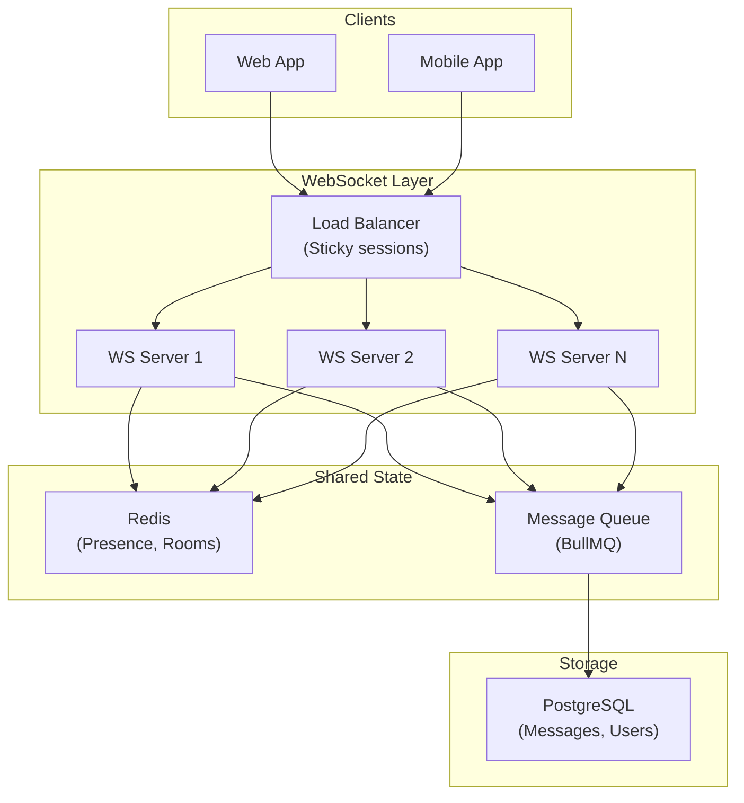

# Chat System Design

## 📖 Introduction

A real-time chat system requires: persistent WebSocket connections, message ordering, room management, message persistence, and horizontal scaling. From Slack to Discord to WhatsApp, chat systems are a fundamental real-time application pattern.

## 🤔 Why Do We Need This?

Chat systems combine multiple challenging requirements:
- **Real-time delivery** — Messages delivered in milliseconds
- **Message ordering** — Messages must appear in order
- **Persistence** — Chat history must survive restarts
- **Multi-device** — Same messages on phone, desktop, web
- **Scale** — Millions of concurrent connections

## ⚠️ Problem Statement



## 🎯 Key Design Decisions

```javascript
// 1. Room-based messaging
io.on('connection', (socket) => {
  socket.on('join-room', (roomId) => {
    socket.join(roomId);
    // Load recent messages from DB
    socket.emit('history', getRecentMessages(roomId, 50));
  });

  socket.on('send-message', async ({ roomId, text }) => {
    const message = { id: uuid(), userId: socket.user.id, text, timestamp: Date.now() };
    // Persist asynchronously
    await messageQueue.add('save-message', message);
    // Deliver immediately
    io.to(roomId).emit('new-message', message);
  });
});

// 2. Message persistence (async)
const worker = new Worker('save-message', async (job) => {
  await Message.create(job.data);
});

// 3. Presence tracking
socket.on('online', () => {
  redis.sadd('online-users', socket.user.id);
  io.emit('presence', { userId: socket.user.id, status: 'online' });
});

socket.on('disconnect', () => {
  redis.srem('online-users', socket.user.id);
  io.emit('presence', { userId: socket.user.id, status: 'offline' });
});
```

## 💻 Coding Challenge 1: Basic Chat Server

Build a Socket.IO chat server:
- Users can join a room (channel)
- Messages are broadcast to all room members
- Show typing indicators
- Show online/offline presence
- Store last 50 messages in memory

## 💻 Coding Challenge 2: Persistent Chat with History

Add persistence to the chat system:
- Store all messages in PostgreSQL
- Load last 50 messages when joining a room
- Support pagination: `GET /rooms/:id/messages?before=timestamp`
- Search messages by text content
- Handle concurrent writes correctly

## 💻 Coding Challenge 3: Multi-Server Chat

Scale the chat system across multiple servers:
- Use Redis adapter for Socket.IO (cross-server events)
- Use sticky sessions for load balancing
- Implement rate limiting per user (10 messages/second)
- Handle reconnection with message replay
- Monitor connection count per server

## 🧪 Mini Exercise: Debugging Chat System Issues

```javascript
// Bug 1: Messages duplicated when user reconnects
// Bug 2: Typing indicator never clears (no timeout)
// Bug 3: No rate limiting — user can spam 1000 messages/second
// Bug 4: Messages stored before DB connection is ready
// Bug 5: Cross-server broadcast not working (no Redis adapter)
```

## 📖 Summary

| Component | Technology | Purpose |
|-----------|------------|---------|
| Real-time | Socket.IO | Bidirectional message delivery |
| Persistence | PostgreSQL | Message history |
| Presence | Redis | Online/offline tracking |
| Cross-server | Redis Adapter | Scale across servers |
| Rate limiting | BullMQ | Prevent spam |
| Message queue | BullMQ | Async persistence |

## 📝 MCQs

**1. What technology is used for cross-server event propagation in a multi-server chat system?**
- A) PostgreSQL replication
- B) Redis Pub/Sub adapter ✅
- C) Direct TCP connections between servers
- D) HTTP polling

**2. How does a chat system typically handle message persistence without blocking the real-time delivery?**
- A) Messages are stored synchronously before delivery
- B) Messages are delivered immediately and persisted asynchronously via a queue ✅
- C) Messages are stored in memory only
- D) Messages are stored in browser localStorage

**3. What is the purpose of sticky sessions in a load-balanced WebSocket deployment?**
- A) To improve database performance
- B) To ensure a client always connects to the same server ✅
- C) To reduce memory usage
- D) To enable HTTP caching

**4. How are typing indicators typically implemented without flooding the server?**
- A) Send a message every keystroke
- B) Throttle events (e.g., every 300ms) with a timeout to clear ✅
- C) Only send when typing stops
- D) Server polls the client for typing status

**5. What happens to a WebSocket connection when the server needs to restart for deployment?**
- A) The connection is maintained by the load balancer
- B) The client reconnects automatically (Socket.IO) ✅
- C) The message is lost permanently
- D) The server waits for all connections to close before restarting

**Answer Key:** 1-B, 2-B, 3-B, 4-B, 5-B

## 🔗 Related Topics

- [WebSockets](../web/websockets-realtime) — Socket.IO fundamentals
- [Message Queues](../data/message-queues) — Async processing
- [Caching](../data/caching) — Redis for presence
