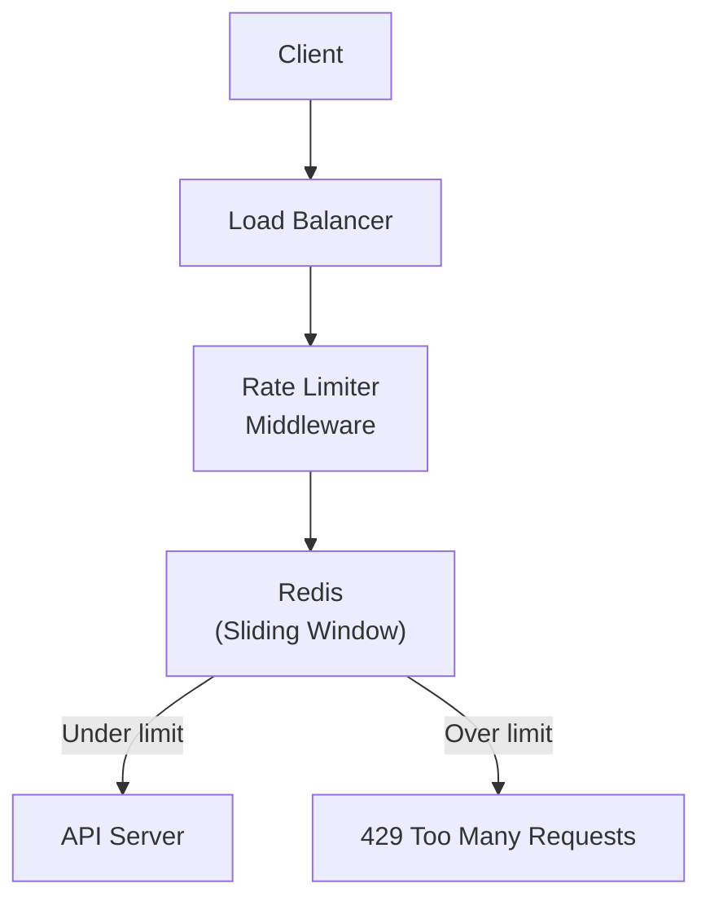

# Distributed Rate Limiter

## 📖 Introduction

A **rate limiter** controls the rate of traffic sent by a client or to a service. It protects APIs from abuse, ensures fair usage, and prevents system overload. Rate limiters are used by every major API platform (GitHub, Stripe, Twitter) and are a classic system design problem.

## 🤔 Why Do We Need This?

Without rate limiting:
- A single user can send 10,000 requests/second, overwhelming the server
- Brute force attacks on auth endpoints succeed faster
- API abuse leads to degraded experience for all users
- Costs increase (more server resources, API calls to paid services)

## ⚠️ Problem Statement



## 🎯 Algorithms

### 1. Token Bucket
```javascript
class TokenBucket {
  constructor(capacity, refillRate) {
    this.capacity = capacity;    // Max tokens
    this.tokens = capacity;
    this.refillRate = refillRate; // Tokens per second
    this.lastRefill = Date.now();
  }

  tryConsume(tokens = 1) {
    this.refill();
    if (this.tokens >= tokens) {
      this.tokens -= tokens;
      return true;
    }
    return false;
  }

  refill() {
    const now = Date.now();
    const elapsed = (now - this.lastRefill) / 1000;
    this.tokens = Math.min(this.capacity, this.tokens + elapsed * this.refillRate);
    this.lastRefill = now;
  }
}
```

### 2. Sliding Window (Redis)
```javascript
async function checkRateLimit(key, maxRequests, windowMs) {
  const now = Date.now();
  const windowStart = now - windowMs;

  // Remove old entries outside the window
  await redis.zremrangebyscore(key, 0, windowStart);

  // Count requests in the window
  const count = await redis.zcard(key);

  if (count >= maxRequests) {
    const ttl = await redis.ttl(key);
    return { allowed: false, retryAfter: ttl, remaining: 0 };
  }

  // Add current request
  await redis.zadd(key, now, `${now}-${Math.random()}`);
  await redis.expire(key, Math.ceil(windowMs / 1000));

  return { allowed: true, remaining: maxRequests - count - 1 };
}
```

## 💻 Coding Challenge 1: Express Rate Limiter Middleware

Build a rate limiter middleware for Express:
- Configurable: `maxRequests`, `windowMs`
- In-memory implementation (single server)
- Returns `X-RateLimit-Limit`, `X-RateLimit-Remaining`, `X-RateLimit-Reset` headers
- Returns 429 with `Retry-After` header when exceeded

## 💻 Coding Challenge 2: Redis Sliding Window Rate Limiter

Build a distributed rate limiter with Redis:
- Sliding window algorithm using Redis Sorted Sets
- Per-IP and per-user rate limiting (different keys)
- Configurable limits per endpoint (stricter for auth)
- Graceful degradation if Redis is unavailable

## 💻 Coding Challenge 3: Multi-Tier Rate Limiter

Build a rate limiter with multiple tiers:
- Tier 1: Global (100 req/s per IP)
- Tier 2: Per endpoint (10 req/s on /auth/login)
- Tier 3: Per user (1000 req/hour per user)
- Each tier is checked independently
- Lowest remaining limit is reported in headers

## 🧪 Mini Exercise: Debugging Rate Limiter Issues

```javascript
// Bug 1: Rate limit key doesn't include user ID
// Bug 2: Redis sorted set grows unboundedly (no cleanup)
// Bug 3: Token bucket not thread-safe across servers
// Bug 4: Error responses don't include Retry-After header
// Bug 5: Rate limiter blocks legitimate traffic after Redis restart
```

## 📖 Summary

| Algorithm | Pros | Cons | Best For |
|-----------|------|------|----------|
| Token Bucket | Allows bursts, simple | In-memory only | Single server |
| Sliding Window | Accurate, distributed | More Redis calls | Distributed systems |
| Fixed Window | Simple, low memory | Boundary spikes | Simple use cases |
| Sliding Log | Most accurate | High memory | Audit requirements |

## 📝 MCQs

**1. Which rate limiting algorithm allows short bursts of traffic?**
- A) Fixed window
- B) Token bucket ✅
- C) Sliding window
- D) Sliding log

**2. What HTTP status code indicates rate limiting?**
- A) 400
- B) 429 ✅
- C) 503
- D) 500

**3. Which rate limiting algorithm is most accurate for distributed systems?**
- A) Token bucket
- B) Fixed window
- C) Sliding window (sorted sets) ✅
- D) Leaky bucket

**4. What Redis data structure is ideal for sliding window rate limiting?**
- A) String
- B) List
- C) Sorted Set ✅
- D) Hash

**5. What header tells the client when they can retry after being rate limited?**
- A) X-RateLimit-Reset
- B) Retry-After ✅
- C) Retry-At
- D) RateLimit-Reset

**Answer Key:** 1-B, 2-B, 3-C, 4-C, 5-B

## 🔗 Related Topics

- [Caching with Redis](../data/caching) — Redis data structures
- [Security Hardening](../production/production-architecture) — Rate limiting as security
- [API Design](../web/building-apis) — Rate limiting in APIs
