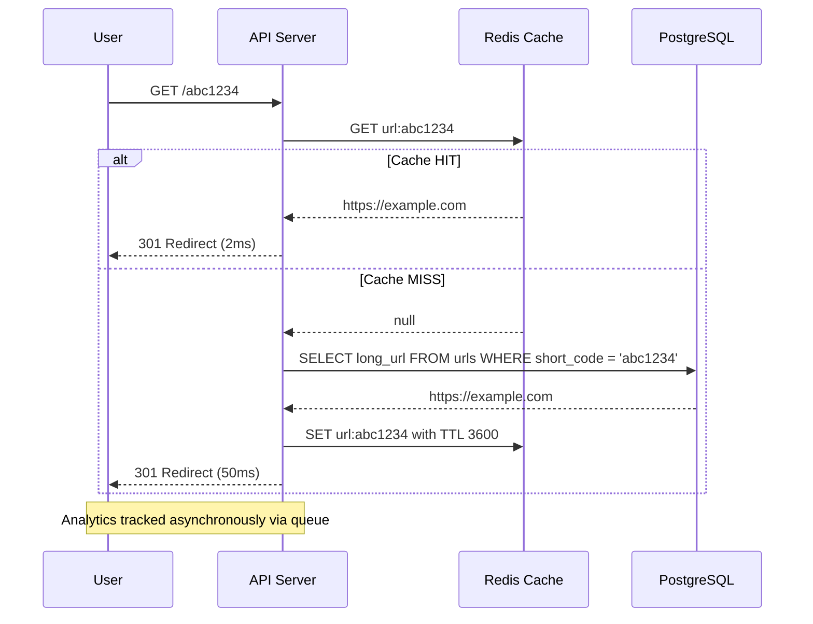

# URL Shortener Design

## 📖 Introduction

A URL shortener transforms long URLs into short, shareable links (like bit.ly or TinyURL). While seemingly simple, a production URL shortener involves unique ID generation, fast lookups for redirects, analytics tracking, and handling billions of requests.

## 🤔 Why Do We Need This?

URL shorteners are a classic system design problem because they combine:
- **Low-latency redirects** — Every millisecond matters for user experience
- **High read throughput** — Shortened URLs are accessed far more often than created (100:1 read:write ratio)
- **Unique ID generation** — Must be collision-free at scale (3.5 trillion combinations for 7 characters)
- **Analytics** — Track clicks, referrers, geographic data, and device types

## ⚠️ Problem Statement

| Challenge | Solution | Scale |
|-----------|----------|-------|
| Short code generation | Base62 encoding (7 chars = 62^7 = 3.5T) | ~1M URLs/day |
| Fast redirection | Redis cache (cache-aside pattern) | <5ms per redirect |
| ID generation | Snowflake-style or Redis INCR | 10K IDs/sec |
| Analytics | Async queue (BullMQ) | Process async, don't block redirect |
| Duplicate URLs | Check existing or allow custom slugs | Configurable |

## 📊 Mermaid Diagram 1: URL Shortener Architecture

```mermaid
flowchart TD
    Client["📱 Client"] --> Create["POST /shorten"]
    Client --> Redirect["GET /:code"]
    
    Create --> IDGen["ID Generator<br/>(Snowflake/Redis)"]
    IDGen --> Encode["Base62 Encode"]
    Encode --> DB["PostgreSQL<br/>(URL Mapping)"]
    DB --> Cache["Redis Cache<br/>(Popular URLs)"]
    Create --> Queue["Analytics Queue<br/>(BullMQ)"]
    
    Redirect --> Cache
    Cache -->|"Miss"| DB
    DB --> Cache
    
    Queue --> Worker["Analytics Worker"]
    Worker --> AnalyticsDB["Analytics DB"]
    
    style Create fill:#4f46e5,color:#fff
    style Redirect fill:#059669,color:#fff
    style Cache fill:#dc2626,color:#fff
```

## 🔄 Mermaid Diagram 2: Redirect Flow

## 📝 MCQs

**1. What encoding is commonly used for URL short codes?**
- A) Base32
- B) Base62 ✅
- C) Base16
- D) Base128

**2. Why is analytics offloaded to a queue instead of processed inline?**
- A) To reduce redirect latency ✅
- B) Queues are more secure
- C) Analytics data is too large
- D) PostgreSQL can't store analytics

**3. What cache pattern is used for URL redirects?**
- A) Write-through
- B) Cache-aside ✅
- C) Read-through
- D) Write-behind

**4. How many unique combinations does 7 characters of Base62 provide?**
- A) 62^7 ≈ 3.5 trillion ✅
- B) 10^7 ≈ 10 million
- C) 62^10
- D) 7^62

**5. What HTTP status code is used for URL redirects?**
- A) 200
- B) 301 ✅
- C) 302
- D) 404

**Answer Key:** 1-B, 2-A, 3-B, 4-A, 5-B

## 🔗 Related Topics

- [Caching](../data/caching) — Redis caching patterns
- [Databases](../data/databases) — PostgreSQL, indexing
- [Message Queues](../data/message-queues) — Async analytics processing
