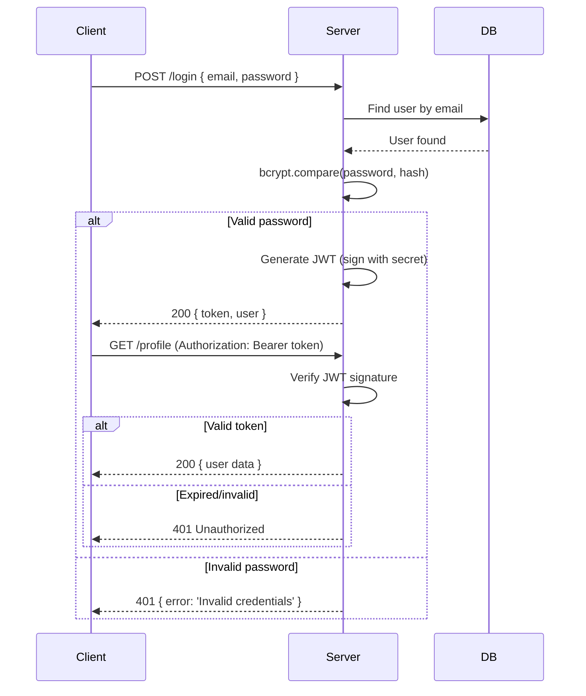
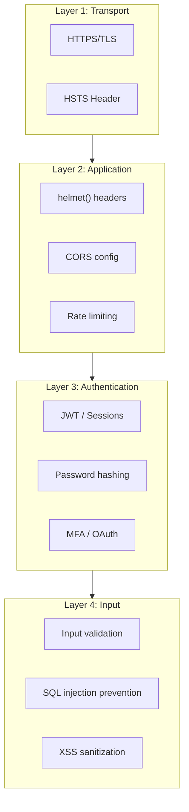

# Authentication & Security

## 📖 Introduction

Authentication and security are **non-negotiable** in production APIs. This covers everything from password hashing and JWT tokens to CORS configuration and rate limiting — the tools that keep your application and users safe.

> **Security isn't a feature. It's a requirement.**

## 📊 Mermaid Diagram 1: JWT Auth Flow



## 🏗️ Architecture: Security Layers



## 📝 Syntax

```javascript
// JWT
const jwt = require('jsonwebtoken');
const token = jwt.sign({ userId: 1, role: 'admin' }, process.env.JWT_SECRET, { expiresIn: '7d' });
jwt.verify(token, process.env.JWT_SECRET);

// Bcrypt
const bcrypt = require('bcrypt');
const hash = await bcrypt.hash(password, 12);
const match = await bcrypt.compare(password, hash);

// Helmet
app.use(require('helmet')());

// CORS
app.use(require('cors')({ origin: 'https://myapp.com' }));

// Rate limit
app.use(require('express-rate-limit')({ windowMs: 15*60*1000, max: 100 }));
```

## 🟢 Basic Example: JWT Auth Middleware

```javascript
const jwt = require('jsonwebtoken');

function authenticate(req, res, next) {
  const header = req.headers.authorization;
  if (!header) {
    return res.status(401).json({ error: 'No token provided' });
  }
  
  const token = header.split(' ')[1]; // Bearer <token>
  
  try {
    const decoded = jwt.verify(token, process.env.JWT_SECRET);
    req.user = decoded;
    next();
  } catch (err) {
    return res.status(401).json({ error: 'Invalid or expired token' });
  }
}

// Protect routes
app.get('/profile', authenticate, (req, res) => {
  res.json({ user: req.user });
});
```

## 🟡 Intermediate Example: Login + Signup with Bcrypt

```javascript
const bcrypt = require('bcrypt');
const jwt = require('jsonwebtoken');

// Signup
app.post('/signup', async (req, res) => {
  const { email, password } = req.body;
  
  const existing = await User.findOne({ email });
  if (existing) return res.status(409).json({ error: 'Email already exists' });
  
  const hashed = await bcrypt.hash(password, 12);
  const user = await User.create({ email, password: hashed });
  
  const token = jwt.sign({ userId: user.id }, process.env.JWT_SECRET, { expiresIn: '7d' });
  res.status(201).json({ token, user: { id: user.id, email: user.email } });
});

// Login
app.post('/login', async (req, res) => {
  const { email, password } = req.body;
  
  const user = await User.findOne({ email });
  if (!user) return res.status(401).json({ error: 'Invalid credentials' });
  
  const match = await bcrypt.compare(password, user.password);
  if (!match) return res.status(401).json({ error: 'Invalid credentials' });
  
  const token = jwt.sign({ userId: user.id }, process.env.JWT_SECRET, { expiresIn: '7d' });
  res.json({ token, user: { id: user.id, email: user.email } });
});
```

## 🔴 Advanced Example: Role-Based Access Control (RBAC)

```javascript
function authorize(...allowedRoles) {
  return (req, res, next) => {
    if (!req.user) return res.status(401).json({ error: 'Auth required' });
    if (!allowedRoles.includes(req.user.role)) {
      return res.status(403).json({ error: 'Insufficient permissions' });
    }
    next();
  };
}

// Usage: only admins can delete users
app.delete('/users/:id', authenticate, authorize('admin'), async (req, res) => {
  await User.findByIdAndDelete(req.params.id);
  res.status(204).end();
});

// Moderators and admins can edit
app.put('/posts/:id', authenticate, authorize('moderator', 'admin'), async (req, res) => {
  const post = await Post.findByIdAndUpdate(req.params.id, req.body, { new: true });
  res.json(post);
});
```

## 🏭 Production Example: Complete Security Setup

```javascript
const express = require('express');
const helmet = require('helmet');
const cors = require('cors');
const rateLimit = require('express-rate-limit');
const mongoSanitize = require('express-mongo-sanitize');
const hpp = require('hpp');

const app = express();

// 1. Security headers
app.use(helmet());

// 2. CORS
app.use(cors({
  origin: process.env.ALLOWED_ORIGINS?.split(','),
  methods: ['GET', 'POST', 'PUT', 'DELETE'],
  allowedHeaders: ['Content-Type', 'Authorization'],
  credentials: true,
  maxAge: 86400, // 24 hours
}));

// 3. Rate limiting
const limiter = rateLimit({
  windowMs: 15 * 60 * 1000,
  max: 100,
  message: { error: 'Too many requests' },
});
app.use('/api', limiter);

// Stricter limiter for auth routes
const authLimiter = rateLimit({
  windowMs: 15 * 60 * 1000,
  max: 5,
  message: { error: 'Too many login attempts' },
});
app.use('/api/auth', authLimiter);

// 4. Data sanitization
app.use(mongoSanitize()); // Prevent NoSQL injection
app.use(hpp()); // Prevent HTTP parameter pollution

// 5. Body size limits
app.use(express.json({ limit: '10kb' }));

// 6. Auth middleware
app.use('/api', authenticate);

// 7. Routes
app.use('/api/v1/users', userRoutes);
```

## 📦 Performance Notes

| Operation | Time | Notes |
|-----------|------|-------|
| bcrypt.hash (salt 12) | ~250ms | CPU-intensive by design |
| JWT sign | ~0.1ms | Fast (symmetric) |
| JWT verify | ~0.1ms | Fast |
| Rate limit check | ~0.01ms | In-memory (fast) |

## 🔒 Security Notes

- Always use HTTPS in production
- Hash passwords with bcrypt (cost 12+)
- Never store plaintext passwords
- Use short-lived JWTs (15min access + 7d refresh)
- Rate limit auth endpoints
- Validate all CORS origins

## ⚠️ Common Mistakes

```javascript
// MISTAKE: Storing password in plaintext
User.create({ email, password: req.body.password }); // ❌

// MISTAKE: No rate limiting on login
app.post('/login', login); // Anyone can brute-force

// MISTAKE: CORS set to wildcard in production
app.use(cors()); // Allows ALL origins!
```

## 🚀 Best Practices

| # | Practice |
|---|----------|
| 1 | Hash passwords with bcrypt (cost 12) |
| 2 | Use short-lived JWTs with refresh tokens |
| 3 | Rate limit all endpoints (stricter on auth) |
| 4 | Use helmet() for security headers |
| 5 | Never trust CORS for authentication |

## 📝 MCQs

**1. What algorithm should you use to hash passwords?**
- A) MD5
- B) SHA256
- C) bcrypt ✅
- D) Base64

**2. Where should JWT tokens be stored on the client?**
- A) localStorage
- B) httpOnly cookie ✅
- C) URL parameter
- D) SessionStorage

**3. What does helmet() do?**
- A) Enables CORS
- B) Sets security headers ✅
- C) Rate limits requests
- D) Hashes passwords

**4. What status code for unauthorized?**
- A) 400
- B) 401 ✅
- C) 403
- D) 404

**5. What's the difference between 401 and 403?**
- A) No difference
- B) 401=not authenticated, 403=not authorized ✅
- C) 401=bad request, 403=not found
- D) 401=expired, 403=invalid

## 💻 Coding Challenge 1: Auth Middleware

Build middleware that extracts JWT from Authorization header and attaches user to req.

## 💻 Coding Challenge 2: RBAC System

Implement a role-based access control system with admin, moderator, and user roles.

## 💻 Coding Challenge 3: Rate Limiter

Build an in-memory rate limiter (without third-party packages) that limits to N requests per minute per IP.

## 🧪 Mini Exercise

```javascript
// Find 3 security vulnerabilities:
app.post('/login', async (req, res) => {
  const user = await User.findOne({ email: req.body.email });
  if (user.password === req.body.password) {
    const token = jwt.sign(user, 'secret123');
    res.json({ token });
  }
});
```

## 🌍 Real World Problem

**Problem:** Your API is being brute-forced. Attackers are trying thousands of passwords on user accounts. Rate limiting on IP isn't working because they rotate IPs. What's your strategy?

## 🏗️ Mini Project: Auth Server

Build a complete auth server with: signup, login, JWT access + refresh tokens, password reset, and rate limiting.

## 📖 Summary

| Concept | Key |
|---------|-----|
| Password hashing | bcrypt with cost 12 |
| JWT | Stateless tokens with expiry |
| CORS | Whitelist allowed origins |
| Rate limiting | Prevent brute-force |
| Authorization | Role-based access control |

## 📋 Cheat Sheet

```javascript
const bcrypt = require('bcrypt');
const jwt = require('jsonwebtoken');
const hash = await bcrypt.hash(password, 12);
const token = jwt.sign({ id: user.id }, SECRET, { expiresIn: '7d' });
const decoded = jwt.verify(token, SECRET);
app.use(require('helmet')());
app.use(require('cors')({ origin: 'https://app.com' }));
app.use(require('express-rate-limit')({ windowMs: 15*60*1000, max: 100 }));
```

## 📚 Further Reading

- [JWT.io](https://jwt.io/)
- [OWASP Node.js Security](https://cheatsheetseries.owasp.org/cheatsheets/Nodejs_Security_Cheat_Sheet.html)
- [Express Security Guide](https://expressjs.com/en/advanced/best-practice-security.html)

## 🔗 Related Topics

| Topic | Link |
|-------|------|
| Input Validation | [Previous](/DSA-Notes-Problems/nodejs/web/validation) |
| File Uploads | [Next](/DSA-Notes-Problems/nodejs/web/file-uploads) |
| WebSockets | [WebSockets](/DSA-Notes-Problems/nodejs/web/websockets-realtime) |
