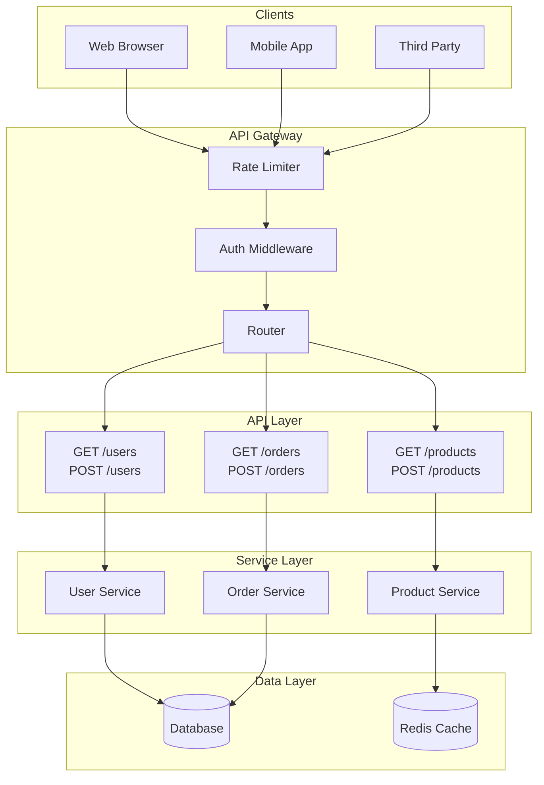
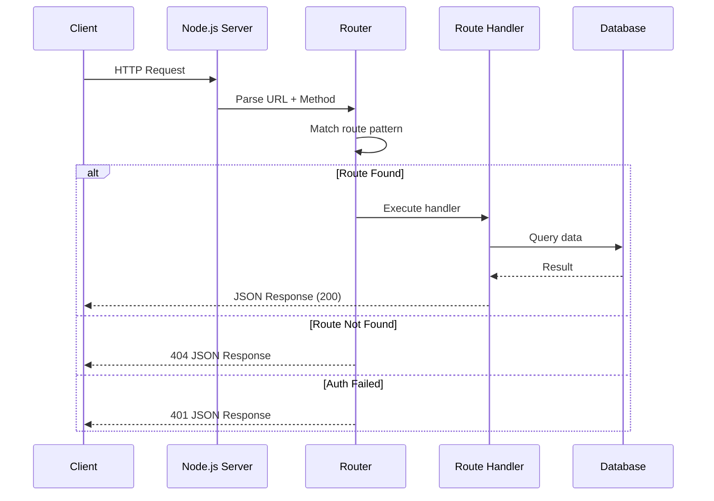
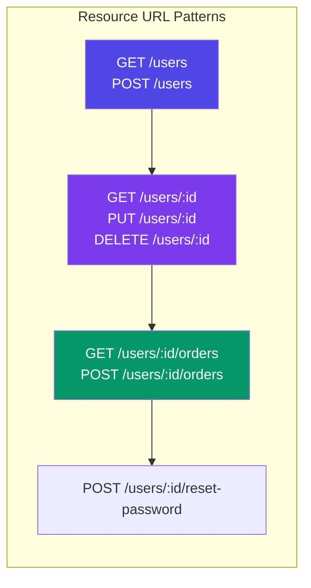
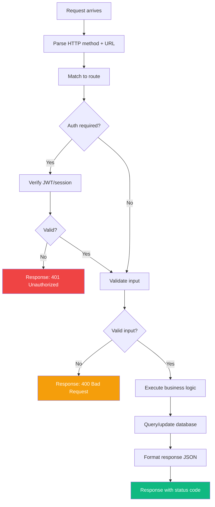

# Building REST APIs

## 📖 Introduction

A **REST API** (Representational State Transfer) is the most common way for web applications to communicate. It uses standard HTTP methods to create, read, update, and delete resources — the foundation of every modern web service.

> **REST is the language of the web. Every server and client speaks HTTP.**

## 🤔 Why Do We Need This?

| Problem | REST API Solution |
|---------|------------------|
| Two apps need to share data | API endpoints expose data over HTTP |
| Mobile app needs server data | JSON responses are lightweight |
| Third-party integrations | Well-defined API contract |
| Microservices communication | HTTP as the universal protocol |

## ⚠️ Problem Statement

Before REST, APIs were inconsistent chaos:
```
Create user: POST /createUser?name=Alice
Delete user: GET /deleteUser?id=1  (GET deletes? 😱)
Get users:  POST /getAllUsers
```

REST standardized this with **resources** (nouns) and **HTTP methods** (verbs).

## 📚 Real World Story

**Stripe's API Design Philosophy**

Stripe's API is widely considered the gold standard. Their design principles:
- Resources as nouns: `/customers`, `/charges`
- HTTP methods as verbs: `POST`, `GET`, `DELETE`
- Consistent error responses with types
- Idempotency keys for safe retries

This consistency is why developers love Stripe's API. Every endpoint follows the same patterns.

## 🍕 Real World Analogy

| REST Concept | Restaurant Analogy |
|-------------|-------------------|
| Resource (`/menu`) | The menu board |
| GET `/menu` | Look at the menu |
| POST `/orders` | Place a new order |
| GET `/orders/123` | Check order status |
| DELETE `/orders/123` | Cancel the order |
| 200 OK | "Here's your food" |
| 404 Not Found | "We don't have that" |
| 400 Bad Request | "We can't make that" |

## 👁️ Visual Explanation

```
REST API REQUEST FLOW

Client                          Server
  │                                │
  │  GET /api/users                │
  │───────────────────────────────>│
  │                                │
  │         ┌─────────────────┐    │
  │         │ 1. Parse URL    │    │
  │         │ 2. Match route  │    │
  │         │ 3. Validate auth│    │
  │         │ 4. Query DB     │    │
  │         │ 5. Format JSON  │    │
  │         └─────────────────┘    │
  │                                │
  │  200 OK [{id:1, name:"Alice"}] │
  │<───────────────────────────────│
  │                                │
```

## 📊 Mermaid Diagram 1: REST API Architecture



## ⚙️ Internal Working: HTTP Request/Response Cycle



## 🏗️ Architecture: RESTful URL Design



## 👣 Step-by-Step Flow: Processing an API Request



## 📝 Syntax

```javascript
// HTTP METHODS
GET     /users          // List all users
POST    /users          // Create a user
GET     /users/:id      // Get one user
PUT     /users/:id      // Replace a user
PATCH   /users/:id      // Update part of a user
DELETE  /users/:id      // Delete a user

// COMMON STATUS CODES
200 OK                  // Success
201 Created             // Resource created
204 No Content          // Success, no body
400 Bad Request         // Invalid input
401 Unauthorized        // Not authenticated
403 Forbidden           // Not authorized
404 Not Found           // Resource missing
429 Too Many Requests   // Rate limited
500 Internal Server Error // Server error
```

## 🟢 Basic Example: Raw HTTP API Server

```javascript
const http = require('http');

const users = [{ id: 1, name: 'Alice', email: 'alice@example.com' }];

const server = http.createServer((req, res) => {
  const { method, url } = req;
  
  res.setHeader('Content-Type', 'application/json');
  
  // GET /users — list all
  if (method === 'GET' && url === '/users') {
    res.writeHead(200);
    res.end(JSON.stringify(users));
  }
  
  // GET /users/1 — get one
  else if (method === 'GET' && url.match(/^\/users\/\d+$/)) {
    const id = parseInt(url.split('/')[2]);
    const user = users.find(u => u.id === id);
    if (user) {
      res.writeHead(200);
      res.end(JSON.stringify(user));
    } else {
      res.writeHead(404);
      res.end(JSON.stringify({ error: 'User not found' }));
    }
  }
  
  // POST /users — create
  else if (method === 'POST' && url === '/users') {
    let body = '';
    req.on('data', chunk => body += chunk);
    req.on('end', () => {
      const data = JSON.parse(body);
      const newUser = { id: users.length + 1, ...data };
      users.push(newUser);
      res.writeHead(201);
      res.end(JSON.stringify(newUser));
    });
  }
  
  else {
    res.writeHead(404);
    res.end(JSON.stringify({ error: 'Route not found' }));
  }
});

server.listen(3000);
```

## 🟡 Intermediate Example: Express REST API

```javascript
const express = require('express');
const app = express();

app.use(express.json());

let users = [{ id: 1, name: 'Alice', email: 'alice@example.com' }];

// GET all
app.get('/api/users', (req, res) => {
  res.json(users);
});

// GET one
app.get('/api/users/:id', (req, res) => {
  const user = users.find(u => u.id === parseInt(req.params.id));
  if (!user) return res.status(404).json({ error: 'User not found' });
  res.json(user);
});

// POST create
app.post('/api/users', (req, res) => {
  const { name, email } = req.body;
  if (!name || !email) {
    return res.status(400).json({ error: 'Name and email required' });
  }
  const newUser = { id: users.length + 1, name, email };
  users.push(newUser);
  res.status(201).json(newUser);
});

// PUT replace
app.put('/api/users/:id', (req, res) => {
  const id = parseInt(req.params.id);
  const index = users.findIndex(u => u.id === id);
  if (index === -1) return res.status(404).json({ error: 'Not found' });
  users[index] = { id, ...req.body };
  res.json(users[index]);
});

// DELETE
app.delete('/api/users/:id', (req, res) => {
  const id = parseInt(req.params.id);
  users = users.filter(u => u.id !== id);
  res.status(204).end();
});

app.listen(3000);
```

## 🔴 Advanced Example: Router with Middleware

```javascript
const express = require('express');
const router = express.Router();

// Middleware: validate ID
const validateId = (req, res, next) => {
  const id = parseInt(req.params.id);
  if (isNaN(id)) {
    return res.status(400).json({ error: 'Invalid ID' });
  }
  req.id = id;
  next();
};

// Middleware: check auth
const requireAuth = (req, res, next) => {
  const token = req.headers.authorization;
  if (!token) return res.status(401).json({ error: 'Auth required' });
  next();
};

// Routes
router.get('/', async (req, res) => {
  const users = await User.find();
  res.json(users);
});

router.get('/:id', validateId, async (req, res) => {
  const user = await User.findById(req.id);
  if (!user) return res.status(404).json({ error: 'Not found' });
  res.json(user);
});

router.post('/', requireAuth, async (req, res) => {
  const user = await User.create(req.body);
  res.status(201).json(user);
});

module.exports = router;
// app.use('/api/users', userRouter);
```

## 🏭 Production Example: Full API with Versioning and Error Handling

```javascript
const express = require('express');
const helmet = require('helmet');
const cors = require('cors');
const rateLimit = require('express-rate-limit');

const app = express();

// Security
app.use(helmet());
app.use(cors({ origin: process.env.ALLOWED_ORIGINS?.split(',') }));
app.use(express.json({ limit: '10kb' }));

// Rate limiting
const limiter = rateLimit({
  windowMs: 15 * 60 * 1000, // 15 min
  max: 100,
  message: { error: 'Too many requests' }
});
app.use('/api', limiter);

// API v1 routes
app.use('/api/v1/users', require('./routes/v1/users'));
app.use('/api/v1/products', require('./routes/v1/products'));

// Health check
app.get('/health', (req, res) => {
  res.json({ status: 'ok', uptime: process.uptime() });
});

// 404 handler
app.use((req, res) => {
  res.status(404).json({ error: 'Route not found' });
});

// Error handler
app.use((err, req, res, next) => {
  logger.error({ err, requestId: req.id });
  res.status(err.statusCode || 500).json({
    error: process.env.NODE_ENV === 'production'
      ? 'Internal server error'
      : err.message,
  });
});
```

## ⚙️ How It Works Internally

```
Express.js request handling:
1. Incoming HTTP request arrives
2. Express parses URL, method, headers
3. Runs middleware stack in order (app.use)
4. Matches route (app.get/post/...)
5. Executes route handler
6. Sends response via res.json/end/send
7. If error thrown, skips to error middleware
```

## 📦 Performance Notes

| Aspect | Impact |
|--------|--------|
| JSON.stringify | Slow for large payloads — use streaming |
| Body parser | Set limit: '10kb' to prevent DoS |
| Route matching | O(n) for n routes — order matters |
| CORS preflight | Adds latency — cache with maxAge |

## 🔒 Security Notes

- Always validate and sanitize input
- Use HTTPS in production
- Set rate limiting on all endpoints
- Never expose stack traces
- Validate Content-Type headers

## ⚠️ Common Mistakes

```javascript
// MISTAKE 1: Not validating input
app.post('/users', (req, res) => {
  User.create(req.body); // Malicious data goes straight to DB!
});

// MISTAKE 2: Exposing internal errors
app.use((err, req, res) => {
  res.status(500).json({ error: err.stack }); // Leaks internal paths!
});

// MISTAKE 3: Not using proper status codes
app.get('/users/:id', (req, res) => {
  // Should be 404 if not found
  res.json({ error: 'Not found' }); // Returns 200 with error!
});
```

## 🚀 Best Practices

| # | Practice |
|---|----------|
| 1 | Use plural nouns for resources: `/users` not `/user` |
| 2 | Version your API: `/api/v1/users` |
| 3 | Use proper HTTP status codes |
| 4 | Validate all input at the boundary |
| 5 | Return consistent error shapes |
| 6 | Use pagination for list endpoints |
| 7 | Include request IDs in responses |

## 🎯 Interview Questions

**Q1: What makes a good REST API?**
Consistent resource naming, proper HTTP methods and status codes, input validation, pagination, versioning, and good error messages.

**Q2: POST vs PUT vs PATCH?**
POST creates new resources. PUT replaces an entire resource. PATCH applies partial updates.

## 📝 MCQs

**1. What status code means "Created"?**
- A) 200
- B) 201 ✅
- C) 204
- D) 301

**2. Which method is idempotent?**
- A) POST
- B) PUT ✅
- C) PATCH
- D) All

**3. What status code means "Not Found"?**
- A) 400
- B) 401
- C) 403
- D) 404 ✅

**4. Which HTTP method has a body?**
- A) GET
- B) POST ✅
- C) Both
- D) Neither

**5. What status code means "Too Many Requests"?**
- A) 429 ✅
- B) 500
- C) 503
- D) 400

## 💻 Coding Challenge 1: Todo API

Build a REST API for todos with GET, POST, PUT, DELETE. Store in memory.

## 💻 Coding Challenge 2: Pagination Middleware

Create middleware that adds pagination (page, limit, total) to any list endpoint.

## 💻 Coding Challenge 3: API Version Router

Build a version routing system that directs `/api/v1/users` and `/api/v2/users` to different handlers.

## 🧪 Mini Exercise: Debugging API

```javascript
// Find the bugs:
app.get('/users/:id', (req, res) => {
  const user = users.find(u => u.id === req.params.id); // Bug 1
  res.json(user); // Bug 2
});
```

## 🌍 Real World Problem

**Problem:** Your API returns 500 errors randomly. Users report that requests sometimes work and sometimes don't. No pattern in timing or endpoints. How do you debug this?

## 🏗️ Mini Project: URL Shortener API

Build a REST API for a URL shortener with create, redirect, stats, and rate limiting.

## 📖 Summary

| Concept | Key |
|---------|-----|
| REST | Resources (nouns) + Methods (verbs) |
| Status codes | 2xx success, 4xx client error, 5xx server error |
| Validation | Always validate input |
| Versioning | /api/v1/ for backward compatibility |

## 📋 Cheat Sheet

```javascript
// Express skeleton
const app = express();
app.use(express.json());
app.get('/api/users', (req, res) => res.json([]));
app.post('/api/users', (req, res) => res.status(201).json(req.body));
app.use((err, req, res, next) => res.status(500).json({ error: err.message }));
```

## 📚 Further Reading

- [REST API Tutorial](https://restfulapi.net/)
- [Express.js Guide](https://expressjs.com/en/guide/routing.html)

## 🔗 Related Topics

| Topic | Link |
|-------|------|
| Express.js Framework | [Next](/DSA-Notes-Problems/nodejs/web/express-framework) |
| Input Validation | [Validation](/DSA-Notes-Problems/nodejs/web/validation) |
| Error Handling | [Errors](/DSA-Notes-Problems/nodejs/core/error-handling) |
