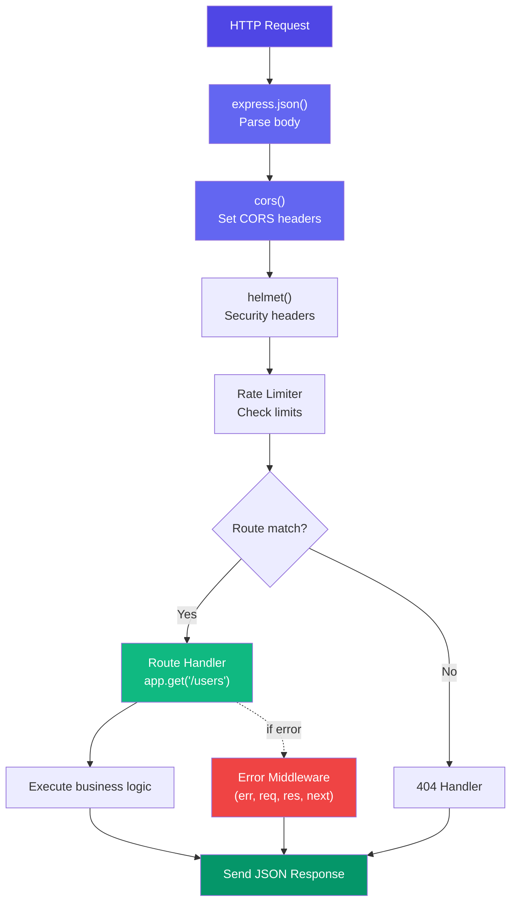
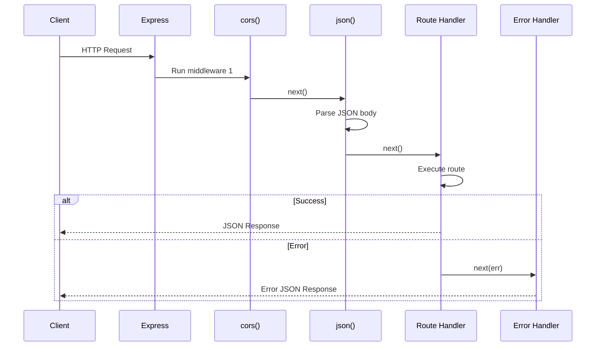
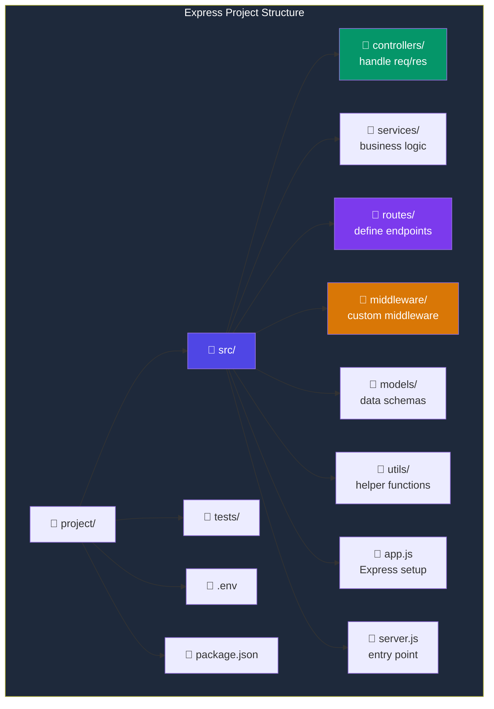
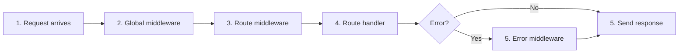

# Express.js Framework

## 📖 Introduction

**Express.js** is the most popular Node.js web framework — used by ~80% of Node.js web applications. It provides a minimal but powerful layer over Node.js's HTTP module, adding routing, middleware, and error handling.

> **Express is to Node.js what jQuery was to the browser — the essential abstraction that everyone uses.**

## 🤔 Why Do We Need This?

| Feature | Raw `http` Module | Express.js |
|---------|-----------|------------|
| Routing | Manual if/else chains | `app.get('/path', handler)` |
| JSON parsing | Manual `req.on('data')` | `express.json()` middleware |
| Static files | Custom logic | `express.static('public')` |
| Error handling | Manual try/catch everywhere | Global error middleware |
| Middleware | DIY | Built-in + 3rd party ecosystem |

## ⚠️ Problem Statement

```javascript
// Without Express — 50 lines for basic routing
const http = require('http');
http.createServer((req, res) => {
  const [path, query] = req.url.split('?');
  if (req.method === 'GET' && path === '/users') { /* ... */ }
  else if (req.method === 'POST' && path === '/users') { /* ... */ }
  // 20 more if/else statements!
});

// With Express — 5 lines
const app = require('express')();
app.get('/users', getUsers);
app.post('/users', createUser);
```

## 📚 Real World Story

**Why Express Won**

In 2014, TJ Holowaychuk (Express creator) was maintaining multiple frameworks (Express, Koa, Connect). He chose to pass Express to the Node.js foundation. This decision made Express the **official** Node.js web framework — giving enterprises confidence to adopt it.

Today, Express powers: PayPal, Uber, MySpace, IBM, and thousands of other companies.

## 🍕 Real World Analogy

| Concept | Factory Assembly Line |
|---------|----------------------|
| Middleware | Each station in the assembly line |
| `req` | The product moving down the line |
| `res` | The finished product |
| `next()` | Move to the next station |
| Error middleware | Quality control station |
| Router | Different assembly lines for different products |

## 👁️ Visual Explanation

```
REQUEST FLOW THROUGH EXPRESS

Incoming Request
      │
      ▼
┌─────────────────┐
│ app.use(cors()) │  ← Global middleware (runs for ALL routes)
├─────────────────┤
│ app.use(logger) │
├─────────────────┤
│ app.use(auth)   │
├─────────────────┤
│ Router-level    │  ← Route-specific middleware
│   validateId    │
├─────────────────┤
│ Route Handler   │  ← Finally, the actual handler
│   getUsers      │
├─────────────────┤
│ Error Middleware│  ← Only runs if next(err) is called
└─────────────────┘
      │
      ▼
  Response Sent
```

## 📊 Mermaid Diagram 1: Middleware Stack



## ⚙️ Internal Working: Express Middleware Chain



## 🏗️ Architecture: Professional Express Folder Structure



## 👣 Step-by-Step Flow: Request Lifecycle



## 📝 Syntax

```javascript
const express = require('express');
const app = express();

// ─── MIDDLEWARE ─────────────────────────────────────
app.use(express.json());           // Parse JSON bodies
app.use(express.static('public')); // Serve static files
app.use(cors());                   // Enable CORS
app.use(helmet());                 // Security headers

// ─── ROUTING ────────────────────────────────────────
app.get('/users', handler);
app.post('/users', handler);
app.put('/users/:id', handler);
app.delete('/users/:id', handler);
app.patch('/users/:id', handler);

// ─── CHAINABLE ──────────────────────────────────────
app.route('/users')
  .get(getUsers)
  .post(createUser);

// ─── ROUTER ─────────────────────────────────────────
const router = express.Router();
router.get('/', handler);
app.use('/api/users', router);

// ─── ERROR MIDDLEWARE (4 params!) ───────────────────
app.use((err, req, res, next) => {
  res.status(err.statusCode || 500).json({ error: err.message });
});
```

## 🟢 Basic Example: Express Hello World

```javascript
const express = require('express');
const app = express();
const PORT = process.env.PORT || 3000;

app.get('/', (req, res) => {
  res.send('Hello World!');
});

app.get('/api/time', (req, res) => {
  res.json({
    iso: new Date().toISOString(),
    unix: Date.now(),
  });
});

app.listen(PORT, () => {
  console.log(`Server running on :${PORT}`);
});
```

## 🟡 Intermediate Example: CRUD with Express Router

```javascript
const express = require('express');
const router = express.Router();

// In-memory store
let items = [
  { id: 1, name: 'Item 1', price: 10 },
  { id: 2, name: 'Item 2', price: 20 },
];

// List
router.get('/', (req, res) => {
  const { page = 1, limit = 10 } = req.query;
  const start = (page - 1) * limit;
  const paginated = items.slice(start, start + parseInt(limit));
  res.json({ data: paginated, total: items.length, page: +page });
});

// Get one
router.get('/:id', (req, res) => {
  const item = items.find(i => i.id === parseInt(req.params.id));
  if (!item) return res.status(404).json({ error: 'Item not found' });
  res.json(item);
});

// Create
router.post('/', (req, res) => {
  const { name, price } = req.body;
  if (!name || !price) {
    return res.status(400).json({ error: 'Name and price required' });
  }
  const newItem = { id: items.length + 1, name, price };
  items.push(newItem);
  res.status(201).json(newItem);
});

module.exports = router;
// app.use('/api/items', itemsRouter);
```

## 🔴 Advanced Example: Middleware Composition

```javascript
// middleware/validate.js
const validate = (schema) => {
  return (req, res, next) => {
    const { error } = schema.validate(req.body);
    if (error) {
      return res.status(400).json({
        error: 'Validation failed',
        details: error.details.map(d => d.message),
      });
    }
    next();
  };
};

// middleware/auth.js
const authenticate = (requiredRole) => {
  return (req, res, next) => {
    const token = req.headers.authorization?.split(' ')[1];
    if (!token) return res.status(401).json({ error: 'Not authenticated' });
    try {
      req.user = jwt.verify(token, process.env.JWT_SECRET);
      if (requiredRole && req.user.role !== requiredRole) {
        return res.status(403).json({ error: 'Insufficient permissions' });
      }
      next();
    } catch (err) {
      return res.status(401).json({ error: 'Invalid token' });
    }
  };
};

// Usage: compose middleware
router.post('/items',
  authenticate('admin'),
  validate(itemSchema),
  createItem
);
```

## 🏭 Production Example: Express App Factory

```javascript
// app.js — Production Express setup
const express = require('express');
const helmet = require('helmet');
const cors = require('cors');
const rateLimit = require('express-rate-limit');

function createApp() {
  const app = express();

  // Security
  app.use(helmet());
  app.use(cors({ 
    origin: process.env.CORS_ORIGIN?.split(',') || '*',
    credentials: true 
  }));
  
  // Parsing
  app.use(express.json({ limit: '10kb' }));
  app.use(express.urlencoded({ extended: true, limit: '10kb' }));

  // Rate limiting
  app.use('/api', rateLimit({
    windowMs: 15 * 60 * 1000,
    max: 100,
    message: { error: 'Too many requests' }
  }));

  // Request logging
  app.use((req, res, next) => {
    req.startTime = Date.now();
    res.on('finish', () => {
      const duration = Date.now() - req.startTime;
      logger.info({ method: req.method, url: req.url, status: res.statusCode, duration });
    });
    next();
  });

  // Routes
  app.use('/api/v1/users', require('./routes/users'));
  app.use('/api/v1/products', require('./routes/products'));
  app.get('/health', (req, res) => res.json({ status: 'ok' }));

  // 404
  app.use((req, res) => res.status(404).json({ error: 'Not found' }));

  // Error handler
  app.use((err, req, res, next) => {
    logger.error({ err, requestId: req.id });
    res.status(err.statusCode || 500).json({
      error: process.env.NODE_ENV === 'production' 
        ? 'Internal server error' 
        : err.message
    });
  });

  return app;
}

module.exports = createApp;
```

## ⚙️ How It Works Internally

```
Express middleware is just an array of functions:
const middleware = [fn1, fn2, fn3, ...];

Each function calls next() to go to the next:
function fn(req, res, next) {
  // do something
  next(); // passes control
  // after next returns, code here runs AFTER downstream
}

Error middleware has 4 params:
function(err, req, res, next) { }
Express checks .length to detect error middleware.
```

## 📦 Performance Notes

- Use compression: `npm install compression`
- Avoid synchronous operations in handlers
- Set body parser limits: `express.json({ limit: '10kb' })`
- Use clustering for multi-core: `pm2` or `cluster` module

## 🔒 Security Notes

- Use `helmet()` for security headers
- Enable CORS selectively (not `*` in production)
- Rate limit all endpoints
- Validate all input at the boundary

## ⚠️ Common Mistakes

```javascript
// MISTAKE 1: Missing next() in middleware
app.use((req, res) => {
  logger.info(req.url);
  // Missing next() — request hangs forever!
});

// MISTAKE 2: Async handlers without error handling
app.get('/users', async (req, res) => {
  const users = await User.find(); // If rejects → unhandled!
  res.json(users);
});

// FIX: Wrap async handlers
const asyncHandler = (fn) => (req, res, next) => fn(req, res, next).catch(next);
```

## 🚀 Best Practices

| # | Practice |
|---|----------|
| 1 | Use express.Router() for route groups |
| 2 | Separate app.js (config) from server.js (entry) |
| 3 | Use asyncHandler wrapper for all async routes |
| 4 | Centralize error handling in one middleware |
| 5 | Use environment variables for configuration |

## 🎯 Interview Questions

**Q1: What is middleware in Express?**
Functions that have access to req, res, and next. They can execute code, modify req/res, end the request, or call next().

**Q2: How does Express error middleware work?**
It has 4 parameters (err, req, res, next). Express detects it by checking .length. It only runs when next(err) is called or an exception is thrown.

## 📝 MCQs

**1. How does Express know a middleware is an error handler?**
- A) Named 'error'
- B) 4 parameters ✅
- C) Called with next(err)
- D) Placed after routes

**2. What does express.json() do?**
- A) Stringifies JSON
- B) Parses JSON request bodies ✅
- C) Validates JSON
- D) Logs JSON

**3. Which method groups routes?**
- A) app.use()
- B) express.Router() ✅
- C) app.route()
- D) express.group()

**4. Which middleware adds security headers?**
- A) cors()
- B) helmet() ✅
- C) rateLimit()
- D) morgan()

**5. What does `app.route('/path').get(h).post(h)` enable?**
- A) Chained route handling ✅
- B) Middleware grouping
- C) Dynamic routing
- D) Error handling

## 💻 Coding Challenge 1: Middleware Chain

Create middleware that logs request duration, validates auth, and parses query params — all chained on one route.

## 💻 Coding Challenge 2: Rate Limiter

Build a simple in-memory rate limiter middleware.

## 💻 Coding Challenge 3: Express Error Handler

Build a comprehensive error handler that handles ValidationError, AuthError, and NotFoundError with proper status codes.

## 🧪 Mini Exercise: Debugging Express

```javascript
// Find 3 bugs:
app.get('/users/:id', async (req, res) => {
  const user = await User.findById(req.params.id);
  res.json(user);
});
```

## 🌍 Real World Problem

**Problem:** Your Express app crashes randomly with "Cannot set headers after they are sent to the client." What causes this and how do you prevent it?

## 🏗️ Mini Project: Express CLI Scaffolder

Build a CLI that generates an Express project with folder structure and boilerplate.

## 📖 Summary

| Concept | Key |
|---------|-----|
| Middleware | Functions with (req, res, next) |
| Router | Group routes with express.Router() |
| Error handler | 4 params (err, req, res, next) |
| Folder structure | controllers, services, routes, middleware |

## 📋 Cheat Sheet

```javascript
const app = require('express')();
app.use(require('cors')());
app.use(require('helmet')());
app.use(express.json());
app.get('/api/users', handler);
app.use((err, req, res, next) => res.status(500).json({ error: err.message }));
```

## 📚 Further Reading

- [Express.js Guide](https://expressjs.com/en/guide/routing.html)
- [Express Middleware](https://expressjs.com/en/guide/using-middleware.html)

## 🔗 Related Topics

| Topic | Link |
|-------|------|
| Building REST APIs | [Previous](/DSA-Notes-Problems/nodejs/web/building-apis) |
| Input Validation | [Next](/DSA-Notes-Problems/nodejs/web/validation) |
| Authentication | [Auth](/DSA-Notes-Problems/nodejs/web/authentication-security) |
