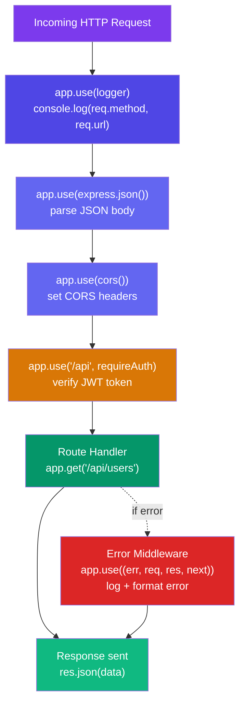

# Express.js Framework

## 🤔 Why Express?

The built-in `http` module works, but it's very **low-level**. **Express.js** is a minimal, flexible framework that handles all of this for you.

| Feature | Raw `http` | Express.js |
|---------|-----------|------------|
| Routing | Manual if/else | `app.get('/path', handler)` |
| JSON parsing | Manual `req.on('data')` | `express.json()` middleware |
| Serving static files | Custom logic | `express.static('public')` |
| Error handling | Manual try/catch everywhere | Global error middleware |
| Middleware | DIY | Built-in + 3rd party ecosystem |

---

## 🚀 Express Basics

```javascript
const express = require('express');
const app = express();

// ─── MIDDLEWARE ─────────────────────────────────────
app.use(express.json());
app.use(express.urlencoded({ extended: true }));

app.use((req, res, next) => {
  console.log(`${new Date().toISOString()} ${req.method} ${req.path}`);
  next();
});

// ─── ROUTES ──────────────────────────────────────────
app.get('/', (req, res) => {
  res.send('Hello World!');
});

app.get('/users/:id', (req, res) => {
  const { id } = req.params;
  const { page, limit } = req.query;
  res.json({ id, page, limit });
});

app.post('/users', (req, res) => {
  const { name, email } = req.body;
  res.status(201).json({ id: 1, name, email });
});

// ─── ERROR HANDLER ───────────────────────────────────
app.use((err, req, res, next) => {
  console.error(err.stack);
  res.status(err.statusCode || 500).json({
    error: err.message || 'Internal Server Error'
  });
});

app.listen(3000, () => console.log('🚀 Running on port 3000'));
```

---

## 🗂️ Professional Express Folder Structure

```
project/
├── src/
│   ├── controllers/          # Handle HTTP req/res
│   ├── routes/               # Define URL paths
│   ├── services/             # Business logic
│   ├── middleware/           # Custom middleware
│   ├── models/               # Database schemas/models
│   ├── utils/                # Utility functions
│   ├── config/               # Configuration
│   └── app.js                # Express app setup
├── tests/
│   ├── unit/
│   └── integration/
├── .env
├── package.json
└── server.js                 # Entry point
```

---

## 🔌 Middleware Deep Dive

Middleware functions are the backbone of Express. They run in sequence for every request.

### Request Lifecycle Through Middleware



```javascript
// 1. APPLICATION-LEVEL middleware (runs for all routes)
app.use(express.json());
app.use(cors());
app.use(helmet());

// 2. ROUTE-LEVEL middleware (runs for specific routes)
app.get('/admin', requireAdmin, (req, res) => { ... });
app.post('/users', validateBody, sanitize, createUser);

// 3. ERROR-HANDLING middleware (4 params)
app.use((err, req, res, next) => { ... });

// Custom auth middleware
const requireAuth = async (req, res, next) => {
  try {
    const token = req.headers.authorization?.split(' ')[1];
    if (!token) {
      return res.status(401).json({ error: 'No token provided' });
    }
    const decoded = jwt.verify(token, process.env.JWT_SECRET);
    req.user = decoded;
    next();
  } catch (err) {
    res.status(401).json({ error: 'Invalid token' });
  }
};

app.get('/profile', requireAuth, (req, res) => {
  res.json(req.user);
});
```

---

## 📁 Express Router

```javascript
// routes/user.routes.js
const router = express.Router();

router.get('/', getUsers);         // GET /users
router.post('/', createUser);      // POST /users
router.get('/:id', getUser);       // GET /users/123
router.put('/:id', updateUser);    // PUT /users/123
router.delete('/:id', deleteUser); // DELETE /users/123

module.exports = router;

// app.js
app.use('/users', userRoutes);
app.use('/products', productRoutes);
app.use('/auth', authRoutes);
```
