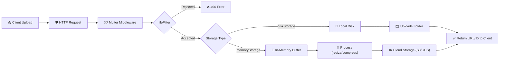
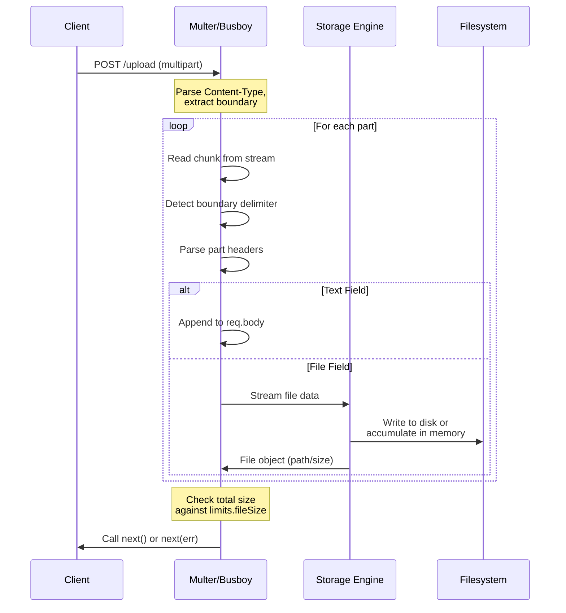
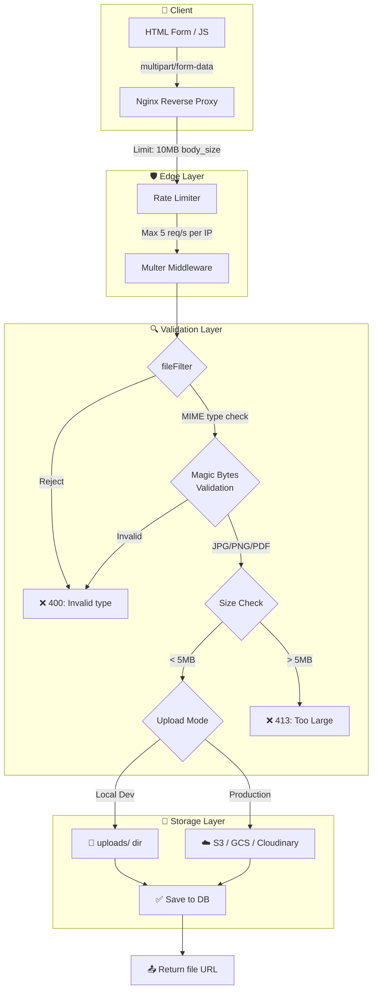
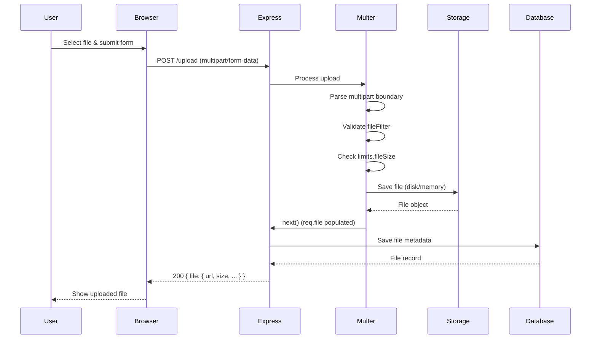

# File Uploads

## 📖 Introduction

File uploads are a fundamental feature of modern web applications — profile pictures, document attachments, image galleries, and CSV imports all require the client to send binary data to the server. Unlike JSON or form-urlencoded data, file uploads use **multipart/form-data** encoding, which requires specialized handling on the server side.

In Node.js, the de facto standard library for handling multipart uploads is **Multer**, a middleware that parses incoming file data, validates it, and makes it available as `req.file` or `req.files`. Understanding how to properly configure Multer, validate file types, manage storage, and secure the upload pipeline is essential for building production-grade APIs.

## 🤔 Why Do We Need This?

HTTP was designed primarily for text-based communication. Sending binary files over HTTP requires breaking the data into chunks and encoding it in a way that preserves the binary content across the wire. Without a proper multipart parser, you'd have to manually parse raw `multipart/form-data` request bodies — a complex, error-prone task involving boundary detection, header parsing, and chunk reassembly.

Multer handles all this complexity internally, providing a clean, express-compatible API that lets you focus on business logic: where to store files, what types to accept, and how to process them after upload.

## ⚠️ Problem Statement

A production file upload system must handle:

1. **Large files** — Some uploads can be hundreds of megabytes; the server must stream them rather than loading them entirely into memory
2. **Malicious files** — Attackers may upload executables, scripts, or files with double extensions to bypass validation
3. **Name collisions** — Two users uploading `profile.jpg` will overwrite each other without unique naming
4. **Size limits** — Unbounded uploads can exhaust disk space or memory
5. **Concurrent uploads** — Multiple users uploading simultaneously must not block one another
6. **Cloud storage** — Production systems rarely save files to local disk; they stream to S3, GCS, or Cloudinary

## 📚 Real World Story

**Dropbox** processes over 100,000 file uploads per second across its infrastructure. When a user uploads a file, the service must:

1. Stream the file to temporary storage
2. Scan it for malware (using ClamAV or custom heuristics)
3. Compute a SHA-256 hash for deduplication
4. Chunk the file into blocks for distributed storage
5. Replicate those blocks across multiple data centers

In their early days, Dropbox relied on a simple file upload endpoint. As scale grew, they had to implement chunked uploads with resumability, server-side deduplication, and progressive validation — all patterns that Node.js developers encounter (at smaller scale) when building file upload features.

## 🍕 Real World Analogy

Think of file uploads like mailing a package:

| Concept | Package Analogy |
|---------|----------------|
| **Multipart form** | The shipping box containing your items |
| **Form fields** | The packing slip (text metadata) |
| **File** | The actual item inside the box |
| **Multer** | The postal worker who opens the box and hands you the contents |
| **Storage config** | Where you put the item (shelf / warehouse / cloud) |
| **File filter** | Customs inspection — rejecting prohibited items |
| **Size limit** | Postal service's weight restriction |
| **Unique filename** | Your package tracking number |

Just as a postal worker doesn't throw your package at you still in the box, Multer parses the multipart wrapper and hands you the clean data.

## 👁️ Visual Explanation

When a browser submits a form with `enctype="multipart/form-data"`, the HTTP body looks like this:

```
POST /upload HTTP/1.1
Content-Type: multipart/form-data; boundary=----WebKitFormBoundary7MA4YWxkTrZu0gW

------WebKitFormBoundary7MA4YWxkTrZu0gW
Content-Disposition: form-data; name="userId"

123
------WebKitFormBoundary7MA4YWxkTrZu0gW
Content-Disposition: form-data; name="avatar"; filename="photo.jpg"
Content-Type: image/jpeg

[binary data here...]
------WebKitFormBoundary7MA4YWxkTrZu0gW--
```

Multer parses this raw body, extracting:
- **Text fields** (`userId`) → `req.body`
- **File fields** (`avatar`) → `req.file` (single) or `req.files` (multiple)

Each file object contains: `fieldname`, `originalname`, `encoding`, `mimetype`, `destination`, `filename`, `path`, `size`, and `buffer` (for memory storage).

## 📊 Mermaid Diagram 1: Upload Pipeline



## ⚙️ Internal Working: How Multer Parses Multipart Data

Multer uses the lower-level `busboy` library internally. Here's what happens when a request arrives:

1. **Content-Type inspection** — Multer checks that the request has `Content-Type: multipart/form-data`. If not, it passes the request through to the next middleware.

2. **Boundary extraction** — The boundary string (e.g., `----WebKitFormBoundary7MA4...`) is extracted from the Content-Type header. This boundary separates the different parts of the multipart body.

3. **Stream parsing** — The raw HTTP request is a readable stream. `busboy` reads this stream chunk by chunk, looking for boundary delimiters. When it finds one, it starts a new part.

4. **Header parsing** — Each part has its own headers: `Content-Disposition` (which includes the field name and filename) and `Content-Type`. Busboy parses these headers to determine if the part is a text field or a file.

5. **Field collection** — Text fields (no filename in Content-Disposition) are collected into an internal fields object, which Multer exposes as `req.body`.

6. **File streaming** — File parts (with a filename) are streamed to the configured storage engine:
   - **Disk storage**: Data is piped to a `fs.WriteStream` in the configured destination directory
   - **Memory storage**: Data is accumulated into a `Buffer` in memory

7. **Size limit enforcement** — Multer tracks the total bytes received. If it exceeds the configured `limits.fileSize`, it destroys the stream and emits a `LIMIT_FILE_SIZE` error.

## 🔄 Mermaid Diagram 2: Stream Processing Pipeline



## 🏗️ Architecture: Production Upload System



## 👣 Step-by-Step Flow: Processing a File Upload Request



## 📝 Syntax

### Basic Multer Setup

```javascript
const multer = require('multer');
const path = require('path');

const storage = multer.diskStorage({
  destination: (req, file, cb) => cb(null, 'uploads/'),
  filename: (req, file, cb) => {
    const uniqueSuffix = Date.now() + '-' + Math.round(Math.random() * 1E9);
    cb(null, uniqueSuffix + path.extname(file.originalname));
  },
});

const upload = multer({ storage });
```

### Upload Methods

| Method | Use Case | `req` Property |
|--------|----------|----------------|
| `upload.single('fieldName')` | One file | `req.file` |
| `upload.array('fieldName', maxCount)` | Multiple files, same field | `req.files[]` |
| `upload.fields([{name, maxCount}])` | Multiple fields | `req.files` object |
| `upload.none()` | Only text fields | `req.body` |
| `upload.any()` | Accept all files (⚠️ use carefully) | `req.files[]` |

## 🟢 Basic Example: Simple Avatar Upload

```javascript
const express = require('express');
const multer = require('multer');
const path = require('path');

const app = express();
const upload = multer({ dest: 'uploads/' });

app.post('/avatar', upload.single('avatar'), (req, res) => {
  console.log('Uploaded file:', req.file);
  console.log('Text fields:', req.body);

  res.json({
    success: true,
    filename: req.file.filename,
    size: req.file.size,
    mimetype: req.file.mimetype,
  });
});

app.listen(3000);
```

**What's happening:**
- `upload.single('avatar')` tells Multer to look for a form field named `avatar`
- The file is saved to `uploads/` with a random filename (no extension!)
- `req.file` contains all file metadata
- `req.body` still has any text fields from the form
- **⚠️ Note:** Using `dest` with a simple string like this does NOT preserve file extensions — you need `diskStorage` for that

## 🟡 Intermediate Example: Validated Upload with Custom Storage

```javascript
const multer = require('multer');
const path = require('path');
const crypto = require('crypto');

// Custom disk storage configuration
const storage = multer.diskStorage({
  destination: (req, file, cb) => {
    // Create date-based folders: uploads/2024/01/
    const date = new Date();
    const dir = `uploads/${date.getFullYear()}/${String(date.getMonth() + 1).padStart(2, '0')}`;
    
    // In production, use fs.mkdirSync(dir, { recursive: true })
    cb(null, dir);
  },
  filename: (req, file, cb) => {
    // Generate a cryptographically secure unique filename
    const hash = crypto.randomBytes(16).toString('hex');
    const ext = path.extname(file.originalname).toLowerCase();
    cb(null, `${hash}${ext}`);
  },
});

// File filter — accept only images
const fileFilter = (req, file, cb) => {
  const allowedMimes = ['image/jpeg', 'image/png', 'image/gif', 'image/webp'];
  if (allowedMimes.includes(file.mimetype)) {
    cb(null, true);
  } else {
    cb(new Error('Only JPEG, PNG, GIF, and WebP files are allowed'), false);
  }
};

const upload = multer({
  storage,
  limits: { fileSize: 5 * 1024 * 1024, files: 1 },
  fileFilter,
});

app.post('/avatar', (req, res) => {
  upload.single('avatar')(req, res, (err) => {
    if (err instanceof multer.MulterError) {
      if (err.code === 'LIMIT_FILE_SIZE') {
        return res.status(413).json({ error: 'File must be under 5MB' });
      }
      return res.status(400).json({ error: err.message });
    }
    if (err) {
      return res.status(400).json({ error: err.message });
    }
    res.json({ success: true, file: req.file });
  });
});
```

**What's happening:**
- **Date-based folders** keep the uploads directory organized and prevent too many files in one folder
- **`crypto.randomBytes`** generates unpredictable filenames, preventing enumeration attacks
- **Lowercased extension** normalizes `.JPG` or `.jPg` to `.jpg`
- **File filter** checks the MIME type before any data is written
- **Error wrapper** handles Multer errors (size limits) separately from custom errors (file type rejection)

## 🔴 Advanced Example: Image Processing Pipeline with Cloud Upload

```javascript
const express = require('express');
const multer = require('multer');
const sharp = require('sharp');
const { S3Client, PutObjectCommand } = require('@aws-sdk/client-s3');
const crypto = require('crypto');

const app = express();
const s3 = new S3Client({ region: process.env.AWS_REGION });

// Memory storage — we need the buffer to process before uploading
const upload = multer({
  storage: multer.memoryStorage(),
  limits: { fileSize: 20 * 1024 * 1024 }, // 20MB
  fileFilter: (req, file, cb) => {
    const allowed = ['image/jpeg', 'image/png', 'image/webp'];
    cb(null, allowed.includes(file.mimetype));
  },
});

app.post('/upload', upload.single('image'), async (req, res) => {
  try {
    // Validate magic bytes (not just MIME type)
    const { fileTypeFromBuffer } = await import('file-type');
    const type = await fileTypeFromBuffer(req.file.buffer);
    if (!type || !['image/jpeg', 'image/png', 'image/webp'].includes(type.mime)) {
      return res.status(400).json({ error: 'Invalid file content (magic bytes mismatch)' });
    }

    // Process: generate multiple sizes
    const id = crypto.randomUUID();
    const sizes = [
      { suffix: 'thumb', width: 150, height: 150 },
      { suffix: 'small', width: 400, height: 400 },
      { suffix: 'medium', width: 800, height: 800 },
    ];

    const urls = [];
    for (const size of sizes) {
      const processed = await sharp(req.file.buffer)
        .resize(size.width, size.height, { fit: 'cover', position: 'centre' })
        .jpeg({ quality: 80, progressive: true })
        .toBuffer();

      const key = `images/${id}/${size.suffix}.jpg`;
      await s3.send(new PutObjectCommand({
        Bucket: process.env.S3_BUCKET,
        Key: key,
        Body: processed,
        ContentType: 'image/jpeg',
        CacheControl: 'public, max-age=31536000, immutable',
      }));

      urls.push({ size: size.suffix, url: `https://cdn.example.com/${key}` });
    }

    res.json({ success: true, id, urls });
  } catch (err) {
    console.error('Upload pipeline error:', err);
    res.status(500).json({ error: 'Upload processing failed' });
  }
});
```

**What's happening:**
- **Memory storage** keeps the file in a Buffer so we can process it with Sharp
- **Magic byte validation** checks the actual file content, not just the MIME header — prevents renamed `.exe` files from passing as images
- **Multiple sizes** generates thumbnail, small, and medium versions in one request
- **Sharp pipeline** resizes, compresses, and converts to progressive JPEG
- **CDN-friendly** filenames include a UUID and `Cache-Control: immutable` for optimal caching
- **Parallel uploads** to S3 — each size is uploaded concurrently

## 🏭 Production Example: Enterprise Document Upload Service

```javascript
const express = require('express');
const multer = require('multer');
const { S3Client } = require('@aws-sdk/client-s3');
const { Upload } = require('@aws-sdk/lib-storage');
const crypto = require('crypto');
const { RateLimiterMemory } = require('rate-limiter-flexible');
const sanitize = require('sanitize-filename');

const app = express();
const s3 = new S3Client({ region: process.env.AWS_REGION });

// Rate limit: 10 uploads per minute per user
const rateLimiter = new RateLimiterMemory({
  points: 10,
  duration: 60,
  keyPrefix: 'upload',
});

// Memory storage with strict limits
const upload = multer({
  storage: multer.memoryStorage(),
  limits: {
    fileSize: 100 * 1024 * 1024, // 100MB
    files: 5,                     // Max 5 files per request
    fields: 10,                   // Max 10 text fields
    parts: 20,                    // Max 20 parts (fields + files)
  },
  fileFilter: (req, file, cb) => {
    const allowedMimes = [
      'application/pdf', 'application/msword',
      'application/vnd.openxmlformats-officedocument.wordprocessingml.document',
      'image/jpeg', 'image/png',
    ];
    if (!allowedMimes.includes(file.mimetype)) {
      return cb(new Error(`File type ${file.mimetype} not allowed`), false);
    }
    cb(null, true);
  },
});

// Document metadata schema validation
function validateMetadata(body) {
  const errors = [];
  if (!body.documentType || !['report', 'invoice', 'contract'].includes(body.documentType)) {
    errors.push('documentType must be: report, invoice, or contract');
  }
  if (body.tags && !Array.isArray(body.tags)) {
    errors.push('tags must be an array');
  }
  return errors;
}

app.post('/documents', (req, res) => {
  // Rate limiting
  const userId = req.user?.id || req.ip;
  rateLimiter.consume(userId).then(() => {
    upload.array('documents', 5)(req, res, async (err) => {
      if (err) {
        if (err instanceof multer.MulterError) {
          const messages = {
            LIMIT_FILE_SIZE: 'Each file must be under 100MB',
            LIMIT_FILE_COUNT: 'Maximum 5 files per upload',
            LIMIT_FIELD_COUNT: 'Maximum 10 text fields',
            LIMIT_PART_COUNT: 'Too many parts in request',
          };
          return res.status(413).json({ error: messages[err.code] || err.message });
        }
        return res.status(400).json({ error: err.message });
      }

      // Validate metadata
      const metaErrors = validateMetadata(req.body);
      if (metaErrors.length > 0) {
        return res.status(422).json({ errors: metaErrors });
      }

      try {
        // Upload each document to S3 with metadata
        const results = await Promise.all(req.files.map(async (file) => {
          const key = `documents/${userId}/${crypto.randomUUID()}-${sanitize(file.originalname)}`;

          const parallelUpload = new Upload({
            client: s3,
            params: {
              Bucket: process.env.DOCS_BUCKET,
              Key: key,
              Body: file.buffer,
              ContentType: file.mimetype,
              Metadata: {
                uploadedBy: userId,
                documentType: req.body.documentType,
                originalName: Buffer.from(file.originalname, 'latin1').toString('utf8'),
              },
            },
            queueSize: 4,        // 4 concurrent parts
            partSize: 5 * 1024 * 1024, // 5MB parts
            leavePartsOnError: false,
          });

          const result = await parallelUpload.done();
          return {
            id: key,
            url: `https://docs.example.com/${key}`,
            size: file.size,
            type: file.mimetype,
          };
        }));

        res.status(201).json({ documents: results });
      } catch (uploadErr) {
        console.error('S3 upload failed:', uploadErr);
        res.status(500).json({ error: 'Storage service unavailable' });
      }
    });
  }).catch(() => {
    res.status(429).json({ error: 'Too many uploads. Try again later.' });
  });
});
```

**What's happening:**
- **Rate limiting** prevents abuse — 10 uploads per minute per user
- **S3 Multipart Upload** (`@aws-sdk/lib-storage`) handles large files efficiently with parallel chunks
- **Metadata validation** enforces business rules before accepting the upload
- **Sanitized filenames** prevent path traversal and special character attacks
- **`Buffer.from` encoding fix** preserves non-ASCII characters in original filenames across S3
- **Transaction-like error handling** — `leavePartsOnError: false` cleans up partial uploads

## ⚙️ How It Works Internally

When Multer receives a multipart request, the internal flow is:

```
Incoming Stream → Busboy Parser → Part Detection → Storage Engine → req.file / req.files
```

**Busboy** is the underlying stream parser. It:

1. **Reads chunks** from the incoming HTTP request (a `Readable` stream)
2. **Detects boundaries** by matching the `--boundary` string pattern
3. **Emits `'file'` and `'field'` events** for each part it finds
4. **Pipes file data** directly to the storage engine's `_handleFile` method (no buffering in memory unless using memory storage)

**Storage engines** implement two methods:
- `_handleFile(req, file, cb)` — Called for each file part. The `file` parameter is a `Readable` stream of the file data.
- `_removeFile(req, file, cb)` — Called when an error occurs mid-upload, to clean up partial files.

This architecture means files are **streamed directly to disk** without being fully loaded into memory — critical for large uploads.

## 📦 Performance Notes

| Aspect | Recommendation | Why |
|--------|---------------|-----|
| **Storage** | Use memory storage + cloud upload | Avoids disk I/O bottleneck and enables horizontal scaling |
| **File size** | Enforce at Nginx AND Multer | Defense in depth — don't let large bodies hit Node at all |
| **Concurrency** | Use S3 multipart upload | Parallel upload of chunks speeds transfers by 3-5× |
| **Processing** | Offload to worker queue | Image processing is CPU-bound; use Bull/BullMQ for async processing |
| **CDN** | Serve files from CDN, not origin | Reduces server load by 80-90% for static file delivery |
| **Temp files** | Clean up failed uploads | Set up a cron/scheduled job to delete orphaned files older than 24h |

**Benchmark:** A 50MB file upload:
- **Local disk** → ~200ms write time (limited by disk speed)
- **S3 direct** (streaming) → ~1-3s (limited by network, 50-100 Mbps)
- **Memory + S3** → buffer must fit in RAM first → risk of OOM with concurrent large uploads

## 🔒 Security Notes

### 1. Validate Magic Bytes, Not Just MIME Types

```javascript
// ❌ MIME type from header is user-controlled
if (file.mimetype === 'image/jpeg') { /* trust? */ }

// ✅ Check actual file content
const type = await fileTypeFromBuffer(buffer);
if (type?.mime !== 'image/jpeg') { /* reject */ }
```

### 2. Prevent Path Traversal

```javascript
// ❌ Never use originalname as-is
fs.writeFileSync('uploads/' + file.originalname, data);  // ~/../../etc/passwd

// ✅ Sanitize
const sanitize = require('sanitize-filename');
fs.writeFileSync('uploads/' + sanitize(file.originalname), data);
```

### 3. Additional Security Measures

- **Virus scanning** — Integrate ClamAV (or a cloud API like VirusTotal) for production systems
- **Extension-Content-Type mismatch** — Reject files where the extension doesn't match the detected type
- **Rate limiting** — Prevent upload floods (both in size and frequency)
- **Authentication** — Verify the user is authorized to upload before processing any data
- **Temporary URLs** — Generate signed, expiring URLs for accessing uploaded files (S3 presigned URLs)

## ⚠️ Common Mistakes

1. **❌ Forgetting `enctype="multipart/form-data"` on the form** — Without this, the browser sends `application/x-www-form-urlencoded` and `req.file` will be `undefined`

2. **❌ Not wrapping Multer in error handling** — Multer errors crash the server if uncaught. Always wrap in a try/catch or use the callback pattern

3. **❌ Trusting `file.originalname` as-is** — Attackers can include path traversal characters, special characters, or extremely long names

4. **❌ Using `upload.any()` in production** — This accepts every field as a file, opening you up to unexpected uploads. Always specify field names

5. **❌ Not cleaning up failed uploads** — If a request errors after the file is partially written, the temp file remains on disk. Use `fs.unlink` in error handlers

6. **❌ Loading entire files into memory** — For large files, use `diskStorage` or stream directly to S3. `memoryStorage` for a 500MB file will consume 500MB of RAM

## 🚀 Best Practices

### File Upload Checklist

```javascript
// ✅ Complete production upload configuration
const upload = multer({
  storage: multer.memoryStorage(),           // Stream to cloud, not disk
  limits: {
    fileSize: 10 * 1024 * 1024,              // 10MB max
    files: 3,                                 // Max 3 files
  },
  fileFilter: (req, file, cb) => {
    // Whitelist approach — only allow known types
    const allowedTypes = [
      'image/jpeg', 'image/png', 'image/webp',
      'application/pdf',
    ];
    cb(null, allowedTypes.includes(file.mimetype));
  },
});
```

### Architecture Decisions

- **Development:** Use `diskStorage` for simplicity, inspect files on disk
- **Production:** Use `memoryStorage` + cloud upload (S3/GCS/Cloudinary). Never store files on application servers
- **Large files (>100MB):** Implement **chunked uploads** (tus protocol or custom resumable upload)
- **Processing:** Use a queue (Bull/BullMQ) for image/video processing — don't block the request
- **Graceful degradation:** If S3 is down, save to a temp queue and retry later

## 🎯 Interview Questions

**Q1: How do you handle large file uploads without running out of memory?**

Use streams and the `diskStorage` engine. Multer's `diskStorage` pipes the incoming data directly to a file write stream without buffering everything in RAM. For S3 uploads, use `@aws-sdk/lib-storage`'s `Upload` class, which performs multipart uploads in parallel chunks while only holding one chunk in memory at a time.

**Q2: What's the difference between `diskStorage` and `memoryStorage`?**

`diskStorage` saves files to the local filesystem with a configurable destination and filename. The file is available as `req.file.path`. `memoryStorage` keeps the file in a `Buffer` in `req.file.buffer`. Disk storage is better for large files (no RAM pressure); memory storage is better when you need to process the file (resize, compress) before saving.

**Q3: How would you validate that an uploaded file is actually an image (not a renamed .exe)?**

The `mimetype` from the HTTP request is user-controlled and can be spoofed. Instead, read the file's **magic bytes** — the first few bytes that identify the file format. Use a library like `file-type` to read the buffer's signature (e.g., JPEG starts with `FF D8 FF`, PNG with `89 50 4E 47`).

**Q4: How do you implement resumable uploads for large files?**

Resumable uploads (like tus protocol) require:
1. **Chunking** — Client splits the file into small chunks (e.g., 5MB)
2. **Upload ID** — Server returns an ID for the first chunk
3. **Offset tracking** — Client sends the offset with each chunk; server appends to the file
4. **Resume** — Client queries the server for the current offset and resumes from there
5. **Assembly** — Server reassembles chunks after the final one

This is complex to implement from scratch. Use tus-js-client + tus-node-server or `@aws-sdk/lib-storage` for S3 multipart uploads.

## 📝 MCQs

**1. Which Multer method do you use to handle a single file upload from a field named `avatar`?**
- A) `upload.array('avatar')`
- B) `upload.single('avatar')` ✅
- C) `upload.fields([{name: 'avatar'}])`
- D) `upload.any()`

**2. What happens if a file exceeds the `limits.fileSize` configuration?**
- A) The file is truncated to the limit
- B) Multer throws a `LIMIT_FILE_SIZE` error ✅
- C) The request times out
- D) The file is saved but logs a warning

**3. Why should you NOT trust `file.mimetype` for security validation?**
- A) It's always `application/octet-stream`
- B) The MIME type is sent by the client and can be spoofed ✅
- C) Multer doesn't provide mimetype
- D) It's only available with diskStorage

**4. Which storage engine is best for large file uploads in production?**
- A) `diskStorage` — saves to local disk
- B) `memoryStorage` — keeps in RAM
- C) Stream directly to cloud storage (S3/GCS) ✅
- D) No storage engine; reject large files

**5. What additional validation should you perform beyond MIME type checking?**
- A) Check file extension only
- B) Validate magic bytes (file signature) ✅
- C) Check file creation date
- D) Verify the filename length

**Answer Key:** 1-B, 2-B, 3-B, 4-C, 5-B

## 💻 Coding Challenge 1: Profile Picture Upload

Build an Express endpoint that:
- Accepts a single image upload (field name: `profilePic`)
- Validates it's JPEG or PNG only
- Limits to 2MB
- Saves with a UUID-based filename
- Returns the filename and size

```javascript
// Expected endpoint: POST /profile/picture
// Success: { filename: "abc123.jpg", size: 54321 }
// Error (wrong type): 400 { error: "Only JPEG and PNG allowed" }
// Error (too large): 413 { error: "File must be under 2MB" }
```

## 💻 Coding Challenge 2: Gallery Upload with Variants

Build a gallery upload system that:
- Accepts up to 5 images (field name: `gallery`)
- Validates image types
- Generates 3 variants for each image: `thumbnail` (150×150), `medium` (600×600), `full` (original)
- Returns an array of objects, each with original filename and URLs for all 3 variants

## 💻 Coding Challenge 3: CSV File Processor

Build an endpoint that:
- Accepts CSV file uploads (field name: `data`)
- Validates the file is actually CSV (check magic bytes or extension + header)
- Parses the CSV using a streaming approach (don't load the whole file into memory)
- Validates required columns exist
- Returns row count and column names

**Hints:** Use `csv-parse` with the stream API. Pipe the Multer file stream through the CSV parser.

## 🧪 Mini Exercise: Debugging Upload Issues

This server has bugs. Find and fix them:

```javascript
const express = require('express');
const multer = require('multer');
const app = express();

// Bug 1: Missing enctype check — Multer won't parse without it
app.post('/upload', (req, res) => {
  upload.single('file');
  // Bug 2: upload.single() returns middleware — it's not called!
  // Bug 3: No error handling for Multer errors
  res.json({ file: req.file });  // Bug 4: req.file will be undefined
});

// Bug 5: Missing multer configuration entirely
// const upload = multer({ dest: 'uploads/' });

app.listen(3000);
```

**Fixes:**
1. Add `const upload = multer({ dest: 'uploads/' })` before the route
2. Use `upload.single('file')` as middleware: `app.post('/upload', upload.single('file'), ...)`
3. Wrap in error handling to catch `LIMIT_FILE_SIZE`
4. Actually call the middleware so `req.file` is populated

## 🌍 Real World Problem (Interview Coding Challenge)

**Problem:** You're building a document management system for a legal firm. Lawyers upload case files (PDFs, Word docs, images) ranging from 100KB to 500MB. The system must handle hundreds of concurrent uploads without crashing and ensure documents are never lost during upload.

**Requirements:**
1. Files over 50MB must be uploaded in chunks (resumable)
2. Each file must be scanned for malware before being accessible
3. Uploads must be encrypted at rest (AES-256)
4. Lawyers must be able to search files by original name, upload date, and case number
5. The system should support 500+ concurrent uploads

**Questions:**
1. How would you architect the upload pipeline to handle 500MB files without running out of memory?
2. What's your strategy for resumable uploads on unreliable connections?
3. How do you ensure file integrity (no corruption during upload)?
4. What storage backend would you choose for scalability?

**Interview Tip:** Draw the architecture on the whiteboard. Start with a simple Nginx → Node.js → S3 pipeline, then add complexity. Mentioning the **tus protocol** for resumable uploads and **multipart upload** for S3 shows deep knowledge.

## 🏗️ Mini Project: File Sharing Service

Build a minimal file-sharing API (similar to a simplified WeTransfer):

**Core features:**
- `POST /upload` — Upload one or more files, receive a share link
- `GET /share/:id` — List files in a share
- `GET /download/:fileId` — Download a specific file
- `DELETE /share/:id` — Expire a share

**Technical requirements:**
- Store files locally (for development) or stream to S3
- Generate unique share IDs (10-character nanoid)
- Auto-expire shares after 24 hours (use a scheduled cleanup)
- Rate limit to 10 uploads per IP per hour
- Maximum 100MB total per share

**Bonus features:**
- Add password protection for shares
- Email notification when files are downloaded
- Progress tracking via WebSocket for large uploads

## 📖 Summary

| Concept | Key Takeaway |
|---------|-------------|
| **Multipart parsing** | Multer parses `multipart/form-data` into `req.file` / `req.files` |
| **Storage engines** | `diskStorage` for local dev; `memoryStorage` for cloud processing |
| **Validation** | Check MIME type at middleware level + magic bytes at content level |
| **Security** | Never trust filenames, scan for malware, enforce size limits at multiple layers |
| **Production** | Stream to cloud storage, never save to app server disk |
| **Large files** | Use multipart uploads (S3) or chunked uploads (tus protocol) |
| **Error handling** | Wrap Multer in a try/catch or callback pattern for graceful error responses |

## 📋 Cheat Sheet

```javascript
// Quick reference: Multer configuration

// 1. Basic setup
const upload = multer({ dest: 'uploads/' });

// 2. Custom disk storage
const storage = multer.diskStorage({
  destination: (req, file, cb) => cb(null, 'uploads/'),
  filename: (req, file, cb) => cb(null, Date.now() + '-' + file.originalname),
});

// 3. Memory storage (for cloud upload)
const upload = multer({ storage: multer.memoryStorage() });

// 4. With all options
const upload = multer({
  storage,
  limits: { fileSize: 5 * 1024 * 1024, files: 1 },
  fileFilter: (req, file, cb) => {
    cb(null, ['image/jpeg'].includes(file.mimetype));
  },
});

// 5. Single file
app.post('/upload', upload.single('field'), handler);

// 6. Multiple files, same field
app.post('/upload', upload.array('field', 5), handler);

// 7. Multiple fields
app.post('/upload', upload.fields([
  { name: 'avatar', maxCount: 1 },
  { name: 'gallery', maxCount: 5 },
]), handler);

// 8. Error handling pattern
app.post('/upload', (req, res) => {
  upload.single('file')(req, res, (err) => {
    if (err instanceof multer.MulterError) {
      return res.status(413).json({ error: err.code });
    }
    if (err) return res.status(400).json({ error: err.message });
    res.json({ file: req.file });
  });
});
```

## 📚 Further Reading

- [Multer Documentation](https://github.com/expressjs/multer)
- [Busboy (underlying parser)](https://github.com/mscdex/busboy)
- [tus protocol — Resumable Uploads](https://tus.io/)
- [Sharp Image Processing](https://sharp.pixelplumbing.com/)
- [S3 Multipart Upload](https://docs.aws.amazon.com/AmazonS3/latest/userguide/mpuoverview.html)
- [OWASP File Upload Cheat Sheet](https://cheatsheetseries.owasp.org/cheatsheets/File_Upload_Cheat_Sheet.html)

## 🔗 Related Topics

- [Streams & Buffers](../core/streams-and-buffers) — Streaming data through pipelines
- [Authentication & Security](./authentication-security) — Securing upload endpoints
- [Building REST APIs](./building-apis) — HTTP fundamentals for file transfer
- [Express Framework](./express-framework) — Middleware patterns in Express
- [Validation](./validation) — Request validation strategies
- [Error Handling](../core/error-handling) — Graceful error handling patterns
