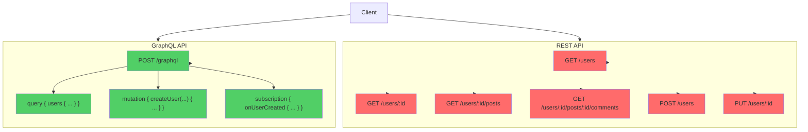
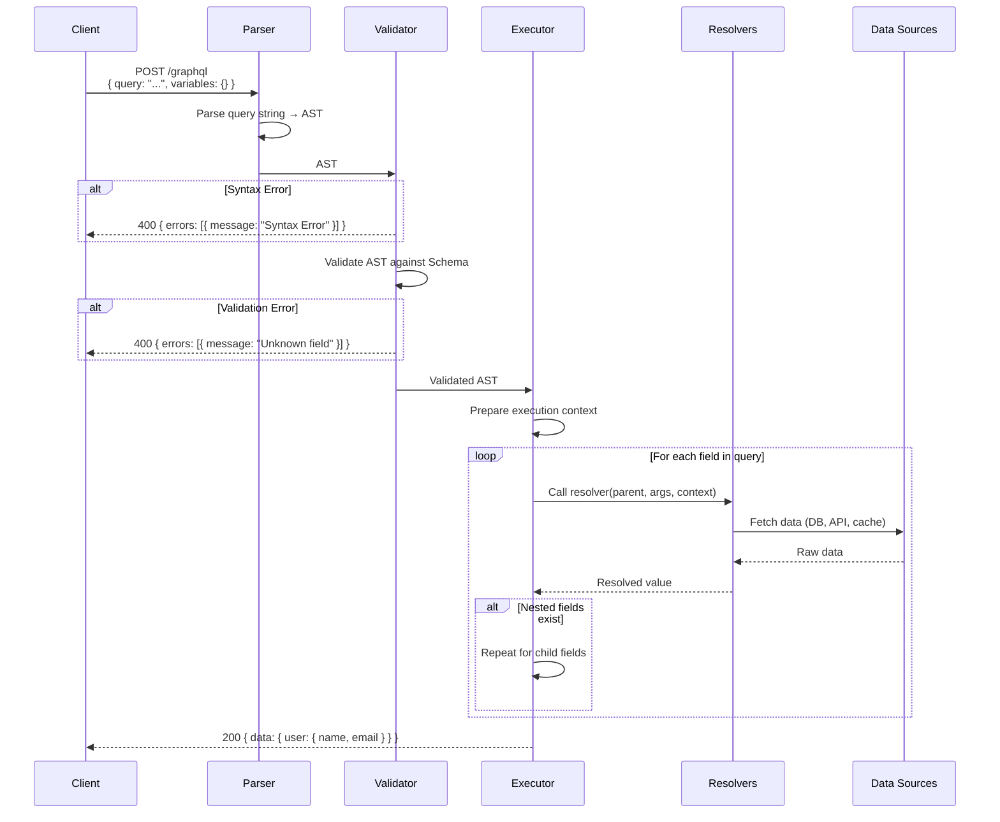
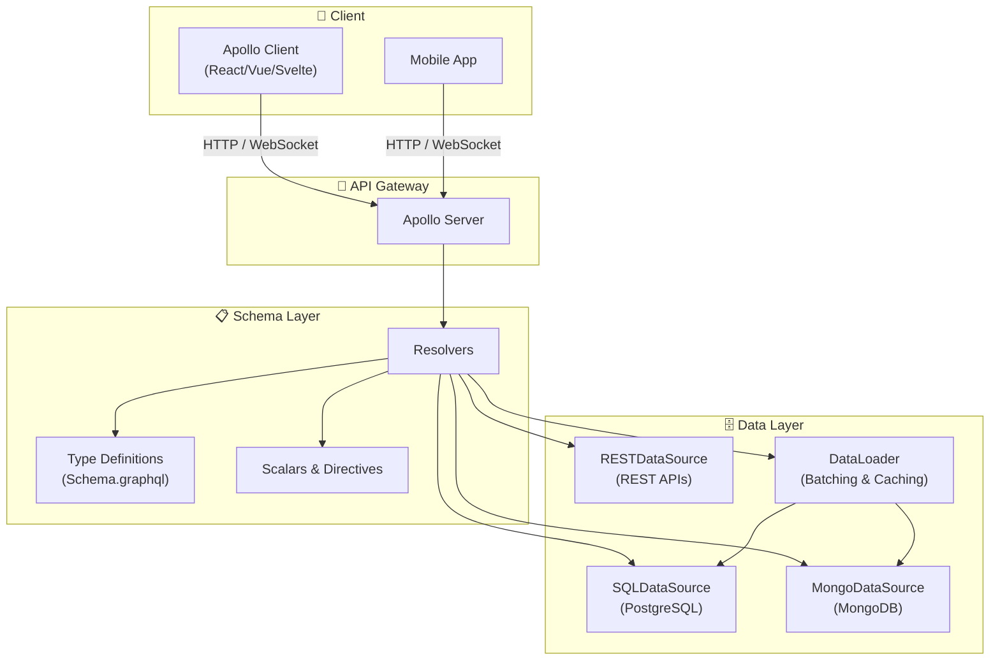
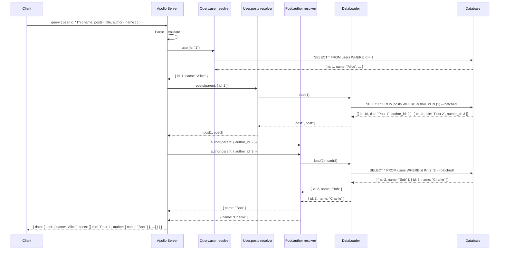

# GraphQL

## 📖 Introduction

**GraphQL** is a query language for APIs developed by Facebook in 2012 and open-sourced in 2015. Unlike REST, where the server defines fixed response shapes across multiple endpoints, GraphQL provides a **single endpoint** where clients can specify exactly what data they need — nothing more, nothing less.

In a REST API, fetching a user and their posts might require two requests (`GET /users/1`, `GET /users/1/posts`) or one request that returns far more data than needed. With GraphQL, a single query fetches exactly the fields requested:

```graphql
query {
  user(id: "1") {
    name
    email
    posts { title }
  }
}
```

This flexibility makes GraphQL particularly powerful for applications with multiple client types (web, mobile, IoT) where each client has different data requirements.

## 🤔 Why Do We Need This?

REST APIs have several inherent limitations:

1. **Over-fetching** — A mobile app and a web app calling `GET /users/1` both get the same response, even if the mobile app only needs `name` and `avatar`
2. **Under-fetching** — Fetching a user's friends' recent posts requires multiple round-trips (`GET /users/1/friends`, then `GET /users/:id/posts` for each friend)
3. **Versioning** — Changing a REST response shape requires new endpoints (`/v2/users`)
4. **Frontend dependency on backend** — UI changes often require backend changes to add or remove fields

GraphQL solves these by:
- **Declarative data fetching** — Client says exactly what it needs
- **Single round-trip** — Complex nested data in one request
- **No versioning** — Fields can be added without breaking existing queries
- **Self-documenting** — Schema introspection generates interactive docs (GraphiQL/Playground)

## ⚠️ Problem Statement

Implementing a production GraphQL API requires solving:

1. **Schema design** — Defining types, relationships, queries, and mutations that are flexible yet predictable
2. **Resolver efficiency** — The N+1 problem: resolving nested relationships one-at-a-time destroys performance
3. **Authentication & authorization** — Controlling access at the field level, not just the endpoint level
4. **Error handling** — Returning partial data with field-level errors instead of failing the entire request
5. **Caching** — REST's HTTP caching doesn't apply to a single POST endpoint; need custom caching strategies
6. **File uploads** — GraphQL doesn't natively support multipart uploads
7. **Complexity management** — Deeply nested queries can overload your database

## 📚 Real World Story

**GitHub** migrated their public API from REST to GraphQL in 2016. Their REST API had proliferated to hundreds of endpoints, each returning fixed responses. Mobile clients were downloading 5-10× more data than needed, and adding new features often required shipping new endpoints.

The GraphQL migration allowed GitHub to:
- Reduce payload sizes by 50-80% for common mobile queries
- Eliminate dozens of `?include=comments,reactions,labels` query parameters
- Let integrators (apps like GitKraken, VS Code) request exactly the fields they need
- Deprecate fields gracefully (mark as `@deprecated` in the schema) instead of breaking clients

Today, GitHub's GraphQL API handles billions of queries per day and serves as a reference implementation for production GraphQL APIs.

## 🍕 Real World Analogy

| GraphQL Concept | Restaurant Analogy |
|----------------|-------------------|
| **REST API** | Fixed menu — you get a complete meal whether you want it all or not |
| **GraphQL** | À la carte menu — you order exactly what you want |
| **Schema** | The menu describing all available dishes (types) and ingredients (fields) |
| **Query** | Your order slip — "I want the user's name, email, and only the titles of their posts" |
| **Resolver** | The chef who prepares each item you ordered |
| **Mutation** | Ordering a custom dish (creating/updating data) |
| **N+1 problem** | Each ingredient requires a separate trip to the market |

## 👁️ Visual Explanation

```
REST Approach:
GET /users/1          → { id, name, email, age, address, phone, avatar, createdAt, updatedAt, ... }
GET /users/1/posts    → [{ id, title, content, published, userId, createdAt, updatedAt, tags, ... }]
                        ↓
                        Two requests, lots of unwanted data

GraphQL Approach:
query {
  user(id: "1") {       → { user: {
    name                           name: "Alice",
    email                          email: "alice@example.com",
    posts {                        posts: [
      title                            { title: "Hello" },
    ]                                  { title: "World" }
  }                                ] } }
}
  ↓
  One request, only the fields you asked for
```

## 📊 Mermaid Diagram 1: GraphQL vs REST Comparison



## ⚙️ Internal Working: GraphQL Request Lifecycle

When a GraphQL request arrives at the server:

1. **Parse** — The query string is parsed into an AST (Abstract Syntax Tree). Syntax errors are caught here.
2. **Validate** — The AST is validated against the schema. Unknown fields, incorrect argument types, and missing required arguments are caught here.
3. **Execute** — The validated AST is executed:
   - For each field in the query, the corresponding resolver is called
   - Resolvers can be synchronous or asynchronous
   - Child fields are resolved using the parent resolver's result
4. **Respond** — The resolved data is assembled into the response shape matching the query structure

```
Query String            AST                     Resolved Data
"user(id: 1) {          Document                { user: {
  name                    Field: "user"           name: "Alice",
  email                   Field: "name"           email: "alice@test.com"
}"                        Field: "email"       } }
```

## 🔄 Mermaid Diagram 2: GraphQL Request Lifecycle



## 🏗️ Architecture: Apollo Server with Data Sources



## 👣 Step-by-Step Flow: Resolving a Nested Query



## 📝 Syntax

### Schema Definition Language (SDL)

```graphql
# Types define the shape of data
type User {
  id: ID!
  name: String!
  email: String!
  age: Int
  posts: [Post!]!
  createdAt: String!
}

type Post {
  id: ID!
  title: String!
  content: String
  author: User!
  published: Boolean!
  tags: [String!]
}

# Entry points for reading data
type Query {
  users: [User!]!
  user(id: ID!): User
  posts: [Post!]!
  post(id: ID!): Post
}

# Entry points for writing data
type Mutation {
  createUser(name: String!, email: String!, age: Int): User!
  updateUser(id: ID!, name: String, email: String): User!
  deleteUser(id: ID!): Boolean!
}

# Entry points for real-time subscriptions
type Subscription {
  userCreated: User!
  postPublished(postId: ID!): Post
}
```

### Resolver Signature

```javascript
// Resolver function signature
fieldName: (parent, args, context, info) => {
  // parent:    The result of the parent resolver (useful for nested fields)
  // args:      Arguments passed to this field (e.g., { id: "1" })
  // context:   Shared context object (auth, data loaders, DB connections)
  // info:      Query information (field name, path, AST)
  return value;
};
```

## 🟢 Basic Example: Simple Apollo Server

```javascript
const { ApolloServer } = require('@apollo/server');
const { expressMiddleware } = require('@apollo/server/express4');
const express = require('express');
const { readFileSync } = require('fs');

const app = express();
app.use(express.json());

// Type definitions
const typeDefs = `#graphql
  type Book {
    id: ID!
    title: String!
    author: String!
    year: Int
  }

  type Query {
    books: [Book!]!
    book(id: ID!): Book
  }

  type Mutation {
    addBook(title: String!, author: String!, year: Int): Book!
  }
`;

// In-memory data store
let books = [
  { id: '1', title: 'The Hobbit', author: 'J.R.R. Tolkien', year: 1937 },
  { id: '2', title: '1984', author: 'George Orwell', year: 1949 },
];

// Resolvers
const resolvers = {
  Query: {
    books: () => books,
    book: (_, { id }) => books.find(b => b.id === id),
  },
  Mutation: {
    addBook: (_, { title, author, year }) => {
      const book = { id: String(books.length + 1), title, author, year };
      books.push(book);
      return book;
    },
  },
};

// Start server
async function start() {
  const server = new ApolloServer({ typeDefs, resolvers });
  await server.start();
  app.use('/graphql', expressMiddleware(server));
  app.listen(4000, () => console.log('GraphQL at http://localhost:4000/graphql'));
}

start();
```

**What's happening:**
- **TypeDefs** define the schema — `Book` type with fields, `Query` for reads, `Mutation` for writes
- **Resolvers** map schema fields to data-fetching functions
- `(_, { id })` — The first param `_` is the parent (unused for top-level queries), the second is `args`
- The server is started asynchronously with `await server.start()` before attaching to Express

## 🟡 Intermediate Example: Database Integration with Relationships

```javascript
const { ApolloServer } = require('@apollo/server');
const { expressMiddleware } = require('@apollo/server/express4');
const express = require('express');

const app = express();

const typeDefs = `#graphql
  type User {
    id: ID!
    name: String!
    email: String!
    posts: [Post!]!
  }

  type Post {
    id: ID!
    title: String!
    content: String
    author: User!
    published: Boolean!
    createdAt: String!
  }

  type Query {
    users: [User!]!
    user(id: ID!): User
    posts: [Post!]!
    post(id: ID!): Post
  }

  type Mutation {
    createUser(name: String!, email: String!): User!
    createPost(title: String!, content: String, authorId: ID!): Post!
  }
`;

// Simulated database functions
const db = {
  async findUsers() { /* SELECT * FROM users */ },
  async findUserById(id) { /* SELECT * FROM users WHERE id = $1 */ },
  async findPostsByUserId(userId) { /* SELECT * FROM posts WHERE author_id = $1 */ },
  async findPostById(id) { /* SELECT * FROM posts WHERE id = $1 */ },
  async findAuthorByPostId(postId) { /* SELECT * FROM users JOIN posts ON ... */ },
  async createUser(data) { /* INSERT INTO users ... RETURNING * */ },
  async createPost(data) { /* INSERT INTO posts ... RETURNING * */ },
};

const resolvers = {
  Query: {
    users: () => db.findUsers(),
    user: (_, { id }) => db.findUserById(id),
    posts: () => db.findPosts(),
    post: (_, { id }) => db.findPostById(id),
  },
  Mutation: {
    createUser: (_, { name, email }) => db.createUser({ name, email }),
    createPost: (_, { title, content, authorId }) =>
      db.createPost({ title, content, author_id: authorId }),
  },
  User: {
    // Resolve the 'posts' field for each User
    posts: (parent) => db.findPostsByUserId(parent.id),
  },
  Post: {
    // Resolve the 'author' field for each Post
    author: (parent) => db.findUserById(parent.author_id),
  },
};
```

**What's happening:**
- **Relationship resolvers** (`User.posts`, `Post.author`) resolve nested fields when requested
- The `parent` parameter contains the result from the parent resolver (e.g., a `User` object)
- **⚠️ N+1 problem** — `User.posts` and `Post.author` run a separate DB query for each parent item. This is where DataLoader comes in.

## 🔴 Advanced Example: Apollo Server with DataLoader and Authentication

```javascript
const { ApolloServer } = require('@apollo/server');
const { expressMiddleware } = require('@apollo/server/express4');
const { ApolloError } = require('apollo-server-errors');
const DataLoader = require('dataloader');
const express = require('express');

const app = express();

// DataLoader batches and caches database queries
function createLoaders() {
  return {
    userLoader: new DataLoader(async (ids) => {
      const users = await db.findUsersByIds(ids);
      return ids.map(id => users.find(u => u.id === id) || null);
    }),
    postLoader: new DataLoader(async (ids) => {
      const posts = await db.findPostsByIds(ids);
      return ids.map(id => posts.find(p => p.id === id) || null);
    }),
    postsByUserLoader: new DataLoader(async (userIds) => {
      const posts = await db.findPostsByUserIds(userIds);
      return userIds.map(id => posts.filter(p => p.author_id === id));
    }),
  };
}

// Resolvers with DataLoader
const resolvers = {
  Query: {
    user: async (_, { id }, { loaders }) => {
      const user = await loaders.userLoader.load(id);
      if (!user) throw new ApolloError('User not found', 'USER_NOT_FOUND');
      return user;
    },
    users: async (_, __, { db }) => db.findUsers(),
  },
  User: {
    posts: (parent, _, { loaders }) => {
      // Batches all post loads for all users in the query
      return loaders.postsByUserLoader.load(parent.id);
    },
  },
  Post: {
    author: (parent, _, { loaders }) => {
      return loaders.userLoader.load(parent.author_id);
    },
  },
};

const server = new ApolloServer({
  typeDefs,
  resolvers,
  // Custom formatting for errors
  formatError: (formattedError) => {
    return {
      message: formattedError.message,
      code: formattedError.extensions?.code || 'INTERNAL_ERROR',
    };
  },
});

async function start() {
  await server.start();
  app.use('/graphql', expressMiddleware(server, {
    context: async ({ req }) => {
      // Authentication
      const token = req.headers.authorization?.split(' ')[1];
      let user = null;
      if (token) {
        try {
          user = jwt.verify(token, process.env.JWT_SECRET);
        } catch {
          // Token invalid — user stays null
        }
      }

      // Create fresh DataLoader instances per request
      return {
        user,
        db,
        loaders: createLoaders(),
      };
    },
  }));
  app.listen(4000);
}
```

**What's happening:**
- **DataLoader** batches multiple `load(id)` calls within a single event-loop tick into a single query
- **Per-request context** creates fresh DataLoader instances for each request, ensuring cache isolation
- **`formatError`** standardizes error responses and hides internal error details
- **Authentication** in context — `user` is `null` for unauthenticated requests, allowing resolvers to check permissions

## 🏭 Production Example: Full-Featured GraphQL API

```javascript
const { ApolloServer } = require('@apollo/server');
const { expressMiddleware } = require('@apollo/server/express4');
const { ApolloServerPluginDrainHttpServer } = require('@apollo/server/plugin/drainHttpServer');
const { makeExecutableSchema } = require('@graphql-tools/schema');
const { WebSocketServer } = require('ws');
const { useServer } = require('graphql-ws/lib/use/ws');
const DataLoader = require('dataloader');
const redis = require('redis');
const express = require('express');
const http = require('http');

const app = express();
const httpServer = http.createServer(app);

// WebSocket server for subscriptions
const wsServer = new WebSocketServer({
  server: httpServer,
  path: '/graphql',
});

// Redis for caching and real-time events
const cacheClient = redis.createClient({ url: process.env.REDIS_URL });

// Schema with subscriptions
const typeDefs = `#graphql
  type Post {
    id: ID!
    title: String!
    content: String
    author: User!
    reactions: [Reaction!]!
  }

  type Reaction {
    type: String!
    user: User!
  }

  type Subscription {
    postReactionAdded(postId: ID!): Reaction!
  }

  type Query {
    post(id: ID!): Post
  }

  type Mutation {
    addReaction(postId: ID!, type: String!): Reaction!
  }
`;

// PubSub for subscriptions (use Redis in production)
const { PubSub } = require('graphql-subscriptions');
const pubsub = new PubSub();

const resolvers = {
  Subscription: {
    postReactionAdded: {
      subscribe: (_, { postId }) => pubsub.asyncIterator(`REACTION_ADDED_${postId}`),
    },
  },
  Mutation: {
    addReaction: async (_, { postId, type }, { user, loaders }) => {
      if (!user) throw new ApolloError('Unauthorized', 'UNAUTHENTICATED');

      const reaction = { type, user: { id: user.id, name: user.name } };
      await db.addReaction({ postId, type, userId: user.id });

      // Publish to subscribers
      pubsub.publish(`REACTION_ADDED_${postId}`, {
        postReactionAdded: reaction,
      });

      return reaction;
    },
  },
  Post: {
    reactions: (parent, _, { loaders }) => loaders.reactionsLoader.load(parent.id),
    author: (parent, _, { loaders }) => loaders.userLoader.load(parent.author_id),
  },
};

// Caching middleware
const resolversWithCache = {
  Query: {
    post: async (_, { id }, { loaders, cacheClient }) => {
      const cacheKey = `post:${id}`;

      // Try cache first
      const cached = await cacheClient.get(cacheKey);
      if (cached) return JSON.parse(cached);

      // Cache miss — load from DB
      const post = await loaders.postLoader.load(id);
      if (post) {
        await cacheClient.setEx(cacheKey, 300, JSON.stringify(post)); // 5 min TTL
      }
      return post;
    },
  },
};

// Graceful shutdown
const server = new ApolloServer({
  typeDefs,
  resolvers,
  plugins: [
    ApolloServerPluginDrainHttpServer({ httpServer }),
    {
      async serverWillStart() {
        return {
          async drainServer() {
            await serverCleanup.dispose();
          },
        };
      },
    },
  ],
  introspection: process.env.NODE_ENV !== 'production',
});

async function start() {
  await cacheClient.connect();
  await server.start();

  app.use('/graphql', expressMiddleware(server, {
    context: async ({ req }) => ({
      user: await authenticate(req),
      loaders: createLoaders(),
      cacheClient,
    }),
  }));

  httpServer.listen(4000);
}
```

**What's happening:**
- **Subscriptions** via WebSocket — clients subscribe to real-time events (e.g., new reactions)
- **Redis caching** — frequently accessed data is cached with TTL
- **`graphql-ws`** — modern WebSocket protocol for subscriptions (replaces deprecated `subscriptions-transport-ws`)
- **Graceful shutdown** — plugins ensure connections drain properly on restart
- **Introspection disabled in production** — prevents schema exposure

## ⚙️ How It Works Internally

### The GraphQL Execution Algorithm

1. **Top-down resolution**: Starting from the root `Query` or `Mutation` type, the executor calls resolvers for each field in parallel (all fields at the same level resolve concurrently).

2. **Type coercion**: Return values from resolvers are coerced to match the schema types. If a resolver returns a number for a `String!` field, it's converted to a string. If it returns `null` for a non-null field (`String!`), an error propagates up to the parent.

3. **Error propagation**: If a resolver throws an error:
   - The field resolves to `null`
   - The error is added to the `errors` array in the response
   - If the field is non-nullable (`!`), the error propagates to the parent field
   - If the parent is also non-nullable, the entire data branch becomes `null`

4. **Parallelism**: Fields at the same level are resolved concurrently using `Promise.all`. Nested fields wait for their parent to resolve first.

## 📦 Performance Notes

### The N+1 Problem

```javascript
// ❌ Without DataLoader: N+1 queries
// Query: { users { posts { title } } }
// 1 query for users + N queries for each user's posts = N+1 queries

// ✅ With DataLoader: 2 queries total
// 1 query for users + 1 batched query for all posts = 2 queries
```

### Query Complexity Analysis

Prevent expensive queries by calculating a **complexity score**:

```javascript
const server = new ApolloServer({
  schema,
  plugins: [{
    requestDidStart: () => ({
      async didResolveOperation({ request, document }) {
        const complexity = calculateComplexity(document);
        if (complexity > 1000) {
          throw new ApolloError('Query too complex', 'MAX_COMPLEXITY');
        }
      },
    }),
  }],
});
```

### Caching Strategies

| Strategy | Use Case | Implementation |
|----------|----------|----------------|
| **DataLoader cache** | Per-request, deduplication | Automatic with DataLoader per request |
| **Redis cache** | Cross-request, TTL-based | Cache resolver results with `setEx` |
| **Persisted queries** | Reduce parsing overhead | Apollo Client's persisted queries |
| **CDN caching** | Public data (GET requests) | Apollo Server's automatic persisted queries (APQ) |

## 🔒 Security Notes

### 1. Depth Limiting

```javascript
const depthLimit = require('graphql-depth-limit');

const server = new ApolloServer({
  typeDefs,
  resolvers,
  validationRules: [depthLimit(7)], // Max 7 levels of nesting
});
```

### 2. Query Cost Analysis

```javascript
// Prevent abusive queries like:
// query { users { posts { comments { author { posts { ... } } } } } }
const { createComplexityLimitRule } = require('graphql-validation-complexity');

const server = new ApolloServer({
  validationRules: [createComplexityLimitRule(1000)],
});
```

### 3. Field-Level Authorization

```javascript
const resolvers = {
  User: {
    email: (parent, _, { user }) => {
      // Only the user themselves or admins can see the email
      if (user?.id === parent.id || user?.role === 'admin') {
        return parent.email;
      }
      return null; // Or throw ApolloError
    },
  },
};
```

### 4. Rate Limiting

```javascript
app.use('/graphql', rateLimit({
  windowMs: 60 * 1000,
  max: 100,
  message: { error: 'Too many requests' },
}));
```

## ⚠️ Common Mistakes

1. **❌ Not handling the N+1 problem** — The most common GraphQL performance issue. Always use DataLoader for relationship resolvers that query a database.

2. **❌ Exposing internal types** — Don't use your database schema as your GraphQL schema. Create a separate GraphQL schema that abstracts internal implementation details.

3. **❌ No error wrapping** — Resolver errors leak internal details by default. Use `formatError` to sanitize the error response.

4. **❌ Ignoring null propagation** — Making a field non-nullable when it might reasonably be null causes the entire parent to become null when that field errors.

5. **❌ No query complexity limits** — A deeply nested query like `users { posts { comments { author { posts { ... } } } } }` can bring down your database.

6. **❌ Not using persisted queries in production** — Parsing and validating query strings on every request is wasteful. Persisted queries send a hash instead of the full query string.

## 🚀 Best Practices

### Schema Design

- **Naming conventions**: PascalCase for types, camelCase for fields
- **Nullable by default**: Only use `!` when the field is guaranteed to exist
- **Use interfaces and unions** for shared fields across types
- **`@deprecated` directive** to phase out fields instead of breaking changes
- **Input types** for mutation arguments with more than 2-3 fields

### Resolver Design

```javascript
// ✅ Good: DataLoader for batching
User: { posts: (parent, _, { loaders }) => loaders.postLoader.load(parent.id) }

// ✅ Good: Authorization in resolver
User: { email: (parent, _, { user }) => user?.id === parent.id ? parent.email : null }

// ✅ Good: Error handling
Query: {
  user: async (_, { id }) => {
    const user = await db.findUser(id);
    if (!user) throw new ApolloError('User not found', 'NOT_FOUND');
    return user;
  }
}
```

### Production Checklist

- [ ] Enable persisted queries
- [ ] Set query depth and complexity limits
- [ ] Disable introspection in production
- [ ] Use DataLoader for all relationship resolvers
- [ ] Implement field-level authorization
- [ ] Set up monitoring (Apollo Studio or similar)
- [ ] Cache frequently accessed data
- [ ] Use subscriptions via WebSocket (not polling)

## 🎯 Interview Questions

**Q1: What is the N+1 problem in GraphQL and how do you solve it?**

The N+1 problem occurs when resolving nested fields. For example, querying `{ users { posts { title } } }` executes 1 query for all users, then N queries for each user's posts. This results in N+1 database queries. The solution is **DataLoader**, which batches all `load(id)` calls within a single event-loop tick into a single batched query. With DataLoader, the same query executes only 2 database queries regardless of N.

**Q2: How does GraphQL execution differ from REST in terms of error handling?**

In REST, a request either succeeds (2xx) or fails (4xx/5xx). In GraphQL, a single request can return **partial data with errors**. The response contains both a `data` object (with `null` values for failed fields) and an `errors` array. This allows a query like `{ user(id: 1) { name, email } }` to successfully return the name even if email resolution fails.

**Q3: How do you handle authentication and authorization in GraphQL?**

Authentication happens in the **context** function — extract the token from headers, verify it, and attach the user to the context. Authorization is handled at the **resolver level** — check the user's permissions before returning sensitive data. For field-level authorization, wrap sensitive fields in resolver functions that check the context user.

**Q4: When would you choose GraphQL over REST?**

Choose GraphQL when: multiple client types (web, mobile, IoT) with different data needs; complex data relationships; rapid iteration without API versioning; real-time features (subscriptions). Choose REST when: simple CRUD operations; need robust HTTP caching; a single client with predictable data needs; file-heavy operations; simpler learning curve for the team.

## 📝 MCQs

**1. What does the exclamation mark (`!`) mean in a GraphQL type definition?**
- A) The field is required and cannot be null ✅
- B) The field is deprecated
- C) The field is an array
- D) The field is private

**2. What problem does DataLoader primarily solve?**
- A) Authentication
- B) The N+1 query problem ✅
- C) Schema validation
- D) File upload handling

**3. Which part of a GraphQL request maps schema fields to data-fetching functions?**
- A) Type definitions
- B) Resolvers ✅
- C) Context
- D) Subscriptions

**4. What happens if a non-nullable field resolver throws an error?**
- A) The error is added to the errors array and the field returns null
- B) The error propagates upward, nullifying the parent field ✅
- C) The entire request fails with a 500 status
- D) The resolver retries automatically

**5. Which HTTP method does a typical production GraphQL API use?**
- A) GET (for queries), POST (for mutations)
- B) POST (for all operations) ✅
- C) GET (for all operations)
- D) PATCH (for mutations)

**Answer Key:** 1-A, 2-B, 3-B, 4-B, 5-B

## 💻 Coding Challenge 1: Book Collection API

Build a GraphQL API for a book collection:
- Define a `Book` type with `id`, `title`, `author`, `publishedYear`, `genre`
- Implement `Query.books` (list all) and `Query.book(id)` (single)
- Implement `Mutation.addBook` and `Mutation.deleteBook`
- Use an in-memory array as the data store

## 💻 Coding Challenge 2: Blog with Authors

Build a GraphQL API for a blog with Users and Posts:
- Define `User` (id, name, email, posts) and `Post` (id, title, content, author, comments)
- Implement the relationship resolvers for `User.posts` and `Post.author`
- Simulate the N+1 problem first, then fix it with DataLoader
- Add a `createPost` mutation that returns the post with the populated author

## 💻 Coding Challenge 3: Real-Time Reaction System

Build a GraphQL API with subscriptions:
- Define `Reaction` type (type, user, createdAt)
- Add `Mutation.addReaction(postId, type)` that stores the reaction
- Add `Subscription.reactionAdded(postId)` that pushes new reactions in real time
- Use `graphql-subscriptions` PubSub for the event system
- Test with GraphiQL's subscription support (or write a small WebSocket client)

## 🧪 Mini Exercise: Debugging GraphQL Resolvers

This GraphQL server has bugs. Find and fix them:

```javascript
const typeDefs = `#graphql
  type User {
    id: ID!
    name: String!
    posts: [Post!]!
  }
  type Post {
    id: ID!
    title: String!
    author: User!
  }
  type Query {
    user(id: ID!): User
    users: [User!]!
  }
`;

const resolvers = {
  Query: {
    users: () => db.findUsers(),
    user: (id) => db.findUserById(id),  // Bug 1: Wrong args destructuring
  },
  User: {
    posts: () => db.findAllPosts(),  // Bug 2: Not filtering by user — returns ALL posts
  },
  Post: {
    author: () => db.findUserById(post.authorId),  // Bug 3: 'post' is undefined
  },
};

// Bug 4: No error handling — what if db.findUserById returns null?
// Bug 5: Missing context — where's authentication?
```

**Fixes:**
1. `user: (_, { id }) => db.findUserById(id)` — destructure args correctly
2. `posts: (parent) => db.findPostsByUserId(parent.id)` — filter by parent user
3. `author: (parent) => db.findUserById(parent.author_id)` — use parent parameter
4. Add null checks and throw `ApolloError` for missing data
5. Add context with authentication in the Apollo Server constructor

## 🌍 Real World Problem (Interview Coding Challenge)

**Problem:** You're designing a GraphQL API for an e-commerce platform with products, categories, reviews, and inventory. The mobile app needs product names and prices; the web app needs full descriptions, images, reviews, and related products. Some admins need inventory counts.

**Requirements:**
1. Optimize for different client needs without over-fetching
2. Handle N+1 when fetching reviews for multiple products
3. Implement authorization so only admins see inventory counts
4. Cache product data that doesn't change frequently
5. Implement a search mutation that returns paginated results

**Questions:**
1. How would you structure the schema to handle different client needs?
2. How would you implement authorization at the field level?
3. What caching strategy would you use for product data?
4. How would you implement pagination (offset vs cursor-based)?
5. How would you handle a product with 10,000 reviews?

**Interview Tip:** Discuss using **cursor-based pagination** (Relay connections spec) for large lists, **DataLoader** for batching, and **field-level middleware** for authorization. Mention **persisted queries** for mobile clients to reduce payload size.

## 🏗️ Mini Project: Task Management GraphQL API

Build a full-featured GraphQL API for a task management app (like a simple Trello):

**Core features:**
- **Types**: `User`, `Board`, `List`, `Card`, `Comment`
- **Queries**: `board(id)`, `boards`, `user(id)`, `searchCards(query)`
- **Mutations**: `createBoard`, `createList`, `createCard`, `moveCard`, `addComment`, `assignUser`
- **Subscriptions**: `cardMoved(boardId)`, `commentAdded(cardId)`

**Technical requirements:**
- Use DataLoader for all relationship resolvers
- Implement cursor-based pagination for cards in a list
- Field-level authorization (only board members can see cards)
- Query complexity limiting (max 500 points)
- Introspection disabled in production

**Bonus features:**
- Add a `@rateLimit` directive for mutation rate limiting
- Implement persisted queries for the mobile client
- Add Apollo Studio reporting for query performance monitoring
- Write integration tests using `graphql-request` or `supertest`

## 📖 Summary

| Concept | Key Takeaway |
|---------|-------------|
| **GraphQL** | Query language that lets clients request exactly the data they need |
| **Schema** | Type definitions that define the API contract |
| **Resolvers** | Functions that fetch data for each field in the schema |
| **DataLoader** | Batch + cache layer that solves the N+1 problem |
| **Subscriptions** | Real-time updates over WebSocket |
| **Security** | Field-level auth, query depth limiting, cost analysis |
| **When to use** | Multiple clients, complex relationships, rapid iteration |
| **When to avoid** | Simple CRUD, heavy file uploads, need HTTP caching |

## 📋 Cheat Sheet

```javascript
// Quick reference: Apollo Server

// 1. Install
// npm install @apollo/server graphql

// 2. Basic setup
const { ApolloServer } = require('@apollo/server');
const { expressMiddleware } = require('@apollo/server/express4');
const server = new ApolloServer({ typeDefs, resolvers });
await server.start();
app.use('/graphql', expressMiddleware(server));

// 3. Context (auth, loaders)
context: async ({ req }) => ({
  user: await authenticate(req),
  loaders: createLoaders(),
})

// 4. DataLoader
const DataLoader = require('dataloader');
const userLoader = new DataLoader(async (ids) => {
  const users = await User.find({ _id: { $in: ids } });
  return ids.map(id => users.find(u => u.id === id));
});

// 5. Schema (SDL)
// type User { id: ID! name: String! posts: [Post!]! }
// type Query { user(id: ID!): User }
// type Mutation { createUser(name: String!): User! }
// type Subscription { userCreated: User! }

// 6. Resolver signature
// fieldName: (parent, args, context, info) => value

// 7. Error handling
// throw new ApolloError('Not found', 'NOT_FOUND');

// 8. Query complexity
// validationRules: [depthLimit(7), createComplexityLimitRule(1000)]
```

## 📚 Further Reading

- [Apollo Server Documentation](https://www.apollographql.com/docs/apollo-server/)
- [GraphQL Official Specification](https://spec.graphql.org/)
- [DataLoader GitHub](https://github.com/graphql/dataloader)
- [How to GraphQL](https://www.howtographql.com/)
- [GraphQL N+1 Problem Explained](https://shopify.engineering/solving-the-n-1-problem-for-graphql-through-batching)
- [GraphQL Security Best Practices](https://graphql.org/learn/security/)

## 🔗 Related Topics

- [Building REST APIs](./building-apis) — Comparing REST and GraphQL architectures
- [Authentication & Security](./authentication-security) — JWT, OAuth, field-level authorization
- [WebSockets & Real-Time](./websockets-realtime) — Subscriptions via WebSocket
- [Express Framework](./express-framework) — Express middleware for Apollo Server
- [Validation](./validation) — Input validation for mutation arguments
- [Streams & Buffers](../core/streams-and-buffers) — Streaming file uploads with GraphQL
