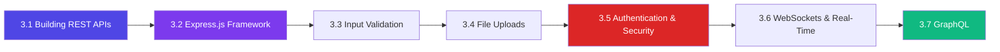

# 3️⃣ Web Development

## 📖 Introduction

This module covers **building web applications and APIs** with Node.js. From raw HTTP servers and Express.js frameworks to real-time WebSockets and GraphQL — you'll learn the patterns and practices used by every major Node.js web application in production.

## 🎯 Why This Module Exists

Knowing Node.js fundamentals isn't enough. This module bridges the gap between runtime knowledge and **production web development** — routing, middleware, validation, auth, file handling, real-time communication, and API design patterns.

## 📚 Learning Objectives

| # | Objective |
|---|-----------|
| 1 | Build RESTful APIs with Express.js following professional patterns |
| 2 | Implement authentication and authorization (JWT, sessions, OAuth) |
| 3 | Validate input data at multiple layers (request, schema, business) |
| 4 | Handle file uploads securely with proper validation |
| 5 | Build real-time features with WebSockets and Socket.io |
| 6 | Design and implement GraphQL APIs |
| 7 | Protect applications against common web vulnerabilities |

## 🧱 Prerequisites

| Skill | Level |
|-------|-------|
| Node.js fundamentals | ✅ Comfortable |
| Async/await and Promises | ✅ Comfortable |
| HTTP protocol basics | ✅ Familiar |
| JSON and REST concepts | 🔧 Helpful |

## ⏱️ Estimated Learning Time

| Topic | Est. Time |
|-------|-----------|
| Building REST APIs | 90 min |
| Express.js Framework | 120 min |
| Input Validation | 60 min |
| File Uploads | 45 min |
| Authentication & Security | 120 min |
| WebSockets & Real-Time | 90 min |
| GraphQL | 90 min |
| **Total** | **~10 hours** |

## 🗺️ Learning Roadmap

## 📋 Topics Covered

| # | Topic | Difficulty |
|---|-------|------------|
| 3.1 | Building REST APIs | 🟡 Intermediate |
| 3.2 | Express.js Framework | 🟡 Intermediate |
| 3.3 | Input Validation | 🟡 Intermediate |
| 3.4 | File Uploads | 🟡 Intermediate |
| 3.5 | Authentication & Security | 🔴 Advanced |
| 3.6 | WebSockets & Real-Time | 🔴 Advanced |
| 3.7 | GraphQL | 🔴 Advanced |

## 🌍 Real-World Applications

| Topic | Used In |
|-------|---------|
| Express.js | ~80% of Node.js web apps |
| JWT/Sessions | Every authenticated API |
| WebSockets | Chat, live dashboards, gaming |
| GraphQL | GitHub, Shopify, Netflix |

## 🛠️ Mini Projects

| Project | Topics |
|---------|--------|
| **E-Commerce API** | REST, validation, auth |
| **Real-Time Chat** | WebSockets, Socket.io |
| **File Sharing Service** | Uploads, validation |

## 🎯 Interview Preparation

Common questions: REST vs GraphQL, JWT vs sessions, middleware patterns, CORS, rate limiting, WebSocket scaling.

## 🔗 Related Modules

| Module | Connection |
|--------|-----------|
| [Core Concepts](/DSA-Notes-Problems/nodejs/core) | Streams, errors |
| [Data Layer](/DSA-Notes-Problems/nodejs/data) | Express + databases |
| [Production](/DSA-Notes-Problems/nodejs/production) | Deployment, security |
