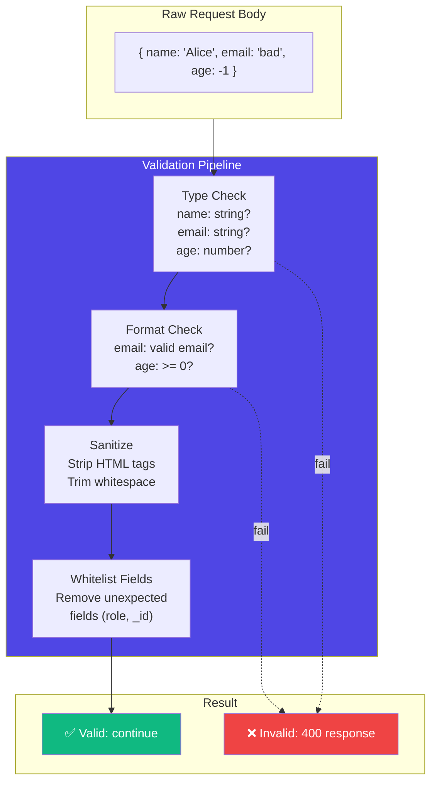
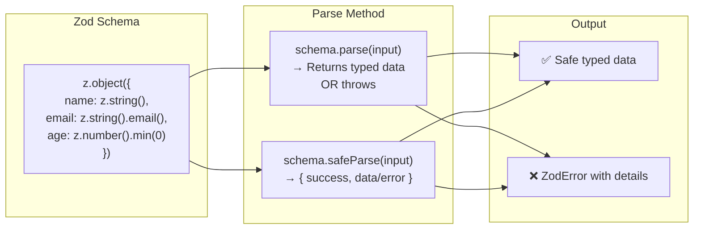
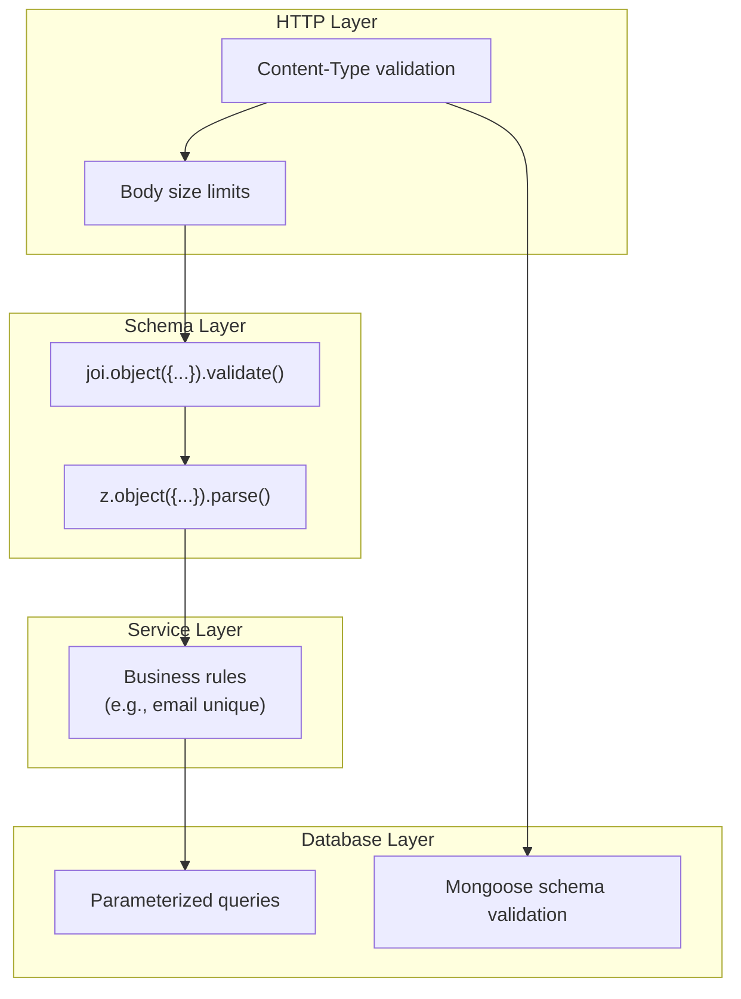
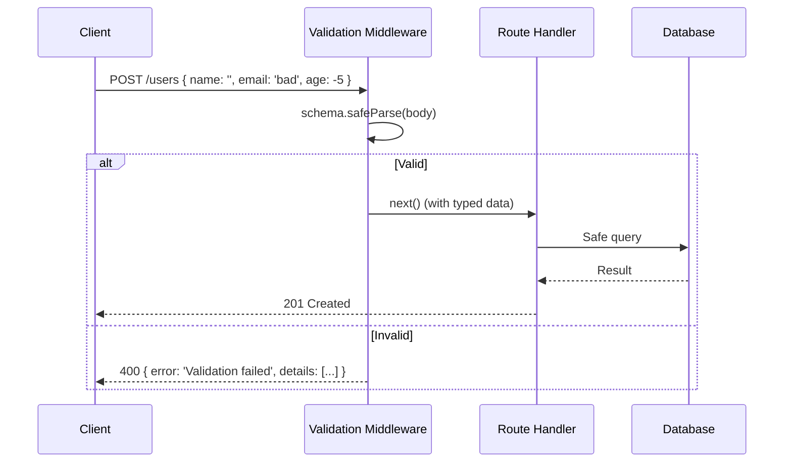

# Input Validation

## 📖 Introduction

**Input validation** is the first line of defense against malicious data. Every HTTP request your application receives is potentially hostile — validation ensures only properly formatted, safe data reaches your business logic.

> **Never trust user input. Validate everything, sanitize aggressively.**

## 🤔 Why Do We Need This?

| Without Validation | With Validation |
|-------------------|----------------|
| `req.body.price = "abc"` → `NaN` in DB | Rejected with 400 error |
| SQL injection via string input | Input is escaped/sanitized |
| XSS via HTML in name field | HTML tags stripped |
| Missing required fields → cryptic crash | Clear error message |
| Over-posting: user sends `{role: "admin"}` | Only allowed fields accepted |

## ⚠️ Problem Statement

```javascript
// No validation — disaster waiting to happen:
app.post('/users', async (req, res) => {
  // What if req.body is empty?
  // What if email is "not-an-email"?
  // What if age is -5?
  // What if name is "<script>alert('xss')</script>"?
  // What if role is "admin" (shouldn't be settable)?
  const user = await User.create(req.body); // 💥
  res.json(user);
});
```

## 📚 Real World Story

**The MongoDB Injection That Cost Millions**

In 2017, a Node.js application that didn't validate its input allowed attackers to send `{ "email": { "$gt": "" } }` in a login request. MongoDB interpreted `$gt` as a query operator, returning the first user in the database. The attacker logged in as an admin without knowing any password.

**Lesson:** Always validate and sanitize input. Never pass raw request data to database queries.

## 🍕 Real World Analogy

| Validation Layer | Airport Security Analogy |
|-----------------|-------------------------|
| Schema validation | Check ID at ticket counter |
| Type coercion | "Is this really a number?" |
| Sanitization | Remove prohibited items from luggage |
| Business rules | "You need a visa for this destination" |
| Rate limiting | How many bags per person |

## 👁️ Visual Explanation

```
VALIDATION DEFENSE LAYERS

Input arrives
    │
    ▼
┌─────────────────┐
│ Layer 1: HTTP   │  ← Content-Type check, size limits
│ Transport       │
├─────────────────┤
│ Layer 2: Schema │  ← Joi/Zod: types, required, format
│ Validation      │
├─────────────────┤
│ Layer 3:        │  ← Strip HTML, escape special chars
│ Sanitization    │
├─────────────────┤
│ Layer 4:        │  ← Business rules: age > 18, unique email
│ Business Logic  │
├─────────────────┤
│ Layer 5:        │  ← Parameterized queries, ORM
│ Database        │
└─────────────────┘
    │
    ▼
  Safe data in DB
```

## 📊 Mermaid Diagram 1: Validation Architecture



## ⚙️ Internal Working: How Validation Libraries Work



## 🏗️ Architecture: Multi-Layer Validation



## 👣 Step-by-Step Flow: Validation with Zod



## 📝 Syntax

```javascript
// ─── JOI ────────────────────────────────────────────
const Joi = require('joi');
const schema = Joi.object({
  name: Joi.string().min(2).max(50).required(),
  email: Joi.string().email().required(),
  age: Joi.number().integer().min(0).max(150),
  role: Joi.string().valid('user', 'admin').default('user'),
});
const { error, value } = schema.validate(body);

// ─── ZOD ────────────────────────────────────────────
const { z } = require('zod');
const schema = z.object({
  name: z.string().min(2).max(50),
  email: z.string().email(),
  age: z.number().int().min(0).max(150).optional(),
  role: z.enum(['user', 'admin']).default('user'),
});
const data = schema.parse(body); // throws on invalid
const result = schema.safeParse(body); // returns { success, data/error }
```

## 🟢 Basic Example: Express Validation Middleware

```javascript
const Joi = require('joi');

const userSchema = Joi.object({
  name: Joi.string().min(2).max(50).required(),
  email: Joi.string().email().required(),
  age: Joi.number().integer().min(0).max(150),
});

const validateUser = (req, res, next) => {
  const { error, value } = userSchema.validate(req.body, {
    abortEarly: false, // Return ALL errors, not just first
    stripUnknown: true, // Remove fields not in schema
  });
  
  if (error) {
    return res.status(400).json({
      error: 'Validation failed',
      details: error.details.map(d => ({
        field: d.path.join('.'),
        message: d.message,
      })),
    });
  }
  
  // Replace body with validated (and stripped) data
  req.body = value;
  next();
};

app.post('/users', validateUser, createUser);
```

## 🟡 Intermediate Example: Zod with TypeScript

```typescript
import { z } from 'zod';

// Define schema
const createUserSchema = z.object({
  name: z.string().min(2, 'Name must be at least 2 characters').max(50),
  email: z.string().email('Invalid email format'),
  age: z.number().int().min(0).max(150).optional(),
  role: z.enum(['user', 'admin']).default('user'),
});

// Infer TypeScript type from schema
type CreateUserDTO = z.infer<typeof createUserSchema>;

// Validation middleware
function validate<T>(schema: z.ZodSchema<T>) {
  return (req: Request, res: Response, next: NextFunction) => {
    const result = schema.safeParse(req.body);
    if (!result.success) {
      return res.status(400).json({
        error: 'Validation failed',
        details: result.error.issues.map(i => ({
          field: i.path.join('.'),
          message: i.message,
        })),
      });
    }
    req.body = result.data;
    next();
  };
}

// Usage — req.body is now typed as CreateUserDTO
app.post('/users', validate(createUserSchema), async (req, res) => {
  const user = await User.create(req.body); // Fully typed!
  res.status(201).json(user);
});
```

## 🔴 Advanced Example: Conditional Validation

```javascript
const Joi = require('joi');

const createOrderSchema = Joi.object({
  items: Joi.array().items(Joi.object({
    productId: Joi.string().required(),
    quantity: Joi.number().integer().min(1).max(100).required(),
  })).min(1).max(50).required(),
  
  shippingAddress: Joi.object({
    street: Joi.string().required(),
    city: Joi.string().required(),
    zipCode: Joi.string().pattern(/^\d{5}(-\d{4})?$/),
    country: Joi.string().length(2).uppercase(),
  }).required(),
  
  // Conditional: express shipping requires valid phone
  shippingMethod: Joi.string().valid('standard', 'express').required(),
  phone: Joi.string().when('shippingMethod', {
    is: 'express',
    then: Joi.string().pattern(/^\+?[\d\s-]{10,15}$/).required(),
    otherwise: Joi.string().optional(),
  }),
  
  // Coupon code validation
  coupon: Joi.string().alphanum().length(8).optional(),
  
  // Prevent over-posting
}).options({ stripUnknown: true });
```

## 🏭 Production Example: Comprehensive Validation Setup

```javascript
// middleware/validate.js
const validate = (schema, source = 'body') => {
  return (req, res, next) => {
    const data = source === 'body' ? req.body 
      : source === 'query' ? req.query 
      : req.params;
    
    const { error, value } = schema.validate(data, {
      abortEarly: false,
      stripUnknown: true,
    });
    
    if (error) {
      // Log validation errors for monitoring
      logger.warn({
        path: req.path,
        errors: error.details,
        ip: req.ip,
      }, 'Validation failed');
      
      return res.status(422).json({
        error: 'Validation failed',
        code: 'VALIDATION_ERROR',
        details: error.details.map(d => ({
          field: d.path.join('.'),
          message: d.message,
          code: d.type,
        })),
      });
    }
    
    // Replace with validated data
    if (source === 'body') req.body = value;
    else if (source === 'query') req.query = value;
    else req.params = value;
    
    next();
  };
};

// Usage
app.post('/api/v1/users', 
  validate(createUserSchema, 'body'),
  createUser
);
app.get('/api/v1/users',
  validate(listUsersSchema, 'query'),
  listUsers
);
```

## ⚙️ How It Works Internally

```
Validation library internals:
1. Define schema: object structure + rules
2. Parse input: compare input against schema
3. Type coercion: "5" → 5 if schema says number
4. Rule validation: min, max, email, regex, etc.
5. Error aggregation: collect all failures
6. Return: validated data OR error details
```

## 📦 Performance Notes

| Library | Ops/sec | Bundle Size | TypeScript |
|---------|---------|-------------|------------|
| Joi | ~5K | 200KB | Good |
| Zod | ~50K | 30KB | Excellent |
| Yup | ~15K | 60KB | Good |
| Ajv (JSON Schema) | ~200K | 100KB | Fair |

## 🔒 Security Notes

- Always validate on the server (never trust client validation)
- Use `stripUnknown` to prevent over-posting
- Set body size limits to prevent DoS
- Sanitize strings to prevent XSS

## ⚠️ Common Mistakes

```javascript
// MISTAKE 1: Client-side validation only
// MISTAKE 2: Passing raw body to DB
// MISTAKE 3: Not stripping unknown fields
```

## 🚀 Best Practices

| # | Practice |
|---|----------|
| 1 | Validate at the boundary (middleware) |
| 2 | Use schema validation libraries (Zod/Joi) |
| 3 | Strip unknown fields |
| 4 | Return clear error messages |
| 5 | Validate ALL input sources (body, query, params) |

## 📝 MCQs

**1. What does stripUnknown: true do?**
- A) Removes null values
- B) Removes fields not in schema ✅
- C) Removes empty strings
- D) Removes duplicate fields

## 🧪 Mini Exercise

Create a validation middleware that validates a user registration form with: name (2-50 chars), email (valid format), password (8+ chars, 1 number).

## 📖 Summary

| Concept | Key |
|---------|-----|
| Schema validation | Define structure + rules |
| Sanitization | Strip dangerous content |
| Over-posting | Remove unexpected fields |
| Defense in depth | Multiple validation layers |

## 📋 Cheat Sheet

```javascript
// Zod
const schema = z.object({ name: z.string().min(2) });
const result = schema.safeParse(input);
// Joi
const schema = Joi.object({ name: Joi.string().min(2) });
const { error, value } = schema.validate(input);
```

## 📚 Further Reading

- [Zod Documentation](https://zod.dev/)
- [Joi Documentation](https://joi.dev/)
- [Express Validation Guide](https://expressjs.com/en/advanced/best-practice-performance.html)

## 🔗 Related Topics

| Topic | Link |
|-------|------|
| Express.js | [Previous](/DSA-Notes-Problems/nodejs/web/express-framework) |
| File Uploads | [Next](/DSA-Notes-Problems/nodejs/web/file-uploads) |
| Authentication | [Auth](/DSA-Notes-Problems/nodejs/web/authentication-security) |
