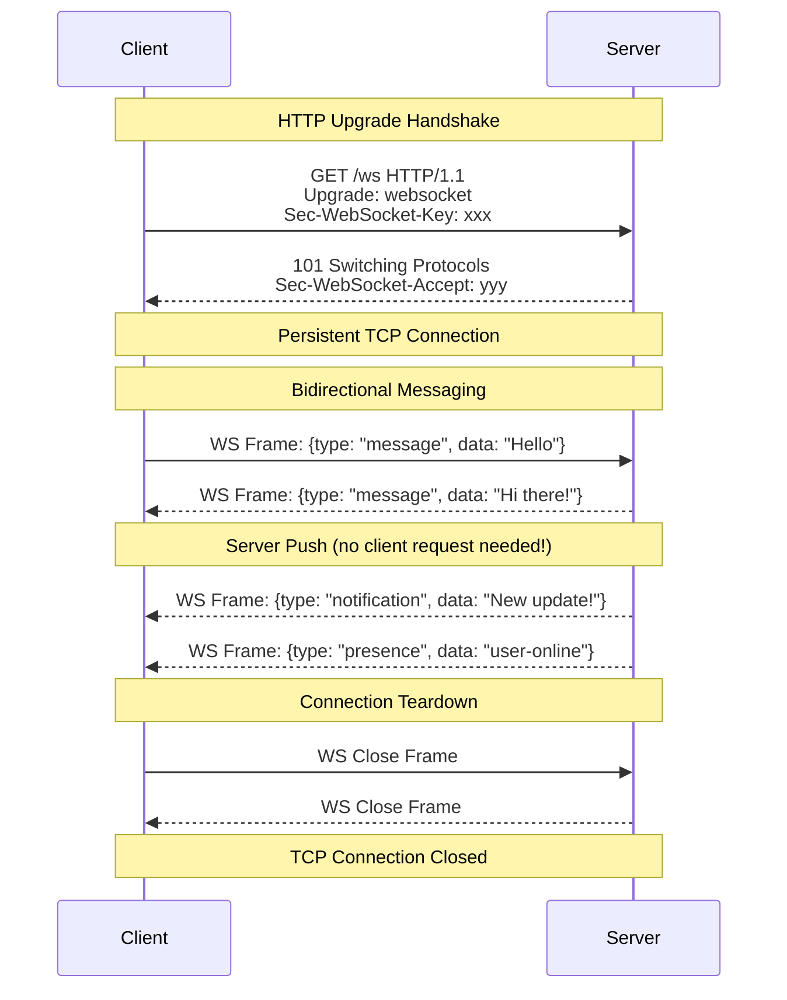
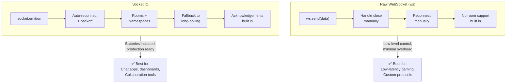
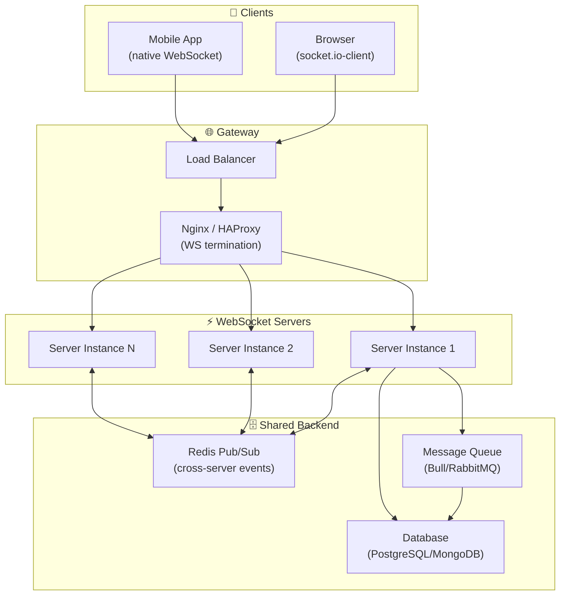
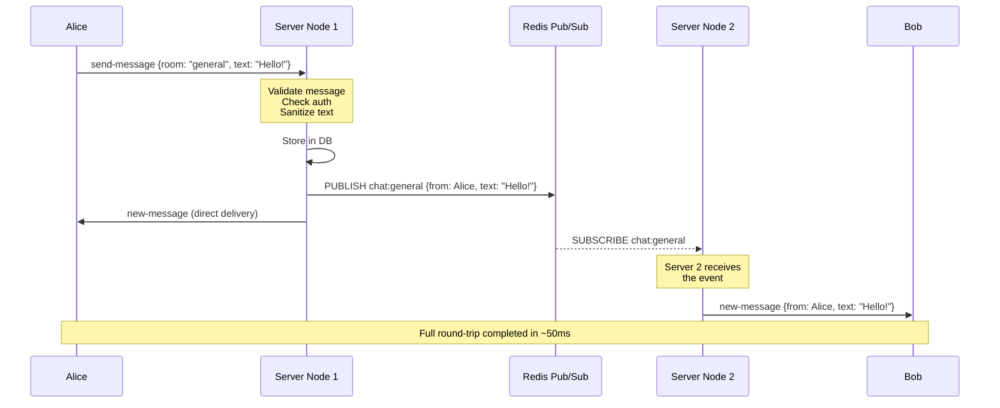

# WebSockets & Real-Time

## 📖 Introduction

WebSockets provide a **persistent, bidirectional communication channel** between a client and server. Unlike HTTP's request-response model (where the client must initiate every interaction), WebSockets allow the server to push data to clients in real time — enabling features like live chat, collaborative editing, real-time dashboards, and multiplayer gaming.

Node.js is uniquely suited for WebSocket applications because of its event-driven, non-blocking architecture. A single Node.js process can handle tens of thousands of concurrent WebSocket connections, each consuming minimal memory, by leveraging the Event Loop and asynchronous I/O.

Two primary approaches exist: the lightweight `ws` library for raw WebSocket protocol handling, and **Socket.IO** for production-ready applications with auto-reconnection, rooms, namespaces, and fallback transports.

## 🤔 Why Do We Need This?

HTTP was designed for **document retrieval** — you request a page, and the server responds. This model breaks for applications that need real-time updates:

- **Polling (bad):** Client asks every 5 seconds "any new messages?" — wasteful, high latency
- **Long-polling (worse):** Server holds the request open until data arrives — complex, unreliable
- **WebSockets (good):** Client connects once, both sides send data freely — low latency, minimal overhead

With WebSockets, the server can push events the instant they happen, reducing latency from seconds (polling) to milliseconds (push).

## ⚠️ Problem Statement

A production real-time system must solve:

1. **Connection management** — Handle 10,000+ concurrent persistent connections on a single server
2. **Authentication** — Verify user identity at connection time, not just at login
3. **State synchronization** — Keep all connected clients in sync without race conditions
4. **Graceful degradation** — Handle network drops, reconnections, and server restarts
5. **Horizontal scaling** — Distribute connections across multiple servers with shared state
6. **Memory leaks** — Clean up listeners and references when clients disconnect
7. **Rate limiting** — Prevent malicious clients from flooding the server with messages

## 📚 Real World Story

**Slack** runs one of the largest WebSocket infrastructures in production. Every workspace member maintains a persistent WebSocket connection to receive notifications, messages, and presence updates in real time. At peak, Slack handles over **1 million concurrent WebSocket connections**.

Their architecture evolved from a monolithic Socket.IO setup to a custom WebSocket gateway that:

1. Terminates WebSocket connections at an edge layer (HAProxy → custom Gateway)
2. Routes events through Redis Pub/Sub for cross-server broadcasting
3. Uses a message-acknowledgment protocol to ensure delivery even through network interruptions
4. Implements exponential backoff reconnection — clients retry with 1s, 2s, 4s, 8s delays

The lesson: start with Socket.IO for rapid development, but be prepared to move to a custom WebSocket infrastructure as your scale grows beyond what off-the-shelf solutions can handle.

## 🍕 Real World Analogy

| WebSocket Concept | Real-World Analogy |
|------------------|-------------------|
| **Persistent connection** | A phone call (stays open until someone hangs up) |
| **HTTP request** | Sending a letter (you wait for a reply) |
| **Server push** | Someone calling you with news (unsolicited) |
| **Socket.IO rooms** | Conference call channels (join/leave specific groups) |
| **Reconnection** | Redialing when the call drops |
| **Broadcast** | Announcing to everyone in the room |
| **Namespace** | Different phone lines (work vs personal) |

## 👁️ Visual Explanation

```
HTTP (Request-Response):           WebSocket (Persistent):
                                   
Client          Server             Client          Server
  │                │                 │                │  
  ├── Request ────►│                 ├── Upgrade ────►│  
  │◄── Response ──┤                 │◄── 101 Switch ─┤  
  │                │                 │                │  
  ├── Request ────►│                 │── Message ────►│  
  │◄── Response ──┤                 │◄── Message ────┤  
  │                │                 │── Message ────►│  
  ├── Request ────►│                 │◄── Message ────┤  
  │◄── Response ──┤                 │                │  
  │                │                 │── Close ──────►│  
```

The WebSocket connection starts as an HTTP request, then **upgrades** to the WebSocket protocol via the `101 Switching Protocols` status code. After that, both sides send frames freely without the HTTP request/response overhead.

## 📊 Mermaid Diagram 1: WebSocket Connection Lifecycle



## ⚙️ Internal Working: WebSocket Protocol

The WebSocket protocol has two phases:

### Phase 1: HTTP Upgrade Handshake

```http
GET /chat HTTP/1.1
Host: server.example.com
Upgrade: websocket
Connection: Upgrade
Sec-WebSocket-Key: dGhlIHNhbXBsZSBub25jZQ==
Sec-WebSocket-Version: 13
```

The server computes the accept key by concatenating the client key with a fixed GUID (`258EAFA5-E914-47DA-95CA-C5AB0DC85B11`), taking the SHA-1 hash, and base64-encoding it. This proves both sides understand the protocol.

### Phase 2: Frame Exchange

Once upgraded, data is sent in **frames**:

```
 0                   1                   2                   3
 0 1 2 3 4 5 6 7 8 9 0 1 2 3 4 5 6 7 8 9 0 1 2 3 4 5 6 7 8 9 0 1
+-+-+-+-+-+-+-+-+-+-+-+-+-+-+-+-+-+-+-+-+-+-+-+-+-+-+-+-+-+-+-+-+
|F|R|R|R| opcode|M| Payload len |    Extended payload length    |
|I|S|S|S|  (4)  |A|     (7)     |             (16/64)           |
|N|V|V|V|       |S|             |   (if payload len==126/127)   |
| |1|2|3|       |K|             |                               |
+-+-+-+-+-+-+-+-+-+-+-+-+-+-+-+-+-+-+-+-+-+-+-+-+-+-+-+-+-+-+-+-+
|     Extended payload length continued, if payload len == 127  |
+-+-+-+-+-+-+-+-+-+-+-+-+-+-+-+-+-+-+-+-+-+-+-+-+-+-+-+-+-+-+-+-+
|               Masking-key, if MASK set to 1                   |
+-+-+-+-+-+-+-+-+-+-+-+-+-+-+-+-+-+-+-+-+-+-+-+-+-+-+-+-+-+-+-+-+
|          Payload Data (variable length)                        |
+-+-+-+-+-+-+-+-+-+-+-+-+-+-+-+-+-+-+-+-+-+-+-+-+-+-+-+-+-+-+-+-+
```

**Key aspects:**
- **FIN**: Indicates the final frame of a message (allows fragmentation)
- **Opcode**: Text (1), Binary (2), Close (8), Ping (9), Pong (10)
- **MASK**: Client-to-server frames MUST be masked (xor with masking key)
- **Payload length**: 7 bits, or 7+16 bits, or 7+64 bits

## 🔄 Mermaid Diagram 2: Socket.IO vs Raw WebSocket



## 🏗️ Architecture: Production Real-Time System



## 👣 Step-by-Step Flow: Processing a Real-Time Chat Message



## 📝 Syntax

### Raw WebSocket (`ws` library)

```javascript
// Server
const WebSocket = require('ws');
const wss = new WebSocket.Server({ port: 8080 });

wss.on('connection', (ws, req) => {
  ws.on('message', (data) => {
    wss.clients.forEach(client => {
      if (client.readyState === WebSocket.OPEN) client.send(data);
    });
  });
});
```

```javascript
// Client (browser)
const ws = new WebSocket('ws://localhost:8080');
ws.onopen = () => ws.send('Hello!');
ws.onmessage = (event) => console.log(event.data);
```

### Socket.IO

```javascript
// Server
const { Server } = require('socket.io');
const io = new Server(httpServer, {
  cors: { origin: 'https://myapp.com' },
  pingTimeout: 60000,
});

io.on('connection', (socket) => {
  socket.join('room-1');                          // Join room
  io.to('room-1').emit('event', data);             // To room (all)
  socket.to('room-1').emit('event', data);         // To room (except sender)
  socket.broadcast.emit('event', data);             // To all except sender
  io.emit('event', data);                           // To all connected
});
```

```javascript
// Client (browser)
import { io } from 'socket.io-client';
const socket = io('https://api.myapp.com', {
  auth: { token: 'jwt-here' },
  reconnection: true,
  reconnectionAttempts: 10,
});
socket.emit('event', data);
socket.on('event', handler);
```

## 🟢 Basic Example: Echo Server with Raw WebSocket

```javascript
const WebSocket = require('ws');
const http = require('http');

const server = http.createServer((req, res) => {
  res.end('WebSocket server is running');
});

const wss = new WebSocket.Server({ server });

wss.on('connection', (ws, req) => {
  console.log('Client connected from:', req.socket.remoteAddress);

  // Send welcome message
  ws.send(JSON.stringify({ type: 'welcome', message: 'Connected!' }));

  // Echo incoming messages
  ws.on('message', (data) => {
    console.log('Received:', data.toString());
    ws.send(`Echo: ${data}`);
  });

  // Handle disconnection
  ws.on('close', (code, reason) => {
    console.log('Client disconnected. Code:', code, 'Reason:', reason.toString());
  });

  // Handle errors
  ws.on('error', (err) => {
    console.error('WebSocket error:', err.message);
  });
});

server.listen(3000, () => {
  console.log('Server listening on :3000');
});
```

**What's happening:**
- `WebSocket.Server({ server })` attaches WebSocket handling to the existing HTTP server
- `ws.on('message')` fires for each incoming text or binary frame
- `ws.send()` sends data back to the specific client
- The `close` event provides status codes (1000=normal, 1006=abnormal drop)
- Both HTTP and WebSocket share the same port — the server detects the Upgrade header

## 🟡 Intermediate Example: Chat Application with Socket.IO Rooms

```javascript
const express = require('express');
const http = require('http');
const { Server } = require('socket.io');
const jwt = require('jsonwebtoken');

const app = express();
const server = http.createServer(app);
const io = new Server(server, {
  cors: { origin: process.env.CLIENT_URL, credentials: true },
  pingTimeout: 60000,
  pingInterval: 25000,
});

// Authentication middleware
io.use((socket, next) => {
  const token = socket.handshake.auth.token;
  if (!token) return next(new Error('Authentication required'));
  try {
    const user = jwt.verify(token, process.env.JWT_SECRET);
    socket.user = user;
    next();
  } catch (err) {
    next(new Error('Invalid token'));
  }
});

io.on('connection', (socket) => {
  console.log(`${socket.user.name} connected (${socket.id})`);

  // Auto-join user to their personal room
  socket.join(`user:${socket.user.id}`);

  // Join a chat room
  socket.on('join-room', (roomId) => {
    socket.join(roomId);
    socket.to(roomId).emit('user-joined', {
      userId: socket.user.id,
      name: socket.user.name,
    });
  });

  // Leave a chat room
  socket.on('leave-room', (roomId) => {
    socket.leave(roomId);
    socket.to(roomId).emit('user-left', {
      userId: socket.user.id,
      name: socket.user.name,
    });
  });

  // Chat message
  socket.on('send-message', ({ roomId, text }) => {
    const message = {
      id: require('crypto').randomUUID(),
      from: socket.user.name,
      userId: socket.user.id,
      text,
      timestamp: Date.now(),
    };
    io.to(roomId).emit('new-message', message);
  });

  // Typing indicator
  socket.on('typing', ({ roomId, isTyping }) => {
    socket.to(roomId).emit('user-typing', {
      userId: socket.user.id,
      name: socket.user.name,
      isTyping,
    });
  });

  // Mark as read
  socket.on('mark-read', ({ roomId, messageId }) => {
    socket.to(roomId).emit('read-receipt', {
      userId: socket.user.id,
      messageId,
    });
  });

  // Handle disconnect
  socket.on('disconnect', () => {
    console.log(`${socket.user.name} disconnected`);
    // Broadcast presence
    socket.broadcast.emit('user-offline', socket.user.id);
  });
});

server.listen(3000);
```

**What's happening:**
- **JWT authentication** in `io.use()` middleware verifies the user before the connection is established
- **Personal rooms** (`user:${userId}`) allow direct messages to a specific user
- **Typing indicators** are broadcast to everyone in the room except the sender (`socket.to()`)
- **Read receipts** demonstrate how to acknowledge specific messages
- **Presence broadcasting** notifies others when a user comes online/goes offline

## 🔴 Advanced Example: Collaborative Document Editing

```javascript
const { Server } = require('socket.io');
const http = require('http');
const { RateLimiterMemory } = require('rate-limiter-flexible');

const server = http.createServer();
const io = new Server(server, {
  cors: { origin: '*' },
  maxHttpBufferSize: 1e6, // 1MB max message size
});

// Rate limit: 50 operations per 10 seconds per socket
const rateLimiter = new RateLimiterMemory({
  points: 50,
  duration: 10,
});

// In-memory document store (use Redis in production)
const documents = new Map();

io.use((socket, next) => {
  const token = socket.handshake.auth.token;
  // ... JWT verification ...
  next();
});

io.on('connection', (socket) => {
  // Join a specific document room
  socket.on('join-document', async ({ docId }) => {
    socket.join(`doc:${docId}`);

    // Initialize document if needed
    if (!documents.has(docId)) {
      documents.set(docId, { content: '', version: 0, cursors: {} });
    }

    const doc = documents.get(docId);

    // Send current state to the joining client
    socket.emit('document-state', {
      content: doc.content,
      version: doc.version,
    });

    // Broadcast presence
    socket.to(`doc:${docId}`).emit('user-joined', {
      userId: socket.user.id,
      name: socket.user.name,
    });
  });

  // Handle operational transformation (OT) edits
  socket.on('edit', ({ docId, operation, version }) => {
    try {
      rateLimiter.consume(socket.id); // Check rate limit

      const doc = documents.get(docId);
      if (!doc) return;

      // Apply operation to server document
      doc.content = applyOperation(doc.content, operation);
      doc.version = version + 1;

      // Broadcast to all OTHER clients in the document room
      socket.to(`doc:${docId}`).emit('remote-edit', {
        operation,
        version: doc.version,
      });
    } catch (rateLimited) {
      socket.emit('rate-limited', { message: 'Too many edits. Slow down.' });
    }
  });

  // Cursor position sharing
  socket.on('cursor-update', ({ docId, position }) => {
    socket.to(`doc:${docId}`).emit('remote-cursor', {
      userId: socket.user.id,
      name: socket.user.name,
      position,
    });
  });

  // Leave document
  socket.on('leave-document', ({ docId }) => {
    socket.leave(`doc:${docId}`);
    socket.to(`doc:${docId}`).emit('user-left', {
      userId: socket.user.id,
      name: socket.user.name,
    });
  });
});

function applyOperation(content, operation) {
  // Simple OT implementation: insert/delete at position
  if (operation.type === 'insert') {
    return content.slice(0, operation.position) +
           operation.text +
           content.slice(operation.position);
  }
  if (operation.type === 'delete') {
    return content.slice(0, operation.position) +
           content.slice(operation.position + operation.length);
  }
  return content;
}

server.listen(3000);
```

**What's happening:**
- **Operational Transformation (OT)** allows concurrent editing without conflicts
- **Rate limiting** prevents a single user from flooding the server with edits
- **Cursor sharing** sends position data to show where other users are typing
- **Version tracking** ensures clients stay in sync and detect missed edits
- **`maxHttpBufferSize`** limits the maximum message size to prevent abuse
- **`socket.to()`** (without the sender) ensures the editing user doesn't get their own operation echoed back

> **Note:** For production collaborative editing, use a library like **ShareDB** or **Yjs** instead of building OT from scratch.

## 🏭 Production Example: Real-Time Notification System

```javascript
const { Server } = require('socket.io');
const Redis = require('ioredis');
const http = require('http');

const server = http.createServer();
const io = new Server(server, {
  cors: { origin: process.env.CLIENT_URL },
  adapter: require('@socket.io/redis-adapter'), // Enable horizontal scaling
});

// Redis clients for pub/sub (cross-server communication)
const pubClient = new Redis(process.env.REDIS_URL);
const subClient = pubClient.duplicate();
io.adapter(require('@socket.io/redis-adapter')(pubClient, subClient));

// Authentication middleware
io.use(async (socket, next) => {
  try {
    const token = socket.handshake.auth.token;
    const user = await verifyToken(token);
    socket.user = user;
    socket.join(`user:${user.id}`);
    next();
  } catch (err) {
    next(new Error('Authentication failed'));
  }
});

io.on('connection', (socket) => {
  console.log(`User ${socket.user.id} connected`);

  // Send pending notifications on connect
  sendPendingNotifications(socket.user.id);

  // Listen for acknowledgements
  socket.on('notification-read', async ({ notificationId }) => {
    await markAsRead(socket.user.id, notificationId);
  });

  // Subscribe to real-time feeds
  socket.on('subscribe-feed', (feedName) => {
    socket.join(`feed:${feedName}`);
  });
});

// External API to push notifications (called from your Express routes)
async function sendNotification(userId, notification) {
  io.to(`user:${userId}`).emit('notification', {
    id: require('crypto').randomUUID(),
    ...notification,
    timestamp: Date.now(),
    read: false,
  });
}

// Broadcast system-wide announcements
async function sendAnnouncement(message, level = 'info') {
  io.emit('announcement', {
    message,
    level, // 'info' | 'warning' | 'critical'
    timestamp: Date.now(),
  });
}

// Health monitoring
io.on('connection', (socket) => {
  socket.on('ping', () => {
    socket.emit('pong', { serverTime: Date.now() });
  });
});

// Metrics endpoint
setInterval(() => {
  const connections = io.engine.clientsCount;
  const rooms = Object.keys(io.sockets.adapter.rooms).length;
  console.log(`Active connections: ${connections}, Rooms: ${rooms}`);
}, 60000);

server.listen(3000);
```

**What's happening:**
- **Redis adapter** enables horizontal scaling — events broadcast from one server reach clients on all servers
- **Personal room pattern** (`user:${id}`) allows any server to send notifications to a specific user
- **Pending notifications** are sent on connection (in case the user was offline)
- **Notification-read** acknowledgements track what the user has seen
- **Metrics** help monitor cluster health

## ⚙️ How It Works Internally

### Engine.IO (Socket.IO's transport layer)

Socket.IO is not a pure WebSocket implementation. It uses **Engine.IO** as its transport layer:

1. **Connection phase**: Engine.IO establishes the best available transport:
   - WebSocket (preferred) — persistent, bidirectional
   - Polling (fallback) — XHR or JSONP polling when WebSockets are blocked (corporate firewalls, proxies)

2. **Upgrade**: If the connection starts with polling, Engine.IO attempts to upgrade to WebSocket within a few seconds. The upgrade is seamless to the application layer.

3. **Heartbeating**: Every `pingInterval`, the server sends a ping. If the client doesn't respond with a pong within `pingTimeout`, the connection is considered dead and closed.

4. **Buffering**: If a client disconnects and reconnects quickly, the server buffers events and replays them on reconnect (configurable).

### Socket.IO Protocol

```
Client → Server:
  "42" + JSON.stringify(["eventName", data])
  // 4=Message, 2=Socket.IO event

Server → Client:
  "42" + JSON.stringify(["eventName", data])

Acknowledgement:
  Client: "42" + JSON.stringify(["event", data, "ack123"])
  Server: "43" + JSON.stringify(["ack123", result])
```

The "4" prefix is the Engine.IO packet type (message), and "2" is the Socket.IO packet type (event).

## 📦 Performance Notes

### Benchmark: 10,000 concurrent connections

| Metric | Raw WebSocket (`ws`) | Socket.IO |
|--------|---------------------|-----------|
| Memory per connection | ~20-30 KB | ~40-60 KB |
| Memory for 10K connections | ~200-300 MB | ~400-600 MB |
| Messages per second (single core) | ~200,000 | ~50,000 |
| Connection time | ~5ms | ~50ms (includes handshake + upgrade) |

### Optimization Strategies

1. **Use binary frames** for large data — Text frames are UTF-8 encoded, which adds overhead for binary data. Use `socket.binary(true)` or send `Buffer`/`ArrayBuffer` directly.

2. **Batch small messages** — Sending 100 small messages individually creates 100 frame headers. Batch them into a single frame with an array payload.

3. **Compress with permessage-deflate** — Enable compression for text-heavy workloads:
   ```javascript
   const wss = new WebSocket.Server({
     perMessageDeflate: { zlibDeflateOptions: { level: 1 } }
   });
   ```

4. **Scale horizontally with Redis** — Socket.IO's built-in Redis adapter is efficient, but for extreme scale, consider a custom adapter with Kafka or NATS.

## 🔒 Security Notes

### 1. Connection Authentication

```javascript
// ❌ Don't authenticate in 'connection' event
io.on('connection', (socket) => {
  // Anyone can connect!
});

// ✅ Authenticate in middleware
io.use((socket, next) => {
  const token = socket.handshake.auth.token;
  try {
    socket.user = jwt.verify(token, process.env.JWT_SECRET);
    next();
  } catch {
    next(new Error('Unauthorized'));
  }
});
```

### 2. Input Validation

```javascript
// ❌ Never trust client data
socket.on('message', (data) => {
  io.emit('message', data); // XSS possible!
});

// ✅ Sanitize before broadcasting
const sanitize = require('sanitize-html');
socket.on('message', (data) => {
  io.emit('message', {
    ...data,
    text: sanitize(data.text, { allowedTags: [] }),
  });
});
```

### 3. Rate Limiting

- Limit messages per second per socket to prevent flooding
- Limit connections per IP to prevent resource exhaustion
- Limit room joins to prevent spam

### 4. Additional Security Measures

- **WSS (WebSocket Secure)** — Always use `wss://` (TLS) in production to prevent eavesdropping
- **Origin validation** — Check `socket.handshake.headers.origin` against a whitelist
- **Message size limits** — Set `maxHttpBufferSize` to prevent memory exhaustion
- **Disconnect idle connections** — Close connections that have been silent for too long

## ⚠️ Common Mistakes

1. **❌ Not handling disconnections** — Listeners and intervals attached to a socket continue running after disconnect, causing memory leaks. Always clean up in the `disconnect` handler.

2. **❌ Broadcasting to yourself unintentionally** — `socket.emit()` sends only to the sender. `io.emit()` sends to everyone (including sender). `socket.broadcast.emit()` sends to everyone except sender. Know which one you need.

3. **❌ No reconnection strategy** — Networks drop connections. Without reconnection, users see a blank screen and have to refresh. Socket.IO reconnects by default — use it.

4. **❌ Sending too much data in one message** — Messages are serialized to JSON. Sending a 100MB object will block the Event Loop during serialization and likely hit the `maxHttpBufferSize` limit.

5. **❌ Scaling without shared state** — On multiple servers, a user's socket is only on one server. Without Redis or another shared adapter, broadcasting to a room only reaches clients on the same server.

6. **❌ No heartbeat / ping-pong** — Without heartbeats, you can't detect dead connections (e.g., a laptop that went to sleep). Socket.IO handles this automatically with `pingInterval`/`pingTimeout`.

## 🚀 Best Practices

### Socket.IO Configuration

```javascript
const io = new Server(server, {
  // Security
  cors: { origin: process.env.CLIENT_URL },
  maxHttpBufferSize: 1e6,

  // Reliability
  pingTimeout: 60000,
  pingInterval: 25000,

  // Performance
  transports: ['websocket'], // Skip polling in modern browsers
  allowEIO3: false,          // Only support latest protocol
});
```

### Client Configuration

```javascript
const socket = io(URL, {
  auth: { token },
  reconnection: true,
  reconnectionAttempts: Infinity,
  reconnectionDelay: 1000,
  reconnectionDelayMax: 10000,
  randomizationFactor: 0.5,
  timeout: 20000,
});
```

### Architecture Patterns

- **Use Redis adapter** as soon as you have more than one server
- **Implement backpressure** — If the client can't keep up, buffer or drop messages
- **Monitor connection health** — Track connect/disconnect events, reconnection attempts
- **Graceful shutdown** — Close all connections on `SIGTERM` instead of dropping them

## 🎯 Interview Questions

**Q1: What's the difference between WebSocket and Socket.IO?**

WebSocket is a **protocol** (RFC 6455) that provides persistent, bidirectional communication over a TCP connection. Socket.IO is a **library** that uses WebSocket as its primary transport but adds features: auto-reconnection, rooms, namespaces, fallback to long-polling, and acknowledgements. Socket.IO also wraps messages in its own protocol (Engine.IO), adding overhead.

**Q2: How do you handle 10,000+ concurrent WebSocket connections on a single Node.js server?**

Node.js is event-driven and non-blocking, so a single thread can handle many connections as long as the work per message is minimal. Use `cluster` module to spawn worker processes (one per CPU core). For horizontal scaling across machines, use Socket.IO's Redis adapter or a custom Pub/Sub system. Monitor memory — each connection costs ~20-60 KB depending on the library.

**Q3: How does Socket.IO handle reconnection?**

Socket.IO uses exponential backoff reconnection. After a disconnect, it waits `reconnectionDelay` (default 1s), then doubles the delay up to `reconnectionDelayMax` (default 5s). With `randomizationFactor: 0.5`, the actual delay is randomized to prevent the thundering herd problem. It also buffers events during reconnection and replays them.

**Q4: Explain how you'd implement a "user is typing" indicator without flooding the server.**

Throttle the typing events on the client side (e.g., only send an event if 300ms have passed since the last one). On the server, debounce: clear a timer on each new typing event, and only broadcast "stopped typing" after 1-2 seconds of silence. This reduces events from ~10/sec to ~3/sec per user.

## 📝 MCQs

**1. What HTTP status code is used for the WebSocket upgrade?**
- A) 200 OK
- B) 101 Switching Protocols ✅
- C) 301 Moved Permanently
- D) 426 Upgrade Required

**2. Which Socket.IO method sends an event to all clients in a room EXCEPT the sender?**
- A) `io.to(room).emit()`
- B) `socket.to(room).emit()` ✅
- C) `socket.emit()`
- D) `io.emit()`

**3. How does Socket.IO enable horizontal scaling across multiple servers?**
- A) It uses a shared file system
- B) Each server maintains its own state, no sharing needed
- C) It uses a Redis adapter for cross-server event propagation ✅
- D) Socket.IO cannot scale horizontally

**4. What happens to events emitted while a Socket.IO client is disconnected?**
- A) They are lost forever
- B) They are buffered and replayed on reconnection (configurable) ✅
- C) The server throws an error
- D) The connection is terminated permanently

**5. What is the purpose of WebSocket masking?**
- A) Encrypt the payload for security
- B) Prevent cache poisoning in intermediary proxies ✅
- C) Compress the data for performance
- D) Authenticate the client

**Answer Key:** 1-B, 2-B, 3-C, 4-B, 5-B

## 💻 Coding Challenge 1: Broadcast Server

Build a WebSocket server that:
- Listens on port 3000
- When any client sends a message, broadcast it to ALL other connected clients (not the sender)
- Track how many clients are connected and send the count as a `presence` event
- Handle client disconnect gracefully (update the count)

## 💻 Coding Challenge 2: Room-Based Chat

Build a Socket.IO chat server with:
- Users join a room by emitting `join-room {roomId}`
- Messages sent via `send-message {roomId, text}` are broadcast to the room
- Show typing indicators (`user-typing` event) that auto-clear after 2 seconds of silence
- Track room member count and broadcast it on join/leave

## 💻 Coding Challenge 3: Live Leaderboard

Build a real-time leaderboard system:
- Clients send `score-update {playerId, score}`
- Server maintains a sorted leaderboard (top 10)
- Server broadcasts the updated leaderboard to all connected clients every time it changes
- New clients receive the current leaderboard immediately on connection
- Handle 100+ concurrent connections updating scores every second

**Hints:** Use a sorted set in Redis for the leaderboard. Use a debounce to avoid broadcasting too frequently.

## 🧪 Mini Exercise: Debugging a Real-Time Chat

This chat server has bugs. Find and fix them:

```javascript
const { Server } = require('socket.io');
const io = new Server(3000, { cors: { origin: '*' } });

io.on('connection', (socket) => {
  console.log('User connected');

  // Bug 1: What happens when the user sends HTML like <script>alert('xss')</script>?
  socket.on('message', (text) => {
    io.emit('message', text);
    // Bug 2: Should this be io.emit or socket.broadcast.emit?
    // Bug 3: No validation on 'text' — could be undefined, null, or an object
  });

  // Bug 4: Missing listener cleanup — if socket disconnects,
  // do we leak anything?
  socket.on('disconnect', () => {
    console.log('User disconnected');
  });
});
```

**Fixes to think about:**
1. XSS — sanitize user input before broadcasting
2. Broadcasting — decide whether the sender should see their own message echoed
3. Validation — ensure `text` is a non-empty string
4. Cleanup — if there were intervals or external listeners, remove them on disconnect

## 🌍 Real World Problem (Interview Coding Challenge)

**Problem:** You're building the real-time backend for a live auction platform. Thousands of users bid on items simultaneously. When a new bid comes in, all watchers of that item must see the updated price within 100ms.

**Requirements:**
1. Each item has its own room — users join via `join-auction {itemId}`
2. Bids must be validated server-side (higher than current price, user authenticated)
3. Bid history must persist in the database
4. The system must handle 10,000 concurrent users across 500 items
5. If a user disconnects during bidding, their bid must still be processed when they reconnect

**Questions:**
1. How do you ensure bid ordering when multiple users bid simultaneously?
2. How would you architect the system to scale to 100,000 concurrent users?
3. What happens if the WebSocket server crashes during a bid — how do you prevent data loss?
4. How do you handle the "last second" bidding frenzy (inspired by eBay sniping)?

**Interview Tip:** Discuss using a message queue (Kafka/RabbitMQ) as the source of truth for bids, with WebSocket servers as thin push layers. Mention idempotency keys to prevent duplicate bids on retry.

## 🏗️ Mini Project: Real-Time Collaborative Whiteboard

Build a collaborative whiteboard application:

**Core features:**
- Multiple users can draw on the same canvas in real time
- Each stroke is broadcast as a series of `{x, y, color, width}` points
- New joiners see the full current state of the board
- Users can see cursor positions of other active users
- Undo/redo support (broadcasts `undo`/`redo` events)

**Technical requirements:**
- Socket.IO for real-time communication
- HTML5 Canvas for the drawing surface
- Store stroke history in memory (or Redis for persistence)
- Rate limit drawing events (throttle on client side)
- Support rooms for separate whiteboards

**Bonus features:**
- Add shape tools (rectangle, circle, line)
- Text tool with font selection
- Export canvas as PNG/SVG
- Color picker with recent colors

## 📖 Summary

| Concept | Key Takeaway |
|---------|-------------|
| **WebSocket protocol** | Persistent, bidirectional TCP connection with HTTP upgrade handshake |
| **Socket.IO** | Production library adding reconnection, rooms, namespaces, fallbacks |
| **Rooms** | Logical groupings within a namespace — users join/leave rooms |
| **Authentication** | Verify identity in `io.use()` middleware before connection is established |
| **Horizontal scaling** | Use Redis adapter to broadcast events across multiple server instances |
| **Connection management** | Each connection ~40-60 KB memory; 10K connections on a single server is feasible |
| **Security** | WSS, rate limiting, input sanitization, origin validation |
| **Error handling** | Always clean up listeners on disconnect to prevent memory leaks |

## 📋 Cheat Sheet

```javascript
// ============ RAW WEBSOCKET ============
const WebSocket = require('ws');
const wss = new WebSocket.Server({ port: 8080 });
wss.on('connection', (ws) => {
  ws.on('message', (data) => {
    wss.clients.forEach(c => c.send(data));
  });
});

// ============ SOCKET.IO ============
const { Server } = require('socket.io');
const io = new Server(httpServer, {
  cors: { origin: '*' },
  pingTimeout: 60000,
});

// Middleware (auth)
io.use((socket, next) => { /* verify token */ next(); });

// Events
io.on('connection', (socket) => {
  socket.join('room');
  socket.to('room').emit('event', data);  // Room excluding sender
  io.to('room').emit('event', data);       // Room including sender
  socket.broadcast.emit('event', data);     // All except sender
  io.emit('event', data);                   // All

  socket.on('event', handler);
  socket.on('disconnect', () => { /* cleanup */ });
});

// Cross-server scaling
const { createAdapter } = require('@socket.io/redis-adapter');
io.adapter(createAdapter(pubClient, subClient));
```

## 📚 Further Reading

- [Socket.IO Documentation](https://socket.io/docs/v4/)
- [WebSocket Protocol RFC 6455](https://datatracker.ietf.org/doc/html/rfc6455)
- [Engine.IO Protocol](https://github.com/socketio/engine.io-protocol)
- [Socket.IO Redis Adapter](https://socket.io/docs/v4/redis-adapter/)
- [MDN: WebSocket API](https://developer.mozilla.org/en-US/docs/Web/API/WebSocket)
- [Building a Chat Application with Socket.IO](https://socket.io/get-started/chat/)

## 🔗 Related Topics

- [Streams & Buffers](../core/streams-and-buffers) — Streaming data through pipelines
- [Building REST APIs](./building-apis) — HTTP fundamentals
- [Authentication & Security](./authentication-security) — JWT and session management
- [Express Framework](./express-framework) — Middleware patterns with WebSocket
- [Building APIs](../core/child-process) — Worker processes for CPU-heavy real-time tasks
- [Validation](./validation) — Input validation for real-time messages
