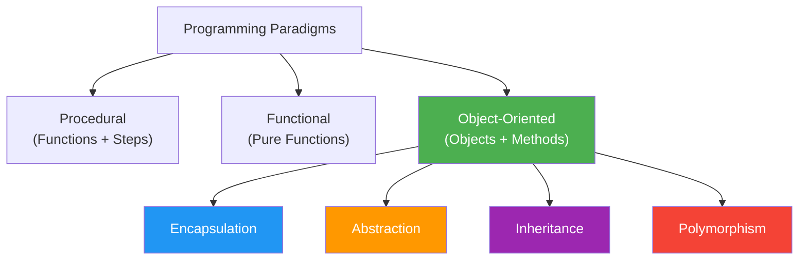

# What is Object-Oriented Programming (OOP)?

## Introduction

**Object-Oriented Programming (OOP)** is a programming paradigm that organizes software design around **objects** rather than functions and logic. An object is a self-contained entity that contains both **data** (properties) and **behavior** (methods).

OOP was developed to manage the growing complexity of software systems. As programs grew larger, the limitations of procedural programming became clear — code became tangled, hard to maintain, and difficult to extend.

### Why Does OOP Exist?

- **To model real-world entities naturally** — Objects map directly to real things (a user, a product, a bank account)
- **To manage complexity** — Break large systems into smaller, manageable pieces
- **To promote reusability** — Objects and classes can be reused across projects
- **To improve maintainability** — Changes in one object don't break others

### Why Do Developers Use It?

- Most modern applications (web, mobile, desktop) are built using OOP
- Major frameworks (React, Angular, Spring, Django) are OOP-based
- It's the dominant paradigm in industry for large-scale applications
- Interview questions heavily focus on OOP concepts

---

## Programming Paradigms Overview

A **programming paradigm** is a style or way of writing code. There are three major paradigms:

### 1. Procedural Programming

Focuses on writing **procedures** (functions) that operate on data. Code is organized as a sequence of steps.

```javascript
// Procedural approach
let balance = 0;

function deposit(amount) {
  balance += amount;
}

function withdraw(amount) {
  if (amount <= balance) {
    balance -= amount;
  }
}

deposit(100);
withdraw(50);
console.log(balance); // 50
```

### 2. Functional Programming

Focuses on **pure functions** and **immutable data**. Avoids shared state and side effects.

```javascript
// Functional approach
const deposit = (balance, amount) => balance + amount;
const withdraw = (balance, amount) =>
  amount <= balance ? balance - amount : balance;

const balance = deposit(0, 100);
const newBalance = withdraw(balance, 50);
console.log(newBalance); // 50
```

### 3. Object-Oriented Programming

Focuses on **objects** that contain both data and methods that operate on that data.

```javascript
// OOP approach
class BankAccount {
  constructor() {
    this.balance = 0;
  }

  deposit(amount) {
    this.balance += amount;
  }

  withdraw(amount) {
    if (amount <= this.balance) {
      this.balance -= amount;
    }
  }

  getBalance() {
    return this.balance;
  }
}

const account = new BankAccount();
account.deposit(100);
account.withdraw(50);
console.log(account.getBalance()); // 50
```

---

## Comparison Table

| Feature | Procedural | Functional | Object-Oriented |
|---------|-----------|------------|-----------------|
| **Primary Focus** | Functions / Procedures | Pure Functions | Objects |
| **Data & Behavior** | Separate | Separate | Combined |
| **State Management** | Mutable shared state | Immutable | Encapsulated in objects |
| **Code Organization** | Functions + Data structures | Functions | Classes / Objects |
| **Reusability** | Low (copy-paste) | Medium (higher-order functions) | High (inheritance, composition) |
| **Scalability** | Poor for large systems | Good for data processing | Excellent for large systems |
| **Learning Curve** | Low | Medium | Medium-High |
| **Real-World Mapping** | Poor | Fair | Excellent |
| **Testing** | Difficult (shared state) | Easy (pure functions) | Medium (mocking) |
| **Concurrency** | Difficult | Excellent | Medium |

---

## Visual Overview



---

## Real-World Analogy: A Restaurant

| OOP Concept | Restaurant Analogy |
|-------------|-------------------|
| **Class** | A job description template (Chef, Waiter, Manager) |
| **Object** | An actual person filling that role (Chef John, Waiter Sarah) |
| **Encapsulation** | The kitchen is hidden from customers; orders go through the counter |
| **Abstraction** | You press buttons on a coffee machine, not wiring inside |
| **Inheritance** | A pizza chef is a type of chef, shares skills but adds specialization |
| **Polymorphism** | Different chefs can all "cook()" but produce different dishes |

---

## Key Characteristics of OOP

1. **Everything is an object** — Programs are collections of interacting objects
2. **Objects have identity** — Each object is unique and distinguishable
3. **Objects communicate** — Objects interact by calling each other's methods
4. **Objects encapsulate state** — Internal data is protected from outside access
5. **Code is organized by behavior** — Related behaviors are grouped in classes

---

## Best Practices

- Start with procedural for small scripts; use OOP when complexity grows
- Don't force OOP — not every problem needs classes
- Keep objects focused (Single Responsibility Principle)
- Favor composition over inheritance
- Design for interfaces, not implementations

---

## Common Mistakes

- **Over-engineering** — Creating classes for everything, even simple data
- **God objects** — One object that does everything
- **Premature abstraction** — Abstracting before understanding the problem
- **Deep inheritance hierarchies** — More than 3-4 levels becomes unmanageable

---

## Interview Questions

**Easy:**
1. What is OOP and why is it used?
2. What are the four main principles of OOP?
3. How is OOP different from procedural programming?

**Medium:**
4. What are the advantages and disadvantages of OOP?
5. When would you choose OOP over functional programming?
6. How does OOP help with code maintainability?

**Advanced:**
7. Compare and contrast OOP with functional programming in terms of state management and concurrency.
8. Explain how OOP principles apply in dynamically-typed languages like JavaScript vs statically-typed languages like Java.
9. What is the "expression problem" and how does OOP address it differently than functional programming?

---

## Summary

| Concept | Takeaway |
|---------|----------|
| **OOP** | Programming paradigm based on objects with data + behavior |
| **Why?** | Manages complexity, models real world, promotes reuse |
| **Paradigms** | Procedural (functions), Functional (pure functions), OOP (objects) |
| **Key Benefit** | Code is organized, maintainable, and scalable |

---

**Previous Topic:** None (Start Here)
**Next Topic:** [Procedural vs OOP →](/DSA-Notes-Problems/oops/02-procedural-vs-oops)
**Related Topics:** [Classes](/DSA-Notes-Problems/oops/03-class), [Objects](/DSA-Notes-Problems/oops/04-object)
