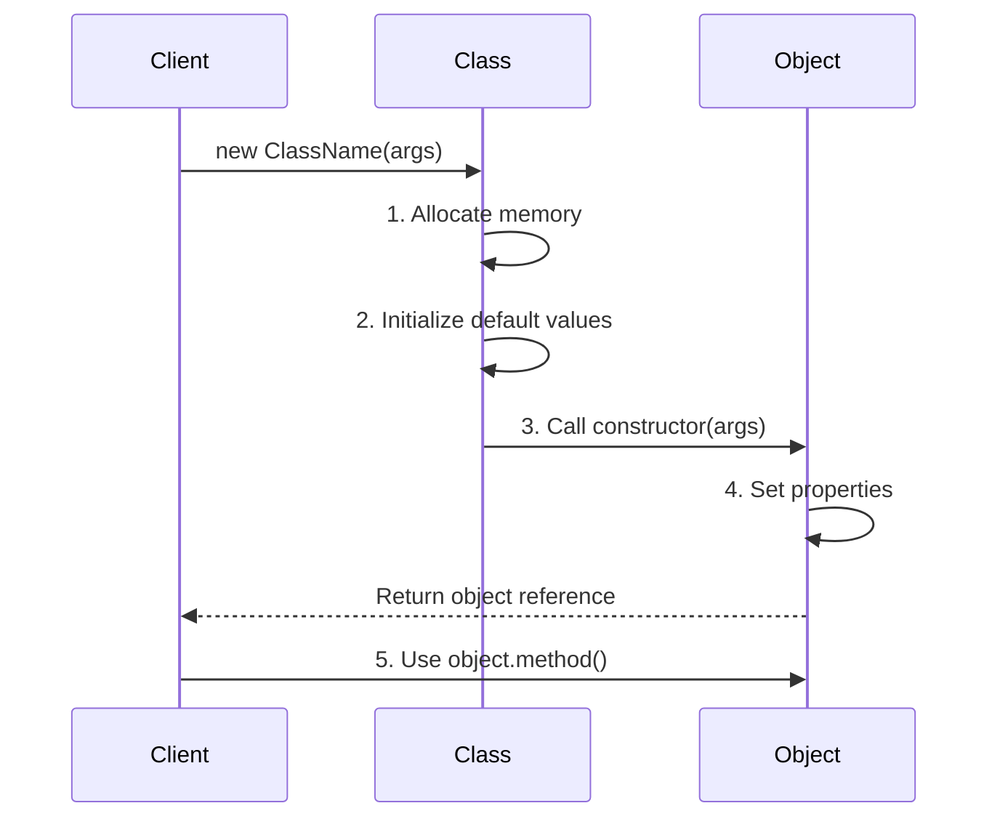

import { Tabs, TabItem } from '@astrojs/starlight/components';

# Constructor

## Introduction

A **constructor** is a special method that is automatically called when an object is created. Its primary purpose is to **initialize** the new object — set up initial values, allocate resources, and perform any setup the object needs before it's used.

### Why Does It Exist?
- Ensures objects are created in a **valid initial state**
- **Automates initialization** — no manual setup after creation
- Allows **parameterization** — creating objects with different initial values

### Why Do Developers Use It?
- To guarantee objects are ready to use immediately after creation
- To enforce required parameters for object creation
- To set up default values and configurations

---

## Real-World Analogy: Building a House

When you build a house, the constructors set it up:
- **Default constructor**: You get a basic empty lot
- **Parameterized constructor**: You specify the number of rooms, color, and layout
- **Constructor chaining**: You start with a foundation, then add floors, then roof

Without a constructor, you'd have a pile of materials. With it, you get a ready-to-move-in house.

---

## Definition

A **constructor** is a special method that:
- Has the same name as the class (in Java, C#)
- Is called automatically when using the `new` keyword
- Has no return type (not even `void`)
- Initializes the object's state

---

## Why Do We Need It?

Without constructors:

```javascript
// Without a constructor — manual setup, easy to forget
const user = {};
user.name = "John";
user.email = "john@email.com";
// What if we forget to set email? The object is in an invalid state.
```

With constructors:

```javascript
class User {
  constructor(name, email) {
    this.name = name;
    this.email = email;
    this.isActive = true; // Default value
  }
}

// Object is fully initialized after creation
const user = new User("John", "john@email.com");
```

---

## Visual Explanation: Object Lifecycle



---

## Types of Constructors

### 1. Default Constructor

A constructor with no parameters. If you don't define any constructor, most languages provide a default one automatically.

```javascript
// JavaScript — if no constructor is defined, an empty one is implied
class Car {
  // Default constructor is: constructor() {}
}

const car = new Car(); // Works, but properties are undefined
```

```javascript
// Explicit default constructor
class Car {
  constructor() {
    this.brand = "Unknown";
    this.color = "White";
  }
}

const car = new Car();
console.log(car.brand); // "Unknown"
```

### 2. Parameterized Constructor

Accepts arguments to initialize the object with specific values.

```javascript
class Car {
  constructor(brand, color, year) {
    this.brand = brand;
    this.color = color;
    this.year = year;
  }
}

const car = new Car("Toyota", "Red", 2023);
console.log(car.brand); // "Toyota"
```

### 3. Constructor Chaining (Calling parent constructor)

When a class inherits from another, the child constructor must call the parent constructor.

```javascript
class Vehicle {
  constructor(type) {
    this.type = type;
  }
}

class Car extends Vehicle {
  constructor(brand, color) {
    super("Car"); // Call parent constructor FIRST
    this.brand = brand;
    this.color = color;
  }
}
```

---

## Code Examples

<Tabs>
<TabItem label="JavaScript">

```javascript
class Book {
  // Default values with parameterized constructor
  constructor(title = "Untitled", author = "Unknown", pages = 0) {
    this.title = title;
    this.author = author;
    this.pages = pages;
    this.isCheckedOut = false;
    this.createdAt = new Date();
  }

  getInfo() {
    return `'${this.title}' by ${this.author}`;
  }
}

const book1 = new Book("1984", "George Orwell", 328);
const book2 = new Book(); // Uses defaults
const book3 = new Book("The Hobbit"); // Partial parameters

console.log(book1.getInfo()); // "'1984' by George Orwell"
console.log(book2.title);     // "Untitled"
console.log(book3.title);     // "The Hobbit"
console.log(book3.author);    // "Unknown"
```

</TabItem>
<TabItem label="TypeScript">

```typescript
class DatabaseConnection {
  private connection: any;
  private isConnected: boolean = false;

  // Shorthand constructor — declares AND initializes properties
  constructor(
    private host: string,
    private port: number,
    private username: string,
    private password: string
  ) {}

  // Multiple constructors are NOT supported in TS/JS
  // Use static factory methods instead
  static createLocal(): DatabaseConnection {
    return new DatabaseConnection("localhost", 5432, "admin", "admin");
  }

  static fromConfig(config: { host: string; port: number }): DatabaseConnection {
    return new DatabaseConnection(config.host, config.port, "admin", "secret");
  }

  async connect(): Promise<void> {
    // Connection logic...
    this.isConnected = true;
  }
}

// Different ways to create instances
const db1 = new DatabaseConnection("prod.example.com", 5432, "user", "pass");
const db2 = DatabaseConnection.createLocal();
```

</TabItem>
<TabItem label="Python">

```python
class Student:
    def __init__(self, name: str, student_id: int, grades: list[int] = None):
        """
        Constructor (__init__) for Student class.
        __init__ is NOT the constructor — it initializes after creation.
        __new__ is the actual constructor in Python.
        """
        self.name = name
        self.student_id = student_id
        self.grades = grades if grades is not None else []
        self.attendance = 0

    def __str__(self) -> str:
        return f"Student({self.name}, ID: {self.student_id})"

# Usage
alice = Student("Alice", 101, [85, 92, 78])
bob = Student("Bob", 102)  # grades defaults to []

print(alice)  # "Student(Alice, ID: 101)"
```

</TabItem>
<TabItem label="Java">

```java
public class Rectangle {
    private double width;
    private double height;

    // Default constructor
    public Rectangle() {
        this(1.0, 1.0); // Constructor chaining
    }

    // Parameterized constructor
    public Rectangle(double width, double height) {
        // Validation in constructor
        if (width <= 0 || height <= 0) {
            throw new IllegalArgumentException("Dimensions must be positive");
        }
        this.width = width;
        this.height = height;
    }

    // Copy constructor
    public Rectangle(Rectangle other) {
        this(other.width, other.height);
    }

    public double area() { return width * height; }
}

// Usage
Rectangle r1 = new Rectangle();            // 1x1
Rectangle r2 = new Rectangle(5, 3);        // 5x3
Rectangle r3 = new Rectangle(r2);          // Copy of r2
```

</TabItem>
</Tabs>

Some languages support multiple constructors with different parameter lists.

### Java

```java
public class Message {
    private String text;
    private String sender;
    private long timestamp;

    public Message() {
        this("", "System");
    }

    public Message(String text) {
        this(text, "Anonymous");
    }

    public Message(String text, String sender) {
        this.text = text;
        this.sender = sender;
        this.timestamp = System.currentTimeMillis();
    }
}
```

*Note: JavaScript and Python don't support constructor overloading. Use default parameters or factory methods instead.*

---

## Constructor Patterns

### Factory Method Pattern (Alternative to overloading)

```javascript
class Logger {
  constructor(level) {
    this.level = level;
  }

  // Static factory methods
  static createDevLogger() {
    return new Logger("debug");
  }

  static createProdLogger() {
    return new Logger("error");
  }

  static createTestLogger() {
    return new Logger("silent");
  }
}

const logger = Logger.createDevLogger();
```

### Builder Pattern (For complex construction)

```javascript
class Pizza {
  constructor() {
    this.size = "medium";
    this.toppings = [];
    this.crust = "regular";
  }
}

class PizzaBuilder {
  constructor() { this.pizza = new Pizza(); }

  setSize(size) { this.pizza.size = size; return this; }
  addTopping(topping) { this.pizza.toppings.push(topping); return this; }
  setCrust(crust) { this.pizza.crust = crust; return this; }

  build() { return this.pizza; }
}

const pizza = new PizzaBuilder()
  .setSize("large")
  .addTopping("pepperoni")
  .addTopping("mushrooms")
  .setCrust("stuffed")
  .build();
```

---

## Best Practices

- **Validate parameters** in the constructor to ensure valid state
- **Don't do heavy work** in constructors — initialize only, defer heavy logic
- **Use default parameters** for optional values
- **Keep constructors simple** — if it's complex, use a factory or builder
- **Call `super()` first** in derived class constructors
- **Avoid throwing exceptions** in constructors when possible

---

## Common Mistakes

- **Calling methods that can be overridden** in constructors (Java/C#)
- **Performing I/O in constructors** — makes testing difficult
- **Leaking `this` reference** before object is fully constructed
- **Too many parameters** — consider an options object or builder
- **Not calling `super()`** in derived class constructors

---

## Interview Questions

**Easy:**
1. What is a constructor?
2. What's the difference between a default and parameterized constructor?
3. Is a constructor required in a class?

**Medium:**
4. What is constructor chaining and why is it needed?
5. Can constructors be inherited?
6. What is constructor overloading?

**Advanced:**
7. How does JavaScript's constructor differ from Java's constructor?
8. What is the difference between `__init__` and `__new__` in Python?
9. Explain the builder pattern as an alternative to complex constructors.

---

## Summary

| Concept | Key Point |
|---------|-----------|
| **Constructor** | Special method called when creating an object |
| **Purpose** | Initialize object to a valid state |
| **Default** | No-args constructor provided automatically if none defined |
| **Parameterized** | Constructor with parameters for custom initialization |
| **Chaining** | `super()` calls parent constructor in inheritance |
| **Overloading** | Multiple constructors with different parameters (Java/C#) |
| **Factory** | Alternative pattern for flexible object creation |

---

**Previous Topic:** [Object →](/DSA-Notes-Problems/oops/02-classes-objects/object)
**Next Topic:** [this Keyword →](/DSA-Notes-Problems/oops/02-classes-objects/this-keyword)
**Related Topics:** [Class](/DSA-Notes-Problems/oops/02-classes-objects/class), [Object Lifecycle](/DSA-Notes-Problems/oops/05-advanced-concepts/object-lifecycle)
