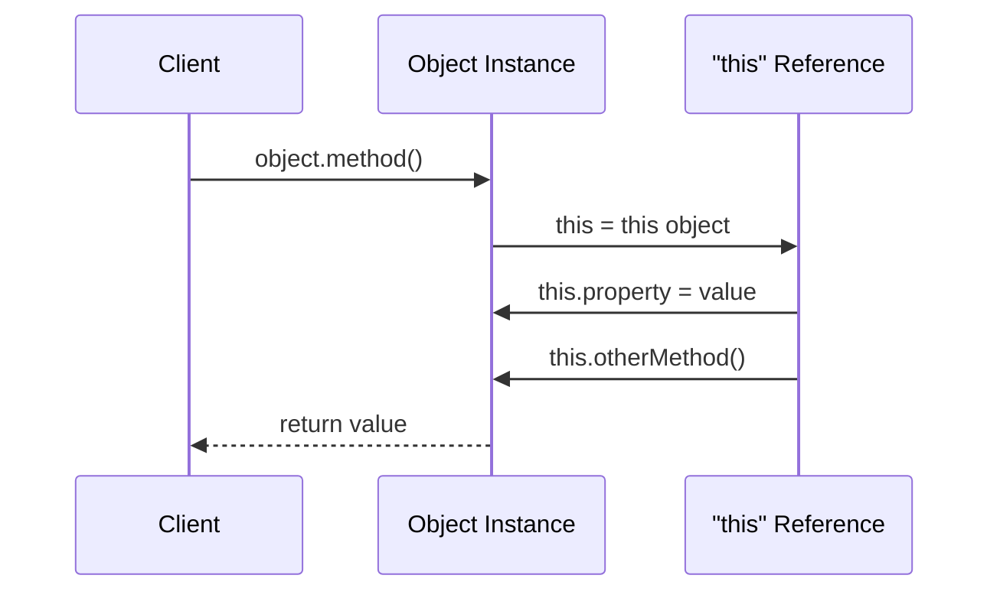

import { Tabs, TabItem } from '@astrojs/starlight/components';

# this Keyword

## Introduction

The **`this`** keyword refers to the **current object** — the object that is executing the current method. It's how an object refers to itself from within its own code.

### Why Does It Exist?
- Allows methods to access the object's own properties
- Disambiguates between parameters and object properties
- Enables method chaining (returning `this`)
- Provides context for how a function is called

### Why Do Developers Use It?
- To access and modify object properties from within methods
- To pass the current object to other methods
- To implement method chaining (fluent interfaces)

---

## Real-World Analogy: Saying "Myself"

When you say "I will do it myself," you're using a concept like `this`. In a conversation:
- "**I** am speaking" → the current speaker refers to themselves
- "**My** name" → the speaker's own name
- "**I** will call **myself**" → the speaker performs an action on themselves

Similarly, `this` is how an object says "**me**" or "**my**" from within its code.

---

## Definition

**`this`** is a reference to the current object — the object on which a method is being invoked. It provides a way for methods to access the object's own properties and methods.

---

## Why Do We Need It?

Without `this`, you'd have to pass the object reference manually:

```javascript
// Without 'this' — awkward and error-prone
function greet(user) {
  return `Hello, ${user.name}!`;
}

// With 'this' — clean and natural
class User {
  constructor(name) {
    this.name = name;
  }

  greet() {
    return `Hello, ${this.name}!`;
  }
}
```

---

## Visual Explanation



---

## `this` in Different Languages

<Tabs>
<TabItem label="JavaScript">

`this` in JavaScript depends on **how** a function is called, not where it's defined.

```javascript
// 1. Method call — 'this' is the object
const obj = {
  name: "Alice",
  greet() {
    console.log(this.name); // "Alice"
  }
};
obj.greet(); // 'this' → obj

// 2. Function call — 'this' is global (or undefined in strict mode)
function showThis() {
  console.log(this); // Window (non-strict) or undefined (strict)
}
showThis();

// 3. Arrow functions — 'this' is lexical (from surrounding scope)
const obj2 = {
  name: "Bob",
  greet: () => {
    console.log(this.name); // undefined! 'this' is from outer scope
  }
};

// 4. Constructor call — 'this' is the new instance
function Person(name) {
  this.name = name; // 'this' → new instance
}
const p = new Person("Charlie");

// 5. Event handlers — 'this' is the element
button.addEventListener("click", function() {
  console.log(this); // button element
});
```

#### Controlling `this` with bind, call, apply

```javascript
function greet(greeting) {
  console.log(`${greeting}, ${this.name}!`);
}

const user = { name: "David" };

// call — invoke with specific 'this' and arguments
greet.call(user, "Hello"); // "Hello, David!"

// apply — same as call, but arguments as array
greet.apply(user, ["Hi"]); // "Hi, David!"

// bind — create new function with fixed 'this'
const boundGreet = greet.bind(user);
boundGreet("Hey"); // "Hey, David!"
```

</TabItem>
<TabItem label="TypeScript">

```typescript
class Counter {
  private count: number = 0;

  // 'this' is the class instance
  increment(): this {
    this.count++;
    return this; // Method chaining
  }

  // TypeScript can type-check 'this' parameters
  log(this: { count: number }): void {
    console.log(this.count);
  }
}

const c = new Counter();
c.increment().increment().log(); // 2
```

</TabItem>
<TabItem label="Python (`self`)">

Python uses `self` instead of `this`. It's explicitly declared as the first parameter.

```python
class Person:
    def __init__(self, name: str):
        self.name = name  # 'self' refers to the instance

    def greet(self):
        # 'self' must be the first parameter
        return f"Hello, {self.name}! "

    def rename(self, new_name: str) -> 'Person':
        self.name = new_name
        return self  # Method chaining

# Usage
p = Person("Alice")
print(p.greet())  # "Hello, Alice!"
p.rename("Bob").greet()  # Method chaining
```

</TabItem>
<TabItem label="Java">

```java
public class Employee {
    private String name;
    private double salary;

    public Employee(String name, double salary) {
        // 'this' disambiguates parameter from field
        this.name = name;
        this.salary = salary;
    }

    public Employee setSalary(double salary) {
        this.salary = salary;
        return this; // Method chaining
    }

    public void printInfo() {
        System.out.println(this.name + ": $" + this.salary);
        // 'this' is optional here, but explicit is clearer
    }
}
```

</TabItem>
</Tabs>

---

## `this` in Different Contexts

| Context | JavaScript | TypeScript | Python | Java |
|---------|-----------|------------|--------|------|
| **Method** | The object | The object | The instance (`self`) | The instance |
| **Constructor** | New instance | New instance | New instance (`self`) | New instance |
| **Global scope** | `window`/`global` | N/A | Module-level | N/A |
| **Event handler** | The element | The element | N/A | N/A |
| **Arrow function** | Lexical (outer scope) | Lexical | N/A | N/A |
| **Static method** | The class | The class | The class (`cls`) | The class |

---

## Common Uses of `this`

### 1. Accessing Properties
```javascript
class Circle {
  constructor(radius) {
    this.radius = radius;
  }

  area() {
    return Math.PI * this.radius ** 2;
  }
}
```

### 2. Calling Other Methods
```javascript
class Timer {
  start() {
    console.log("Starting...");
    this.tick();
  }

  tick() {
    console.log("Tick...");
  }
}
```

### 3. Method Chaining
```javascript
class QueryBuilder {
  constructor() { this.query = {}; }

  select(fields) { this.query.fields = fields; return this; }
  from(table) { this.query.table = table; return this; }
  where(condition) { this.query.where = condition; return this; }

  execute() {
    console.log("Executing:", this.query);
  }
}

new QueryBuilder()
  .select(["name", "email"])
  .from("users")
  .where("age > 18")
  .execute();
```

### 4. Passing Current Object
```javascript
class Button {
  constructor(label) {
    this.label = label;
  }

  onClick() {
    console.log(`${this.label} clicked`);
    notificationCenter.notify("click", this); // Pass 'this'
  }
}
```

---

## Best Practices

- **In JavaScript, prefer arrow functions** for callbacks to preserve `this`
- **Use `bind` in constructors** for method callbacks
- **Be explicit** — use `this.property` even when not required (clarity)
- **Avoid relying on `this` in global scope**
- **Use method shorthand** syntax (`method() {}`) in JavaScript objects
- **Use `that = this` pattern** only in older JavaScript code (prefer arrow functions)

---

## Common Mistakes

### 1. Losing `this` in Callbacks
```javascript
class Logger {
  constructor(prefix) {
    this.prefix = prefix;
  }

  log(message) {
    console.log(`${this.prefix}: ${message}`);
  }

  startLogging() {
    // ❌ Bug: 'this' is undefined in setTimeout callback
    setInterval(function() {
      this.log("tick"); // TypeError: this.log is not a function
    }, 1000);

    // ✅ Fix: Use arrow function
    setInterval(() => {
      this.log("tick"); // Works!
    }, 1000);
  }
}
```

### 2. Arrow Functions as Methods
```javascript
// ❌ Arrow function as method — 'this' is wrong
const obj = {
  name: "Test",
  greet: () => {
    console.log(this.name); // undefined (this is from outer scope)
  }
};

// ✅ Regular function as method
const obj2 = {
  name: "Test",
  greet() {
    console.log(this.name); // "Test"
  }
};
```

---

## Interview Questions

**Easy:**
1. What is the `this` keyword?
2. What does `this` refer to in a class method?

**Medium:**
3. How does `this` behave differently in arrow functions vs regular functions?
4. What's the difference between `call`, `apply`, and `bind`?
5. What does `this` refer to in the global scope?

**Advanced:**
6. Explain how `this` is determined in JavaScript (the 4 rules: default, implicit, explicit, new).
7. How does `this` work in event handlers in the browser?
8. Why does Python use `self` as an explicit parameter instead of a keyword like `this`?

---

## Summary

| Aspect | Behavior |
|--------|----------|
| **`this`** | Reference to the current object |
| **Purpose** | Access object's own properties and methods |
| **JavaScript** | Dynamic — depends on how function is called |
| **Python** | Explicit `self` — always the instance |
| **Java/C#** | Always the current instance |
| **Arrow Functions** | Lexical `this` (inherits from outer scope) |
| **Method Chaining** | Return `this` from methods |
| **bind/call/apply** | Explicitly set `this` value |

---

**Previous Topic:** [Constructor →](/DSA-Notes-Problems/oops/02-classes-objects/constructor)
**Next Topic:** [Four Pillars of OOP →](/DSA-Notes-Problems/oops/03-four-pillars/)
**Related Topics:** [Class](/DSA-Notes-Problems/oops/02-classes-objects/class), [Object](/DSA-Notes-Problems/oops/02-classes-objects/object)
