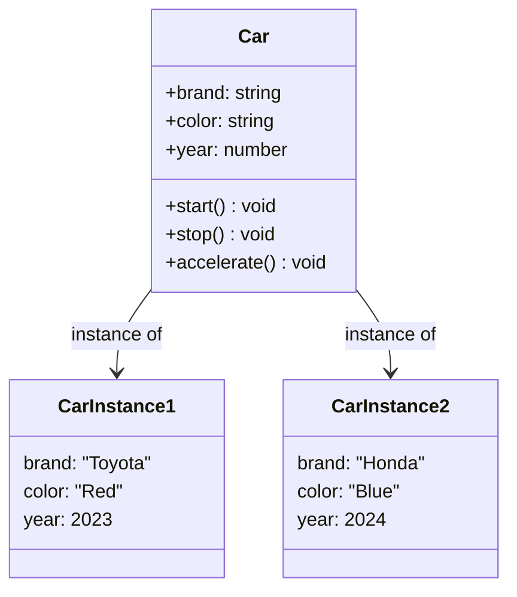
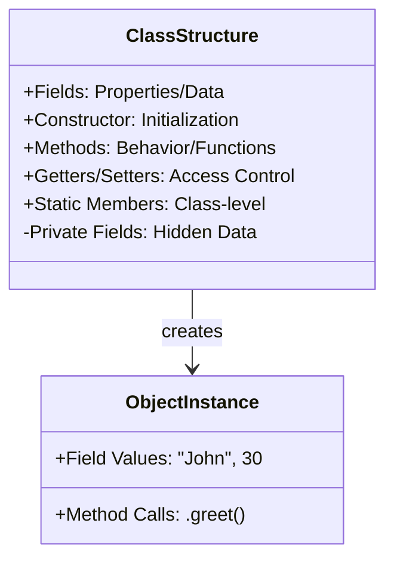

# Class

## Introduction

A **class** is a blueprint or template for creating objects. It defines what properties (data) and methods (behavior) the objects created from it will have.

Think of a class as a **cookie cutter** and objects as the **cookies**. The cookie cutter defines the shape, but each cookie is a separate instance.

### Why Does It Exist?
- Provides a **template** so you don't write the same code repeatedly
- **Organizes code** by grouping related properties and methods
- **Reusability** — One class can create many objects
- **Maintainability** — Change the class, all objects get the update

### Why Do Developers Use It?
- To model real-world entities (User, Product, Order)
- To create multiple instances with shared behavior but independent data
- To organize code in a logical, hierarchical way

---

## Real-World Analogy: A House Blueprint

| Concept | Analogy |
|---------|---------|
| **Class** | The blueprint/architectural plan for a house |
| **Blueprint Details** | Specifies rooms (properties), plumbing/electrical (methods) |
| **Object (Instance)** | The actual physical house built from that blueprint |
| **Multiple Objects** | Many houses can be built from the same blueprint |

A blueprint is **not** a house — it's the **idea** of a house. Similarly, a class is **not** an object — it's the **definition** of an object.

---

## Definition

A **class** is a user-defined data type that serves as a template for creating objects. It encapsulates data (fields/properties) and functions (methods) that operate on that data.

---

## Why Do We Need It?

Without classes, you'd have to manually create each object:

```javascript
// Without a class — repetitive and error-prone
const car1 = { brand: "Toyota", color: "Red", start() { /* ... */ } };
const car2 = { brand: "Honda", color: "Blue", start() { /* ... */ } };
const car3 = { brand: "Ford", color: "Black", start() { /* ... */ } };
```

With a class:

```javascript
class Car {
  constructor(brand, color) {
    this.brand = brand;
    this.color = color;
  }

  start() {
    console.log(`${this.brand} is starting...`);
  }
}

const car1 = new Car("Toyota", "Red");
const car2 = new Car("Honda", "Blue");
const car3 = new Car("Ford", "Black");
```

---

## Visual Explanation



---

## Code Examples

### JavaScript

```javascript
// ES6 Class Syntax
class Person {
  // Constructor — called when creating a new instance
  constructor(name, age) {
    this.name = name;
    this.age = age;
  }

  // Method
  greet() {
    return `Hi, I'm ${this.name} and I'm ${this.age} years old.`;
  }

  // Getter
  get birthYear() {
    return new Date().getFullYear() - this.age;
  }

  // Setter
  set birthYear(year) {
    this.age = new Date().getFullYear() - year;
  }

  // Static method — called on the class itself, not instances
  static createAnonymous() {
    return new Person("Anonymous", 0);
  }
}

const john = new Person("John", 30);
console.log(john.greet()); // "Hi, I'm John and I'm 30 years old."
console.log(john.birthYear); // 1994
john.birthYear = 1990;
console.log(john.age); // 34

const anonymous = Person.createAnonymous();
```

### TypeScript

```typescript
// TypeScript adds type annotations and access modifiers
class Employee {
  // Access modifiers: public (default), private, protected
  public name: string;
  private salary: number;
  protected department: string;

  constructor(name: string, salary: number, department: string) {
    this.name = name;
    this.salary = salary;
    this.department = department;
  }

  // Shorthand constructor (TypeScript)
  // constructor(
  //   public name: string,
  //   private salary: number,
  //   protected department: string
  // ) {}

  public getSalary(): number {
    return this.salary;
  }

  public work(): string {
    return `${this.name} is working in ${this.department}`;
  }
}

const emp = new Employee("Alice", 75000, "Engineering");
console.log(emp.name); // "Alice"
// console.log(emp.salary); // ❌ Error: Property 'salary' is private
console.log(emp.getSalary()); // 75000
```

### Python

```python
class Book:
    # Class variable — shared by all instances
    total_books = 0

    # Constructor
    def __init__(self, title: str, author: str, pages: int):
        # Instance variables
        self.title = title
        self.author = author
        self.pages = pages
        Book.total_books += 1

    # Instance method
    def description(self) -> str:
        return f"'{self.title}' by {self.author}, {self.pages} pages"

    # Class method
    @classmethod
    def create_empty(cls) -> 'Book':
        return cls("Unknown", "Unknown", 0)

    # Static method
    @staticmethod
    def is_valid_title(title: str) -> bool:
        return len(title) > 0 and len(title) < 200


book1 = Book("1984", "George Orwell", 328)
book2 = Book("To Kill a Mockingbird", "Harper Lee", 281)
print(book1.description())  # "'1984' by George Orwell, 328 pages"
print(Book.total_books)     # 2
```

### Java

```java
// Java — explicit and strongly-typed
public class Student {
    // Fields
    private String name;
    private int id;
    private double gpa;

    // Constructor
    public Student(String name, int id) {
        this.name = name;
        this.id = id;
        this.gpa = 0.0;
    }

    // Methods
    public void setGpa(double gpa) {
        if (gpa >= 0.0 && gpa <= 4.0) {
            this.gpa = gpa;
        }
    }

    public double getGpa() {
        return this.gpa;
    }

    public String getGrade() {
        if (gpa >= 3.7) return "A";
        if (gpa >= 2.7) return "B";
        if (gpa >= 1.7) return "C";
        return "D";
    }

    // Static method
    public static Student createFreshman(String name, int id) {
        return new Student(name, id);
    }
}
```

---

## Class Components

| Component | Description | Example |
|-----------|-------------|---------|
| **Fields/Properties** | Data the object holds | `name`, `age`, `color` |
| **Constructor** | Special method to initialize objects | `constructor(name, age)` |
| **Methods** | Functions that define behavior | `greet()`, `start()` |
| **Getters/Setters** | Controlled access to properties | `get fullName()` |
| **Static Members** | Belong to the class, not instances | `Math.PI`, `Array.from()` |
| **Access Modifiers** | Control visibility | `public`, `private`, `protected` |

---

## Mermaid Diagram: Class Structure



---

## Best Practices

- **Single Responsibility** — A class should have one reason to change
- **Meaningful Names** — Name classes as nouns (User, Payment, Order)
- **Keep it Focused** — Don't create "God classes" that do everything
- **Favor Composition** — Prefer combining small classes over large inheritance
- **Limit Constructor Work** — Constructors should only initialize, not do logic
- **Use Static Members Wisely** — Only for truly class-level behavior

---

## Common Mistakes

- **Doing too much in the constructor** — Constructors should set up, not process
- **Too many parameters** — If a constructor needs 6+ parameters, consider a builder pattern
- **Public fields by default** — Always consider making fields private first
- **Classes without a clear purpose** — If you can't describe it in one sentence, it's too broad
- **Mixing concerns** — A class shouldn't handle both database and presentation logic

---

## Interview Questions

**Easy:**
1. What is a class in OOP?
2. What's the difference between a class and an object?
3. What are the main components of a class?

**Medium:**
4. What is a constructor and why is it important?
5. What are static methods and when would you use them?
6. How do access modifiers (public, private, protected) work?

**Advanced:**
7. Explain the concept of "class-level" vs "instance-level" members.
8. How does class inheritance affect the constructor chain?
9. In JavaScript, how does the `class` syntax differ from prototype-based inheritance under the hood?

---

## Summary

| Concept | Key Point |
|---------|-----------|
| **Class** | Blueprint/template for creating objects |
| **Fields** | Data that each object will hold |
| **Methods** | Behavior that each object can perform |
| **Constructor** | Special method to initialize new objects |
| **Static** | Belongs to class, not instances |
| **One class = one responsibility** | Keep classes focused and small |

---

**Previous Topic:** [Procedural vs OOP →](/DSA-Notes-Problems/oops/02-procedural-vs-oops)
**Next Topic:** [Object →](/DSA-Notes-Problems/oops/04-object)
**Related Topics:** [Constructor →](/DSA-Notes-Problems/oops/05-constructor), [Static Members →](/DSA-Notes-Problems/oops/19-static-members)
