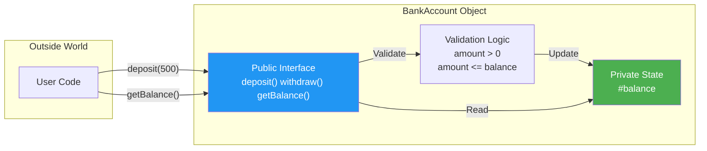

import { Tabs, TabItem } from '@astrojs/starlight/components';

# Encapsulation

## Introduction

**Encapsulation** is the practice of bundling data (properties) and methods (behavior) that operate on that data within a single unit (class/object), while **restricting direct access** to the internal state.

It's one of the four fundamental pillars of OOP, often called **data hiding**.

### Why Does It Exist?
- To **protect data** from accidental or unauthorized modification
- To **enforce invariants** — ensuring objects are always in a valid state
- To create a **clear interface** between an object and the outside world
- To **reduce complexity** by hiding implementation details

### Why Do Developers Use It?
- Prevents bugs caused by direct field manipulation
- Makes code more maintainable (change internals without affecting callers)
- Provides controlled access through getters and setters
- Enables validation and computation during access

---

## Real-World Analogy: ATM Machine

When you use an ATM:
- You **can't** directly access the bank's vault (encapsulated data)
- You can only use the **interface** (insert card, enter PIN, press buttons)
- The ATM **validates** your actions (sufficient balance? correct PIN?)
- You never touch the actual money storage mechanism

This is encapsulation: the internal state (cash, account balances) is hidden, and all operations go through a controlled interface.

---

## Definition

**Encapsulation** is the mechanism of wrapping data (variables) and code (methods) together as a single unit, and restricting direct access to some of an object's components.

---

## Why Do We Need It?

Without encapsulation:

```javascript
// ❌ No encapsulation — anyone can change anything
let balance = 1000;

// Direct modification — no validation!
balance = -500; // Negative balance! Bug!
```

With encapsulation:

```javascript
// ✅ Encapsulated — controlled access
class BankAccount {
  #balance = 0;

  constructor(initial) {
    if (initial >= 0) this.#balance = initial;
  }

  deposit(amount) {
    if (amount > 0) {
      this.#balance += amount;
      return true;
    }
    return false;
  }

  withdraw(amount) {
    if (amount > 0 && amount <= this.#balance) {
      this.#balance -= amount;
      return true;
    }
    return false;
  }

  getBalance() {
    return this.#balance;
  }
}

const account = new BankAccount(1000);
// account.#balance = -500; // ❌ SyntaxError: Private field
account.deposit(500);
account.withdraw(200);
console.log(account.getBalance()); // 1300
```

---

## Visual Explanation



---

## Code Examples

<Tabs>
<TabItem label="JS #private">

```javascript
class Employee {
  // Private fields (using # syntax)
  #salary;
  #ssn;

  constructor(name, salary, ssn) {
    this.name = name;       // Public
    this.#salary = salary;  // Private
    this.#ssn = ssn;        // Private
  }

  // Public getter
  getSalary() {
    return this.#salary;
  }

  // Public setter with validation
  setSalary(amount) {
    if (amount >= 0) {
      this.#salary = amount;
    } else {
      throw new Error("Salary cannot be negative");
    }
  }

  // Private method
  #validateSSN() {
    return /^\d{3}-\d{2}-\d{4}$/.test(this.#ssn);
  }
}

const emp = new Employee("Alice", 75000, "123-45-6789");
console.log(emp.name);            // "Alice"
// console.log(emp.#salary);      // ❌ SyntaxError
console.log(emp.getSalary());     // 75000
emp.setSalary(80000);
```

</TabItem>
<TabItem label="JS Closure">

```javascript
function createCounter() {
  let count = 0; // Private via closure

  return {
    increment() {
      count++;
    },
    decrement() {
      count--;
    },
    getCount() {
      return count;
    }
  };
}

const counter = createCounter();
counter.increment();
counter.increment();
console.log(counter.getCount()); // 2
// console.log(counter.count);   // undefined — private
```

</TabItem>
<TabItem label="TypeScript">

```typescript
class Database {
  private connectionString: string;
  private isConnected: boolean = false;

  constructor(connectionString: string) {
    this.connectionString = connectionString;
  }

  // Public interface
  async connect(): Promise<void> {
    if (!this.isConnected) {
      await this.#establishConnection();
      this.isConnected = true;
    }
  }

  async disconnect(): Promise<void> {
    if (this.isConnected) {
      await this.#closeConnection();
      this.isConnected = false;
    }
  }

  // Private implementation
  private async #establishConnection(): Promise<void> {
    // Complex connection logic
  }

  private async #closeConnection(): Promise<void> {
    // Cleanup logic
  }
}

const db = new Database("postgres://localhost:5432/mydb");
await db.connect();
// db.isConnected; // ❌ Error: private
```

</TabItem>
<TabItem label="Python">

```python
class Temperature:
    def __init__(self, celsius: float = 0):
        self.__celsius = celsius  # Name mangling (private-like)

    # Property getter
    @property
    def celsius(self) -> float:
        return self.__celsius

    # Property setter with validation
    @celsius.setter
    def celsius(self, value: float):
        if value < -273.15:
            raise ValueError("Temperature below absolute zero!")
        self.__celsius = value

    @property
    def fahrenheit(self) -> float:
        return (self.__celsius * 9/5) + 32

# Usage
temp = Temperature(25)
print(temp.celsius)      # 25 (uses getter)
temp.celsius = 30        # Uses setter with validation
# temp.celsius = -300    # ❌ ValueError!
# print(temp.__celsius)  # ❌ AttributeError (name mangling)
```

</TabItem>
<TabItem label="Java">

```java
public class User {
    private String email;
    private String password;
    private boolean isActive;

    public User(String email) {
        this.email = email;
        this.isActive = true;
    }

    // Getter
    public String getEmail() {
        return email;
    }

    // Setter with validation
    public void setEmail(String email) {
        if (email != null && email.contains("@")) {
            this.email = email;
        } else {
            throw new IllegalArgumentException("Invalid email");
        }
    }

    // No getter for password — only verification
    public boolean verifyPassword(String input) {
        return this.password.equals(hash(input));
    }

    // Private helper
    private String hash(String input) {
        return input; // Actual hashing would happen here
    }
}
```

</TabItem>
</Tabs>

| Benefit | Description |
|---------|-------------|
| **Data Protection** | Prevents unauthorized or accidental modification |
| **Validation** | Control what values are assigned to properties |
| **Flexibility** | Change internal implementation without affecting users |
| **Maintainability** | Localize changes within the class |
| **Testability** | Test the interface, mock the internals |
| **Readability** | Clear separation of public API and private details |

---

## Best Practices

- **Default to private** — Make fields private unless there's a good reason to expose them
- **Use getters/setters** for controlled access to properties
- **Validate in setters** — Ensure data integrity before assignment
- **Don't expose internal references** — Return copies or immutable wrappers
- **Keep public API minimal** — Less surface area means less to maintain

---

## Common Mistakes

- **Making everything public** — Exposing internal state leads to tight coupling
- **Returning mutable references** to internal collections
- **Exposing too many getters** — If every field has a getter, you've created a data structure, not an object
- **Getters and setters for everything** — Don't add them until needed
- **Encapsulating incorrectly** — Putting related data in different objects

---

## Interview Questions

**Easy:**
1. What is encapsulation in OOP?
2. How does encapsulation improve code security?
3. What's the difference between public and private members?

**Medium:**
4. How is encapsulation implemented in JavaScript (different methods)?
5. What's the relationship between encapsulation and abstraction?
6. How do getters and setters support encapsulation?

**Advanced:**
7. How does encapsulation relate to the Single Responsibility Principle?
8. What's the difference between data hiding and encapsulation?
9. How do you handle encapsulation in functional programming?

---

## Summary

| Concept | Key Point |
|---------|-----------|
| **Encapsulation** | Bundling data + methods, hiding internals |
| **Purpose** | Protect data, enforce valid state |
| **Implementation** | Private fields + public methods |
| **Access Control** | Private → Protected → Public |
| **Benefits** | Security, flexibility, maintainability |
| **Rule of Thumb** | Make fields private; expose only what's needed |

---

**Previous Topic:** [Four Pillars →](/DSA-Notes-Problems/oops/03-four-pillars/)
**Next Topic:** [Abstraction →](/DSA-Notes-Problems/oops/03-four-pillars/abstraction)
**Related Topics:** [Access Modifiers](/DSA-Notes-Problems/oops/05-advanced-concepts/access-modifiers), [SOLID](/DSA-Notes-Problems/oops/06-design-principles/solid-principles)
