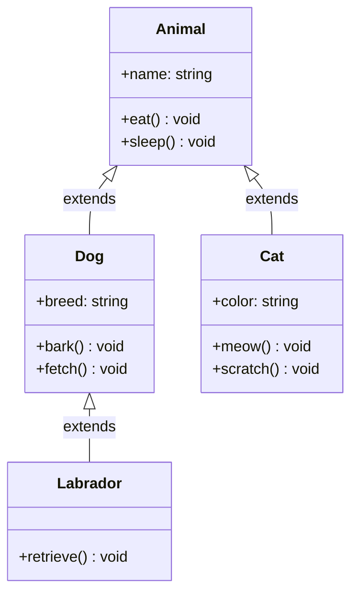

# Inheritance

## Introduction

**Inheritance** is a mechanism that allows a class (child/derived class) to inherit properties and methods from another class (parent/base class). It's one of the four pillars of OOP and enables **code reuse** and **hierarchical relationships**.

### Why Does It Exist?
- To **reuse code** without duplication
- To create **hierarchical relationships** between classes (IS-A relationship)
- To enable **polymorphism** through shared interfaces
- To create **specialized versions** of general concepts

### Why Do Developers Use It?
- To avoid rewriting common code in multiple classes
- To model real-world hierarchical relationships (Dog IS-A Animal)
- To create extensible frameworks and libraries
- To implement the Open/Closed Principle (open for extension, closed for modification)

---

## Real-World Analogy: Family Traits

Children inherit traits from their parents:
- **Parents** provide a genetic blueprint (eye color, height, certain behaviors)
- **Children** get all these traits automatically
- **Children** can also have their own unique traits
- **Children** can override inherited traits (e.g., dye their hair a different color)

A child IS-A descendant of their parent — the same type of relationship exists with class inheritance.

---

## Definition

**Inheritance** is the mechanism where a new class is derived from an existing class. The derived class automatically contains all non-private properties and methods of the base class, and can add new members or override existing ones.

---

## Why Do We Need It?

Without inheritance:

```javascript
// ❌ Without inheritance — duplicated code
class Dog {
  constructor(name) { this.name = name; }
  eat() { console.log(`${this.name} is eating`); }
  sleep() { console.log(`${this.name} is sleeping`); }
  bark() { console.log(`${this.name} barks`); }
}

class Cat {
  constructor(name) { this.name = name; }
  eat() { console.log(`${this.name} is eating`); } // Duplicate!
  sleep() { console.log(`${this.name} is sleeping`); } // Duplicate!
  meow() { console.log(`${this.name} meows`); }
}
```

With inheritance:

```javascript
// ✅ With inheritance — shared code in parent
class Animal {
  constructor(name) { this.name = name; }
  eat() { console.log(`${this.name} is eating`); }
  sleep() { console.log(`${this.name} is sleeping`); }
}

class Dog extends Animal {
  bark() { console.log(`${this.name} barks`); }
}

class Cat extends Animal {
  meow() { console.log(`${this.name} meows`); }
}
```

---

## Visual Explanation



---

## Types of Inheritance

Inheritance can be categorized into several types. [Click here to explore each type in detail →](/DSA-Notes-Problems/oops/03-four-pillars/inheritance/types/)

| Type | Description | Support | Example |
|------|-------------|---------|---------|
| **Single** | One child, one parent | All OOP languages | `Dog extends Animal` |
| **Multilevel** | Chain of inheritance | All OOP languages | `A → B → C` |
| **Hierarchical** | Many children, one parent | All OOP languages | `Animal → Dog, Cat, Bird` |
| **Multiple** | One child, many parents | Python, C++ | `Duck extends Animal, Flyable` |
| **Hybrid** | Combination | C++ | Rarely used |

---

## Code Examples

### Basic Inheritance

```javascript
class Vehicle {
  constructor(make, model, year) {
    this.make = make;
    this.model = model;
    this.year = year;
  }

  start() {
    console.log(`${this.make} ${this.model} is starting...`);
  }

  stop() {
    console.log(`${this.make} ${this.model} is stopping...`);
  }

  getInfo() {
    return `${this.year} ${this.make} ${this.model}`;
  }
}

class Car extends Vehicle {
  constructor(make, model, year, doors) {
    super(make, model, year); // Call parent constructor
    this.doors = doors;
  }

  honk() {
    console.log("Beep beep!");
  }

  // Override parent method
  getInfo() {
    return `${super.getInfo()} — ${this.doors} doors`;
  }
}

class ElectricCar extends Car {
  constructor(make, model, year, doors, batteryRange) {
    super(make, model, year, doors);
    this.batteryRange = batteryRange;
  }

  // Override
  start() {
    console.log(`⚡ ${this.make} ${this.model} is starting silently...`);
  }

  charge() {
    console.log("Charging battery...");
  }
}

const tesla = new ElectricCar("Tesla", "Model 3", 2024, 4, 358);
console.log(tesla.getInfo()); // "2024 Tesla Model 3 — 4 doors"
tesla.start();                // "⚡ Tesla Model 3 is starting silently..."
tesla.charge();               // "Charging battery..."
tesla.stop();                 // "Tesla Model 3 is stopping..."
```

---

## Best Practices

- **Favor composition over inheritance** — "Has-a" is often better than "is-a"
- **Keep inheritance hierarchies shallow** — 3-4 levels max
- **Follow the Liskov Substitution Principle** — child should be substitutable for parent
- **Use inheritance for behavior, not just code reuse**
- **Make base classes abstract** if they shouldn't be instantiated
- **Document overridden methods** — `super()` calls included

---

## Common Mistakes

- **Deep inheritance chains** — Hard to understand and maintain
- **Breaking LSP** — Child class that doesn't behave like parent
- **Overusing inheritance** for code reuse — composition is usually better
- **Calling overridable methods in constructors** — May call child method before child is initialized
- **Misusing `super`** — Forgetting to call parent constructor

---

## Summary

| Concept | Key Point |
|---------|-----------|
| **Inheritance** | Child class extends parent class (IS-A) |
| **Benefits** | Code reuse, hierarchical modeling, polymorphism |
| **Types** | Single, Multilevel, Hierarchical, Multiple, Hybrid |
| **super** | Access parent class constructor and methods |
| **Override** | Child redefines parent method |
| **Rule of Thumb** | Prefer composition unless IS-A is clearly satisfied |

---

**Previous Topic:** [Abstraction →](/DSA-Notes-Problems/oops/03-four-pillars/abstraction)
**Next Topic:** [Super Keyword →](/DSA-Notes-Problems/oops/03-four-pillars/inheritance/super-keyword)
**Related Topics:** [Types of Inheritance](/DSA-Notes-Problems/oops/03-four-pillars/inheritance/types/), [Method Overriding](/DSA-Notes-Problems/oops/03-four-pillars/inheritance/method-overriding)
