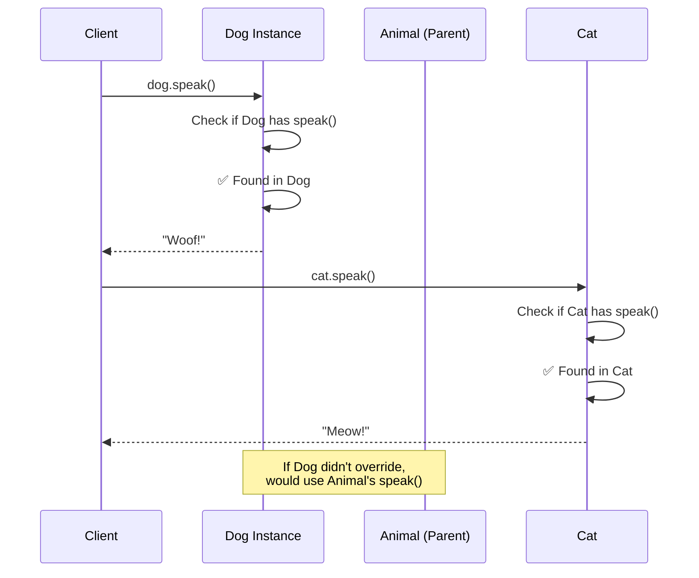

import { Tabs, TabItem } from '@astrojs/starlight/components';

# Method Overriding

## Introduction

**Method overriding** is a feature where a child class provides its own implementation of a method that is already defined in its parent class. It's a form of **run-time polymorphism** (dynamic dispatch).

### Why Does It Exist?
- To allow child classes to **customize** inherited behavior
- To implement **polymorphism** — same method name, different behavior
- To follow the **Open/Closed Principle** — extend behavior without modifying parent

---

## Real-World Analogy: Generic vs Specific Sounds

A generic "Animal" makes a generic sound. But specific animals override that:
- `Animal.speak()` → "Some sound"
- `Dog.speak()` → "Woof!" (overrides)
- `Cat.speak()` → "Meow!" (overrides)

Same method name (`speak`), different implementations.

---

## Definition

**Method overriding** is the process of redefining a method in a child class that already exists in the parent class with the same signature (name and parameters).

---

## Visual Explanation



---

## Code Examples

<Tabs>
<TabItem label="JavaScript">

```javascript
class Employee {
  constructor(name, salary) {
    this.name = name;
    this.salary = salary;
  }

  work() {
    return `${this.name} is working`;
  }

  getRole() {
    return "Employee";
  }
}

class Manager extends Employee {
  constructor(name, salary, department) {
    super(name, salary);
    this.department = department;
  }

  // Override work()
  work() {
    return `${this.name} is managing the ${this.department} department`;
  }

  // Override getRole()
  getRole() {
    return "Manager";
  }

  // Extend — call parent method then add more
  getCompensation() {
    const base = super.getCompensation(); // Call parent
    const bonus = this.salary * 0.2;
    return `${base} + $${bonus} bonus`;
  }
}

// Polymorphism in action
const employees = [
  new Employee("Generic", 50000),
  new Manager("Alice", 80000, "Engineering")
];

employees.forEach(e => {
  console.log(`${e.getRole()}: ${e.work()}`);
  // "Employee: Generic is working"
  // "Manager: Alice is managing the Engineering department"
});
```

</TabItem>
<TabItem label="Python">

```python
class Vehicle:
    def start(self):
        return "Engine starting..."

class ElectricCar(Vehicle):
    def start(self):
        return "Motor starting silently..."

class HybridCar(Vehicle):
    def start(self):
        parent_start = super().start()
        return f"{parent_start} (using electric motor)"

cars = [Vehicle(), ElectricCar(), HybridCar()]
for car in cars:
    print(car.start())
    # "Engine starting..."
    # "Motor starting silently..."
    # "Engine starting... (using electric motor)"
```

</TabItem>
</Tabs>

---

## Overriding vs Overloading

| Aspect | Overriding | Overloading |
|--------|-----------|-------------|
| **Relationship** | Parent → Child | Same class |
| **Method signature** | Same | Different |
| **Polymorphism type** | Run-time | Compile-time |
| **Purpose** | Specialize behavior | Convenience API |

---

## Rules for Method Overriding

| Rule | Description |
|------|-------------|
| **Same signature** | Method name and parameters must match |
| **Inheritance** | Must be a parent-child relationship |
| **Access level** | Cannot be more restrictive |
| **Final methods** | Cannot be overridden if marked `final` |
| **Static methods** | Cannot be overridden (can be hidden) |
| **Constructors** | Cannot be overridden |

---

## Best Practices

- Use `@Override` annotation (Java) or `override` keyword for clarity
- Call `super.methodName()` when extending, not replacing
- Keep overridden methods **consistent** with the parent's contract (LSP)
- Don't override to add **completely unrelated** behavior

---

## Summary

| Concept | Key Point |
|---------|-----------|
| **Overriding** | Child redefines parent method |
| **Polymorphism** | Run-time (dynamic dispatch) |
| **Same signature** | Name + parameters must match |
| **super** | Call parent's version |
| **Rule** | Don't violate LSP when overriding |

---

**Previous Topic:** [Super Keyword →](/DSA-Notes-Problems/oops/03-four-pillars/inheritance/super-keyword)
**Next Topic:** [Polymorphism →](/DSA-Notes-Problems/oops/03-four-pillars/polymorphism/)
