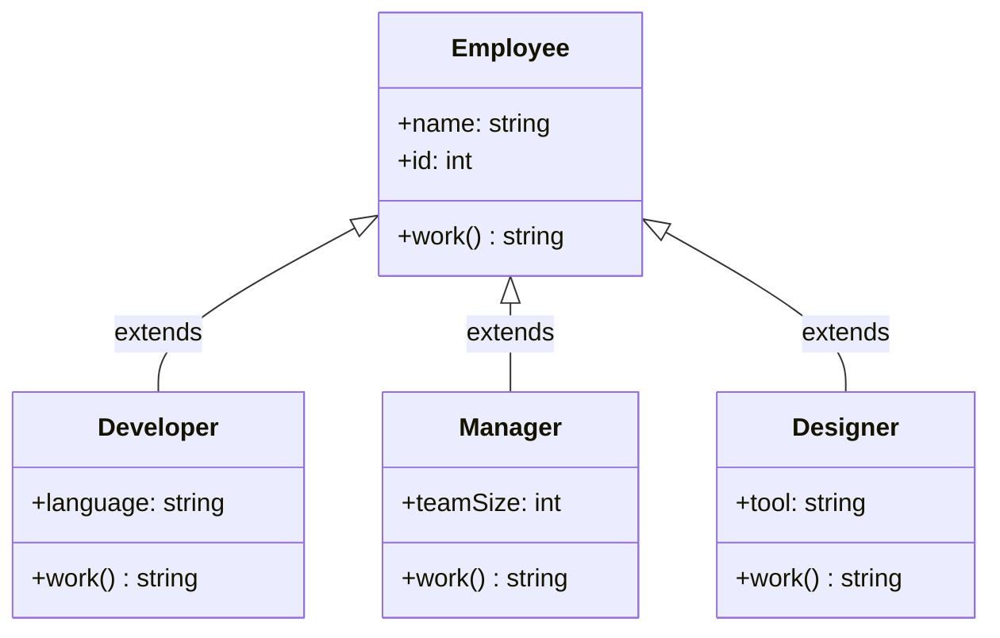

# Hierarchical Inheritance

## Definition

**Hierarchical inheritance** occurs when multiple child classes inherit from the **same parent class**. The parent provides shared behavior, and each child adds its own specialization.

---

## Characteristics

| Aspect | Description |
|--------|-------------|
| **Structure** | One parent → many children |
| **Complexity** | Low — children are independent |
| **Reuse** | High — shared code in parent |
| **Benefit** | Organizes related types under one concept |

---

## Example

```javascript
class Employee {
  constructor(name, id) {
    this.name = name;
    this.id = id;
  }

  work() {
    return `${this.name} is working`;
  }
}

class Developer extends Employee {
  constructor(name, id, language) {
    super(name, id);
    this.language = language;
  }

  work() {
    return `${this.name} is coding in ${this.language}`;
  }
}

class Manager extends Employee {
  constructor(name, id, teamSize) {
    super(name, id);
    this.teamSize = teamSize;
  }

  work() {
    return `${this.name} is managing ${this.teamSize} people`;
  }
}

class Designer extends Employee {
  constructor(name, id, tool) {
    super(name, id);
    this.tool = tool;
  }

  work() {
    return `${this.name} is designing in ${this.tool}`;
  }
}
```

---

## Visual Diagram



---

**Previous Topic:** [Multilevel Inheritance →](/DSA-Notes-Problems/oops/03-four-pillars/inheritance/types/multilevel-inheritance)
**Next Topic:** [Multiple Inheritance →](/DSA-Notes-Problems/oops/03-four-pillars/inheritance/types/multiple-inheritance)
