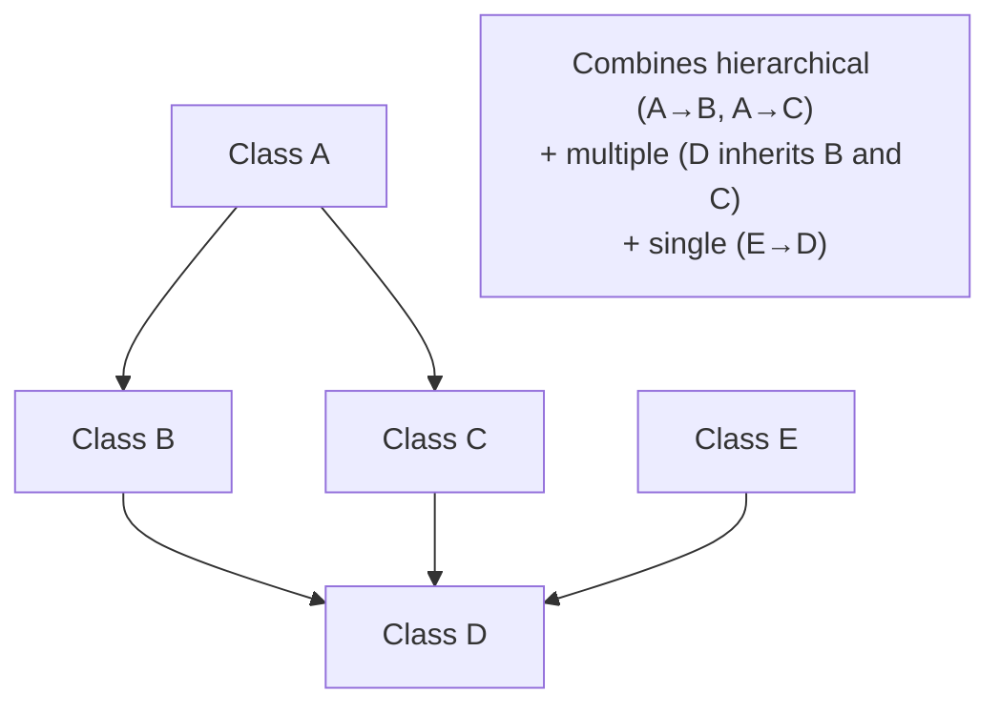

# Hybrid Inheritance

## Definition

**Hybrid inheritance** is a combination of two or more types of inheritance (e.g., single + multiple, or multilevel + hierarchical). It creates complex inheritance graphs.

> ⚠️ **Rarely used and generally discouraged.** Hybrid inheritance often leads to the diamond problem and makes code difficult to understand and maintain.

---

## Characteristics

| Aspect | Description |
|--------|-------------|
| **Structure** | Mix of multiple inheritance types |
| **Complexity** | Very high — hard to trace |
| **Diamond Problem** | Almost always present |
| **Support** | C++ (rarely) |
| **Recommendation** | Avoid — use composition instead |

---

## Example of Hybrid Inheritance



---

## Why to Avoid Hybrid Inheritance

| Reason | Explanation |
|--------|-------------|
| **Complexity** | Hard to trace method resolution through the hierarchy |
| **Ambiguity** | Diamond problem creates method ambiguity |
| **Maintenance** | Changes in any parent can break the child |
| **Readability** | Developers must understand the entire graph |
| **Testing** | Difficult to test in isolation |

---

## Better Alternative: Composition

Instead of hybrid inheritance, use **composition**:

```javascript
class Engine {
  start() { /* engine logic */ }
}

class Wheels {
  rotate() { /* wheel logic */ }
}

class Car {
  constructor() {
    this.engine = new Engine();  // Composition
    this.wheels = new Wheels();  // Composition
  }

  drive() {
    this.engine.start();
    this.wheels.rotate();
  }
}
```

---

**Previous Topic:** [Multiple Inheritance →](/DSA-Notes-Problems/oops/03-four-pillars/inheritance/types/multiple-inheritance)
**Next Topic:** [Super Keyword →](/DSA-Notes-Problems/oops/03-four-pillars/inheritance/super-keyword)
