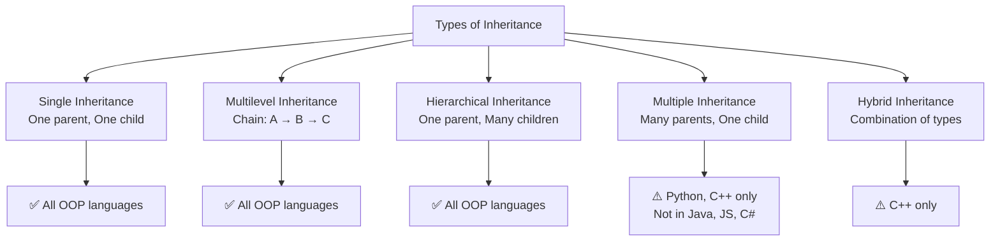

# Types of Inheritance

## Introduction

Inheritance can be categorized into different types based on how many parent and child classes are involved. Understanding these types helps you design class hierarchies effectively.

---

## Types Overview



---

## 1. Single Inheritance

[Full details →](/DSA-Notes-Problems/oops/03-four-pillars/inheritance/types/single-inheritance)

One child class inherits from one parent class.

```javascript
class Parent { /* ... */ }
class Child extends Parent { /* ... */ }
```

**Supported by:** All OOP languages (JavaScript, TypeScript, Python, Java, C#)

---

## 2. Multilevel Inheritance

[Full details →](/DSA-Notes-Problems/oops/03-four-pillars/inheritance/types/multilevel-inheritance)

A chain of inheritance where class C inherits from class B, which inherits from class A.

```javascript
class Animal { /* ... */ }
class Mammal extends Animal { /* ... */ }
class Dog extends Mammal { /* ... */ }
```

**Supported by:** All OOP languages

---

## 3. Hierarchical Inheritance

[Full details →](/DSA-Notes-Problems/oops/03-four-pillars/inheritance/types/hierarchical-inheritance)

One parent class has multiple child classes.

```javascript
class Animal { /* ... */ }
class Dog extends Animal { /* ... */ }
class Cat extends Animal { /* ... */ }
class Bird extends Animal { /* ... */ }
```

**Supported by:** All OOP languages

---

## 4. Multiple Inheritance

[Full details →](/DSA-Notes-Problems/oops/03-four-pillars/inheritance/types/multiple-inheritance)

One child class inherits from multiple parent classes.

```javascript
// Not supported in JavaScript, TypeScript, Java, C#
// Supported in Python, C++
class Child extends Parent1, Parent2 { /* ... */ }
```

**Supported by:** Python, C++ (not Java, JS, C#)

---

## 5. Hybrid Inheritance

[Full details →](/DSA-Notes-Problems/oops/03-four-pillars/inheritance/types/hybrid-inheritance)

A combination of multiple inheritance types — can lead to the diamond problem.

**Supported by:** C++ (rarely used)

---

## Which Type Should You Use?

| Type | Use Case |
|------|----------|
| **Single** | Most common — simple IS-A relationship |
| **Multilevel** | When each level adds more specificity |
| **Hierarchical** | When one concept has multiple variations |
| **Multiple** | When a class needs capabilities from multiple sources (use interfaces instead) |
| **Hybrid** | Avoid if possible — too complex |

---

**Previous Topic:** [Inheritance Overview →](/DSA-Notes-Problems/oops/03-four-pillars/inheritance/)
**Next Topic:** [Single Inheritance →](/DSA-Notes-Problems/oops/03-four-pillars/inheritance/types/single-inheritance)
