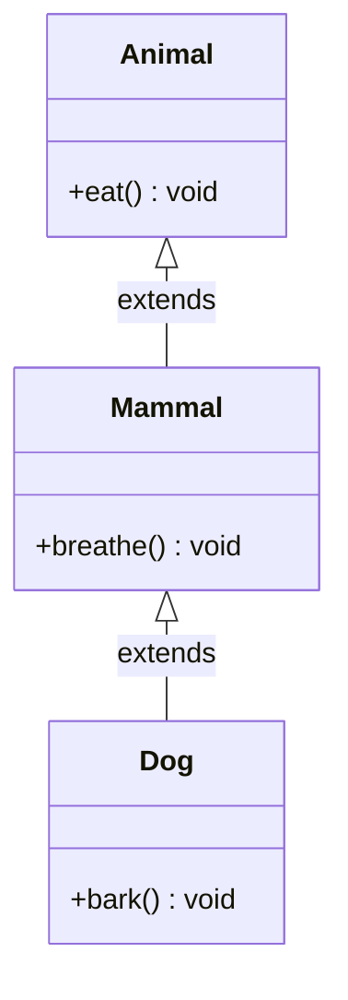

# Multilevel Inheritance

## Definition

**Multilevel inheritance** is a chain of inheritance where class C inherits from class B, which inherits from class A. Each level in the chain adds more specific behavior.

---

## Characteristics

| Aspect | Description |
|--------|-------------|
| **Structure** | Grandparent → Parent → Child |
| **Complexity** | Medium — must understand the full chain |
| **Risk** | Fragile base class problem |
| **Depth Limit** | Practical limit: 3-5 levels |

---

## Example

```javascript
class Animal {
  constructor(name) {
    this.name = name;
  }
  eat() { console.log(`${this.name} is eating`); }
}

class Mammal extends Animal {
  constructor(name, hasFur = true) {
    super(name);
    this.hasFur = hasFur;
  }
  breathe() { console.log(`${this.name} is breathing`); }
}

class Dog extends Mammal {
  constructor(name, breed) {
    super(name);
    this.breed = breed;
  }
  bark() { console.log(`${this.name} barks!`); }
}

const dog = new Dog("Rex", "Labrador");
dog.eat();     // Inherited from Animal
dog.breathe(); // Inherited from Mammal
dog.bark();    // Own method
```

---

## Visual Diagram



---

**Previous Topic:** [Single Inheritance →](/DSA-Notes-Problems/oops/03-four-pillars/inheritance/types/single-inheritance)
**Next Topic:** [Hierarchical Inheritance →](/DSA-Notes-Problems/oops/03-four-pillars/inheritance/types/hierarchical-inheritance)
