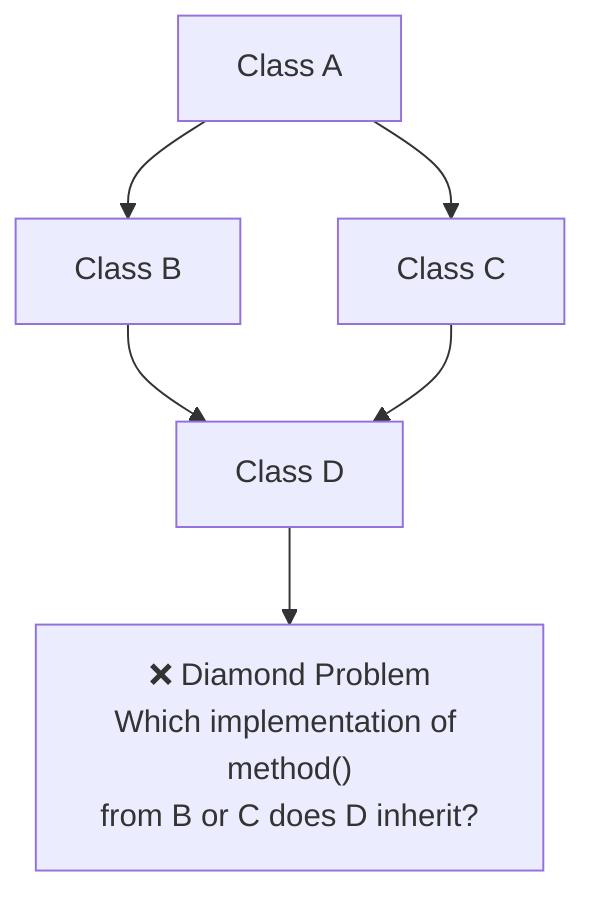

# Multiple Inheritance

## Definition

**Multiple inheritance** allows a child class to inherit from **more than one parent class**. This is more powerful but also more complex.

> ⚠️ **Not supported in many languages.** JavaScript, TypeScript, Java, and C# do NOT support multiple inheritance with classes. Python and C++ do.

---

## Characteristics

| Aspect | Description |
|--------|-------------|
| **Parents** | Two or more parent classes |
| **Children** | One child inherits from multiple parents |
| **Complexity** | High — especially the diamond problem |
| **Support** | Python, C++ (not Java, JS, C#) |

---

## The Diamond Problem

The main issue with multiple inheritance is the **diamond problem**:



---

## Python Example (with MRO)

Python uses **Method Resolution Order (MRO)** — C3 linearization — to solve the diamond problem.

```python
class A:
    def method(self):
        return "A"

class B(A):
    def method(self):
        return "B"

class C(A):
    def method(self):
        return "C"

class D(B, C):
    pass

d = D()
print(d.method())  # "B" — follows MRO: D → B → C → A
print(D.__mro__)   # Shows the MRO chain
```

---

## Interfaces as Alternatives

In languages without multiple inheritance, use **interfaces** to achieve similar capability:

```typescript
interface Swimmable {
  swim(): void;
}

interface Flyable {
  fly(): void;
}

class Duck implements Swimmable, Flyable {
  swim() { console.log("Swimming"); }
  fly() { console.log("Flying"); }
}
```

---

**Previous Topic:** [Hierarchical Inheritance →](/DSA-Notes-Problems/oops/03-four-pillars/inheritance/types/hierarchical-inheritance)
**Next Topic:** [Hybrid Inheritance →](/DSA-Notes-Problems/oops/03-four-pillars/inheritance/types/hybrid-inheritance)
