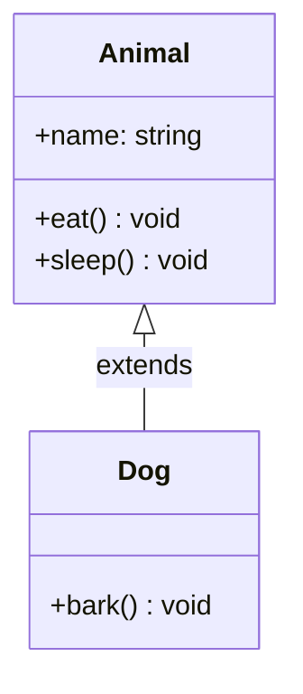

# Single Inheritance

## Definition

**Single inheritance** is when a child class inherits from exactly **one parent class**. It's the simplest and most common form of inheritance.

All OOP languages support single inheritance.

---

## Characteristics

| Aspect | Description |
|--------|-------------|
| **Parents** | Exactly one parent class |
| **Children** | One or more children (each has one parent) |
| **Complexity** | Low — simple and clear hierarchy |
| **Diamond Problem** | Not possible |
| **Support** | Every OOP language |

---

## Example

```javascript
class Animal {
  constructor(name) {
    this.name = name;
  }

  eat() {
    console.log(`${this.name} is eating`);
  }

  sleep() {
    console.log(`${this.name} is sleeping`);
  }
}

class Dog extends Animal {
  bark() {
    console.log(`${this.name} barks!`);
  }
}

const dog = new Dog("Rex");
dog.eat();   // "Rex is eating" (inherited)
dog.sleep(); // "Rex is sleeping" (inherited)
dog.bark();  // "Rex barks!" (own method)
```

---

## Visual Diagram



---

**Previous Topic:** [Types Overview →](/DSA-Notes-Problems/oops/03-four-pillars/inheritance/types/)
**Next Topic:** [Multilevel Inheritance →](/DSA-Notes-Problems/oops/03-four-pillars/inheritance/types/multilevel-inheritance)
