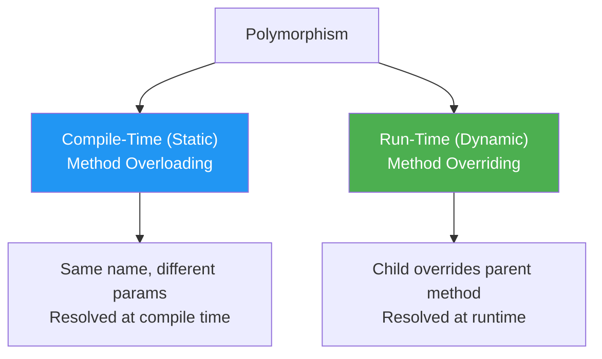

# Polymorphism

## Introduction

**Polymorphism** (from Greek: "poly" = many, "morph" = form) is the ability of objects of different types to respond to the same method call in **different ways**. It's one of the four pillars of OOP and enables flexible, extensible code.

### Why Does It Exist?
- To write code that works with **multiple types** without knowing their specific implementation
- To enable **extensibility** — new types can be added without changing existing code
- To implement **strategy pattern** — swapping behaviors at runtime
- To realize the principle "**program to an interface, not an implementation**"

---

## Real-World Analogy: A Universal Remote

A universal remote has buttons like "Power", "Volume Up", "Volume Down":
- When pointed at a **TV**, pressing "Power" turns the TV on/off
- When pointed at a **Sound System**, pressing "Power" turns the audio on/off
- When pointed at a **DVD Player**, pressing "Power" ejects the tray

Same button (interface), different behavior depending on the device (implementation). That's polymorphism!

---

## Types of Polymorphism



---

## Why Do We Need It?

Without polymorphism:

```javascript
// ❌ Without polymorphism — conditional logic for each type
function processPayment(payment, amount) {
  if (payment.type === "credit") {
    // Credit card processing
  } else if (payment.type === "paypal") {
    // PayPal processing
  } else if (payment.type === "bitcoin") {
    // Bitcoin processing
  }
  // Every time a new type is added, this function must change!
}
```

With polymorphism:

```javascript
// ✅ With polymorphism — each type handles itself
function processPayment(payment, amount) {
  payment.process(amount); // Each payment type implements its own process()
}

// New payment types can be added without changing processPayment()
```

---

## 1. Method Overloading (Compile-Time)

[Full details →](/DSA-Notes-Problems/oops/03-four-pillars/polymorphism/method-overloading)

Multiple methods with the **same name** but **different parameters**. Resolved at compile time.

```javascript
class Calculator {
  add(a, b) { return a + b; }
  add(a, b, c) { return a + b + c; }
}
```

## 2. Method Overriding (Run-Time)

[Full details →](/DSA-Notes-Problems/oops/03-four-pillars/inheritance/method-overriding)

A child class provides its own implementation of a parent method. Resolved at runtime.

```javascript
class Animal { speak() { return "sound"; } }
class Dog extends Animal { speak() { return "Woof!"; } }
```

---

## Code Example

```javascript
// Polymorphism through inheritance
class Shape {
  area() { return 0; }
}

class Circle extends Shape {
  constructor(radius) { super(); this.radius = radius; }
  area() { return Math.PI * this.radius ** 2; }
}

class Rectangle extends Shape {
  constructor(w, h) { super(); this.w = w; this.h = h; }
  area() { return this.w * this.h; }
}

// Polymorphic function — works with any Shape
function printArea(shape) {
  console.log(`Area: ${shape.area()}`);
}

const shapes = [new Circle(5), new Rectangle(4, 6)];
shapes.forEach(s => printArea(s));
// Area: 78.539...
// Area: 24
```

---

## Benefits of Polymorphism

| Benefit | Description |
|---------|-------------|
| **Extensibility** | Add new types without changing existing code |
| **Maintainability** | Centralized behavior in each class |
| **Reusability** | Generic functions work with many types |
| **Flexibility** | Swap implementations at runtime |
| **Clean Code** | No switch/if-else chains for type checking |

---

## Summary

| Concept | Key Point |
|---------|-----------|
| **Polymorphism** | Same interface, different implementations |
| **Overloading** | Same name, different parameters (compile-time) |
| **Overriding** | Child redefines parent method (run-time) |
| **Benefits** | Extensibility, flexibility, clean code |
| **Rule of Thumb** | Code to interfaces, not implementations |

---

**Previous Topic:** [Inheritance →](/DSA-Notes-Problems/oops/03-four-pillars/inheritance/)
**Next Topic:** [Object Relationships →](/DSA-Notes-Problems/oops/04-object-relationships/)
**Related Topics:** [Method Overloading](/DSA-Notes-Problems/oops/03-four-pillars/polymorphism/method-overloading), [Method Overriding](/DSA-Notes-Problems/oops/03-four-pillars/inheritance/method-overriding)
