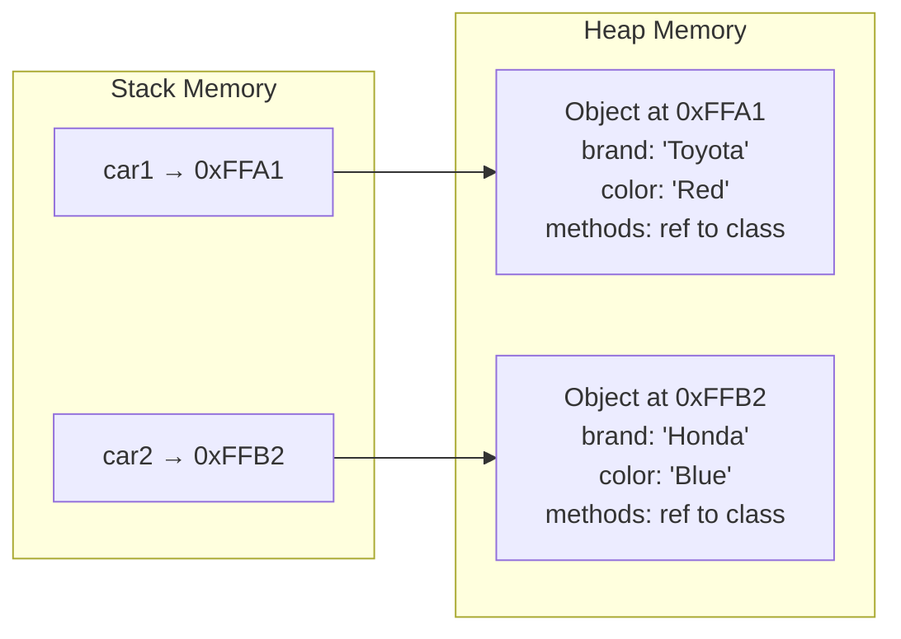

# Object

## Introduction

An **object** is an instance of a class. It's a concrete entity that exists in memory, with its own unique set of data (property values) and the ability to perform actions (methods).

If a class is a blueprint, an **object** is the actual thing built from that blueprint.

### Why Does It Exist?
- Objects represent real-world entities in code
- They allow multiple independent copies of the same structure
- They encapsulate state (data) and behavior (methods) together

### Why Do Developers Use It?
- To work with concrete instances of data
- Each object has its own identity and state
- Objects can interact with each other through messages (method calls)

---

## Real-World Analogy: Cars from a Factory

| Concept | Analogy |
|---------|---------|
| **Class (Car)** | The design blueprint at the factory |
| **Object (My Car)** | The actual car you drive — it has a VIN, color, and mileage |
| **Properties** | Your car's color = "Red", mileage = 15,000 |
| **Methods** | Your car can start(), stop(), accelerate() |
| **Identity** | Each car has a unique license plate |

Two cars built from the same blueprint are different objects:
- MyCar: Red Toyota Camry, license ABC-123
- YourCar: Blue Toyota Camry, license XYZ-789

---

## Definition

An **object** is a self-contained entity that contains:
- **State** (properties/fields) — Data about the object
- **Behavior** (methods) — Actions the object can perform
- **Identity** — A unique reference that distinguishes it from other objects

---

## Why Do We Need It?

Without objects, you work with disconnected data and functions:

```javascript
// Disconnected data and functions
const userName = "John";
const userEmail = "john@email.com";
const userAge = 30;

function sendEmail(name, email) { /* ... */ }
function celebrateBirthday(name, age) { /* ... */ }
```

With objects, related data and behavior are bundled together:

```javascript
class User {
  constructor(name, email, age) {
    this.name = name;
    this.email = email;
    this.age = age;
  }

  sendEmail() { /* Uses this.name, this.email */ }
  celebrateBirthday() {
    this.age++;
    console.log(`Happy birthday ${this.name}!`);
  }
}

const user = new User("John", "john@email.com", 30);
user.celebrateBirthday(); // "Happy birthday John!"
```

---

## Visual Explanation

```mermaid
graph TD
    Class[Car Class<br/>Blueprint] --> Object1[Object: MyCar<br/>Red Toyota, ABC-123]
    Class --> Object2[Object: YourCar<br/>Blue Honda, XYZ-789]
    Class --> Object3[Object: TheirCar<br/>Black Ford, DEF-456]

    subgraph Object1_Details["MyCar Object Details"]
        P1[brand: 'Toyota'<br/>color: 'Red'<br/>year: 2023]
        M1[start() stop()<br/>accelerate()]
    end

    Object1 --> Object1_Details
```

### Memory View



---

## Code Examples

### JavaScript

```javascript
// Creating objects from a class
class Smartphone {
  constructor(brand, model, price) {
    this.brand = brand;
    this.model = model;
    this.price = price;
    this.batteryLevel = 100;
  }

  charge(amount) {
    this.batteryLevel = Math.min(100, this.batteryLevel + amount);
  }

  use(amount) {
    this.batteryLevel = Math.max(0, this.batteryLevel - amount);
  }

  getInfo() {
    return `${this.brand} ${this.model} — $${this.price}`;
  }
}

// Creating objects (instances)
const phone1 = new Smartphone("Apple", "iPhone 15", 999);
const phone2 = new Smartphone("Samsung", "Galaxy S24", 899);

// Objects have independent state
phone1.use(30);
console.log(phone1.batteryLevel); // 70
console.log(phone2.batteryLevel); // 100

console.log(phone1.getInfo()); // "Apple iPhone 15 — $999"
```

### TypeScript

```typescript
interface Product {
  id: number;
  name: string;
  price: number;
}

class Order {
  private items: Product[] = [];

  constructor(public orderId: number) {}

  addItem(product: Product): void {
    this.items.push(product);
  }

  getTotal(): number {
    return this.items.reduce((sum, item) => sum + item.price, 0);
  }
}

const order1 = new Order(1001);
order1.addItem({ id: 1, name: "Laptop", price: 1200 });
order1.addItem({ id: 2, name: "Mouse", price: 25 });
console.log(order1.getTotal()); // 1225
```

### Python

```python
class Dog:
    def __init__(self, name: str, breed: str):
        self.name = name
        self.breed = breed
        self.energy = 100

    def bark(self) -> str:
        return f"{self.name} says Woof!"

    def run(self, distance: int):
        self.energy = max(0, self.energy - distance // 10)

# Creating objects
buddy = Dog("Buddy", "Golden Retriever")
max_dog = Dog("Max", "German Shepherd")

print(buddy.bark())   # "Buddy says Woof!"
buddy.run(50)
print(buddy.energy)   # 95
```

### Java

```java
public class BankAccount {
    private String accountNumber;
    private double balance;

    public BankAccount(String accountNumber) {
        this.accountNumber = accountNumber;
        this.balance = 0.0;
    }

    public void deposit(double amount) {
        this.balance += amount;
    }

    public boolean withdraw(double amount) {
        if (amount <= this.balance) {
            this.balance -= amount;
            return true;
        }
        return false;
    }

    public double getBalance() {
        return this.balance;
    }
}

// Creating and using objects
BankAccount savings = new BankAccount("SAV-001");
BankAccount checking = new BankAccount("CHK-001");

savings.deposit(5000);
checking.deposit(2000);

savings.withdraw(1000);
System.out.println(savings.getBalance()); // 4000.0
```

---

## Object Characteristics

| Characteristic | Description | Example |
|----------------|-------------|---------|
| **Identity** | Each object has a unique reference | `obj1 !== obj2` even with same values |
| **State** | Current values of all properties | `user.name = "John"`, `user.age = 30` |
| **Behavior** | What the object can do | `user.greet()`, `user.login()` |
| **Encapsulation** | Internal details are hidden | Private fields, public methods |
| **Polymorphism** | Different objects can respond to same message | `animal.speak()` |

---

## Object Creation Patterns

### 1. Using `new` keyword (most common)
```javascript
const obj = new ClassName(args);
```

### 2. Object literal (JavaScript)
```javascript
const obj = { key: "value", method() { /* ... */ } };
```

### 3. Factory function
```javascript
function createUser(name) {
  return { name, greet() { return `Hi ${this.name}`; } };
}
```

### 4. `Object.create()`
```javascript
const proto = { greet() { return "Hello"; } };
const obj = Object.create(proto);
```

---

## Best Practices

- Initialize all properties in the constructor
- Use meaningful variable names for objects
- Don't mutate object properties from outside when possible
- Use getters/setters for controlled access
- Treat objects as the smallest unit of reusable code

---

## Common Mistakes

- **Comparing objects with `==`** — Compare references, not values
- **Mutating shared state** — Objects passed by reference can be modified unexpectedly
- **Too many objects** — If you have thousands of objects, consider data-oriented design
- **Shallow copies** — `Object.assign` and spread only copy one level deep

---

## Interview Questions

**Easy:**
1. What is an object in OOP?
2. What's the difference between a class and an object?
3. How do you create an object from a class?

**Medium:**
4. How are objects stored in memory?
5. What is object identity and why does it matter?
6. Explain pass-by-reference vs pass-by-value for objects.

**Advanced:**
7. How does JavaScript's prototypal inheritance differ from classical inheritance for objects?
8. What is the object lifecycle from creation to garbage collection?
9. Explain how object pooling works and when it's useful.

---

## Summary

| Concept | Key Point |
|---------|-----------|
| **Object** | An instance of a class — a concrete entity with state and behavior |
| **Identity** | Each object is unique, even with same values |
| **State** | The property values of an object at a given time |
| **Behavior** | Methods that define what the object can do |
| **Creation** | `new ClassName(args)` creates an object in memory |
| **Memory** | Objects live on the heap, referenced by variables on the stack |

---

**Previous Topic:** [Class →](/DSA-Notes-Problems/oops/03-class)
**Next Topic:** [Constructor →](/DSA-Notes-Problems/oops/05-constructor)
**Related Topics:** [Class](/DSA-Notes-Problems/oops/03-class), [Object Lifecycle](/DSA-Notes-Problems/oops/24-object-lifecycle)
