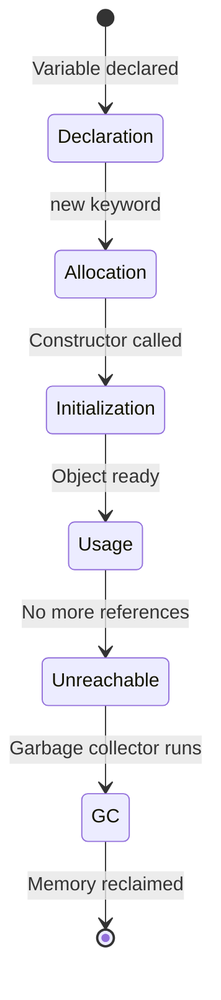

# Object Lifecycle

## Introduction

Every object in a program goes through a **lifecycle**: from the moment it's created (memory allocated) to the moment it's destroyed (memory reclaimed). Understanding this lifecycle is crucial for writing efficient, leak-free code.

---

## The Object Lifecycle Stages



---

## Stage Details

| Stage | What Happens |
|-------|--------------|
| **Declaration** | Reference variable created (null/undefined) |
| **Allocation** | Memory allocated on heap |
| **Initialization** | Constructor runs |
| **Usage** | Methods called, properties accessed |
| **Unreachable** | No more references to the object |
| **GC** | Memory reclaimed (non-deterministic timing) |

---

## Example

```javascript
class Resource {
  constructor(name) {
    this.name = name;
    this.id = ++Resource.instanceCount;
  }
  use() { /* using the object */ }
  dispose() { /* cleanup logic */ }
}

// Lifecycle
let res = new Resource("DB Connection"); // Created + Initialized
res.use();                                // Used
res.dispose();                            // Manual cleanup
res = null;                               // Eligible for GC
```

---

## Best Practices

- **Clean up resources explicitly** — close files, connections, sockets
- **Don't rely on finalizers/destructors** — they're not deterministic
- **Nullify references** to help GC (in long-lived collections)

---

**Previous Topic:** [Abstract Classes →](/DSA-Notes-Problems/oops/05-advanced-concepts/abstract-classes)
**Next Topic:** [Memory Management →](/DSA-Notes-Problems/oops/05-advanced-concepts/memory-management)
